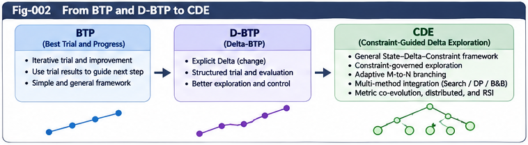
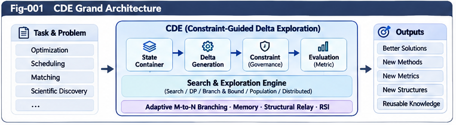

# Constrained Delta Evolution (CDE)

### A General Framework for Structural Search, Optimization, Metric Evolution, and Distributed Intelligence

**Research framework · v1.0.0 · 2026-11-23**  
**Authors:** Sizhe Tan and GPT-Obot  
**License:** Apache-2.0  
**Status:** Conceptual research, proposed specifications, benchmark designs, and validation protocols. **Not a demonstrated universal optimizer or validated AGI/RSI system.**

> **Central proposition:** A search process can be organized around versioned **State Containers**, typed **Deltas**, explicit **Constraints**, and governed transitions. The same structural contracts can support multiple search methods, adaptive branching, evolving metrics, distributed exploration, and validated knowledge transfer—without treating these distinct capabilities as automatically equivalent.

---

## 1. Why CDE?

Many search and optimization systems are described in terms of a particular data structure or algorithm: a permutation tree, a graph, a constraint solver, a local-search neighborhood, or an evolutionary population. These structures are valuable, but they are not the only possible level of abstraction.

**Constrained Delta Evolution (CDE)** asks whether the recurring mechanisms can be expressed through a small, explicit computational core:

- **State Container:** What is the current problem or solution state, and what does it mean?
- **Delta:** What typed change is proposed, with which preconditions and effects?
- **Constraint:** Which transitions are permissible, and which preferences merely guide search?
- **Transition:** What is the result of applying a Delta under a pinned context?
- **Exploration:** Which candidate changes are generated, selected, evaluated, and committed?
- **Evidence and memory:** What has been tried, proved, rejected, deferred, or left unresolved?

CDE grows out of **Bucket Tree of Permutation (BTP)** and **Dynamic Bucket Tree of Permutation (D-BTP)**. BTP supplies constructive branching intuition; D-BTP motivates dynamic candidate generation, directional exploration, and feedback. CDE generalizes these ideas beyond bucket-shaped states, permutation operations, and binary Yes/No branching.

This is a **research architecture and integration proposal**, not a claim that search, dynamic programming, branch-and-bound, constraint programming, or evolutionary computation are newly invented here. Their established methods remain important components and baselines.



*Figure 2. Research lineage from BTP's binary constructive decisions, through D-BTP's dynamic and directional Delta generation, to CDE's representation-independent State–Delta–Constraint framework. The diagram expresses a conceptual generalization, not a claim of strict algorithmic superiority.*

## 2. The minimal computational model

A simplified CDE problem can be written as:

$$
\mathcal P=(S,\Delta,T,C,G,L),
\qquad s_{t+1}=T(s_t,\delta_t),\quad \delta_t\in G(s_t).
$$

Here:

| Symbol | Role |
|---|---|
| $S$ | Typed, versioned State Container and state space |
| $\Delta$ | Delta definitions and instantiated proposed changes |
| $T$ | Transition interpretation and commit semantics |
| $C$ | Hard constraints and separately identified soft preferences |
| $G$ | Delta generator and candidate selection mechanisms |
| $L$ | Path memory, evidence, provenance, and lineage |

A transition is **committed** only after the applicable hard-constraint contract is satisfied. `UNKNOWN` or `ERROR` is not equivalent to `PASS`. A high heuristic score is not a feasibility proof.

### Adaptive M-to-N branching

Instead of assuming two children per node, CDE distinguishes:

- **M:** candidate Deltas proposed;
- **Q:** selected Delta attempts;
- **N:** realized transition edges;
- **Nᶜ:** committed transition edges;
- **K:** distinct successor states under an explicitly declared equivalence relation.

The counts are deliberately different: several Deltas can lead to the same state, an attempted Delta can fail, and a realized edge need not be committed. The branching policy may adapt to budget, evidence, uncertainty, and search history.

### Search graph and path semantics

A CDE exploration may form a tree, DAG, or cyclic state graph. Path-local **NoSubtree** decisions and **Loop Back** are governed by explicit scope and identity rules. `EXCLUDE`, `DEFER`, `PRUNE`, and `INFEASIBLE` are not interchangeable. Deduplication and dynamic-programming memoization require sound future-equivalence conditions.

## 3. Architecture at a glance

```text
                           TASKS / PROBLEMS
                     optimization · matching · science
                                    |
                                    v
                  +-----------------------------------+
                  |    CDE ORCHESTRATOR (optional)    |
                  | control plane · policy · budget   |
                  +-----------------+-----------------+
                                    |
                                    v
             +---------------------------------------------+
             |         CDE STATE–DELTA CORE               |
             |                                             |
             | State Container -> Delta Generation         |
             |          -> Constraint Validation           |
             |          -> Transition / Evaluation         |
             |          -> Path Memory / Evidence          |
             +----------------------+----------------------+
                                    |
                 +------------------+------------------+
                 |                  |                  |
                 v                  v                  v
            Search / Local       DP / Memo          B&B / CP / MIP
            Evolutionary         Equivalence        Certified Bounds
                 |                  |                  |
                 +------------------+------------------+
                                    |
                                    v
                     VALIDATED RESULTS / LEFTOVERS
                                    |
                     +--------------+--------------+
                     |                             |
                     v                             v
              Structural Relay             Metric / Generator /
              Collective Learning          Policy Evolution
                     |                             |
                     +-------------+---------------+
                                   v
                        INDEPENDENT VALIDATION
                        GOVERNANCE / ROLLBACK
```

The orchestrator is optional: the minimal CDE core does not require a distributed system, a learning agent, or recursive evolution. The more ambitious layers are research extensions with additional contracts and validation obligations.



*Figure 1. Conceptual architecture of Constrained Delta Evolution. A versioned State–Delta–Constraint core supports adaptive proposal generation and solver portfolios; optional orchestration, independent validation, Structural Relay, and controlled meta-evolution extend the system without weakening hard-constraint governance.*

## 4. Ten central design principles

1. **Contracts before runtime.** Define state, Delta, constraints, evidence, and versions before implementing a solver.
2. **Hard feasibility before soft preference.** Directional fields guide exploration but do not override hard constraints.
3. **Branch counts are auditable.** Separate proposals, attempts, realized edges, committed edges, and unique successors.
4. **Search history has semantics.** NoSubtree, Loop Back, pruning, and equivalence must have explicit scopes.
5. **Established solvers are partners, not strawmen.** Compare fairly with DP, B&B, CP-SAT/MIP, local search, and other appropriate methods.
6. **Metrics are versioned and contestable.** Better scores under a changed metric are not evidence that the metric improved.
7. **Relay is typed and evidence-bearing.** Result, Evidence, Constraint, Method, Policy, Metric, and Leftover artifacts carry provenance and applicability conditions.
8. **Transfer requires target validation.** A source-domain success is not automatically a reusable capability.
9. **Recursive change requires independent authorization.** Generator, representation, policy, and metric changes do not self-certify.
10. **Explicit Leftovers are research outputs.** Unresolved questions, failed migrations, counterexamples, and incomplete coverage are retained for future work.

## 5. Research map: 27 core manuscripts

The v1.0.0 research corpus consists of **12 Foundations, 6 Specifications, 5 Cases, and 4 Extensions**. Manuscripts describe proposed architectures and validation plans; publication of a manuscript is not experimental validation.

### 5.1 Foundations — conceptual and algorithmic framework

| ID | Manuscript | Focus |
|---|---|---|
| CDE-001 | [From BTP and D-BTP to Constrained Delta Evolution](docs/foundations/CDE-001-From-BTP-and-D-BTP-to-Constrained-Delta-Evolution.md) | Lineage, generalization, research boundaries |
| CDE-002 | [State Containers and Constraint-Governed Transitions](docs/foundations/CDE-002-State-Containers-and-Constraint-Governed-Transitions.md) | State semantics, feasibility, atomic transitions |
| CDE-003 | [Delta Semantics and Adaptive M-to-N Branching](docs/foundations/CDE-003-Delta-Semantics-and-Adaptive-M-to-N-Branching.md) | Delta identities, adaptive branching, accounting |
| CDE-004 | [Path Memory, NoSubtree Semantics, and Loop Back Control](docs/foundations/CDE-004-Path-Memory-No-Subtree-Semantics-and-Loop-Back-Control.md) | Path history, exclusion, revisitation |
| CDE-005 | [Search, Dynamic Programming, and Branch-and-Bound Integration](docs/foundations/CDE-005-Search-Dynamic-Programming-and-Branch-and-Bound-Integration.md) | Solver interoperability and conditional guarantees |
| CDE-006 | [Directional Fields and Multi-Scale Delta Generation](docs/foundations/CDE-006-Directional-Fields-and-Multi-Scale-Delta-Generation.md) | Local, regional, long-range, evidence-guided search |
| CDE-007 | [Solution-Space and Metric-Space Co-Evolution](docs/foundations/CDE-007-Solution-Space-and-Metric-Space-Co-Evolution.md) | Evolving solutions and evaluation criteria |
| CDE-008 | [CDE as a General Exploration and Optimization Orchestrator](docs/foundations/CDE-008-CDE-as-a-General-Exploration-and-Optimization-Orchestrator.md) | Solver portfolios and control-plane responsibilities |
| CDE-009 | [Distributed CDE and Delta Exploration Contracts](docs/foundations/CDE-009-Distributed-CDE-and-Delta-Exploration-Contracts.md) | Distributed tasks, versions, leases, reconciliation |
| CDE-010 | [Structural Relay and Collective Learning](docs/foundations/CDE-010-Structural-Relay-and-Collective-Learning.md) | Typed knowledge transfer and validation |
| CDE-011 | [Recursive Generator and Policy Evolution](docs/foundations/CDE-011-Recursive-Generator-and-Policy-Evolution.md) | Controlled changes to generators and policies |
| CDE-012 | [Generalization Boundaries, Guarantees, and Open Research](docs/foundations/CDE-012-Generalization-Boundaries-Guarantees-and-Open-Research.md) | Conditional claims, limitations, falsifiability |

### 5.2 Specifications — contracts and conformance

| ID | Manuscript | Focus |
|---|---|---|
| SPEC-001 | [State Container and Constraint Contract](docs/specifications/SPEC-001-State-Container-and-Constraint-Contract.md) | Typed states, constraint outcomes, commits |
| SPEC-002 | [Delta Generation and Branch Contract](docs/specifications/SPEC-002-Delta-Generation-and-Branch-Contract.md) | Generator interfaces, M/Q/N/K accounting |
| SPEC-003 | [Path Memory and Loop Control Contract](docs/specifications/SPEC-003-Path-Memory-and-Loop-Control-Contract.md) | Path decisions, revisit rules, equivalence |
| SPEC-004 | [Solver and Optimization Contract](docs/specifications/SPEC-004-Solver-and-Optimization-Contract.md) | Claims, certificates, bounds, solver adapters |
| SPEC-005 | [Distributed Exploration and Relay Contract](docs/specifications/SPEC-005-Distributed-Exploration-and-Relay-Contract.md) | Distributed coordination and evidence transfer |
| SPEC-006 | [Metric and Recursive Evolution Contract](docs/specifications/SPEC-006-Metric-and-Recursive-Evolution-Contract.md) | Metric versions, promotion, rollback, governance |

### 5.3 Cases — falsifiable evaluation scenarios

| ID | Manuscript | Primary testbed |
|---|---|---|
| CASE-001 | [Multi-Scale Peak Search](docs/cases/CASE-001-Multi-Scale-Peak-Search.md) | Synthetic multi-peak optimization |
| CASE-002 | [Constrained School-Bus Assignment and Routing](docs/cases/CASE-002-Constrained-School-Bus-Assignment-and-Routing.md) | Fleet minimization under scheduling and ride constraints |
| CASE-003 | [Dynamic Structural Matching](docs/cases/CASE-003-Dynamic-Structural-Matching.md) | Matching with uncertainty, weak evidence, and consistency |
| CASE-004 | [Metric Discovery and Co-Evolution](docs/cases/CASE-004-Metric-Discovery-and-Co-Evolution.md) | Metric design, Goodhart risk, independent utility |
| CASE-005 | [Distributed CDE and Method Relay](docs/cases/CASE-005-Distributed-CDE-and-Method-Relay.md) | Multi-agent exploration, transfer, global reconciliation |

### 5.4 Extensions — frontier hypotheses

| ID | Manuscript | Research direction |
|---|---|---|
| EXT-001 | [Biomimetic and Population-Based CDE](docs/extensions/EXT-001-Biomimetic-and-Population-Based-CDE.md) | Population diversity, island models, multi-scale search |
| EXT-002 | [Open-Ended Delta and Representation Evolution](docs/extensions/EXT-002-Open-Ended-Delta-and-Representation-Evolution.md) | Operator genesis, schema evolution, migration |
| EXT-003 | [CDE for Scientific Hypothesis and Metric Discovery](docs/extensions/EXT-003-CDE-for-Scientific-Hypothesis-and-Metric-Discovery.md) | Hypotheses, experiments, evidence, measurement |
| EXT-004 | [CDE Collective Intelligence and Structural RSI](docs/extensions/EXT-004-CDE-Collective-Intelligence-and-Structural-RSI.md) | Collective learning, governance, structural RSI |

**Reading recommendation:** Begin with [START-HERE.md](START-HERE.md), then CDE-001 → CDE-002 → CDE-003 → SPEC-001 → SPEC-002. For implementation and testing, prioritize the specifications and case-study validation protocols. For the complete manuscript map, see [CONTENTS.md](CONTENTS.md).

## 6. Ten planned architecture figures

The figure set is intended to help readers navigate the framework. Figure filenames below are the **planned repository paths**; their presence in a particular release must be checked before linking or embedding.

| Figure | Topic |
|---|---|
| `Fig-001-CDE-Grand-Architecture.png` | Minimal core and optional orchestration layers |
| `Fig-002-From-BTP-and-D-BTP-to-CDE.png` | Conceptual lineage |
| `Fig-003-State-Container-and-Constraint-Governed-Delta.png` | Typed transitions and constraint gates |
| `Fig-004-Adaptive-M-to-N-Delta-Branching.png` | Proposal, selection, realization, and unique states |
| `Fig-005-Path-Memory-No-Subtree-and-Loop-Back.png` | Memory, exclusion, revisitation |
| `Fig-006-Search-DP-and-Branch-and-Bound-Integration.png` | Heterogeneous solver integration |
| `Fig-007-Multi-Scale-Delta-Generation-and-Directional-Exploration.png` | Exploration at multiple scales |
| `Fig-008-Solution-and-Metric-Co-Evolution.png` | Separate evolution and independent validation |
| `Fig-009-Distributed-CDE-Orchestrator-and-Structural-Relay.png` | Distributed exploration and Relay |
| `Fig-010-Recursive-Generator-Evolution-and-Collective-Learning.png` | Governed recursive improvement |

See `FIGURE-INDEX.md` for finalized placements and attribution once the figures are incorporated into the repository.

## 7. What CDE does—and does not—guarantee

The research separates several claims that are often conflated:

```text
Representability
    != Reachability
    != Search Completeness
    != Optimality
    != Computational Efficiency
    != Validated Generalization
```

Likewise:

```text
Parallel Execution
    != Coordinated Exploration
    != Validated Transfer
    != Collective Learning
    != Recursive Self-Improvement
```

Completeness and optimality are conditional on a particular solver, encoding, finite or otherwise bounded search domain, sound bounds, equivalence rules, and execution assumptions. An unbounded operator generator cannot inherit finite-tree termination claims. A new metric cannot prove its own superiority merely by raising its scores. A proposed representation or method is not an authorized capability until the relevant target-side tests and governance requirements have been met.

**No universal speedup, optimality, autonomous scientific discovery, sustained RSI, or AGI result is claimed by this repository's research texts.**

## 8. Validation and evidence standards

The case studies and specifications propose test fixtures, conformance matrices, negative controls, ablations, and experimental protocols. These are **plans**, not reports of completed runs.

A future implementation should, at minimum:

1. Pass schema and transition conformance checks under pinned versions.
2. Keep hard-constraint validation independent of heuristic scoring.
3. Compare with credible, properly tuned solver baselines under matched information and resource budgets.
4. Report proposals, attempts, realized edges, committed edges, and unique states separately.
5. Preserve negative results, counterexamples, incomplete proofs, and unresolved Leftovers.
6. Revalidate metrics, caches, and solver certificates when their dependencies change.
7. Evaluate transfer on independent target tasks and report negative transfer.
8. Keep candidate-generating agents separate from authorization and independent validation.
9. Publish reproducible instances, seeds, code versions, hardware budgets, uncertainty estimates, and limitations.

Suggested publication assets: `TESTABLE-HYPOTHESES.md`, `VALIDATION-ROADMAP.md`, and `OPEN-QUESTIONS.md`.

## 9. Interoperability with Structural Intelligence research

CDE is designed to be compatible with broader **Structural Intelligence (SI)** research, particularly:

- **SIF — Structural Intelligence Framework:** CDE provides an approach to *exploratory localization*: finding solutions, methods, evidence, or more useful representations.
- **UIERU — Universal Intelligence Evolution and Relay Unit:** typed tasks, capabilities, and validated Relay artifacts can participate in larger learning systems.
- **AQSI — Autonomous Questioning Structural Intelligence:** unresolved constraints, Leftovers, and representation bottlenecks can become structured research questions.
- **UCPSF — Universal Control Planes and Scoring Folding:** policy and scoring controls can guide resource allocation while remaining distinct from hard feasibility.
- **SSICR — Strategic Structural Intelligence and Competitive Relay:** competing solvers and hypotheses can exchange evidence and counterexamples.

These are conceptual integration points. They do not establish operational compatibility or empirical improvements without implementation and tests.

## 10. Repository layout

```text
Constrained-Delta-Evolution/
├── README.md
├── START-HERE.md
├── CONTENTS.md
├── GLOSSARY.md
├── FIGURE-INDEX.md
├── FUTURE-DIRECTIONS.md
├── OPEN-QUESTIONS.md
├── TESTABLE-HYPOTHESES.md
├── VALIDATION-ROADMAP.md
├── CHANGELOG.md
├── CITATION.cff
├── .zenodo.json
├── LICENSE
├── docs/
│   ├── foundations/       # CDE-001 ... CDE-012
│   ├── specifications/    # SPEC-001 ... SPEC-006
│   ├── cases/             # CASE-001 ... CASE-005
│   └── extensions/        # EXT-001 ... EXT-004
├── figures/              # Fig-001 ... Fig-010
└── publication/
    ├── GitHub-Release-Notes-v1.0.0.md
    ├── ResearchGate-Description.txt
    └── CDE-v1.0.0-ResearchGate-Overview.pdf
```

The layout is the intended release organization. Files should be placed and checked before publication; this README does not certify that every listed path is currently populated.

## 11. How to contribute

The project is intended to be **collective-learning-friendly**. Particularly useful contributions include:

- identifying an invalid assumption, counterexample, or ambiguous contract;
- supplying an independently reproducible benchmark or strong baseline;
- proposing a typed Delta, representation, solver adapter, or migration contract;
- testing a claim under a new domain or distribution shift;
- documenting a failed experiment or negative transfer;
- clarifying which theoretical guarantees hold under which assumptions.

Please distinguish **hypothesis**, **design**, **implementation**, **measurement**, and **proof** in contributions. Include task instances, versioned artifacts, validation criteria, and evidence provenance when available. A small, well-documented counterexample is as valuable as a positive result.

No general-purpose runtime or benchmark leaderboard is implied by the manuscript collection alone.

## 12. Citation, licensing, and release

**Authors:** Sizhe Tan and GPT-Obot.  
**License:** Apache License 2.0.  
**Version:** v1.0.0 research release.  
**DOI:** 10.5281/zenodo.24484138

---

## 📚 DBM-SI Series Navigation

See:\
[./docs/DBM-SI-Series-of-gitHub-Repositories/DBM-SI-Series-of-gitHub-Repositories.md](./docs/DBM-SI-Series-of-gitHub-Repositories/DBM-SI-Series-of-gitHub-Repositories.md)

---

### Research transparency

This corpus was developed through human–AI collaborative research and drafting. Technical claims, proposed guarantees, experimental designs, and references require independent verification. The authors welcome constructive critique, alternative formulations, and reproducible tests.

---

**Bottom line:** CDE proposes a disciplined bridge from **constrained state transitions** to **adaptive exploration**, then to **metric and representation evolution**, **distributed Structural Relay**, and **controlled collective learning**. The bridge is a research agenda with explicit contracts and falsifiable claims—not a shortcut around established optimization theory or empirical validation.
