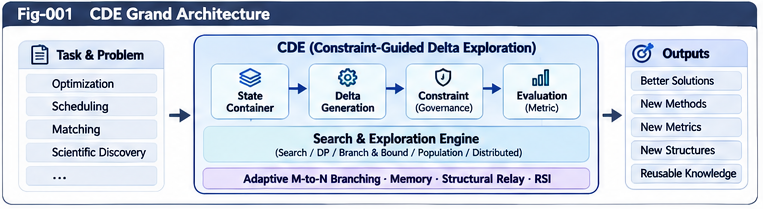

# START HERE — Constrained Delta Evolution (CDE)

**A reader's guide to structural search, constrained optimization, metric evolution, and distributed intelligence**  
**Version:** v1.0.0 research draft · **Date:** 2026-11-04  
**Authors:** Sizhe Tan and GPT-Obot · **License:** Apache-2.0  
**Repository:** `Constrained-Delta-Evolution/`  
**Research status:** Conceptual architecture, proposed specifications, case-study protocols, and falsifiable hypotheses. **No universal optimization, generalization, collective-learning, or recursive-self-improvement result is claimed as experimentally established.**

> **Start with the problem, not the terminology.** CDE asks how a search system can represent a state, propose a typed change, check its constraints, learn from the result, and safely reuse what was learned—potentially across solvers, tasks, representations, and agents.

---



*Figure 1. Conceptual architecture of Constrained Delta Evolution. A versioned State–Delta–Constraint core supports adaptive proposal generation and solver portfolios; optional orchestration, independent validation, Structural Relay, and controlled meta-evolution extend the system without weakening hard-constraint governance.*

---

## 1. What should I read first?

If you have **10 minutes**, read this page and [`README.md`](README.md). Focus on the model in Section 2 and the research boundaries in Section 4.

If you have **30 minutes**, continue to [`CDE-001`](docs/foundations/CDE-001-From-BTP-and-D-BTP-to-Constrained-Delta-Evolution.md), [`CDE-002`](docs/foundations/CDE-002-State-Containers-and-Constraint-Governed-Transitions.md), and [`CDE-003`](docs/foundations/CDE-003-Delta-Semantics-and-Adaptive-M-to-N-Branching.md).

If you want to **implement or critically evaluate CDE**, start with [`SPEC-001`](docs/specifications/SPEC-001-State-Container-and-Constraint-Contract.md) and [`SPEC-002`](docs/specifications/SPEC-002-Delta-Generation-and-Branch-Contract.md), then read the relevant remaining specifications before writing runtime code.

If you want a **concrete problem**, choose [`CASE-001`](docs/cases/CASE-001-Multi-Scale-Peak-Search.md) for numerical search, [`CASE-002`](docs/cases/CASE-002-Constrained-School-Bus-Assignment-and-Routing.md) for scheduling and routing, or [`CASE-003`](docs/cases/CASE-003-Dynamic-Structural-Matching.md) for uncertain structural correspondence.

If you are interested in **AI, multi-agent learning, and RSI**, read [`CDE-009`](docs/foundations/CDE-009-Distributed-CDE-and-Delta-Exploration-Contracts.md), [`CDE-010`](docs/foundations/CDE-010-Structural-Relay-and-Collective-Learning.md), [`CDE-011`](docs/foundations/CDE-011-Recursive-Generator-and-Policy-Evolution.md), and [`EXT-004`](docs/extensions/EXT-004-CDE-Collective-Intelligence-and-Structural-RSI.md).

**Recommended default route:** `README → CDE-001 → CDE-002 → CDE-003 → SPEC-001 → SPEC-002 → CASE-001 → CDE-012`.

---

## 2. The CDE idea in one page

### 2.1 A minimal model

A CDE task can be described by:

\[
\mathcal P=(S,\Delta,T,C,G,L),
\qquad s_{t+1}=T(s_t,\delta_t),\quad\delta_t\in G(s_t).
\]

| Element | Meaning | Questions to ask |
|---|---|---|
| **State Container (S)** | A typed representation of a candidate solution or problem state | What is represented? Which version? |
| **Delta (Δ)** | A proposed, typed change to a state | What are its preconditions, effects, and identity? |
| **Transition (T)** | The application of a Delta under a specified context | Is it atomic, reproducible, and recorded? |
| **Constraints (C)** | Rules that govern validity; hard constraints are separate from preferences | What must never be violated? |
| **Generator (G)** | A mechanism that proposes candidate Deltas | What can it generate, and what can it miss? |
| **Lineage / memory (L)** | Decisions, outcomes, evidence, provenance, and unresolved work | What is known, unknown, or left over? |

**Operational principle:** A proposed Delta is not a committed valid transition until the applicable hard-constraint contract passes. A good score is not proof of feasibility; `UNKNOWN` is not `PASS`.

### 2.2 Adaptive M-to-N branching

A conventional tree may be described as binary or fixed-width. CDE instead distinguishes:

- **M** proposed Delta candidates;
- **Q** selected attempts;
- **N** realized transition edges;
- **Nᶜ** committed edges;
- **K** distinct successor states under a declared equivalence relation.

These counts must not be conflated. An attempted change can fail, multiple edges can reach one state, and a realized transition need not be committed. Adaptive branching changes the **search allocation policy**, not the underlying truth of the constraints.

### 2.3 Trees are not mandatory

A CDE search may be a tree, directed acyclic graph, or cyclic graph. Constructive BTP-style `YesSubtree`/`NoSubtree` decisions are one useful special case. A dynamic or reconfigurable search may revisit earlier states, provided identity, memory, and Loop Back rules are explicit.

### 2.4 Multiple solver families

CDE is intended as an **orchestration and contract layer**, not a replacement for established algorithms. Search, dynamic programming, branch-and-bound, MIP/CP-SAT, local search, evolutionary methods, and specialized domain solvers may operate under compatible contracts. Each solver retains its own assumptions and guarantees.

### 2.5 Beyond the current search space

The later papers investigate changes to Delta generators, metrics, representations, and policies; distributed exploration; and Structural Relay across tasks. These are additional research layers, **not automatic consequences** of the basic state-transition model.

---

## 3. Where did CDE come from?

**BTP — Bucket Tree of Permutation** provides constructive search intuition, including explicit Yes/No-style decisions and path-local exclusions.

**D-BTP — Dynamic Bucket Tree of Permutation** extends the direction toward dynamic Delta proposals, evidence-guided exploration, and feedback.

**CDE — Constrained Delta Evolution** generalizes the state and transition model beyond bucket structures, permutations, and fixed binary branching. Its proposed unifying elements are typed State Containers, governed Deltas, explicit constraint contracts, adaptive branching, memory, and versioned evidence.

Read [`CDE-001`](docs/foundations/CDE-001-From-BTP-and-D-BTP-to-Constrained-Delta-Evolution.md) for the lineage. The earlier D-BTP repository is available at <https://github.com/sizhet/Dynamic-Bucket-Tree-of-Permutation-and-Directional-Structural-Evolution>.

**Research attribution note:** CDE draws on established algorithmic ideas. Dynamic programming, branch-and-bound, constraint programming, program synthesis, evolutionary search, and distributed computing are not claimed as newly invented by this project. The research proposal concerns their structural integration and explicit interoperability contracts.

---

## 4. Six distinctions to keep in mind

### 4.1 Representability is not reachability

A solution may be encodable but unreachable under the current Delta vocabulary. It may be reachable yet too expensive to discover within a budget.

### 4.2 Reachability is not completeness

A generator may reach many useful solutions without systematically covering all relevant possibilities. Completeness claims require a defined universe and valid search assumptions.

### 4.3 Feasibility is not optimality

A solution can satisfy every hard constraint while remaining far from the optimum. Conversely, a high score does not certify feasibility.

### 4.4 Heuristic pruning is not proof

`EXCLUDE`, `DEFER`, `PRUNE`, and `INFEASIBLE` have distinct meanings. A heuristic decision to stop exploring a branch is not an infeasibility certificate.

### 4.5 Shared results are not collective learning

A Relay artifact can be transmitted and stored without improving any target task. Collective learning requires independently validated transfer benefit, with costs and negative transfer reported.

### 4.6 Recursive modification is not validated RSI

Changing a generator, policy, metric, or representation is a candidate intervention. Validated improvement requires independent evidence, generalization checks, authority boundaries, and rollback capability.

A useful summary is:

\[
\boxed{\text{Representability}\ne\text{Reachability}\ne\text{Completeness}\ne\text{Optimality}\ne\text{Validated Generalization}}
\]

For explicit guarantee boundaries, read [`CDE-012`](docs/foundations/CDE-012-Generalization-Boundaries-Guarantees-and-Open-Research.md).

---

## 5. Reading routes by audience

### Route A — Algorithms and optimization researchers

**Goal:** Assess whether the abstraction is mathematically coherent and adds value beyond established search methods.

1. [`CDE-001`](docs/foundations/CDE-001-From-BTP-and-D-BTP-to-Constrained-Delta-Evolution.md) — BTP/D-BTP lineage.
2. [`CDE-002`](docs/foundations/CDE-002-State-Containers-and-Constraint-Governed-Transitions.md) — state and constraint semantics.
3. [`CDE-003`](docs/foundations/CDE-003-Delta-Semantics-and-Adaptive-M-to-N-Branching.md) — branching and Delta accounting.
4. [`CDE-004`](docs/foundations/CDE-004-Path-Memory-No-Subtree-Semantics-and-Loop-Back-Control.md) — path memory and revisitation.
5. [`CDE-005`](docs/foundations/CDE-005-Search-Dynamic-Programming-and-Branch-and-Bound-Integration.md) — established solver integration.
6. [`CDE-012`](docs/foundations/CDE-012-Generalization-Boundaries-Guarantees-and-Open-Research.md) — claims and limits.
7. [`CASE-001`](docs/cases/CASE-001-Multi-Scale-Peak-Search.md) — measurable search benchmark.

**Questions worth challenging:** What is novel beyond a solver interface? Which guarantees are representation-relative? Which baseline is strongest? Is overhead accounted for? Which comparisons can falsify the proposal?

### Route B — Engineers and implementers

**Goal:** Build a small conformance-first prototype without silently changing semantics.

1. [`SPEC-001`](docs/specifications/SPEC-001-State-Container-and-Constraint-Contract.md) — State Container, versions, constraints, commits.
2. [`SPEC-002`](docs/specifications/SPEC-002-Delta-Generation-and-Branch-Contract.md) — Delta schemas and M/Q/N/K accounting.
3. [`SPEC-003`](docs/specifications/SPEC-003-Path-Memory-and-Loop-Control-Contract.md) — path and cycle semantics.
4. [`SPEC-004`](docs/specifications/SPEC-004-Solver-and-Optimization-Contract.md) — solver capabilities and proof statuses.
5. [`CASE-001`](docs/cases/CASE-001-Multi-Scale-Peak-Search.md) — smallest proposed testbed.
6. [`SPEC-005`](docs/specifications/SPEC-005-Distributed-Exploration-and-Relay-Contract.md) — add distribution only after local semantics work.
7. [`SPEC-006`](docs/specifications/SPEC-006-Metric-and-Recursive-Evolution-Contract.md) — add governed evolution last.

**First implementation milestone:** One versioned state schema, two or more typed Delta operators, a hard-constraint validator, an immutable transition ledger, and a deterministic fixture that distinguishes `PASS`, `FAIL`, `UNKNOWN`, and `ERROR`.

### Route C — Scheduling, routing, and operations research

**Goal:** Understand whether CDE can coordinate realistic constrained optimization.

Read [`CASE-002`](docs/cases/CASE-002-Constrained-School-Bus-Assignment-and-Routing.md), [`CDE-005`](docs/foundations/CDE-005-Search-Dynamic-Programming-and-Branch-and-Bound-Integration.md), [`SPEC-004`](docs/specifications/SPEC-004-Solver-and-Optimization-Contract.md), and [`CASE-005`](docs/cases/CASE-005-Distributed-CDE-and-Method-Relay.md).

**Core challenge:** Minimize fleet size without violating student assignment, capacity, travel-time, scheduling, and operational constraints. Compare fairly against established MIP, CP-SAT, routing heuristics, and large-neighborhood search; do not infer superiority from a conceptual design.

### Route D — Structural intelligence and uncertain matching

**Goal:** Explore hypothesis generation, directional weak evidence, structural correspondence, and abstention.

Read [`CDE-006`](docs/foundations/CDE-006-Directional-Fields-and-Multi-Scale-Delta-Generation.md), [`CASE-003`](docs/cases/CASE-003-Dynamic-Structural-Matching.md), [`CDE-010`](docs/foundations/CDE-010-Structural-Relay-and-Collective-Learning.md), and [`EXT-002`](docs/extensions/EXT-002-Open-Ended-Delta-and-Representation-Evolution.md).

**Core challenge:** Weak evidence can guide where to explore but must not be promoted into proof, identity, or certainty without adequate validation.

### Route E — Metrics, scientific discovery, and autonomous questioning

**Goal:** Study the evolution of objectives and hypotheses without self-validating reward hacking.

Read [`CDE-007`](docs/foundations/CDE-007-Solution-Space-and-Metric-Space-Co-Evolution.md), [`CASE-004`](docs/cases/CASE-004-Metric-Discovery-and-Co-Evolution.md), [`SPEC-006`](docs/specifications/SPEC-006-Metric-and-Recursive-Evolution-Contract.md), and [`EXT-003`](docs/extensions/EXT-003-CDE-for-Scientific-Hypothesis-and-Metric-Discovery.md).

**Core challenge:** A candidate metric can raise its own scores without becoming a better measure. Scientific hypotheses likewise need discriminating tests, counterexamples, and independent replication.

### Route F — Distributed systems and collective intelligence

**Goal:** Examine coordination, fault handling, knowledge transfer, and controlled RSI.

Read [`CDE-008`](docs/foundations/CDE-008-CDE-as-a-General-Exploration-and-Optimization-Orchestrator.md), [`CDE-009`](docs/foundations/CDE-009-Distributed-CDE-and-Delta-Exploration-Contracts.md), [`CDE-010`](docs/foundations/CDE-010-Structural-Relay-and-Collective-Learning.md), [`CASE-005`](docs/cases/CASE-005-Distributed-CDE-and-Method-Relay.md), [`CDE-011`](docs/foundations/CDE-011-Recursive-Generator-and-Policy-Evolution.md), and [`EXT-004`](docs/extensions/EXT-004-CDE-Collective-Intelligence-and-Structural-RSI.md).

**Core challenge:** Local feasibility does not imply global feasibility. Source-task success does not imply target-task validity. Parallel execution does not itself establish collective learning.

### Route G — New contributors and critical reviewers

**Goal:** Find a bounded, useful contribution without accepting the entire framework.

Start with [`OPEN-QUESTIONS.md`](OPEN-QUESTIONS.md) and [`TESTABLE-HYPOTHESES.md`](TESTABLE-HYPOTHESES.md) when these publication assets are available. Until then, use the research questions, negative controls, and conformance tests embedded in the papers. Select one falsifiable claim, build a strong baseline, report negative results, and preserve provenance.

---

## 6. Complete research map — 27 papers

The corpus is organized into **12 Foundations**, **6 Specifications**, **5 Cases**, and **4 Extensions**. The paths below are intended repository-relative links; they become active when the named files are placed in their planned directories.

### 6.1 Foundations — 12

| Paper | Topic |
|---|---|
| [CDE-001](docs/foundations/CDE-001-From-BTP-and-D-BTP-to-Constrained-Delta-Evolution.md) | From BTP and D-BTP to CDE |
| [CDE-002](docs/foundations/CDE-002-State-Containers-and-Constraint-Governed-Transitions.md) | State Containers and governed transitions |
| [CDE-003](docs/foundations/CDE-003-Delta-Semantics-and-Adaptive-M-to-N-Branching.md) | Delta semantics and adaptive branching |
| [CDE-004](docs/foundations/CDE-004-Path-Memory-No-Subtree-Semantics-and-Loop-Back-Control.md) | Path memory, NoSubtree, Loop Back |
| [CDE-005](docs/foundations/CDE-005-Search-Dynamic-Programming-and-Branch-and-Bound-Integration.md) | Search, DP, and B&B integration |
| [CDE-006](docs/foundations/CDE-006-Directional-Fields-and-Multi-Scale-Delta-Generation.md) | Directional fields and multi-scale Deltas |
| [CDE-007](docs/foundations/CDE-007-Solution-Space-and-Metric-Space-Co-Evolution.md) | Solution–metric co-evolution |
| [CDE-008](docs/foundations/CDE-008-CDE-as-a-General-Exploration-and-Optimization-Orchestrator.md) | General exploration orchestrator |
| [CDE-009](docs/foundations/CDE-009-Distributed-CDE-and-Delta-Exploration-Contracts.md) | Distributed exploration contracts |
| [CDE-010](docs/foundations/CDE-010-Structural-Relay-and-Collective-Learning.md) | Structural Relay and Collective Learning |
| [CDE-011](docs/foundations/CDE-011-Recursive-Generator-and-Policy-Evolution.md) | Recursive generator and policy evolution |
| [CDE-012](docs/foundations/CDE-012-Generalization-Boundaries-Guarantees-and-Open-Research.md) | Boundaries, guarantees, open research |

### 6.2 Specifications — 6

| Paper | Contract |
|---|---|
| [SPEC-001](docs/specifications/SPEC-001-State-Container-and-Constraint-Contract.md) | State Container and Constraint |
| [SPEC-002](docs/specifications/SPEC-002-Delta-Generation-and-Branch-Contract.md) | Delta Generation and Branch |
| [SPEC-003](docs/specifications/SPEC-003-Path-Memory-and-Loop-Control-Contract.md) | Path Memory and Loop Control |
| [SPEC-004](docs/specifications/SPEC-004-Solver-and-Optimization-Contract.md) | Solver and Optimization |
| [SPEC-005](docs/specifications/SPEC-005-Distributed-Exploration-and-Relay-Contract.md) | Distributed Exploration and Relay |
| [SPEC-006](docs/specifications/SPEC-006-Metric-and-Recursive-Evolution-Contract.md) | Metric and Recursive Evolution |

### 6.3 Cases — 5

| Paper | Demonstration target |
|---|---|
| [CASE-001](docs/cases/CASE-001-Multi-Scale-Peak-Search.md) | Multi-scale peak search |
| [CASE-002](docs/cases/CASE-002-Constrained-School-Bus-Assignment-and-Routing.md) | Constrained school-bus assignment and routing |
| [CASE-003](docs/cases/CASE-003-Dynamic-Structural-Matching.md) | Dynamic structural matching |
| [CASE-004](docs/cases/CASE-004-Metric-Discovery-and-Co-Evolution.md) | Metric discovery and co-evolution |
| [CASE-005](docs/cases/CASE-005-Distributed-CDE-and-Method-Relay.md) | Distributed CDE and method Relay |

### 6.4 Extensions — 4

| Paper | Research frontier |
|---|---|
| [EXT-001](docs/extensions/EXT-001-Biomimetic-and-Population-Based-CDE.md) | Biomimetic and population-based exploration |
| [EXT-002](docs/extensions/EXT-002-Open-Ended-Delta-and-Representation-Evolution.md) | Open-ended Delta and representation evolution |
| [EXT-003](docs/extensions/EXT-003-CDE-for-Scientific-Hypothesis-and-Metric-Discovery.md) | Scientific hypothesis and metric discovery |
| [EXT-004](docs/extensions/EXT-004-CDE-Collective-Intelligence-and-Structural-RSI.md) | Collective intelligence and Structural RSI |

---

## 7. The six specifications are the implementation boundary

The Foundations describe the conceptual architecture; the Specifications define proposed contracts. The distinction matters because conceptual examples should not silently become runtime guarantees.

| Contract | Minimum implementation responsibility |
|---|---|
| **SPEC-001** | Typed states, versioned constraints, validity outcomes, atomic commits, provenance |
| **SPEC-002** | Delta definitions and instances, generator scope, M/Q/N/Nᶜ/K accounting |
| **SPEC-003** | Decision identity, path-local exclusions, revisitation, Loop Back, equivalence |
| **SPEC-004** | Solver interfaces, resource budgets, exact versus heuristic claims, certificates |
| **SPEC-005** | Task envelopes, leases/epochs, idempotency, global reconciliation, Relay |
| **SPEC-006** | Metric versions, independent validation, meta-evolution, governance, rollback |

**Conformance before runtime:** A proposed implementation should first demonstrate that its contracts are internally consistent on deterministic fixtures. Passing a schema check is not proof of mathematical correctness or domain validity; stronger claims need stronger evidence.

---

## 8. Five case studies: what they test—and what they do not

### CASE-001 — Multi-Scale Peak Search

A synthetic numerical search environment for local, regional, long-range, and directional Deltas. Useful for controlled branching and budget comparisons. It does **not** establish general optimization superiority.

### CASE-002 — School-Bus Assignment and Routing

A constrained scheduling/routing testbed with fleet minimization and student service requirements. Useful for global coordination, feasibility, multi-agent strategies, and tradeoff evaluation. A proposed algorithm is not a deployed transportation system.

### CASE-003 — Dynamic Structural Matching

A testbed for uncertain graph and ontology correspondences, competing hypotheses, abstention, and weak evidence. A matching hypothesis is not a verified identity or causal attribution.

### CASE-004 — Metric Discovery and Co-Evolution

A testbed for evolving objective definitions and avoiding proxy overfitting. A higher score under a candidate metric is not evidence that the metric itself is better.

### CASE-005 — Distributed CDE and Method Relay

A testbed for multiple solvers, fault handling, global constraint reconciliation, method transfer, and collective learning. More workers do not guarantee a better solution or transferable knowledge.

**Status:** These papers specify experimental designs, baselines, negative controls, and validation protocols. They should not be read as reports of completed benchmark runs.

---

## 9. Four extensions: what becomes evolvable?

| Extension | Evolvable object | Principal caution |
|---|---|---|
| **EXT-001** | Populations, exploration roles, search portfolios | Diversity does not guarantee performance |
| **EXT-002** | Delta operators and State Representations | New syntax does not prove new capability |
| **EXT-003** | Scientific hypotheses, experiments, metrics | Plausibility and prediction do not prove causality |
| **EXT-004** | Collective methods, generators, policies, Relay networks | Coordination is not validated RSI |

The Extensions intentionally make the research frontier broader. They also increase the importance of versioning, independent evaluation, and authority separation.

---

## 10. Figures: a visual route through CDE

The project plans ten figures under `figures/`. They can be read as a visual narrative, but diagrams are explanatory, not empirical evidence.

| Figure | Topic | Recommended companion |
|---|---|---|
| `Fig-001-CDE-Grand-Architecture.png` | Overall architecture | README, CDE-008 |
| `Fig-002-From-BTP-and-D-BTP-to-CDE.png` | Historical/conceptual lineage | CDE-001 |
| `Fig-003-State-Container-and-Constraint-Governed-Delta.png` | State–Delta–Constraint model | CDE-002, SPEC-001 |
| `Fig-004-Adaptive-M-to-N-Delta-Branching.png` | Adaptive branching | CDE-003, SPEC-002 |
| `Fig-005-Path-Memory-No-Subtree-and-Loop-Back.png` | Memory and cycles | CDE-004, SPEC-003 |
| `Fig-006-Search-DP-and-Branch-and-Bound-Integration.png` | Solver integration | CDE-005, SPEC-004 |
| `Fig-007-Multi-Scale-Delta-Generation-and-Directional-Exploration.png` | Multi-scale exploration | CDE-006, CASE-001 |
| `Fig-008-Solution-and-Metric-Co-Evolution.png` | Metric governance | CDE-007, CASE-004 |
| `Fig-009-Distributed-CDE-Orchestrator-and-Structural-Relay.png` | Distribution and Relay | CDE-009, CDE-010, CASE-005 |
| `Fig-010-Recursive-Generator-Evolution-and-Collective-Learning.png` | Controlled RSI | CDE-011, EXT-004 |

**Publishing note:** If the initial illustration is a single composite sheet, the ten named figure files should be exported and checked individually before the paths above are treated as existing image assets. Verify labels and mathematical symbols against the final manuscripts.

---

## 11. A practical first experiment

The recommended first executable demonstration is **CASE-001 Multi-Scale Peak Search**, because its state, constraints, objective, and evaluation budget can be explicitly controlled.

**Step 1 — Freeze the task.** Declare the function family, domain, feasible region, metric, random seeds, and evaluation budget.

**Step 2 — Implement SPEC-001.** Version the state and constraints; distinguish `PASS`, `FAIL`, `UNKNOWN`, and `ERROR`.

**Step 3 — Implement SPEC-002.** Define at least local and long-range Delta generators, and record M/Q/N/Nᶜ/K separately.

**Step 4 — Implement memory.** Record attempted, rejected, deferred, and committed transitions. Do not treat a failed proposal as a proof of global infeasibility.

**Step 5 — Compare strong baselines.** Include random search, multi-start local search, and suitable evolutionary or Bayesian optimization baselines under matched objective-evaluation budgets; report all overhead.

**Step 6 — Run negative controls.** Include landscapes where long-range jumps hurt or where adaptive branching adds cost without improving outcomes.

**Step 7 — Publish the full record.** Include code, seed manifest, failures, costs, uncertainty intervals, and limitations.

**Success criterion:** The experiment should tell us *when a specific CDE mechanism helps and when it does not*, not merely produce an attractive trajectory figure.

---

## 12. How to read claims and evidence

The corpus uses several distinct categories of statements:

| Statement category | Interpretation | Evidence required before stronger claim |
|---|---|---|
| **Definition** | A proposed term, schema, or interface | Internal coherence and clarity |
| **Design proposal** | An architecture or algorithmic workflow | Implementation and conformance tests |
| **Illustrative example** | A possible execution or use case | Not an empirical outcome |
| **Hypothesis** | A falsifiable prediction | Independent experiments |
| **Conditional proposition** | A conclusion under specified assumptions | Valid derivation and verified premises |
| **Empirical claim** | An observed outcome | Reproducible measurements and comparison |
| **Generalization claim** | Performance beyond tested conditions | Independent diverse task evidence |

The current CDE corpus primarily contains the first five categories. Where results are not measured, no numerical advantage should be inferred.

---

## 13. Suggested review checklist

A critical reader or contributor can ask:

- Is the State Representation explicit and versioned?
- Is the Delta type well defined, including preconditions and effects?
- Are hard constraints separate from soft preferences?
- Does a transition have an unambiguous validation and commit status?
- Are proposed, attempted, realized, committed, and unique successors counted separately?
- Are pruning, infeasibility, and deferral distinguished?
- Is state equivalence sufficient for the intended memoization or merging?
- Are solver certificates and heuristic outputs clearly distinguished?
- Are metric versions pinned and cross-version scores treated correctly?
- Are distributed results reconciled under global constraints?
- Is source-task knowledge independently validated before transfer?
- Are negative results and Leftovers retained?
- Are generator and policy modifications independently evaluated?
- Is every performance claim supported by a fair, reproducible comparison?

A negative answer is an opportunity to improve a contract, test, or research question—not a reason to conceal the limitation.

---

## 14. How to contribute to Collective Learning

The project favors **low-key, evidence-oriented, collective-learning-friendly** collaboration. Useful contributions include:

1. a counterexample to a stated assumption;
2. a smaller or clearer State/Delta/Constraint contract;
3. a conformance test that catches an ambiguous behavior;
4. a rigorous comparison with a strong existing algorithm;
5. a domain-specific Delta or solver adapter with applicability conditions;
6. a negative result that narrows a claim;
7. a reproducible benchmark or migration fixture;
8. a method-transfer report that records both successes and failures.

A contribution should identify its task scope, versions, assumptions, evidence, and known limitations. A shared Method or Metric artifact is a **candidate for transfer**, not an automatically validated universal capability.

The intended process is:

```text
Question / Problem / Leftover
    -> Explicit Hypothesis or Proposed Contract
    -> Reproducible Test or Counterexample
    -> Independent Validation
    -> Versioned Result / Evidence / Method Relay
    -> Target-Specific Revalidation
    -> Accepted, Rejected, or Preserved as Leftover
```

---

## 15. Publication and repository navigation

Recommended top-level entry points:

- [`README.md`](README.md) — scope, architecture, and project overview.
- **`START-HERE.md`** — this audience-based reading guide.
- [`CONTENTS.md`](CONTENTS.md) — full table of contents, when added.
- [`GLOSSARY.md`](GLOSSARY.md) — definitions and terminology, when added.
- [`FIGURE-INDEX.md`](FIGURE-INDEX.md) — image catalog and placement guidance, when added.
- [`FUTURE-DIRECTIONS.md`](FUTURE-DIRECTIONS.md) — longer-term research directions, when added.
- [`OPEN-QUESTIONS.md`](OPEN-QUESTIONS.md) — unresolved questions, when added.
- [`TESTABLE-HYPOTHESES.md`](TESTABLE-HYPOTHESES.md) — falsifiable hypotheses, when added.
- [`VALIDATION-ROADMAP.md`](VALIDATION-ROADMAP.md) — experimental phases, when added.
- [`CHANGELOG.md`](CHANGELOG.md) — publication history, when added.
- [`CITATION.cff`](CITATION.cff) — citation metadata, when added.
- [`.zenodo.json`](.zenodo.json) — Zenodo metadata, when added.
- [`LICENSE`](LICENSE) — Apache-2.0 license text, when added.

**DOI status:** A DOI should be added to citation and publication assets only after a release has been deposited and a DOI has actually been assigned. Do not invent a DOI or treat a GitHub draft as a peer-reviewed validation.

---

## 16. Final orientation

CDE's proposed progression is:

```text
BTP / D-BTP
    ↓
State Containers + Typed Deltas + Hard Constraints
    ↓
Adaptive Branching + Path Memory + Solver Integration
    ↓
Directional Exploration + Solution/Metric Co-Evolution
    ↓
Distributed Orchestration + Structural Relay
    ↓
Representation/Generator/Policy Evolution
    ↓
Independently Validated Collective Learning and Controlled RSI
```

The arrows express a **research roadmap**, not a theorem that each stage necessarily produces the next. Each step introduces new assumptions and validation obligations.

**Best next action:** Pick one precise question, identify its corresponding specification, run a controlled experiment against a strong baseline, and report both the improvement and the boundary conditions.

---

*Constrained Delta Evolution (CDE) — Research draft v1.0.0 · Sizhe Tan and GPT-Obot · Apache-2.0.*
