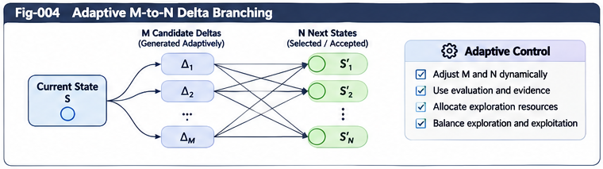
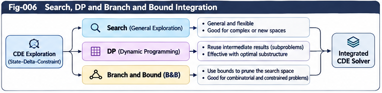
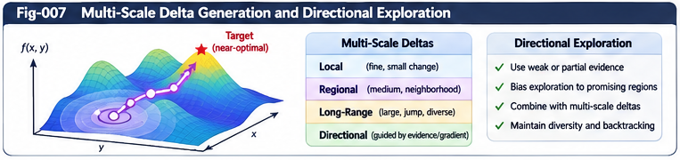

# CASE-001 — Multi-Scale Peak Search

**Project:** Constrained Delta Evolution (CDE)  
**Series:** Cases / Executable Research Designs  
**Status:** Proposed reference case and validation protocol, v1.0.0 draft  
**Date:** 2026-11-04  
**Authors:** Sizhe Tan and GPT-Obot  
**License:** Apache-2.0  
**Related Foundations:** CDE-001–012, especially CDE-003, CDE-005, CDE-006, CDE-008, CDE-011, and CDE-012  
**Related Specifications:** SPEC-001–006  
**Suggested repository path:** `docs/cases/CASE-001-Multi-Scale-Peak-Search.md`

## Abstract

This case study develops a controlled **Multi-Scale Peak Search (MSPS)** laboratory for evaluating Constrained Delta Evolution (CDE). The motivating problem is simple: a search process located near one attractive peak may need to discover a better, distant peak while respecting feasibility constraints, finite evaluation budgets, and uncertainty about the objective landscape. A purely local generator can be trapped; a purely global generator can spend excessive resources; and an adaptive mixture may provide useful coverage and exploitation. Whether that mixture is actually superior is an empirical question, not a theorem.

The case formalizes a two-dimensional benchmark family with multiple peaks, infeasible regions, noisy observations, and changing evaluation metrics. It maps the task to State Containers, typed Deltas, adaptive M-to-N branching, path memory, solver adapters, and Relay artifacts. It specifies reproducible baselines, reference pseudocode, metrics, negative controls, failure modes, ablations, and conformance tests. Small illustrative calculations are distinguished from experimental results; **no benchmark run or measured superiority is claimed in this document**.

**Central question:** Under what landscape structures and resource budgets does an adaptive portfolio of local, regional, long-range, and evidence-guided Deltas discover better *validated feasible solutions* than comparable single-scale search methods?

---



*Figure 4. Adaptive Delta branching distinguishes M proposals, Q selected attempts, N realized transition edges, N_c committed edges, and K distinct successor states. Deduplication, invalid attempts, and uncommitted edges prevent these counts from being treated as interchangeable.*

---



*Figure 6. CDE acts as a contract-driven exploration interface over solver families. General search proposes candidates; dynamic programming requires valid future-equivalence keys; branch-and-bound requires admissible bounds and sound pruning. Solver-specific certificates remain distinct from heuristic best-known solutions.*

---



*Figure 7. Local, regional, long-range, and Relay-guided Delta generators explore complementary neighborhoods. Directional fields and weak evidence guide proposal ranking while maintaining uncertainty, diversity, counterexample probes, and hard-constraint checks.*

---

## 1. Research Motivation

A search algorithm can find a nearby local maximum yet miss a distant, higher one. The challenge is not simply to move farther. The algorithm must decide **when to intensify local exploration, when to broaden its radius, when to start from a different region, and when weak directional evidence is worth following**.

CDE treats these choices as explicit, typed Delta-generation and branch-selection decisions. It offers an orchestration vocabulary rather than claiming to replace established global optimization, evolutionary computation, Bayesian optimization, multi-start local search, or branch-and-bound.

This case has three goals:

1. **Conceptual:** make the State–Delta–Constraint–Branch relationship concrete.
2. **Engineering:** exercise the six CDE specifications through a small, auditable benchmark.
3. **Scientific:** provide falsifiable comparisons against strong and budget-matched baselines.

The metaphor of bees scouting multiple flowers or peaks is a design analogy only. It is not evidence of algorithmic superiority or a claim about biological search mechanisms.

## 2. Questions and Hypotheses

### RQ-1 — Escape from local attraction basins

Can a multi-scale generator discover a distant feasible peak that local-only search fails to reach under the same evaluation budget?

### RQ-2 — Cost of exploration

When does the benefit of long-range proposals outweigh their validation, evaluation, and coordination cost?

### RQ-3 — Adaptive branching

Does a learned or rule-based branch allocator improve feasible best-so-far value compared with a fixed allocation of the same operators?

### RQ-4 — Constraint topology

How do disconnected feasible regions and narrow feasible corridors affect success rates and rejection rates?

### RQ-5 — Weak directional evidence

Can imperfect directional cues improve discovery without causing premature exclusion of low-scoring candidates?

### RQ-6 — Relay and repeated execution

Can independently validated information from prior runs improve future runs without leaking benchmark answers or creating false completeness claims?

**H1:** On landscapes with well-separated attraction basins, multi-scale CDE will improve the probability of discovering the best feasible basin compared with a local-only baseline under matched budgets.

**H2:** On smooth, unimodal landscapes, multi-scale exploration may be worse than well-tuned local search due to wasted global probes.

**H3:** Adaptive scale allocation can outperform fixed mixtures on heterogeneous landscapes, but may underperform when its adaptation signal is noisy or misleading.

**H4:** A calibrated directional field may improve sample efficiency; an adversarial or uncalibrated field may degrade it.

**H5:** Validated Relay can reduce repeated exploration cost on related tasks; unvalidated Relay can cause negative transfer.

These are **testable hypotheses**, not established findings.

## 3. Problem Definition

Let the search domain be:

$$
\Omega=[-6,6]\times[-6,6]\subset\mathbb R^2.
$$

We seek:

$$
\max_{x\in\Omega} f(x)
\quad\text{subject to}\quad
c_j(x)\le 0,\;j=1,\ldots,J.
$$

Here $f$ is an objective, $c_j$ are hard constraints, and each evaluation may consume a finite budget.

For a known deterministic test function, an independent evaluator can compute the exact objective at proposed points. For noisy experiments, the evaluator returns an observation $y=f(x)+\epsilon$, while the benchmark oracle retains the latent $f(x)$ for post-run scoring. The optimizer MUST NOT have access to hidden oracle information during search.

### 3.1 Multi-peak benchmark family

Define a mixture of Gaussian-shaped peaks:

$$
f(x)=b(x)+\sum_{i=1}^{P} a_i
\exp\left(
-\frac{\|x-\mu_i\|_2^2}{2\sigma_i^2}
\right),
$$

where $b(x)$ is an optional low-amplitude background term, $a_i>0$ is peak amplitude, $\mu_i\in\Omega$ its center, and $\sigma_i>0$ its width.

**Important:** In a sum of overlapping peaks, the actual maximizer need not be exactly at a component center. The benchmark MUST evaluate the full function, not equate the largest amplitude with a proven global optimum.

### 3.2 Reference landscape L1

A deliberately separated example is:

| Component | Center $\mu_i$ | Amplitude $a_i$ | Width $\sigma_i$ |
|---|---|---:|---:|
| A | $(-3,-2)$ | 5.0 | 0.85 |
| B | $(2.5,2.2)$ | 8.0 | 0.65 |
| C | $(0,-3.5)$ | 4.0 | 1.10 |

Let $b(x)=0$. A search initialized near A may exploit A successfully yet fail to visit B if it uses only short local steps. This is an intended qualitative stress test; **it does not establish the exact optimizer location or a measured performance gap**.

### 3.3 Constraint variants

Four variants separate search difficulty from constraint difficulty.

**C0 — Box only:** $x\in\Omega$.

**C1 — Forbidden disk:** exclude a disk centered at $z$ with radius $r$:

$$
c_{\rm disk}(x)=r^2-\|x-z\|_2^2\le 0.
$$

**C2 — Capacity-like linear constraint:**

$$
c_{\rm lin}(x)=x_1+0.7x_2-\tau\le 0.
$$

**C3 — Disconnected feasible islands:** the feasible region is a union of explicitly defined regions $F_1\cup F_2$. The validator checks membership in at least one region. This variant probes whether long-range transitions can bridge disconnected feasible components without requiring an infeasible intermediate path.

Constraint definitions and their versions MUST be frozen before each benchmark run. A benchmark SHOULD include a variant where the highest unconstrained peak is infeasible, so algorithms are evaluated on *feasible* rather than raw objective value.

## 4. Task Profiles

The same benchmark can be exercised through several increasingly demanding profiles.

| Profile | Objective | Constraints | Observations | Primary question |
|---|---|---|---|---|
| P0 | Known deterministic | Box | Exact | Operator sanity |
| P1 | Known multi-peak | Box | Exact | Local versus global |
| P2 | Known multi-peak | Nonconvex | Exact | Constraint-aware branching |
| P3 | Hidden multi-peak | Nonconvex | Noisy | Evidence calibration |
| P4 | Hidden related tasks | Nonconvex | Noisy | Relay transfer |
| P5 | Changing objective weights | Nonconvex | Exact/noisy | Metric-version discipline |

The main experimental claims SHOULD be based on P1–P4, not only on the easy P0 profile.

## 5. State Container Contract

The CDE State Container is not merely a coordinate pair. It includes the versioned information required to interpret and validate exploration.

A minimal logical state is:

$$
S_t=(x_t,\mathcal I_t,\kappa_t,\beta_t,\rho_t),
$$

where:

- $x_t$: current candidate point or active search location;
- $\mathcal I_t$: information state, including evaluated points and evidence references;
- $\kappa_t$: schema, constraint, metric, and policy versions;
- $\beta_t$: remaining budget;
- $\rho_t$: provenance and path-context reference.

The information state may be stored separately and referenced immutably; this prevents unnecessary duplication of an expanding evaluation history.

### 5.1 Example State Container

```yaml
state_id: "msps-state-0007"
schema_id: "cde-msps-state"
schema_version: "1.0.0"
state_revision: "r7"
payload_ref_or_value:
  active_point: [-2.7, -2.1]
  best_feasible_point: [-2.9, -2.0]
  best_feasible_observed_value: 4.96
  evaluated_points_ref: "eval-ledger-0007"
  remaining_evaluation_budget: 74
constraint_bundle_id: "msps-C1-v1"
context_refs:
  - "objective-L1-v1"
  - "metric-max-f-v1"
  - "generator-portfolio-v1"
  - "path-context-0007"
provenance_ref: "commit-0007"
```

The numeric value `4.96` is **illustrative placeholder data**, not a reported evaluation of L1.

### 5.2 State identity

Two states with the same `active_point` may differ in budget, observations, path memory, metric version, or policy. They MUST NOT be merged for future-equivalent solver caching solely because their coordinates match.

### 5.3 Immutable evaluation ledger

Each evaluation record SHOULD contain:

```yaml
EvaluationRecord:
  evaluation_id: string
  point: [number, number]
  feasible: boolean
  objective_observation: optional_number
  observation_uncertainty: optional
  objective_version: string
  constraint_bundle_id: string
  evaluator_version: string
  random_seed: optional
  cost: number
  timestamp: string
  provenance_ref: string
```

Failed, rejected, or timed-out evaluations remain valuable negative evidence and SHOULD be recorded without inventing objective values.

## 6. Delta Taxonomy

The benchmark uses four proposal scales.

### 6.1 Local Delta

$$
\delta_L:\quad x'=x+\eta,\qquad
\eta\sim \mathcal N(0,\sigma_L^2 I).
$$

The proposal is clipped or rejected according to a declared boundary policy. Clipping can distort the proposal distribution and MUST be documented.

Local Deltas exploit an attraction basin but may have low probability of crossing a large low-value region.

### 6.2 Regional Delta

$$
\delta_R:\quad x'=x+\eta,\qquad
\eta\sim\mathcal N(0,\sigma_R^2 I),
\quad\sigma_R>\sigma_L.
$$

Regional Deltas broaden exploration without abandoning the current region entirely.

### 6.3 Long-Range Delta

$$
\delta_G:\quad x'\sim q_G(\cdot\mid\Omega),
$$

where $q_G$ may be uniform over the domain, stratified, low-discrepancy, or otherwise explicitly specified.

Long-range proposals are allowed to jump across disconnected feasible regions. Whether an application permits such jumps is domain-dependent; for this numerical optimization case, a proposed evaluation point need not be reachable through a physical continuous path.

### 6.4 Directional Delta

$$
\delta_D:\quad x'=x+\alpha d+\eta,
$$

where $d$ is a normalized direction derived from a declared evidence model, $\alpha$ a step scale, and $\eta$ exploration noise.

Directional evidence may be a local gradient estimate, surrogate-model suggestion, historical improvement vector, or Relay-provided hypothesis. It is **not** a hard-constraint certificate.

### 6.5 Delta descriptor example

```yaml
delta_type_id: "msps-regional-step"
type_version: "1.0.0"
applicable_state_schemas: ["cde-msps-state@1.0.0"]
parameter_schema_ref: "regional-step-parameters-v1"
precondition_contract_ref: "within-budget-and-valid-source-v1"
transition_semantics_ref: "propose-evaluation-point-v1"
declared_effects: ["candidate-point-proposal"]
required_capabilities: ["objective-evaluation"]
outcome_mode: "deterministic"
provenance_ref: "delta-registry-v1"
```

The proposal can be stochastic while the realized state transition is deterministic given a sampled proposal point. Implementations SHOULD distinguish randomness in *proposal generation* from randomness in *environmental outcomes*.

## 7. Adaptive M-to-N Branching

At a given invocation, the generator portfolio emits $M$ Delta proposals. A selector chooses $Q$ attempts. After validation and realization, $N$ edges are recorded and $K$ distinct successor states remain under the declared equivalence relation.

$$
M \longrightarrow Q \longrightarrow N \longrightarrow K.
$$

The four quantities are not interchangeable.

### 7.1 Example accounting

Suppose an invocation emits 12 proposals:

- 5 local;
- 3 regional;
- 2 long-range;
- 2 directional.

The selector attempts 7. Of these, 2 fail hard constraints, 1 duplicates an already evaluated candidate, and 4 produce new committed evaluations. If two committed evaluations lead to the same logical successor under a declared equivalence, the report may show:

$$
M=12,\quad Q=7,\quad N_c=4,\quad K_c=3.
$$

These are **illustrative bookkeeping numbers**, not benchmark results. Whether duplicate evaluations are represented as realized edges depends on the declared edge-kind and accounting policy.

### 7.2 Branch allocation policies

Compare:

- **Fixed mixture:** fixed shares across the four Delta scales.
- **Epsilon-greedy adaptive:** usually favor the empirically best scale, but allocate a fixed fraction to exploration.
- **UCB-style allocation:** prefer scales with high observed reward and uncertainty.
- **Budget-aware portfolio:** maximize a declared utility estimate per evaluation cost.
- **Coverage-constrained allocation:** reserve a minimum budget for broad exploration.

Adaptive policies MUST record their metric and policy versions. They MUST NOT silently discard untried scales while claiming exhaustive exploration.

## 8. Hard Constraints and Candidate Dispositions

A generated point is a proposal, not a feasible state.

The validation sequence is:

1. validate Delta type and parameter schema;
2. verify source state and context versions;
3. check evaluation budget;
4. construct the candidate point;
5. apply box and domain constraints;
6. check authorization;
7. evaluate the objective if the candidate is admissible;
8. record the outcome and update the incumbent only when justified.

Dispositions include:

| Disposition | Meaning |
|---|---|
| `PROPOSED` | Generated, not attempted |
| `SELECTED` | Chosen for validation |
| `DEFERRED` | Preserved for possible later evaluation |
| `EXCLUDED_BY_POLICY` | Not selected under current policy |
| `REJECTED_TYPE` | Invalid Delta or state schema |
| `INFEASIBLE` | Violates a hard constraint |
| `STALE_CONTEXT` | Versions no longer match |
| `VALIDATION_UNKNOWN` | Feasibility cannot be established |
| `PRUNED_WITH_CERTIFICATE` | Removed by a sound solver-specific proof |
| `COMMITTED` | Valid evaluation/transition recorded |

A low heuristic score is not sufficient for `PRUNED_WITH_CERTIFICATE`.

### 8.1 Constraint evaluation cost

In a cheap analytical benchmark, feasibility checks may cost much less than objective evaluations. In realistic applications, constraints may themselves be expensive. Both costs SHOULD be reported separately.

### 8.2 Rejection sampling bias

If a generator repeatedly samples infeasible points and retries until one is feasible, its actual proposal distribution differs from the original distribution. Experiments MUST account for rejected proposals and their costs, not report only accepted points.

## 9. Path Memory, Revisit Policy, and Loop Back

For this continuous-domain benchmark, exact coordinate equality is usually too strict to be useful for revisitation detection. The benchmark SHOULD distinguish:

- exact Delta identity;
- exact point identity;
- tolerance-based point proximity;
- path-local decision identity;
- future-equivalent search state.

A point may be revisited intentionally to reduce observation noise. A different path can also reach the same point with different remaining budgets or evidence.

### 9.1 Default policy

For deterministic exact evaluations, exact duplicate evaluations under the same objective/constraint versions MAY be served from an immutable cache.

For noisy evaluations, repeated observations MAY be legitimate. Their repeated-execution purpose MUST be explicit.

### 9.2 Loop Back

The benchmark allows a generator to propose a point near a previously visited region. This is a **Loop Back** in the exploratory graph, not necessarily a cycle in a physical state machine.

A loop policy SHOULD specify:

- what constitutes a repeated state;
- whether repeated evaluations are allowed;
- maximum revisit counts or budgets;
- whether uncertainty reduction justifies repetition;
- how cached and new observations are distinguished.

### 9.3 NoSubtree distinction

The BTP-style NoSubtree rule prevents repeated resolution of a fixed constructive decision along one path. It does not imply that a continuous optimizer must never revisit a coordinate. Applying fixed-decision NoSubtree globally to this case would be a category error.

## 10. Solver Portfolio and Baselines

The comparison must include strong alternatives, not only a weak local search.

| ID | Baseline / method | Main property |
|---|---|---|
| B0 | Uniform random search | Global coverage reference |
| B1 | Multi-start local search | Repeated local exploitation from diverse starts |
| B2 | Fixed-radius local search | Local-only failure probe |
| B3 | Simulated annealing | Temperature-controlled exploration |
| B4 | Differential evolution | Population-based global optimization |
| B5 | Bayesian optimization | Surrogate-guided sample efficiency |
| B6 | Fixed multi-scale mixture | Same operators, no adaptation |
| C1 | CDE adaptive multi-scale | Adaptive operator allocation |
| C2 | CDE adaptive + directional | Adds weak evidence |
| C3 | CDE adaptive + validated Relay | Adds prior-task knowledge |

Some methods have substantial tuning and implementation costs. Compare under the same objective-evaluation budget **and** report total compute, initialization, tuning, and coordination overhead separately.

### 10.1 Fairness rules

- Use the same objective and constraint definitions.
- Use the same permitted search domain and initial information.
- Match the number of objective evaluations for primary comparisons.
- Report constraint-check and proposal costs.
- Pre-register hyperparameter tuning budgets.
- Run multiple independent seeds.
- Avoid tuning on the held-out test landscapes.
- Do not allow CDE to access hidden peak centers when baselines cannot.
- If one method uses gradients or a surrogate, disclose that information advantage.

### 10.2 Oracle benchmark

For selected deterministic low-dimensional landscapes, a dense grid plus independent local refinement can produce a high-confidence reference value. It MUST be labeled **numerical reference**, not a proven global optimum unless a valid global certificate is available.

## 11. Metrics and Outcome Definitions

### 11.1 Best feasible value

For maximization:

$$
F_t^{\star}=\max\{f(x_i): i\le t,\ x_i\text{ feasible}\}.
$$

If no feasible point has been evaluated, the result is `NO_FEASIBLE_INCUMBENT`, not zero.

### 11.2 Simple regret

Given a trusted reference $f_{\rm ref}^{\star}$:

$$
R_t=f_{\rm ref}^{\star}-F_t^{\star}.
$$

If the reference is approximate, report it as approximate regret. Do not call it a certified optimality gap.

### 11.3 Discovery success

Define a target threshold $\theta$ before the run. Success occurs when the algorithm evaluates a feasible point with $f(x)\ge\theta$. In noisy experiments, distinguish **observed threshold crossing** from **validated latent-objective crossing**.

### 11.4 Time to discovery

Count objective evaluations until the first validated target hit. Right-censor runs that do not reach the threshold within budget.

### 11.5 Exploration diversity

Measure the number of occupied spatial bins or separated basins visited. Report binning resolution; diversity is not inherently equivalent to optimization quality.

### 11.6 Feasibility yield

$$
Y_{\rm feas}=
\frac{\text{feasible attempted candidates}}
{\text{all attempted candidates}},
$$

with the zero-denominator case reported as undefined.

### 11.7 Operator contribution

Track marginal contribution by scale, but avoid naive causal attribution when operator choices depend on earlier outcomes. Use ablations and randomized allocations where possible.

### 11.8 Overhead

Report total time, generator time, validation time, solver time, and orchestration time. A method can improve objective-evaluation efficiency while worsening wall-clock efficiency.

## 12. Experimental Design

### 12.1 Landscape generation

Create a preregistered benchmark suite with varying:

- number of peaks $P$;
- separation between centers;
- width distribution;
- amplitude contrast;
- dimension (2D primary; 5D and 10D extensions);
- feasible-region connectivity;
- constraint rejection rate;
- observation noise;
- directional evidence quality.

Use training, validation, and held-out test landscape families with disjoint random seeds.

### 12.2 Budget levels

Suggested objective-evaluation budgets:

$$
B\in\{25,50,100,250,500\}.
$$

These are proposed design points, not measured thresholds. Larger budgets MAY be necessary for higher dimensions.

### 12.3 Replication

Run at least 30 independent seeds per method–landscape configuration as a starting design target, then assess statistical precision. The required number depends on variance and desired confidence.

### 12.4 Paired comparisons

Where practical, use paired landscape instances and matched initial points. Independent stochastic seeds can still be used within each pair. Report uncertainty intervals rather than only mean outcomes.

### 12.5 Pre-registration

Before executing the held-out suite, freeze:

- benchmark generator versions;
- constraint definitions;
- method configurations;
- evaluation budgets;
- primary metrics;
- success thresholds;
- exclusion rules;
- statistical analysis plan.

## 13. Statistical Analysis Plan

For each method, report median and interquartile range of best feasible value and regret, with bootstrap confidence intervals over independent landscape/seed units.

For paired comparisons, report the distribution of per-instance differences. Avoid treating repeated checkpoints from one run as independent samples.

For time-to-target, report success probability by budget and appropriately handle censored runs. For multiple comparisons, predefine primary contrasts and control multiplicity or clearly label exploratory analyses.

A claim such as “CDE improves sample efficiency” SHOULD specify the landscape family, budget, baseline, effect size, and uncertainty. A statistically detectable difference on one synthetic family is not proof of broad superiority.

## 14. Reference Pseudocode — Multi-Scale CDE

```text
function CDE_MULTI_SCALE_SEARCH(task, config):
    state = initialize_state_container(task, config)
    ledger = immutable_evaluation_ledger()
    incumbent = NO_FEASIBLE_INCUMBENT

    while budget_remaining(state) and not stopping_rule(state):
        manifest = pin_generator_versions(config)
        proposals = []

        for scale in {LOCAL, REGIONAL, LONG_RANGE, DIRECTIONAL}:
            quota = allocation_policy.quota(scale, state, config)
            proposals += generate_typed_proposals(
                scale=scale,
                state=state,
                quota=quota,
                generator_version=manifest[scale],
                random_seed=next_seed()
            )

        record_generation_invocation(proposals, state)

        decisions = branch_selector.select(
            proposals,
            metric_version=state.metric_version,
            budget=state.remaining_budget
        )

        for decision in decisions:
            record_decision(decision)

            if decision.disposition != SELECTED:
                continue

            attempt = create_branch_attempt(decision, state)

            if not type_and_context_valid(attempt, state):
                record_noncommit(attempt, REJECTED_TYPE_OR_STALE)
                continue

            candidate = construct_candidate(attempt)

            if not hard_constraints_pass(candidate, state.constraint_bundle):
                record_noncommit(attempt, INFEASIBLE)
                continue

            observation = evaluate_objective(candidate, task.oracle)
            record_evaluation(ledger, candidate, observation)

            successor = commit_state_transition(
                source=state,
                attempt=attempt,
                evaluation=observation,
                validation=PASS
            )

            incumbent = update_validated_incumbent(
                incumbent, successor, observation
            )

            state = successor

        update_allocation_policy_from_observed_evidence(
            state, ledger, policy_version=config.policy_version
        )

        record_M_Q_N_K_accounting()

    return final_report(
        incumbent=incumbent,
        ledger=ledger,
        resource_costs=all_costs(),
        provenance=all_versions(),
        leftovers=unexplored_proposals()
    )
```

This pseudocode is a **control-flow sketch**, not a complete implementation. In particular, a production optimizer may maintain a frontier of multiple active states rather than a single `state`, and should batch candidate evaluations without allowing the order of commits to corrupt source-state revision semantics. The selected concurrency and versioning rules must be implemented under SPEC-001 and SPEC-005.

## 15. Reference Pseudocode — Fair Budget-Matched Experiment

```text
for landscape in HELD_OUT_LANDSCAPES:
    for seed in REGISTERED_SEEDS:
        initial_information = generate_common_initial_design(
            landscape, seed
        )

        for method in REGISTERED_METHODS:
            result = run_method(
                method=method,
                landscape=landscape,
                seed=seed,
                initial_information=initial_information,
                objective_budget=B,
                hidden_oracle_access=False
            )

            assert result.objective_evaluations <= B
            verify_all_committed_candidates(result)
            verify_provenance_and_metric_versions(result)
            save_immutable_run_artifacts(result)

analyze_paired_outcomes()
report_negative_results_and_overhead()
```

The benchmark harness MUST distinguish initialization evaluations from search evaluations. If a shared initial design consumes budget, it must be charged consistently.

## 16. Worked Walkthrough — A Local Basin and a Distant Basin

Consider the L1 landscape with starting point $x_0=(-3.2,-2.2)$, near peak A. A local step of standard deviation $0.15$ tends to propose points near the current basin. A long-range proposal sampled uniformly over $[-6,6]^2$ has a nonzero probability of landing near peak B.

For a disk of radius $r=0.5$ fully inside the square, the probability of a uniform sample falling inside the disk is:

$$
p=\frac{\pi r^2}{12^2}
=\frac{\pi(0.5)^2}{144}
\approx 0.00545.
$$

With $n$ independent uniform proposals, the probability of at least one point falling in that disk is:

$$
1-(1-p)^n.
$$

For $n=100$, this is approximately $0.421$. This calculation concerns **geometric sampling of a disk**, not probability of finding the true global optimum, satisfying all constraints, or achieving a target score. It illustrates why a uniform global proposal can be expensive even in 2D.

An adaptive portfolio may use local exploitation after discovering a promising region, but it may also prematurely focus on the wrong basin. Both possibilities must be measured.

## 17. Negative Control — Unimodal Landscape

Set:

$$
f_U(x)=-\|x-\mu\|_2^2.
$$

This smooth unimodal function is a negative control for the proposition that multi-scale search is universally better. A gradient-based or well-tuned local optimizer may approach the optimum with fewer evaluations than a method spending budget on long-range proposals.

If CDE performs worse here, that is an informative boundary, not a reason to discard the result.

## 18. Negative Control — Misleading Directional Field

Define a directional model that points away from the strongest feasible basin. For example, the field may estimate a direction based on a noisy local surrogate or be deliberately reversed in an adversarial control.

Compare:

1. no directional field;
2. calibrated field;
3. weak noisy field;
4. systematically misleading field.

A robust branch selector SHOULD preserve exploration diversity rather than allowing a weak directional score to become a global exclusion rule.

## 19. Negative Control — Constraint Barrier

Construct two feasible islands separated by a forbidden band. A local method that only accepts feasible small steps cannot cross the band, whereas a direct long-range proposal can evaluate a point on the other island.

This advantage is **domain-specific**. In a physical routing or robotics problem, a jump that crosses an infeasible region may not correspond to a valid executable trajectory. The Delta semantics must declare whether the transition is an abstract candidate replacement or a physical movement requiring a feasible intermediate path.

## 20. Ablation Study

Ablate one mechanism at a time:

| Ablation | Removed feature | Intended inference |
|---|---|---|
| A1 | Long-range proposals | Importance of global reach |
| A2 | Regional proposals | Intermediate-scale utility |
| A3 | Directional field | Value of weak evidence |
| A4 | Adaptive allocation | Adaptation versus fixed mixture |
| A5 | Deduplication | Cost of redundant evaluation |
| A6 | Path memory | Effect on repeated exploration |
| A7 | Relay reuse | Transfer benefit versus overhead |
| A8 | Constraint preflight | Early screening cost savings |
| A9 | Independent validation | Risk of false improvements |
| A10 | Budget accounting | Sensitivity to hidden overhead |

Ablations must use comparable budgets and the same held-out landscapes. Removing a feature may change the amount of compute spent elsewhere; report that reallocation explicitly.

## 21. Relay Experiment — Related Landscapes

A family of related landscapes may share broad structure while differing in peak positions, amplitudes, or constraint boundaries.

The source task publishes:

- evaluated regions and their objective-version context;
- successful and failed operator choices;
- uncertainty-calibrated directional hypotheses;
- constraint-related rejection patterns;
- unvisited promising regions as Leftover artifacts;
- validation evidence and provenance.

The target task receives these as **candidate evidence**, not authoritative truth. It performs an applicability check and limited independent validation before using them to influence allocation.

### 21.1 Leakage prevention

Source and target test labels must remain separate. If the target landscape is generated from a shared hidden template, disclose the relationship and evaluate out-of-family transfer separately.

### 21.2 Repeated execution as temporal Relay

Repeating an evaluation at a point may reduce uncertainty under noisy observations. The experiment should distinguish intentional replication from accidental duplicate work. A repeat must be budgeted and recorded.

### 21.3 Negative transfer

Test a source landscape whose strongest basin is deliberately shifted away from the target's best region. A Relay policy that over-trusts prior direction may perform worse than no Relay. The target must be able to reject or down-weight transferred evidence.

## 22. Metric Evolution Extension

The primary metric is best feasible objective value. A secondary research extension permits changes in the scoring policy, such as a tradeoff between objective improvement, exploration diversity, and evaluation cost:

$$
U_\omega =
\omega_1 \,\widehat{\Delta f}
+\omega_2\,\text{novelty}
-\omega_3\,\text{cost}.
$$

The weights $\omega$ are *policy evaluation parameters*, not replacements for hard constraints. Each change requires a versioned metric record.

A new metric that improves its own internal score is not necessarily a better metric. Independent validation must compare held-out outcomes against predeclared objectives and guard against Goodhart effects.

## 23. Recursive Generator Evolution Extension

A candidate generator version may adjust:

- step-scale distributions;
- operator library;
- proposal diversity;
- direction-estimation method;
- branch allocation policy;
- duplicate suppression rules.

The experimental loop is:

```text
Propose generator meta-Delta
    -> build candidate generator
    -> validate contract conformance
    -> evaluate on training tasks
    -> evaluate independently on held-out tasks
    -> assess cost, safety, and regressions
    -> authorize limited promotion or reject
    -> monitor and retain rollback
```

A generator update MUST NOT silently inherit its predecessor's coverage claims. A promotion requires independently validated performance and governance under SPEC-006. Recursive modification does not imply guaranteed recursive improvement.

## 24. Distributed Extension

The laboratory can dispatch independent candidate evaluations to multiple workers.

A task envelope includes:

```yaml
task_id: "msps-eval-0104"
source_state_ref: "msps-state-0007@r7"
delta_proposal_ref: "proposal-0104"
constraint_bundle_id: "msps-C2-v1"
metric_version: "metric-max-f-v1"
generator_version: "msps-multiscale-v1"
budget:
  objective_evaluations: 1
validation_contract_ref: "msps-eval-validation-v1"
idempotency_key: "eval-0104-v1"
provenance_ref: "dispatch-0104"
```

A worker result is evidence, not automatically a global commit. The coordinator must reconcile versions, prevent duplicate charged effects where required, and update the incumbent only after validating the result.

### 24.1 Coordination overhead

In cheap 2D analytical functions, distributed execution may be slower than local execution. The distributed profile primarily tests contracts and fault handling; performance advantages are expected only when evaluation cost or parallelism justifies overhead.

### 24.2 Failure injection

Inject stale results, duplicate retries, worker timeouts, inconsistent metric versions, and conflicting incumbent updates. Measure both correctness and recovery cost.

## 25. Solver Guarantee Boundaries

CDE is a framework for generating, validating, and coordinating candidate transitions. It does not by itself prove:

- that every feasible region is reachable;
- that a finite budget finds a global optimum;
- that a heuristic direction is correct;
- that a cache equivalence is sound;
- that an adaptive allocation is asymptotically optimal;
- that a distributed result is globally feasible;
- that a learned metric generalizes;
- that recursive updates monotonically improve performance.

An exact global solver with valid bounds may offer stronger guarantees under its own assumptions. A CDE adapter must preserve, not manufacture, those guarantees.

## 26. Failure Modes and Counterexamples

**F1 — Local trapping:** short-step proposals never reach a distant basin.

**F2 — Global waste:** uniform proposals miss narrow peaks at modest budgets.

**F3 — Premature exploitation:** adaptive allocation collapses onto an early mediocre region.

**F4 — Directional miscalibration:** weak evidence points away from the best region.

**F5 — Constraint rejection:** most proposals fall into infeasible regions.

**F6 — False pruning:** low scores are treated as proof that a branch cannot improve.

**F7 — Unsound deduplication:** nearby coordinates are merged despite distinct outcomes or uncertainty.

**F8 — Hidden budget leakage:** rejected or cached evaluations are not counted consistently.

**F9 — Metric drift:** scores from incompatible objective versions are compared directly.

**F10 — Noisy winner's curse:** the largest observed noise fluctuation is mistaken for true improvement.

**F11 — Stale worker results:** a result is accepted under a superseded constraint bundle.

**F12 — Relay negative transfer:** old directional evidence misguides a new task.

**F13 — RSI overfitting:** generator changes improve training tasks but degrade held-out landscapes.

**F14 — Coordination overhead:** distributed orchestration costs more than it saves.

**F15 — Unproven optimum:** the largest sampled value is called a globally optimal solution.

**F16 — Invalid physical analogy:** abstract jumps are assumed to represent feasible physical paths.

Each failure mode should have at least one explicit negative test.

## 27. Conformance Matrix

| Test | Governing specification | Expected evidence |
|---|---|---|
| CASE-001-T01 Valid State Container | SPEC-001 | Schema and revision report |
| CASE-001-T02 Infeasible candidate rejected | SPEC-001 | Constraint failure record |
| CASE-001-T03 Unknown validation blocks commit | SPEC-001 | `VALIDATION_UNKNOWN` |
| CASE-001-T04 Delta types pinned | SPEC-002 | Manifest and version |
| CASE-001-T05 M/Q/N/K reconciliation | SPEC-002 | Branch accounting |
| CASE-001-T06 Duplicate proposals retained | SPEC-002 | Distinct proposal IDs |
| CASE-001-T07 Partial generation not exhaustive | SPEC-002 | Partial status |
| CASE-001-T08 Heuristic exclusion not proof | SPEC-002/004 | Disposition record |
| CASE-001-T09 Revisitation scoped | SPEC-003 | Path policy |
| CASE-001-T10 NoSubtree not misapplied | SPEC-003 | Decision-scope evidence |
| CASE-001-T11 Cache context coherence | SPEC-003/004 | Cache key and versions |
| CASE-001-T12 Feasible incumbent validated | SPEC-004 | Verification report |
| CASE-001-T13 Optimality claim not fabricated | SPEC-004 | Correct claim type |
| CASE-001-T14 Solver portfolio costs reported | SPEC-004 | Cost ledger |
| CASE-001-T15 Worker stale result rejected | SPEC-005 | Reconciliation record |
| CASE-001-T16 Retry idempotency | SPEC-005 | Single committed effect |
| CASE-001-T17 Relay applicability checked | SPEC-005 | Target validation |
| CASE-001-T18 Leftover preserved | SPEC-005 | Relay artifact |
| CASE-001-T19 Metric version change | SPEC-006 | New metric record |
| CASE-001-T20 Generator update validation | SPEC-006 | Promotion gate |
| CASE-001-T21 Rollback after regression | SPEC-006 | Rollback record |
| CASE-001-T22 No hidden oracle access | Experimental protocol | Audit log |
| CASE-001-T23 Budget matched | Experimental protocol | Evaluation counts |
| CASE-001-T24 Negative controls included | Experimental protocol | Run manifest |
| CASE-001-T25 Uncertainty reported | Experimental protocol | Interval estimates |
| CASE-001-T26 No experimental claims without runs | Research integrity | Evidence inventory |

Passing the contract tests establishes interoperability behavior only within the tested scope; it does not establish scientific performance superiority.

## 28. Reference Data and Reproducibility Package

A future executable companion SHOULD include:

```text
case-001-msps/
├── README.md
├── benchmark/
│   ├── landscapes.py
│   ├── constraints.py
│   ├── oracle.py
│   └── fixtures/
├── cde/
│   ├── state_contract.py
│   ├── delta_generators.py
│   ├── branch_selector.py
│   ├── validator.py
│   ├── path_memory.py
│   └── event_ledger.py
├── baselines/
│   ├── random_search.py
│   ├── multistart_local.py
│   ├── simulated_annealing.py
│   ├── differential_evolution.py
│   └── bayesian_optimization.py
├── experiments/
│   ├── preregistration.yaml
│   ├── train_manifest.yaml
│   ├── test_manifest.yaml
│   └── run.py
├── tests/
│   ├── test_contracts.py
│   ├── test_budget_accounting.py
│   ├── test_relay.py
│   └── test_negative_controls.py
└── reports/
    ├── results.csv
    ├── confidence_intervals.csv
    └── limitations.md
```

This tree is a **proposed future artifact structure**, not a claim that the code or result files already exist.

### 28.1 Run manifest

Every run SHOULD record:

- landscape ID and generation seed;
- objective and constraint versions;
- method and hyperparameter versions;
- source-state and initial-design references;
- evaluation budget and actual consumption;
- all proposal, attempt, and commit IDs;
- random seeds and runtime environment;
- termination reason;
- final feasible incumbent;
- any failure, exception, or leftover work.

### 28.2 Reporting template

```yaml
run_id: string
landscape_id: string
method_id: string
seed: integer
objective_budget: integer
objective_evaluations_used: integer
constraint_checks_used: integer
best_feasible_value: number_or_null
reference_value: number_or_null
reference_is_certified: boolean
success_threshold_reached: boolean
time_to_target_evaluations: integer_or_null
total_wall_time_seconds: number
generation_cost_seconds: number
validation_cost_seconds: number
orchestration_cost_seconds: number
termination_reason: string
conformance_status: string
provenance_ref: string
```

## 29. Validation Roadmap

**Phase V1 — Static contracts.** Review schemas, Delta types, dispositions, version references, and accounting invariants.

**Phase V2 — Deterministic toy tests.** Validate P0 and P1 with fixed seeds and inspect exact proposal/attempt/commit traces.

**Phase V3 — Constraint stress tests.** Add forbidden regions, disconnected feasible islands, and expensive constraint checks.

**Phase V4 — Baseline comparisons.** Run budget-matched B0–B6 and C1 on held-out landscapes.

**Phase V5 — Directional evidence.** Compare calibrated, weak, and misleading fields.

**Phase V6 — Relay transfer.** Test positive transfer, negative transfer, and independent target validation.

**Phase V7 — Generator evolution.** Evaluate meta-Delta candidates with held-out promotion gates and rollback.

**Phase V8 — Distributed execution.** Introduce worker failures, stale results, retries, and coordination overhead.

**Phase V9 — Replication and external review.** Publish manifests, code, negative results, uncertainty intervals, and limitations.

Each phase SHOULD have a clear exit criterion and must not claim completion without evidence.

## 30. Expected Observations Versus Actual Results

The following are **expectations to test**, not observations:

- Multi-scale search may escape local basins more reliably than local-only search.
- Well-tuned multi-start or differential evolution may match or exceed CDE.
- Bayesian optimization may be stronger when objective evaluations are expensive and dimension is low.
- Adaptive allocation may help when landscape types vary, but may overfit early evidence.
- Long-range proposals may be particularly useful when feasible regions are disconnected.
- Directional evidence may help if calibrated and harm if misleading.
- Relay may help related tasks but create negative transfer under distribution shift.
- Distributed execution may increase overhead on cheap benchmarks.

No empirical performance table, p-value, measured speedup, or global optimality certificate is supplied here because no experiment has been executed for this document.

## 31. Scientific Interpretation and Limits

This benchmark deliberately uses simple functions to isolate branching mechanisms. Its simplicity is a strength for conformance testing and a limitation for generalization.

Success on synthetic multi-peak landscapes does not establish superiority in combinatorial optimization, school-bus routing, structural matching, scientific hypothesis generation, or metric discovery. Those tasks have different state representations, constraints, evaluation costs, and admissible Delta semantics.

The benchmark should be interpreted as a **mechanism probe**. It can show whether an implementation correctly combines local and nonlocal proposals, handles constraints, and preserves evidence. Broader effectiveness requires additional independent cases.

## 32. Connection to SIF Localization

The Structural Intelligence Framework (SIF) treats localization as a central intelligence function: locating relevant problems, capabilities, structures, or methods.

In this case, CDE supplies an **exploratory localization mechanism**. Instead of only retrieving a known coordinate or capability, it generates and evaluates candidate locations in a structured search space. The candidate targets can be:

- a high-value feasible region;
- a promising operator family;
- a useful directional hypothesis;
- a transferable method;
- an unresolved search region deserving further work.

This is a proposed interface between CDE and SIF, not evidence that CDE outperforms existing localization or optimization systems.

## 33. Relation to Other CDE Cases

CASE-001 isolates the mechanics of Delta scales and branch control.

**CASE-002 — Constrained School-Bus Assignment and Routing** will add discrete assignments, global coupling, route constraints, and operational tradeoffs.

**CASE-003 — Dynamic Structural Matching** will add uncertain relational evidence, identity hypotheses, and asymmetric error costs.

**CASE-004 — Metric Discovery and Co-Evolution** will treat the scoring model itself as an evolving object.

**CASE-005 — Distributed CDE and Method Relay** will emphasize heterogeneous workers, task partitioning, transfer validation, and collective learning.

The progression is intentional: from a small inspectable numerical laboratory toward richer structural tasks.

## 34. Open Research Questions

1. How should Delta scale be defined in a non-Euclidean state space?
2. When is long-range exploration genuinely more efficient than multi-start local search?
3. Can a branch allocator detect that its current basin is deceptive without an expensive global model?
4. What are sound ways to preserve exploration coverage under adaptive resource allocation?
5. Can a generator supply useful conditional coverage certificates?
6. How should noisy repeated evaluations interact with path memory and deduplication?
7. What is the minimum independent evidence needed to adopt a Relay-suggested direction?
8. How can operator contribution be estimated causally when allocation is adaptive?
9. How should constraint-check cost affect candidate prioritization?
10. When do multi-scale proposals help in disconnected feasible spaces?
11. Can generator evolution improve held-out results without overfitting synthetic benchmark families?
12. Which insights transfer to higher-dimensional, discrete, or mixed-variable problems?
13. What failure modes appear when multiple workers share a rapidly changing incumbent?
14. How should a CDE-Orchestrator decide between exploration, validation, and further evidence collection?
15. Which mechanisms, if any, generalize beyond what established portfolio optimizers already provide?

## 35. Conclusion

Multi-Scale Peak Search is a useful first CDE case because its search geometry is intuitive while its engineering requirements are substantial. It forces an implementation to distinguish generated Deltas from selected attempts, feasible transitions from high-scoring proposals, and committed outcomes from modeled possibilities.

The case's central design is:

$$
\boxed{
\text{Local Exploitation}
+
\text{Regional Exploration}
+
\text{Long-Range Prospecting}
+
\text{Validated Directional Evidence}
}
$$

subject to hard constraints, budget accounting, versioned state transitions, and independently evaluated outcomes.

The combination is a **hypothesis about useful search orchestration**, not a guarantee of improvement. Its value must be judged against strong baselines, negative controls, total cost, and held-out tasks.

> **The objective is not to prove that CDE always finds the highest peak. It is to make the search process, its failures, its evidence, and its opportunities for improvement explicit and testable.**

---

## Appendix A — Compact Benchmark Configuration

```yaml
benchmark_id: "CASE-001-MSPS"
version: "1.0.0"
domain:
  dimensions: 2
  lower_bounds: [-6.0, -6.0]
  upper_bounds: [6.0, 6.0]
objective:
  type: "gaussian-peak-mixture"
  baseline: 0.0
  peaks:
    - center: [-3.0, -2.0]
      amplitude: 5.0
      sigma: 0.85
    - center: [2.5, 2.2]
      amplitude: 8.0
      sigma: 0.65
    - center: [0.0, -3.5]
      amplitude: 4.0
      sigma: 1.10
constraints:
  profile: "C0-box-only"
methods:
  - "uniform-random"
  - "multi-start-local"
  - "fixed-multiscale"
  - "cde-adaptive-multiscale"
budgets: [25, 50, 100, 250, 500]
replicates_per_configuration: 30
primary_metric: "best-feasible-objective"
secondary_metrics:
  - "time-to-target"
  - "feasibility-yield"
  - "total-compute-cost"
  - "spatial-coverage"
reporting:
  include_negative_results: true
  distinguish_reference_from_proof: true
  preserve_all_versions: true
```

## Appendix B — Example Branch Accounting Report

```yaml
invocation_id: "msps-generation-001"
generated_proposal_count_M: 12
distinct_delta_definition_count_D: 11
selected_attempt_count_Q: 7
realized_edge_count_N: 4
committed_edge_count_Nc: 4
unique_successor_count_K: 3
equivalence_contract_ref: "msps-state-equivalence-v1"
outcome_mode: "single_sample"
disposition_counts:
  selected: 7
  deferred: 3
  excluded_by_policy: 2
  infeasible_attempts: 2
  duplicate_attempts: 1
  committed_attempts: 4
generation_terminal_status: "COMPLETE"
provenance_ref: "msps-run-example"
```

This report is **illustrative**. It distinguishes proposal selection from attempt outcomes; `selected`, `deferred`, and `excluded_by_policy` partition the 12 proposals, while the attempt-level outcomes partition the 7 selected attempts.

## Appendix C — Evidence and Claim Registry

| Claim type | Acceptable evidence | Not acceptable alone |
|---|---|---|
| State conformance | Passing SPEC-001 tests | A valid-looking YAML example |
| Branch accounting | Audited M/Q/N/K event ledger | A single summary count |
| Feasible incumbent | Constraint validation at pinned versions | High heuristic score |
| Improved sample efficiency | Budget-matched held-out comparison | One successful run |
| Robust directional guidance | Calibrated and adversarial controls | A favorable anecdote |
| Transfer improvement | Independent target-task evaluation | Source-task success |
| Global optimality | Valid proof/certificate | Largest observed value |
| Recursive improvement | Independent multi-generation validation | Self-reported training gain |

## Appendix D — Suggested Figures

The case can reference the repository's planned figures:

- `Fig-004-Adaptive-M-to-N-Delta-Branching.png`
- `Fig-007-Multi-Scale-Delta-Generation-and-Directional-Exploration.png`
- `Fig-006-Search-DP-and-Branch-and-Bound-Integration.png`
- `Fig-009-Distributed-CDE-Orchestrator-and-Structural-Relay.png`

No figures are embedded or claimed to have been generated in this document.

## Appendix E — Research Status and Attribution

This case is a proposed research design and reference contract exercise. It draws on established ideas from global optimization, local search, multi-start search, evolutionary methods, Bayesian optimization, adaptive portfolios, experimental design, and reproducible benchmarking. CDE's proposed contribution is the explicit State–Delta–Constraint–Branch orchestration and its integration with versioned validation and Structural Relay.

**No experimental runs have been conducted for this manuscript.** All numeric examples are either mathematical calculations or labeled illustrative records. A future executable companion should supply the actual datasets, source code, results, uncertainty intervals, and negative findings.

**Version:** v1.0.0 draft  
**License:** Apache-2.0
