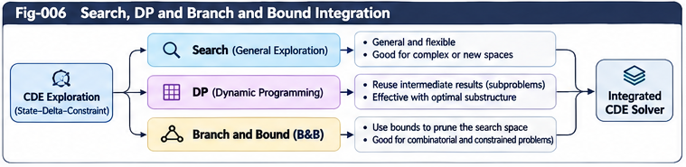

# CASE-002 — Constrained School-Bus Assignment and Routing

**Project:** Constrained Delta Evolution (CDE)  
**Series:** Cases / Applied Structural Optimization  
**Status:** Research design and proposed reference case, v1.0.0 draft  
**Date:** 2026-11-04  
**Authors:** Sizhe Tan and GPT-Obot  
**License:** Apache-2.0  
**Related foundations:** CDE-001–012, especially CDE-003, CDE-005, CDE-006, CDE-008–012  
**Related specifications:** SPEC-001–006  
**Suggested repository location:** `docs/cases/CASE-002-Constrained-School-Bus-Assignment-and-Routing.md`

## Abstract

School-bus assignment and routing provides a concrete, constrained combinatorial optimization laboratory for **Constrained Delta Evolution (CDE)**. The primary operational objective is to **minimize the number of vehicles required** to serve eligible students. Secondary objectives include reducing student ride time, limiting excessive detours and inequity, controlling operating cost, and preserving schedule robustness. Feasibility is governed by non-negotiable capacity, service coverage, vehicle compatibility, time-window, school-arrival, pickup/drop-off, and safety requirements. The actual policies must be supplied by the participating district; this paper does not invent jurisdiction-specific legal limits.

The case defines a versioned State Container, a hierarchy of route and assignment Deltas, constraint validators, lexicographic and multi-objective evaluation, adaptive M-to-N branching, exact and heuristic solver adapters, distributed agent coordination, and Structural Relay. It specifies a reproducible benchmark design, formal invariants, reference pseudocode, illustrative examples, counterexamples, conformance tests, and a validation roadmap. **No operational deployment, measured performance advantage, or optimality proof is claimed.** The intended contribution is an explicit, testable integration contract for combining established routing techniques with CDE's state–Delta–constraint orchestration and controlled collective learning.

**Keywords:** school-bus routing; school-bus scheduling; vehicle routing; vehicle minimization; pickup and delivery; student ride time; capacity constraints; time windows; adaptive Delta branching; multi-agent optimization; structural relay; CDE.

---



*Figure 6. CDE acts as a contract-driven exploration interface over solver families. General search proposes candidates; dynamic programming requires valid future-equivalence keys; branch-and-bound requires admissible bounds and sound pruning. Solver-specific certificates remain distinct from heuristic best-known solutions.*

---

## 1. Motivation and Research Position

A school district may transport many students from dispersed stops to multiple schools with different bell times, vehicle capacities, accessibility requirements, and operational restrictions. The problem is not merely to shorten each bus route. The district may care most about reducing the number of buses and drivers required, while preventing excessively long rides and maintaining safe, reliable service.

These objectives interact. A route merge can save one bus but increase ride time. A vehicle swap can satisfy capacity while violating accessibility requirements. Two independently attractive route changes may both depend on the same bus during overlapping periods. A locally improved schedule can be globally infeasible.

This makes the problem a useful test of CDE's central claims: typed structural changes, constraint-governed transitions, heterogeneous solver portfolios, path-sensitive search, distributed exploration, and validated transfer of methods and evidence.

School-bus routing, vehicle routing with time windows, pickup-and-delivery, set partitioning, and vehicle scheduling are established research areas. CDE does not claim to invent them. The hypothesis is that a well-specified **orchestration and relay layer** can make diverse optimization methods more interoperable, auditable, and adaptable.

## 2. Problem Scope and Important Distinctions

The reference task includes:

1. Assign each eligible student or student group to a designated pickup stop and compatible vehicle service.
2. Construct feasible stop sequences for morning inbound service.
3. Assign trips to physical vehicles, accounting for reuse between nonoverlapping trips.
4. Minimize the number of vehicles needed at the peak of the feasible schedule.
5. Control student ride times and route quality subject to hard constraints.
6. Produce an auditable plan that can be validated independently.

Optional extensions include afternoon outbound trips, special-needs transportation, multiple depots, multiple schools, mixed vehicle fleets, driver schedules, road restrictions, and uncertain travel times.

**Route count is not vehicle count.** A single physical bus may operate two compatible routes sequentially. Conversely, two routes that overlap in time cannot share one bus. The primary objective must therefore count distinct physical vehicles in a feasible trip-to-vehicle assignment, not simply the number of route records.

**A student's in-vehicle ride time is not necessarily their total journey time.** Walking, waiting, transfers, and pickup-window uncertainty may require separate measures and constraints.

**A planned schedule is not an executed trip.** The case distinguishes optimization results, dispatch approval, and real-world execution evidence.

## 3. Research Questions and Falsifiable Hypotheses

**RQ-1:** Can CDE coordinate different assignment, routing, and vehicle-scheduling operators without violating hard constraints?

**RQ-2:** Under matched budgets, does adaptive selection among local, regional, and long-range Deltas improve vehicle-count reduction compared with fixed operator portfolios and strong standard heuristics?

**RQ-3:** How much student ride-time deterioration accompanies vehicle reductions, and can lexicographic or epsilon-constraint policies control this tradeoff?

**RQ-4:** Can multi-agent search improve solution diversity and convergence after accounting for coordination and validation overhead?

**RQ-5:** Can validated Relay artifacts transfer useful route patterns, infeasibility explanations, and solver configurations across districts or scheduling periods without negative transfer?

**H1 — Multi-scale benefit:** For some heterogeneous instances, combining route-level and schedule-level Deltas will find lower feasible vehicle counts than local-only search within a matched budget.

**H2 — Conditional efficiency:** Adaptive allocation may reduce wasted evaluations on difficult instances, but may lose to tuned single-method solvers on simple or highly structured instances.

**H3 — Ride-time protection:** A lexicographic vehicle-first objective with explicit ride-time guardrails will avoid some unacceptable solutions that a poorly calibrated weighted sum might accept.

**H4 — Global coordination necessity:** Independently feasible worker outputs cannot generally be combined without checking shared vehicles, time windows, and assignment consistency.

**H5 — Relay validity:** Transfer of independently verified methods or patterns can improve future tasks under documented applicability conditions; stale or mismatched transfer can degrade performance.

All five are proposed hypotheses, not reported results.

## 4. Mathematical Sets and Inputs

Let:

- \(I\): students or indivisible transportation-demand units;
- \(P\): eligible pickup/drop-off stops;
- \(K\): schools;
- \(V\): candidate physical vehicles;
- \(R\): candidate trips/routes;
- \(D\): depots;
- \(T\): relevant time horizon;
- \(E\): permitted road-network connections.

Each student \(i\in I\) has an assigned school \(k(i)\), eligible stops \(P_i\), demand units \(q_i\), service requirements \(a_i\), and possibly a maximum allowed in-vehicle ride time \(L_i\). Students who must travel together may be modeled as a group, subject to capacity and accessibility constraints.

Each vehicle \(v\in V\) has capacity \(Q_v\), compatibility attributes \(A_v\), depot eligibility, and availability windows. Each school \(k\) has an arrival window \([\underline t_k,\overline t_k]\), interpreted under the district's operating rules.

Travel-time estimates \(\tau_{ab}(t,\omega)\) may depend on departure time \(t\) and scenario \(\omega\). A deterministic reference profile uses frozen travel-time estimates; a robust profile evaluates multiple scenarios.

All input sets and policy values MUST be versioned. Student identifiers SHOULD be pseudonymized in research artifacts.

## 5. Primary Objective: Minimum Feasible Fleet Size

Let \(z_v\in\{0,1\}\) indicate whether physical vehicle \(v\) is used in the schedule. The primary objective is

\[
\min F=\sum_{v\in V} z_v.
\]

This definition requires a valid mapping from trips to vehicles. Counting trips alone can overstate fleet needs when a vehicle serves multiple trips; counting unique vehicle labels without schedule compatibility can understate them.

### 5.1 Secondary objectives

A secondary ride-time measure is

\[
R_{\mathrm{total}}=\sum_{i\in I} w_i\,r_i,
\]

where \(r_i\) is the student's planned in-vehicle ride time and \(w_i\) is an explicitly defined weight. An unweighted mean is obtained with equal weights and suitable normalization.

Other measures may include maximum ride time \(R_{\max}=\max_i r_i\), excess ride time relative to a reference, operating miles, driver-hours, schedule slack, and inequity across schools or student groups.

### 5.2 Recommended objective hierarchy

A default research profile uses a **lexicographic objective**:

1. Satisfy all hard constraints.
2. Minimize feasible fleet size \(F\).
3. Among equal-\(F\) solutions, minimize a declared ride-time objective.
4. Among remaining ties, minimize operating cost and improve robustness.

This avoids trading a whole additional bus against an arbitrarily chosen small ride-time score difference. However, districts may legitimately choose an epsilon-constraint formulation with a hard ride-time cap and a fleet-cost budget. The objective hierarchy is a policy decision, not a universal mandate.

### 5.3 Alternative epsilon-constraint formulation

\[
\min F\quad\text{subject to}\quad R_{\max}\le L_{\max},\quad
R_{\mathrm{total}}\le \bar R,
\]

alongside all safety and service constraints. The thresholds must come from an authorized policy context, not be invented by the optimizer.

## 6. Feasibility Constraints

### 6.1 Complete service coverage

Every eligible demand unit MUST be served exactly as required by the service contract. If split service is prohibited, a student cannot be assigned to multiple conflicting inbound trips.

### 6.2 Vehicle capacity

At every segment of a trip, onboard demand must not exceed the assigned vehicle's capacity:

\[
\operatorname{load}_{rv}(e)\le Q_v.
\]

Capacity is segment-dependent; checking only the total number of assigned students can be incorrect for pickup-and-drop-off patterns.

### 6.3 Compatibility and accessibility

Vehicle equipment and service characteristics MUST satisfy the applicable student requirements. Capacity feasibility alone is insufficient.

### 6.4 School arrival and pickup windows

Each trip must arrive within the applicable school window. Pickup time windows, if required, must also hold. Waiting and travel-time calculations must be internally consistent.

### 6.5 Maximum ride time

Where a maximum ride-time rule applies:

\[
r_i\le L_i.
\]

The reference case treats the threshold as supplied policy data. It does not assert a universal maximum.

### 6.6 Vehicle temporal consistency

Two trips assigned to the same vehicle must be compatible in time, including travel between the end of the first trip and the start of the next, required turnaround, and depot constraints.

### 6.7 Driver and labor constraints

If driver assignments are modeled, availability, licensing, break requirements, and other applicable rules are hard constraints. A fleet-only optimization without driver feasibility MUST declare that limitation and cannot be treated as a dispatch-ready schedule.

### 6.8 Road and operational restrictions

Prohibited roads, turnaround limitations, vehicle-size restrictions, and service-specific constraints must be represented where relevant. A geometric shortest path is not automatically an operable bus route.

### 6.9 Data uncertainty

Unknown or unreliable hard-constraint evidence must not silently be treated as passing. A robust profile may use scenario-based or chance-constrained policies, but these require explicit risk tolerances and independent approval.

## 7. Reference State Container

A logical CDE State Container for this case can be expressed as

\[
S=(A,\mathcal R,\mathcal V,\mathcal T,\mathcal E,\kappa,\beta,\rho),
\]

where \(A\) is student-to-stop/trip assignment, \(\mathcal R\) trip routes, \(\mathcal V\) trip-to-vehicle allocation, \(\mathcal T\) schedules, \(\mathcal E\) evaluation and validation evidence, \(\kappa\) versioned context, \(\beta\) remaining budget, and \(\rho\) path/provenance references.

```yaml
state_id: "schoolbus-state-0042"
schema_id: "cde-schoolbus-state"
schema_version: "1.0.0"
state_revision: "r42"
payload_ref_or_value:
  student_assignment_ref: "assignments-v42"
  route_set_ref: "routes-v42"
  trip_schedule_ref: "trip-schedule-v42"
  vehicle_schedule_ref: "vehicle-schedule-v42"
  fleet_size: 8
  ride_time_summary_ref: "ride-times-v42"
constraint_bundle_id: "district-constraints-v3"
context_refs:
  - "demand-snapshot-v7"
  - "road-travel-time-v12"
  - "fleet-availability-v5"
  - "objective-policy-v2"
  - "path-context-0042"
provenance_ref: "commit-0042"
```

The example is illustrative. The fleet size of eight is not a measured outcome.

### 7.1 Identity and equivalence

Two states with identical routes but different physical vehicle assignments may have different feasibility. Two states with the same fleet size may have radically different ride times. Future-equivalence for DP caching must account for remaining tasks, vehicle availability, time, and any path-sensitive exclusions.

### 7.2 Immutable snapshots

A committed schedule revision MUST be auditable. A later travel-time update produces a new context or revalidation record, not a silent rewrite of the historical result.

## 8. Delta Taxonomy

CDE uses typed Deltas to propose changes at different structural scales.

| Scale | Delta | Example | Principal risk |
|---|---|---|---|
| Local | `MOVE_STOP` | Move one stop to another route | Ride-time/capacity violation |
| Local | `SWAP_STOPS` | Exchange stops between routes | Time-window conflict |
| Local | `REORDER_SEGMENT` | Reverse or reorder route segment | Arrival-time shift |
| Regional | `MOVE_STUDENT_GROUP` | Reassign a compatible group | Service/compatibility conflict |
| Regional | `EXCHANGE_ROUTE_SEGMENTS` | Exchange multi-stop subsequences | Global timing coupling |
| Regional | `SPLIT_ROUTE` | Divide an overloaded route | Additional vehicle need |
| Long-range | `MERGE_ROUTES` | Combine two routes into one | Long rides or infeasibility |
| Long-range | `REBUILD_CLUSTER` | Reconstruct several routes | Search expense |
| Long-range | `REASSIGN_VEHICLE_BLOCKS` | Rechain trips across buses | Vehicle overlap |
| Relay-guided | `APPLY_VALIDATED_PATTERN` | Transfer a route pattern | Negative transfer |
| Meta-level | `CHANGE_OPERATOR_PORTFOLIO` | Alter Delta-generation mix | Overfitting/governance |

A Delta definition is distinct from a proposal instance and from a committed transition. All must carry stable identifiers and version references under SPEC-002.

### 8.1 Merge Delta

`MERGE_ROUTES(r_a,r_b)` proposes replacing two routes with one route or one compatible vehicle block. It must reconstruct pickup sequence, arrival times, student ride times, vehicle capacity, and vehicle compatibility. A reduction in route count does not establish a reduction in fleet size.

### 8.2 Vehicle-block Delta

`REASSIGN_VEHICLE_BLOCKS` changes the mapping of trips to physical vehicles without necessarily changing student pickup sequences. This Delta is essential because vehicle reuse can lower fleet size even when route count is unchanged.

### 8.3 Split Delta

`SPLIT_ROUTE` may increase the number of trips or vehicles while restoring feasibility or creating opportunities for better later merges. A strictly greedy policy that rejects every temporary fleet increase can miss better solutions. Whether such temporary worsening is allowed must be an explicit policy.

### 8.4 Long-range reconstruction

`REBUILD_CLUSTER` may simultaneously alter many assignments and routes. It should be constrained by a declared affected-region boundary, budget, and rollback capability. Large changes need stronger validation, not weaker validation.

## 9. Adaptive M-to-N Branching

At a state \(S_t\), multiple generators produce \(M\) proposals. A branch selector chooses \(Q\) attempts. Validation and realization produce \(N\) recorded edges, including \(N_c\) committed edges, and \(K\) distinct successors under declared equivalence.

\[
M\longrightarrow Q\longrightarrow N\longrightarrow K.
\]

Example: 20 proposals may include 8 local, 6 regional, 4 long-range, and 2 Relay-guided candidates. The selector attempts 10. Four fail hard constraints, two are redundant under a validated equivalence rule, and four lead to distinct committed schedules. These numbers illustrate accounting only; they are not experimental findings.

### 9.1 Branch selection

The selector may use:

- predicted fleet reduction;
- expected ride-time change;
- probability of hard-constraint feasibility;
- structural novelty;
- solver-specific lower bounds;
- compute and validation cost;
- uncertainty and exploration value.

A predicted improvement is not a certificate. A low-scoring proposal may be deferred, but cannot be safely pruned without a solver-valid bound or other proof under SPEC-004.

### 9.2 Two-stage validation

Cheap preliminary checks can screen obvious capacity or compatibility violations. Every committed successor still requires complete validation under SPEC-001. A preliminary pass does not imply global schedule feasibility.

## 10. Search Strategy and Solver Portfolio

A useful solver portfolio may include:

1. **Constructive insertion heuristics** for building an initial feasible schedule.
2. **Local search** for route reorderings, stop moves, and swaps.
3. **Large-neighborhood search (LNS)** for destroying and rebuilding route clusters.
4. **Tabu search or simulated annealing** for controlled exploration beyond immediate improvements.
5. **Mixed-integer programming (MIP)** for restricted exact subproblems or a full small-instance model.
6. **Constraint programming (CP/CP-SAT)** for scheduling and compatibility subproblems.
7. **Set-partitioning or column-generation approaches** where route candidates and vehicle blocks admit suitable formulations.
8. **CDE-Orchestrator** to dispatch, validate, compare, and Relay results.

The orchestrator is not a substitute for the mathematical solver. It should preserve solver-specific claims about feasibility, bounds, completeness, and optimality.

### 10.1 Constructive starting solution

Generate a feasible baseline using a declared method. If the initial solution is infeasible, the system must report infeasibility or incomplete construction rather than silently treat it as a valid incumbent.

### 10.2 Fleet-first neighborhood

Prioritize Deltas that can remove a physical vehicle block, then validate the downstream effect on ride times and schedule feasibility. Avoid optimizing route length alone when fleet size is the primary objective.

### 10.3 Exact subproblem integration

An exact solver may optimize a selected cluster of routes while other assignments are fixed. Its guarantee applies to that restricted subproblem, not necessarily to the global district problem.

## 11. Lexicographic Incumbent and Validation

Define the objective vector

\[
\Phi(S)=\big(F(S),R_{\mathrm{total}}(S),R_{\max}(S),C_{\mathrm{op}}(S)\big)
\]

for feasible states, with lexicographic comparison under a declared policy. Alternative policies must be versioned.

The incumbent registry stores the best **independently validated feasible** schedule under the exact input, constraint, and metric versions.

A new schedule with lower fleet size is not accepted if it violates a hard ride-time limit. A new schedule with the same fleet size and lower total ride time may replace the incumbent, provided all other governing conditions hold.

### 11.1 Unverified candidates

A worker may report `PREDICTED_FLEET_SIZE=7`, but the coordinator must not promote it to a verified seven-bus incumbent without checking physical vehicle allocation and all constraints.

### 11.2 Bounds and optimality

If a solver supplies a valid lower bound \(L\) on fleet size and the incumbent uses \(U\) buses, then \(L\le F^*\le U\) under the same model assumptions. If \(L=U\), optimal fleet size is established for that model. Without a valid lower bound or exhaustive proof, the schedule is only the best known feasible result.

## 12. Trip Scheduling and Physical Vehicle Reuse

A route is a trip with start and end locations and times. Define a compatibility arc \(r\to s\) when a vehicle can complete trip \(r\), reposition as needed, and start trip \(s\) on time, with compatible equipment and operating restrictions.

A vehicle schedule is a path through compatible trips. The fleet minimization subproblem can sometimes be represented as a path-cover or vehicle-scheduling problem on a directed acyclic compatibility graph, depending on modeling assumptions.

This distinction matters: reducing trip count and reducing the minimum path cover are different operations.

### 12.1 Example

Suppose trips A and B do not overlap and one vehicle can travel from A's destination to B's origin in time. They may share a bus. If trips C and D overlap, they cannot share that bus regardless of how short each route is.

### 12.2 Joint optimization

Optimizing trips first and vehicles second may miss better joint solutions. A CDE portfolio can alternate route reconstruction and vehicle-block reassignment, but must revalidate the whole schedule after each accepted change.

## 13. Student Ride-Time Modeling

For a morning inbound trip, a student's ride time is the difference between actual scheduled arrival at the school and the student's boarding time, adjusted for any transfer or intermediate service as specified.

\[
r_i=t_{\mathrm{school},i}-t_{\mathrm{board},i}
\]

for a direct inbound trip without transfer. Other service profiles require more general formulas.

### 13.1 Mean versus tail behavior

Minimizing average ride time may conceal a small group of very long rides. Report at least:

- mean and median ride time;
- 90th and 95th percentile ride time;
- maximum ride time;
- count of students near hard thresholds;
- distribution across schools and service categories, where privacy-safe.

### 13.2 Equity and fairness

Equity constraints are policy-specific and may include maximum deviations or service guarantees for particular student needs. The optimizer must not invent protected-group rules or infer sensitive attributes from incomplete data. Any fairness analysis should use authorized, privacy-preserving inputs and clearly defined metrics.

## 14. Path Memory and Loop Back

A search path records accepted, excluded, deferred, and rejected Delta decisions under SPEC-003. In a fixed constructive assignment profile, already resolved decisions should not be repeated along the same path.

In a reconfiguration profile, a stop may move from route A to B and later back to A. This can be a cycle. The system must distinguish:

- repeating the same decision on a fixed constructive path;
- revisiting an equivalent schedule;
- revisiting a schedule with different budget, evidence, or constraint context;
- intentionally undoing a move as part of a larger search strategy.

### 14.1 Cycle control

Use tabu tenure, state fingerprints, improvement thresholds, bounded revisitation, or explicit exploration budgets as appropriate. None of these alone guarantees global optimality.

### 14.2 Safe memoization

A cache key must include all future-relevant information, including remaining demand, vehicle availability, time, and policy/constraint versions. Identical route geometry is not sufficient for future equivalence.

## 15. Distributed Multi-Agent Architecture

The reference architecture has a logical CDE-Orchestrator and heterogeneous workers:

```text
                  CDE Control Plane
             (constraints, metrics, budget)
                          |
                    Task Registry
                          |
          +---------------+---------------+
          |               |               |
   Assignment Agent   Routing Agent   Scheduling Agent
          |               |               |
          +---------------+---------------+
                          |
                Validation / Reconcile
                          |
                 Incumbent Registry
                          |
               Structural Relay Store
                          |
              Policy / Method Evaluation
```

This is a logical architecture; the control plane may be centralized, hierarchical, or federated.

### 15.1 Worker roles

**Assignment agent:** explores student-to-stop and student-to-trip assignments.

**Routing agent:** explores stop order, route merge/split, and large-neighborhood reconstruction.

**Scheduling agent:** explores trip timing, vehicle chaining, and depot allocation.

**Constraint agent:** independently checks capacity, service, time, and compatibility.

**Strategy agent:** proposes operator portfolios, task splits, and budget allocation subject to governance.

Roles may overlap in implementation; separation of validation authority is more important than the number of processes.

### 15.2 Shared global constraints

An assignment agent and a routing agent can each produce a locally feasible change that is incompatible with the other's update. The coordinator must detect conflicting source revisions and revalidate the combined state.

## 16. Delta Exploration Unit Contract

A task sent to a worker SHOULD include:

```yaml
task_id: "schoolbus-task-0102"
source_state_ref: "schoolbus-state-0042@r42"
task_type: "route-cluster-rebuild"
delta_scope:
  route_ids: ["route-11", "route-12", "route-13"]
constraint_bundle_id: "district-constraints-v3"
metric_version: "fleet-first-objective-v2"
policy_version: "cde-routing-policy-v4"
context_version_refs:
  - "demand-snapshot-v7"
  - "road-travel-time-v12"
resource_budget:
  objective_evaluations: 200
  wall_time_seconds: 60
validation_contract_ref: "schoolbus-global-validation-v2"
authorization_ref: "routing-worker-scope-v1"
idempotency_key: "schoolbus-task-0102-attempt-1"
provenance_ref: "dispatch-0102"
```

All identifiers are illustrative. The task must be interpreted under the full SPEC-005 lifecycle, including lease, retry, cancellation, and stale-result handling.

## 17. Distributed Search Protocol

A safe reference sequence is:

1. Pin the demand, fleet, travel-time, constraints, and objective versions.
2. Create bounded exploration tasks over declared subspaces.
3. Dispatch tasks to authorized workers.
4. Collect proposals, candidate schedules, evidence, and leftovers.
5. Validate each candidate under its pinned context.
6. Reconcile overlapping assignments and shared vehicle resources.
7. Update the incumbent only if the candidate is globally feasible and better under the objective policy.
8. Record negative evidence, successful methods, and uncompleted regions.
9. Reallocate budgets based on validated outcomes, not merely worker self-scores.
10. Stop according to a declared budget, proof, or operational deadline.

### 17.1 Stale results

A worker result computed against an obsolete demand snapshot or vehicle availability set cannot be committed without revalidation. A stale result may remain useful as method evidence, with its limitations recorded.

### 17.2 Idempotency

Retrying a worker task must not create duplicate committed schedule effects. The system should distinguish duplicate computation from duplicate state mutation.

### 17.3 Termination detection

An empty local queue does not mean the distributed search is complete. Outstanding leases, in-flight tasks, deferred branches, and Relay leftovers must be accounted for.

## 18. Structural Relay and Collective Learning

This case supports seven Relay artifact families:

| Artifact | Example | Receiving-side obligation |
|---|---|---|
| Result | Feasible eight-bus schedule | Revalidate under target constraints |
| Evidence | Route merge repeatedly violates capacity | Check context applicability |
| Constraint | New turnaround restriction | Verify authority and version |
| Method | Effective route-cluster reconstruction | Evaluate on held-out target instances |
| Policy | Adaptive operator allocation rule | Independent policy validation |
| Metric | Ride-time tail-risk objective | Governance and metric validation |
| Leftover | Unexplored route cluster | Resume under compatible context |

A Relay record SHOULD include origin, assumptions, scope, versions, evidence strength, target applicability, and validation status.

### 18.1 Repeated execution as temporal Relay

Running a solver repeatedly can accumulate evidence about operator success, instance difficulty, and solution robustness. Repetition is useful when it provides independent validation, stochastic coverage, or fault tolerance; it is wasteful when it only duplicates work without informational value.

### 18.2 Negative transfer

A route pattern successful in a rural district may fail in a dense urban district due to travel-time variability, school schedules, or fleet mix. A receiving worker must not treat source success as proof of target suitability.

### 18.3 Collective learning criterion

Shared information alone is not learning. A stronger claim requires independently validated improvement on target tasks, with appropriate baselines and regression checks.

## 19. Recursive Generator and Policy Evolution

A controlled outer loop may propose changes to:

- relative frequency of merge, swap, split, and reconstruction Deltas;
- neighborhood sizes;
- solver portfolio allocation;
- exploration versus exploitation budgets;
- task partitioning and worker assignment;
- evidence weighting and Relay applicability rules.

A candidate update is tested in a sandbox, evaluated on training instances, checked on held-out instances, and promoted only with authorization. A self-reported improvement on the same cases used for tuning is not sufficient.

### 19.1 Governance

Hard safety constraints, privacy restrictions, and district policy cannot be relaxed by an ordinary generator meta-Delta. Constraint changes require separately authorized versioned migration.

### 19.2 Rollback

A promoted policy must retain a previous known-good version and a rollback mechanism if new results show unacceptable regressions or safety failures.

## 20. Reference Algorithm — Fleet-First CDE Search

```text
function CDE_SCHOOLBUS_SEARCH(instance, policy, budget):
    context = pin_input_and_constraint_versions(instance)
    incumbent = build_and_independently_validate_baseline(context)

    if incumbent is absent:
        return NO_FEASIBLE_BASELINE with diagnostics

    frontier = initialize_frontier(incumbent)
    ledger = immutable_event_ledger()

    while budget.remaining() and not stopping_condition(frontier):
        state = choose_state(frontier, policy)

        proposals = generate_deltas(
            state,
            operator_portfolio=policy.operators,
            scales=[LOCAL, REGIONAL, LONG_RANGE, RELAY],
            budget=budget.generation_share()
        )
        ledger.record_proposals(proposals)

        selected = select_branch_attempts(
            proposals,
            objective_version=policy.objective_version,
            constraint_version=context.constraints_version,
            exploration_reserve=policy.exploration_reserve
        )

        for attempt in selected:
            candidate = construct_candidate_schedule(state, attempt)

            if not validate_schema_and_authorization(candidate):
                ledger.record_rejection(attempt)
                continue

            report = validate_all_hard_constraints(candidate, context)
            if report != PASS:
                ledger.record_noncommit(attempt, report)
                continue

            committed = commit_if_versions_match(state, candidate, report)
            if committed is CONFLICT:
                ledger.record_stale_or_conflict(attempt)
                continue

            ledger.record_commit(committed)
            frontier.add(committed)

            if lexicographically_better(committed, incumbent, policy):
                incumbent = independently_verify_and_promote(committed)

        policy = update_selection_statistics_without_unapproved_promotion(
            policy, ledger
        )
        ledger.record_branch_accounting()

    return {
        best_feasible_schedule: incumbent,
        proof_status: declared_solver_proof_status(),
        total_cost: budget.consumed(),
        unresolved_leftovers: frontier.unexplored(),
        provenance: ledger.references()
    }
```

This is a **reference orchestration sketch**, not executable software. A production system must handle concurrent state revisions, driver and depot constraints, external side effects, and dispatch approval explicitly.

## 21. Reference Algorithm — Global Schedule Validator

```text
function VALIDATE_SCHOOLBUS_SCHEDULE(schedule, context):
    require schema_valid(schedule)
    require context_versions_match(schedule, context)
    require authorized(schedule)

    for student in context.eligible_students:
        require exactly_required_service(student, schedule)
        require assigned_stop_allowed(student, schedule)
        require vehicle_compatible(student, schedule)
        require ride_time_within_policy(student, schedule)

    for trip in schedule.trips:
        require road_and_stop_sequence_permitted(trip)
        require segment_capacity_valid(trip)
        require pickup_and_school_windows_valid(trip)
        require travel_time_consistent(trip, context)

    for vehicle in schedule.vehicles:
        require no_overlapping_trips(vehicle)
        require reposition_and_turnaround_feasible(vehicle)
        require vehicle_availability_valid(vehicle)

    if context.driver_scheduling_enabled:
        require driver_assignments_and_rules_valid(schedule)

    return PASS with versioned evidence
```

A validator cannot establish correctness if required inputs are missing or its rules are unsound. Unknowns must be reported, not silently accepted.

## 22. Small Illustrative Scenario

Consider two schools with different arrival windows, 120 eligible students, 18 candidate pickup stops, and a mixed fleet of standard and accessible buses. These figures are **hypothetical**, chosen for discussion rather than taken from a real district.

A baseline construction yields 11 routes and nine physical buses because two buses can serve sequential trips. A route-merge proposal reduces route count from 11 to 10 but does not change fleet size: the merged trips were already compatible with one vehicle. Another proposal preserves 11 routes but reschedules two trip blocks so that eight physical buses suffice, assuming all hard constraints pass.

The example demonstrates why route count is an imperfect surrogate for fleet count. It does **not** claim that an eight-bus schedule has actually been computed or verified.

### 22.1 Ride-time conflict

Suppose a candidate merge would save a bus but increase one student's ride time beyond the district's hard limit. The candidate must be rejected, regardless of fleet savings.

### 22.2 Lexicographic tradeoff

Suppose schedules A and B both use eight buses, and B has lower total ride time while preserving every hard constraint. B is preferred under the stated lexicographic policy.

### 22.3 Temporary worsening

A split operation may temporarily increase the route count but enable a subsequent vehicle-block reassignment. The search policy should be able to explore such sequences within budget rather than insisting that every intermediate move reduce the primary objective.

## 23. Benchmark Instance Families

A meaningful test suite should vary more than district size.

| Family | Main stressor | Research purpose |
|---|---|---|
| F1 | Small homogeneous fleet | Verify exact baselines and contracts |
| F2 | Multiple schools and bell times | Vehicle reuse across trips |
| F3 | Mixed capacities | Compatibility and load constraints |
| F4 | Accessibility requirements | Specialized assignment feasibility |
| F5 | Dense urban stops | Travel-time variability and short routes |
| F6 | Sparse rural stops | Long ride times and geographic dispersion |
| F7 | Tight ride-time limits | Fleet/ride-time tension |
| F8 | Tight school windows | Schedule feasibility |
| F9 | Multiple depots | Repositioning and deadhead cost |
| F10 | Disrupted fleet availability | Robustness and reoptimization |
| F11 | Uncertain travel times | Scenario-based reliability |
| F12 | Transfer across related instances | Relay and policy generalization |

Synthetic instances must be clearly labeled synthetic. Public real-world instances may be used only under appropriate licenses, privacy constraints, and reproducibility conditions.

## 24. Baselines and Fair Comparison

CDE must be compared against credible alternatives:

- **B0:** current feasible district-style construction heuristic (when available and authorized);
- **B1:** greedy insertion with local improvement;
- **B2:** multi-start local search;
- **B3:** large-neighborhood search;
- **B4:** simulated annealing or tabu search;
- **B5:** MIP or CP-SAT on tractable instances;
- **B6:** fixed operator portfolio with the same Delta library;
- **C1:** CDE adaptive operator portfolio;
- **C2:** CDE multi-agent portfolio with independent validation;
- **C3:** CDE with validated Structural Relay;
- **C4:** CDE with controlled policy evolution.

### 24.1 Budget matching

Compare under both equal wall-clock budgets and equal objective/constraint-evaluation budgets where meaningful. Report solver licensing, hardware, preprocessing, data loading, and orchestration costs.

### 24.2 Information parity

All methods must receive the same relevant constraints and input data. If one method uses a trained surrogate or historical Relay artifacts, report that advantage and compare against appropriately equipped baselines.

### 24.3 Exact benchmarks

On small instances, an exact model may establish optimal fleet size or a valid lower bound. On larger instances, use best-known feasible values and certified bounds when available. Do not label a heuristic incumbent as globally optimal.

## 25. Evaluation Metrics

**Primary metric:** feasible fleet size \(F\).

**Secondary metrics:** total student ride time, average ride time, maximum ride time, 90th/95th percentiles, route operating time, deadhead distance, driver-hours, schedule slack, and feasibility rate.

**Search metrics:** time to first feasible solution, time to first fleet reduction, best-feasible trajectory, valid lower bound, certified optimality gap when available, Delta feasibility yield, unique successor diversity, and total computation cost.

**Distributed metrics:** worker utilization, stale-result rate, duplicate work, coordination overhead, global reconciliation failures, and independently validated Relay uptake.

### 25.1 Fleet reduction

For a valid baseline fleet \(F_0\) and candidate fleet \(F_1\), report absolute savings \(F_0-F_1\) and relative savings \((F_0-F_1)/F_0\) when \(F_0>0\). A claimed saving must be based on physically realizable vehicle schedules.

### 25.2 Ride-time cost of savings

Report the ride-time change for each reduction in fleet count. A Pareto frontier across \((F,R_{\mathrm{total}},R_{\max})\) can be informative even when the deployment policy is lexicographic.

### 25.3 Robustness

Evaluate the schedule against a held-out set of plausible travel-time scenarios. Report on-time arrival probability and ride-time violations under the declared uncertainty model. A deterministic feasible schedule is not necessarily robust.

## 26. Statistical and Experimental Protocol

For stochastic methods, use multiple independent seeds and paired instances. Pre-register primary comparisons, budgets, stopping rules, hyperparameter tuning, and failure handling. Report median, spread, confidence intervals, and paired differences.

Avoid treating multiple checkpoints from the same run as independent observations. For fleet size, discrete outcomes may produce many ties; report success rates for specific fleet thresholds as well as means or medians.

If exact optimal fleet sizes are known for a subset, report how often each method reaches them. For unknown optima, report best-known feasible results and any certified bounds separately.

### 26.1 Train/validation/test split

Generator or policy evolution must use disjoint held-out instances. A policy tuned on one district or synthetic family must not be presented as generally effective without cross-family evaluation.

### 26.2 Negative results

Publish instances where CDE is slower, finds no improvement, or produces more infeasible proposals. Such outcomes are necessary to identify the framework's useful boundaries.

## 27. Ablation Studies

| Ablation | Removed component | Question |
|---|---|---|
| A1 | Route-merge Delta | Contribution to fleet reduction |
| A2 | Vehicle-block reassignment | Value of trip-to-vehicle optimization |
| A3 | Large-neighborhood reconstruction | Value of long-range structural changes |
| A4 | Adaptive branch allocation | Adaptation versus fixed portfolio |
| A5 | Independent global validation | Risk of false local improvements |
| A6 | Path memory | Effect on redundant exploration |
| A7 | Structural Relay | Cross-instance transfer value |
| A8 | Multi-agent distribution | Coordination cost versus parallel benefit |
| A9 | Ride-time secondary objective | Effect on passenger experience |
| A10 | Policy evolution | Generalization of learned search strategy |
| A11 | Robust travel-time evaluation | Reliability tradeoff |
| A12 | Constraint preflight | Cost of screening infeasible Deltas |

Ablations must preserve comparable resource budgets and document changes in available information.

## 28. Counterexamples and Failure Modes

**F1 — Route count mistaken for fleet count.** A route merge does not necessarily reduce physical buses.

**F2 — Capacity checked only at trip start.** Intermediate segment overload is missed.

**F3 — Ride-time average hides outliers.** Mean improves while some students exceed hard limits.

**F4 — Vehicle chaining ignores reposition time.** Sequential trips cannot actually share a bus.

**F5 — Locally feasible but globally conflicting changes.** Two agents assign the same bus simultaneously.

**F6 — Unsound state merging.** States with identical routes but different available vehicles are deduplicated.

**F7 — Stale travel-time snapshot.** A schedule is promoted using outdated road estimates.

**F8 — Unsafe heuristic pruning.** A temporarily worse fleet count is treated as proof that a branch cannot improve.

**F9 — Excessive long-range reconstruction.** Validation overhead overwhelms gains.

**F10 — Unvalidated Relay.** A method transfers from an incompatible district and worsens outcomes.

**F11 — Hidden driver infeasibility.** Fleet schedule is presented as dispatch-ready without driver checks.

**F12 — Goodhart optimization.** A learned policy reduces a proxy cost but worsens actual fleet or ride-time outcomes.

**F13 — Uncertain travel times.** A nominally feasible route is unreliable during congestion.

**F14 — Privacy leakage.** Student-specific routes or identities are unnecessarily exposed in research artifacts.

**F15 — Unproven optimality.** Best known eight-bus schedule is called the minimum without a valid lower bound or exhaustive proof.

**F16 — Partial distributed termination.** Coordinator stops while workers still hold unexplored tasks.

**F17 — Constraint migration bypass.** A generator changes ride-time limits to make its proposal feasible.

**F18 — Repeated evaluation double-counted.** Retries produce false independent evidence or duplicate committed effects.

Each failure mode should have at least one explicit negative test.

## 29. Conformance Test Matrix

| Test ID | Test | Expected result |
|---|---|---|
| BUS-001 | Valid typed State Container | Accepted |
| BUS-002 | Missing demand snapshot version | Rejected/deferred |
| BUS-003 | Student unserved | Infeasible |
| BUS-004 | Student served twice incompatibly | Infeasible |
| BUS-005 | Capacity exceeded on intermediate segment | Infeasible |
| BUS-006 | Vehicle incompatible with service need | Infeasible |
| BUS-007 | School arrival outside window | Infeasible |
| BUS-008 | Ride time above hard limit | Infeasible |
| BUS-009 | Prohibited road used | Infeasible |
| BUS-010 | Same bus assigned overlapping trips | Infeasible |
| BUS-011 | Reposition time omitted | Infeasible |
| BUS-012 | Fleet count based only on route count | Rejected accounting |
| BUS-013 | High score but hard constraint failure | Not committed |
| BUS-014 | Unknown hard check | Not committed |
| BUS-015 | Stale source state revision | Revalidate/reject |
| BUS-016 | Unauthorized constraint relaxation | Rejected |
| BUS-017 | Delta parameter schema mismatch | Rejected |
| BUS-018 | Duplicate proposal IDs | Rejected or normalized with trace |
| BUS-019 | M/Q/N/K reconciliation | Auditable counts |
| BUS-020 | Deferred proposal later revisited | New decision event |
| BUS-021 | NoSubtree decision scope | Path-local semantics |
| BUS-022 | Loop Back permitted under profile | Bounded and recorded |
| BUS-023 | Unsound future-equivalence cache | Rejected |
| BUS-024 | Lower fleet candidate globally valid | Incumbent updated |
| BUS-025 | Lower fleet candidate invalid | Incumbent unchanged |
| BUS-026 | Same fleet, shorter rides | Policy-consistent tie break |
| BUS-027 | Lower bound and incumbent versions differ | No optimality certificate |
| BUS-028 | Worker result stale | Revalidated or rejected |
| BUS-029 | Worker retry duplicate effect | Idempotent commit |
| BUS-030 | Two local solutions conflict globally | Merge rejected |
| BUS-031 | Unfinished worker tasks at stop | Leftover recorded |
| BUS-032 | Relay applicability unknown | No automatic adoption |
| BUS-033 | Negative Relay evidence | Retained with scope |
| BUS-034 | Generator update without held-out tests | No promotion |
| BUS-035 | Policy regression after promotion | Rollback available |
| BUS-036 | Hidden driver requirement omitted | Dispatch-ready claim refused |
| BUS-037 | Uncertain travel-time check unresolved | Explicit uncertainty status |
| BUS-038 | Private student data in public export | Redacted/rejected |
| BUS-039 | Baseline budget mismatch | Comparison flagged |
| BUS-040 | Heuristic result labeled proven optimal | Claim rejected |
| BUS-041 | Trip chaining reduces buses without route merge | Correctly represented |
| BUS-042 | Route merge reduces routes but not buses | Correctly represented |
| BUS-043 | Temporary split enables later improvement | Search profile can represent |
| BUS-044 | Metric version changes | Comparisons revalidated |
| BUS-045 | Constraint bundle changes | Cached feasibility invalidated |
| BUS-046 | Repeat run accumulates evidence | Provenance and budget retained |
| BUS-047 | Stochastic seed and scenario omitted | Reproducibility failure |
| BUS-048 | Incomplete evaluation report | Conformance failure |

Passing these tests demonstrates the behavior covered by the test harness; it does not prove general optimization superiority or deployment safety.

## 30. Proposed Reference Repository Artifacts

```text
case-002-school-bus/
├── README.md
├── schemas/
│   ├── demand.schema.json
│   ├── fleet.schema.json
│   ├── state.schema.json
│   └── delta.schema.json
├── benchmark/
│   ├── synthetic_instance_generator.py
│   ├── travel_time_model.py
│   ├── constraints.py
│   └── fixtures/
├── solvers/
│   ├── constructive_baseline.py
│   ├── local_search.py
│   ├── large_neighborhood_search.py
│   ├── vehicle_block_scheduler.py
│   └── exact_small_instance.py
├── cde/
│   ├── state_container.py
│   ├── delta_generators.py
│   ├── branch_selector.py
│   ├── path_memory.py
│   ├── validator.py
│   ├── orchestrator.py
│   └── relay_registry.py
├── experiments/
│   ├── preregistration.yaml
│   ├── instance_manifest.yaml
│   ├── run.py
│   └── analyze.py
├── tests/
│   ├── test_feasibility.py
│   ├── test_fleet_count.py
│   ├── test_branch_accounting.py
│   ├── test_distributed_conflicts.py
│   └── test_relay_and_governance.py
└── reports/
    ├── results.csv
    ├── bounds.csv
    ├── ride_time_distributions.csv
    └── limitations.md
```

This is a **proposed future implementation layout**. The code, data, and results named here are not claimed to exist.

## 31. Data Governance and Privacy

Student transportation records can contain sensitive location, schedule, and service information. Research and publication should use synthetic or appropriately de-identified data unless access and disclosure are explicitly authorized.

A conforming deployment must enforce applicable privacy, security, and access-control requirements. Public Relay artifacts should avoid student-level identifiers, exact home locations, and unnecessary operational details. Provenance can be preserved through access-controlled references rather than public raw records.

An optimization proposal must never override emergency procedures, dispatch authority, or legally required safety review.

## 32. Validation Roadmap

**V1 — Specification review.** Verify State, Delta, Path, Solver, Distributed, and Metric contracts against SPEC-001–006.

**V2 — Small deterministic fixtures.** Test exact feasibility and vehicle-count accounting on hand-checkable examples.

**V3 — Exact benchmark anchors.** Solve selected small instances to certified optimality or valid lower bounds where practical.

**V4 — Strong heuristic baselines.** Compare insertion, local search, LNS, and exact/hybrid methods on frozen instances.

**V5 — Adaptive Delta evaluation.** Measure whether dynamic branching improves outcomes under matched budgets.

**V6 — Multi-agent coordination.** Inject stale revisions, overlapping tasks, worker failures, and conflicting schedules.

**V7 — Structural Relay.** Evaluate positive and negative transfer with independent target validation.

**V8 — Controlled policy evolution.** Use held-out instances, promotion gates, and rollback tests.

**V9 — Robustness and uncertainty.** Add travel-time scenarios, missed-arrival risks, and schedule slack.

**V10 — External review.** Publish reproducible synthetic benchmarks, negative results, cost reports, and limitations; seek domain-expert review before any operational use.

No phase should be reported complete without its actual evidence artifacts.

## 33. Expected Findings and Interpretation Boundaries

The case is designed to test several plausible outcomes:

- Multi-scale route changes may improve fleet minimization on complex instances.
- Vehicle-block reassignment may be more important than reducing route count.
- Strong existing LNS or exact/hybrid solvers may equal or outperform CDE on many instances.
- Multi-agent parallelism may help expensive subproblems but hurt cheap ones because of coordination overhead.
- Hard ride-time limits may sharply restrict achievable fleet savings.
- Validated Relay may reduce repeated work on related instances, while poorly matched Relay may harm performance.

These are expectations, not empirical findings. No benchmark runs, speedups, fleet savings, p-values, or certified global optima are asserted by this document.

## 34. Broader CDE and SIF Implications

School-bus routing illustrates a general class of problems where **local feasibility, global resource coordination, and multiple objectives** interact. CDE's proposed value is not a new routing theorem; it is the ability to make candidate transformations, constraint checks, solver guarantees, and collective evidence explicit across heterogeneous methods.

In Structural Intelligence Framework (SIF) terms, CDE provides a dynamic localization mechanism: finding feasible schedules, promising route transformations, bottleneck constraints, transferable methods, and unexplored regions of the solution space.

The same architectural pattern may apply to workforce scheduling, fleet allocation, manufacturing, logistics, and resource-constrained service planning, but each domain requires its own state semantics, validators, and independent benchmarks.

## 35. Open Research Questions

1. How should the vehicle-count objective be coupled to trip generation for large districts?
2. When does vehicle-block optimization dominate route-merge optimization?
3. Which Delta operators are most effective under tight ride-time limits?
4. Can admissible lower bounds be transferred safely between related instances?
5. How can adaptive branching preserve sufficient exploration diversity?
6. What is the right decomposition between assignment, routing, and vehicle scheduling?
7. When does distributed search outweigh communication and reconciliation overhead?
8. How should uncertain travel times influence fleet and ride-time decisions?
9. Can validated Relay reduce repeated computation across school terms?
10. Which forms of negative evidence generalize across districts?
11. How should a district authorize metric changes that alter tradeoffs among fleet cost, ride time, and robustness?
12. How can controlled RSI avoid overfitting to synthetic or historical schedules?
13. Which privacy-preserving representations retain useful optimization structure?
14. What independent checks are necessary before a research schedule can be considered dispatch-ready?
15. How should the system represent student needs that cannot be reduced to a single capacity number?
16. Can the CDE contract improve auditability without imposing unacceptable runtime overhead?

## 36. Conclusion

Constrained School-Bus Assignment and Routing is a demanding but concrete CDE case. It requires a genuine distinction between **minimizing physical vehicles** and **minimizing route count**, and it makes the tradeoff between fleet size and student ride time explicit.

The reference research design combines:

\[
\boxed{
\text{State Containers}
+\text{Typed Deltas}
+\text{Hard Constraints}
+\text{Solver Portfolio}
+\text{Distributed Relay}
}
\]

under independent validation, versioned provenance, and controlled policy evolution.

The proposed system should be judged by feasible fleet size, student ride-time outcomes, total computation cost, robustness, and verified solver claims—not by the number of generated Deltas or the apparent sophistication of the orchestrator.

> **The goal is fewer vehicles where safely feasible, shorter and more reliable student journeys, and a search process whose decisions and limitations can be independently checked.**

---

## Appendix A — Compact Synthetic Instance Manifest

```yaml
case_id: "CASE-002-SCHOOLBUS"
version: "1.0.0"
instance_type: "synthetic"
students: 120
pickup_stops: 18
schools: 2
candidate_vehicles: 14
service_profile: "morning-inbound"
objective:
  mode: "lexicographic"
  priority:
    - "hard-constraint-feasibility"
    - "minimum-physical-fleet-size"
    - "minimum-total-student-ride-time"
    - "schedule-robustness"
constraints:
  capacity: "instance-defined"
  school_arrival_windows: "instance-defined"
  student_ride_time_limits: "instance-defined"
  vehicle_compatibility: "instance-defined"
  vehicle_repositioning: "required"
  driver_rules: "not-modeled-in-basic-profile"
solver_budget:
  wall_time_seconds: 300
  candidate_evaluations: 10000
research_integrity:
  measured_results_in_this_document: false
  global_optimality_claim: false
  synthetic_data_only: true
```

The manifest is an illustrative configuration, not an executed instance. A real benchmark requires complete stop coordinates, demand assignments, travel-time matrices, capacities, service rules, and reproducible seeds.

## Appendix B — Sample Candidate and Validation Record

```yaml
proposal_id: "schoolbus-proposal-018"
source_state_ref: "schoolbus-state-0042@r42"
delta_type_id: "REASSIGN_VEHICLE_BLOCKS"
delta_parameters_ref: "vehicle-block-change-018"
generator_version: "schedule-generator-v2"
constraint_bundle_id: "district-constraints-v3"
metric_version: "fleet-first-objective-v2"
status: "PROPOSED"
validation:
  status: "NOT_YET_EVALUATED"
  report_ref: null
commit:
  status: "NOT_COMMITTED"
  record_ref: null
provenance_ref: "proposal-ledger-018"
```

This record intentionally does not assert feasibility or fleet savings before validation.

## Appendix C — Evidence and Claims Registry

| Claim | Required evidence | Insufficient evidence |
|---|---|---|
| Feasible route set | Complete coverage, timing, capacity, compatibility validation | Short route distance |
| Feasible vehicle schedule | Trip chaining, availability, repositioning validation | Unique vehicle labels |
| Fleet reduction | Valid baseline and valid lower-fleet schedule | Fewer route records |
| Student ride-time improvement | Per-student ride-time comparison under same policy | Lower average route duration |
| Certified optimal fleet | Valid lower bound equal to feasible incumbent | Best result observed |
| Adaptive search advantage | Held-out budget-matched comparison | Single favorable example |
| Distributed advantage | End-to-end cost and quality comparison | More workers |
| Validated Relay | Target applicability and independent test | Source-task success |
| Recursive improvement | Held-out promotion and regression evidence | Self-scored policy gain |

## Appendix D — Suggested Figure Placement

The following planned repository figures can support this case:

- `Fig-003-State-Container-and-Constraint-Governed-Delta.png` — after Section 7.
- `Fig-004-Adaptive-M-to-N-Delta-Branching.png` — after Section 9.
- `Fig-006-Search-DP-and-Branch-and-Bound-Integration.png` — after Section 10.
- `Fig-009-Distributed-CDE-Orchestrator-and-Structural-Relay.png` — after Section 15 or 18.
- `Fig-010-Recursive-Generator-Evolution-and-Collective-Learning.png` — after Section 19.

These are figure references and placement suggestions, not claims that images have been embedded in this file.

## Appendix E — Research Status and Attribution

This case draws on established vehicle-routing, pickup-and-delivery, vehicle scheduling, local-search, mathematical optimization, constraint-programming, distributed-search, and experimental-design concepts. CDE's proposed contribution is the integration of these methods through explicit State–Delta–Constraint contracts, adaptive branch accounting, distributed reconciliation, Structural Relay, and controlled policy evolution.

**No operational school district data, deployed schedule, experimental benchmark results, or certified optimization performance is presented.** All example counts and records are illustrative. Future work should include reproducible implementations, appropriate domain-expert review, privacy safeguards, and independently validated experiments.

**Version:** v1.0.0 draft  
**License:** Apache-2.0
