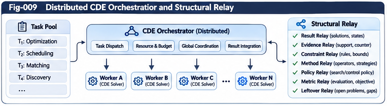

# CASE-005 — Distributed CDE and Method Relay

**Project:** Constrained Delta Evolution (CDE)  
**Series:** Cases / Research and Validation Designs  
**Status:** Proposed reference case, v1.0.0 draft  
**Date:** 2026-11-04  
**Authors:** Sizhe Tan and GPT-Obot  
**License:** Apache-2.0  
**Suggested repository path:** `docs/cases/CASE-005-Distributed-CDE-and-Method-Relay.md`  
**Related foundations:** CDE-001–012, especially CDE-008–012  
**Related specifications:** SPEC-001–006, especially SPEC-004–006  
**Related cases:** CASE-001–004

## Abstract

This case designs a reproducible laboratory for **Distributed Constrained Delta Evolution (D-CDE)** and **Method Relay**. Multiple workers, agents, and heterogeneous solvers explore versioned subproblems, exchange evidence and methods, reconcile locally generated solutions under global constraints, and selectively reuse learned procedures in subsequent tasks. The laboratory distinguishes parallel execution from distributed correctness, information sharing from validated transfer, and transfer from measured collective learning. It also examines deliberate repeated execution as a form of temporal evidence accumulation.

Five benchmark families connect the preceding CDE cases: multi-scale peak search, school-bus assignment and routing, dynamic structural matching, metric discovery, and cross-task method transfer. Experiments compare independent workers, centralized portfolios, coordinated distributed exploration, and relay-enabled variants under matched evaluation and total-cost budgets. Fault injection tests stale results, duplicate execution, worker failure, incompatible metric versions, globally inconsistent local solutions, misleading methods, and incomplete coverage. Reference task, result, and relay contracts are specified with algorithms, conditional invariants, conformance tests, ablations, and a validation roadmap.

**No experiments have been run for this manuscript.** All expected effects are hypotheses; no speedup, optimality, transfer gain, or recursive improvement is asserted as an observed result.

---



*Figure 9. A logical CDE orchestrator dispatches version-pinned exploration contracts to heterogeneous workers, reconciles global constraints and evidence, and publishes typed Structural Relay artifacts. Shared results and methods require target-side validation before being counted as transferable capabilities.*

---

## 1. Purpose and Position in the CDE Case Series

CASE-001 examines multi-scale exploration. CASE-002 introduces tightly coupled hard constraints and fleet-first optimization. CASE-003 studies uncertain evidence and competing matching hypotheses. CASE-004 makes the metric itself an evolving candidate. CASE-005 integrates their mechanisms into a distributed exploration and learning environment.

The proposed contribution is not a new distributed-computing primitive. It is a **contract-first interface** among stateful search, heterogeneous solvers, independent validation, versioned evidence, typed Relay, and controlled method evolution.

The central question is whether a distributed CDE orchestrator can improve validated outcomes or total exploration efficiency by allocating tasks intelligently and reusing transferable knowledge, **after accounting for coordination, validation, and failure-recovery costs**.

## 2. Research Questions

**RQ-1 — Parallelism:** When does distributing CDE tasks improve wall-clock time, throughput, or feasible best-so-far quality relative to a centralized solver portfolio?

**RQ-2 — Coordination:** Can task partitioning, shared incumbents, and evidence-aware scheduling reduce redundant exploration without invalidating solver guarantees?

**RQ-3 — Global coupling:** How should locally feasible assignments or matching hypotheses be reconciled when they compete for shared resources or violate global constraints?

**RQ-4 — Method Relay:** Which learned methods, operator configurations, search policies, and negative findings transfer to a new task, and how should applicability be tested?

**RQ-5 — Temporal Relay:** Under what conditions is intentional repeated execution useful for uncertainty reduction, robustness testing, or fault tolerance?

**RQ-6 — Collective learning:** How can measured target-task improvement be separated from mere artifact sharing or correlated agent agreement?

**RQ-7 — Recursive evolution:** Can controlled generator and scheduling-policy updates improve held-out outcomes without overfitting benchmark instances or bypassing governance?

**RQ-8 — Fault tolerance:** Which safety and liveness properties survive worker crashes, stale leases, retries, partitions, and partial task completion?

## 3. Falsifiable Hypotheses

- **H1:** For sufficiently expensive, parallelizable evaluations, D-CDE reduces time-to-validated-target relative to a single-worker implementation at comparable total evaluation budgets.
- **H2:** For cheap tasks, orchestration overhead can make D-CDE slower than local execution.
- **H3:** Coverage-aware partitioning reduces redundant evaluations compared with naive independent workers on selected benchmark families.
- **H4:** Sharing a verified incumbent and valid bound certificates can reduce work for compatible exact solver tasks; sharing unverified heuristic bounds may corrupt correctness.
- **H5:** Target-validated Method Relay improves held-out performance on related task distributions more reliably than unconditional method reuse.
- **H6:** Negative transfer occurs when methods are reused across incompatible constraints, metrics, representations, or workload regimes.
- **H7:** Intentional repeated execution increases confidence or resilience when observations are noisy or workers unreliable, but wastes resources for deterministic, cached evaluations without a validation purpose.
- **H8:** Governed recursive policy updates may improve a measured portfolio objective, but no monotonic or open-ended improvement is guaranteed.

## 4. Formal Problem Model

A CDE task is a versioned optimization or exploration problem:

$$
\mathcal P=(S,\Delta,T,C,G,L,M,P,B,\Gamma),
$$

where $S$ is the state space, $\Delta$ typed candidate transitions, $T$ transition semantics, $C$ hard constraints, $G$ Delta generator, $L$ path-memory policy, $M$ evaluation metric, $P$ control policy, $B$ resource budget, and $\Gamma$ provenance/governance context.

A distributed task unit $W_i$ binds a **snapshot** of relevant versions and an exploration scope:

$$
W_i=(id_i,S_i^0,\Delta_i^{scope},C_v,M_v,P_v,B_i,V_i,\Gamma_i,\pi_i).
$$

The orchestrator dispatches units to workers, receives typed results, validates applicability and global compatibility, and records uncompleted regions as Leftovers. The orchestrator may be centralized, hierarchical, or federated; a logical control plane need not be one physical process.

### 4.1 Four separations

1. **Task feasibility** is not **global feasibility**.
2. **Worker completion** is not **exhaustive coverage**.
3. **Best known** is not **proven optimal**.
4. **Shared knowledge** is not **validated collective learning**.

These distinctions are normative throughout the case.

## 5. Actors and Trust Boundaries

| Actor | Responsibility | Explicit non-authority |
|---|---|---|
| Task proposer | Suggest exploration units | Cannot certify feasibility |
| Orchestrator | Schedule, budget, reconcile | Cannot manufacture proof |
| Worker | Execute solver or evaluator | Cannot change pinned task rules |
| Solver adapter | Translate solver-specific claims | Cannot upgrade heuristic claims |
| Constraint validator | Check applicable hard rules | Does not establish optimality |
| Evidence validator | Check provenance and observations | Does not establish transfer utility alone |
| Relay registry | Store typed reusable artifacts | Not automatic decision authority |
| Target adopter | Validate Relay in target context | Cannot inherit source guarantees blindly |
| Governance authority | Authorize policy/metric promotions | Does not replace empirical evidence |
| Auditor | Inspect events and claims | Does not imply complete visibility |

A single implementation may combine several logical actors, but their authorities and evidence contracts must remain distinguishable.

## 6. Task Identity, Snapshots, and Version Coherence

Every task MUST bind immutable or content-addressed references to the relevant state, constraint bundle, metric, policy, generator, and validator versions. Revisions to these components require a new task context or an explicitly authorized migration.

```yaml
work_unit:
  task_id: "d-cde-task-0017"
  task_schema: "cde-distributed-work-unit@1.0.0"
  parent_task_id: "d-cde-root-0001"
  lineage_ref: "lineage-0017"
  initial_state_ref: "state-0042@r9"
  delta_scope_ref: "scope-partition-07"
  constraint_bundle_id: "constraints-v3"
  metric_version: "metric-v2"
  policy_version: "policy-v5"
  generator_manifest_ref: "generator-v4"
  solver_profile: "heuristic-or-exact-declared"
  validation_contract_ref: "validator-v3"
  budget:
    objective_evaluations: 250
    wall_time_seconds: 900
  governance_ref: "authorization-v2"
  idempotency_key: "task-0017-context-v3"
  provenance_ref: "proposal-event-0017"
```

An idempotency key identifies the intended effect within a specified context. It does not prove that an external side effect is intrinsically reversible or exactly once.

## 7. Work Unit Lifecycle

The logical lifecycle is:

```text
PROPOSED -> VALIDATED -> QUEUED -> ASSIGNED -> RUNNING
                                  |           |
                                  v           v
                               EXPIRED     CHECKPOINTED
                                  |           |
                                  +----> RETRY_QUEUED
                                              |
RUNNING -> COMPLETED / FAILED / CANCELLED / EXPIRED
COMPLETED -> RESULT_VALIDATED -> RECONCILED -> ARCHIVED
```

Transitions MUST be event-recorded. A worker's `COMPLETED` message does not authorize `RESULT_VALIDATED` or `RECONCILED` without checks. A cancelled or expired task can still return a late result, but the result must be handled under the stale-result policy.

### 7.1 Assignment leases

A lease identifies worker ownership for a bounded interval. Lease epochs or fencing tokens SHOULD prevent an old worker from committing effects after a newer assignment supersedes it. Lease expiry alone does not establish that a remote computation has stopped.

### 7.2 Retries

The design assumes **at-least-once execution is possible**. A retry may recompute an evaluation. The coordinator MUST deduplicate *committed effects* under the declared idempotency contract, while preserving separate attempt and cost records.

### 7.3 Checkpointing

Checkpoints include the frontier, evaluated candidates, local incumbent, constraint/metric versions, random-state information when needed, solver-specific state, and provenance. A checkpoint from an incompatible version cannot be resumed silently.

## 8. Partitioning, Coverage, and Overlap

A parent exploration scope $\Omega$ may be partitioned into child scopes $\Omega_i$. Three distinct claims are possible:

- **Partition:** child scopes are pairwise disjoint and cover the parent scope under a declared equivalence.
- **Cover:** their union covers the parent scope, but overlap is allowed.
- **Sample:** child scopes are selected heuristically; coverage is not guaranteed.

A complete partition requires a checkable relationship:

$$
\bigcup_i\Omega_i=\Omega,
$$

and, for a disjoint partition, $\Omega_i\cap\Omega_j=\varnothing$ for $i\ne j$. These are mathematical obligations, not assumptions inferred from task counts.

### 8.1 Coverage certificates

A partition certificate SHOULD specify its parent scope, child scopes, equivalence relation, generator coverage assumptions, and verification method. If no certificate exists, the orchestrator MUST label coverage as `PARTIAL`, `SAMPLED`, or `UNKNOWN` rather than `EXHAUSTIVE`.

### 8.2 Work stealing

Work stealing can rebalance loads but must transfer or reassign scope ownership without losing Leftovers or double-counting proof coverage. Overlapping speculative work may be permitted, but its cost must be recorded.

### 8.3 Dynamic scope splitting

A worker may propose a finer partition based on observed complexity. A new scope version and parent-child lineage are required. Child tasks must not silently inherit a completeness guarantee from an incomplete generator.

## 9. Local State, Global State, and Reconciliation

A worker's local state may contain a feasible solution to its subproblem. The orchestrator's global state must additionally satisfy shared constraints and compatibility rules.

For a school-bus case, two route workers might each assign the same vehicle at overlapping times. Both routes are locally feasible; their combined fleet schedule is infeasible. For structural matching, two workers may assign the same target node in a one-to-one matching profile. For metric evolution, two worker scores may be incomparable because their metrics differ.

### 9.1 Reconciliation contract

A reconciliation request SHOULD include:

```yaml
reconciliation_request:
  parent_problem_ref: "problem-v3"
  candidate_result_refs: ["result-A", "result-B"]
  global_constraint_bundle_id: "global-C-v3"
  metric_version: "metric-v2"
  conflict_policy_ref: "reconcile-policy-v1"
  independent_validator_ref: "global-validator-v2"
  provenance_ref: "reconcile-event-004"
```

Possible outcomes are `MERGED_VALID`, `CONFLICT`, `NEEDS_REPAIR`, `UNKNOWN`, and `ERROR`. A repair step is a new candidate exploration operation and requires revalidation.

## 10. Solver Claim Taxonomy

Worker reports must preserve the distinctions established in SPEC-004:

| Claim | Meaning | Required discipline |
|---|---|---|
| `CANDIDATE` | Proposed result | No feasibility assumed |
| `FEASIBLE` | Valid under pinned constraints | Independent verification |
| `BEST_KNOWN` | Best observed in declared scope | No global optimality claim |
| `BOUNDED_GAP` | Gap under valid bounds | Bound and metric coherence |
| `OPTIMAL` | Proven optimal for declared problem | Checkable proof or trusted certified solver contract |
| `INFEASIBLE_PROVEN` | Proven no feasible solution in scope | Sound proof and coverage |
| `EXHAUSTIVE` | Declared scope fully searched | Coverage certificate |
| `UNKNOWN` | No justified stronger claim | Preserve uncertainty |

A distributed orchestrator MUST NOT infer global `OPTIMAL` from a collection of local `BEST_KNOWN` results.

## 11. Shared Incumbents and Bound Propagation

A shared incumbent may accelerate search, but updates must satisfy:

1. same problem and constraint context;
2. same objective semantics and metric version;
3. independently validated feasibility;
4. atomic or conflict-safe update;
5. provenance of the candidate and comparison.

For maximization, a feasible incumbent is a lower bound on the optimal objective. An admissible upper bound can justify pruning when it cannot exceed the incumbent. For minimization, orientations reverse. A heuristic estimate is not an admissible bound merely because it predicts performance well.

### 11.1 Stale incumbents

An incumbent from an older metric or constraint version may remain useful as a candidate for re-evaluation, but must not be used as a proof bound until revalidated under the new context.

### 11.2 Concurrency

Compare-and-swap or serialized updates may preserve incumbent consistency. The mechanism does not by itself prove the candidate's validity; validation is a separate prerequisite.

## 12. Distributed Termination Detection

The following states are different:

- `QUIESCENT`: no currently active workers or queued tasks;
- `BUDGET_EXHAUSTED`: no permitted further work under current budget;
- `CANCELLED`: execution stopped by policy;
- `PARTIAL_COMPLETE`: all currently assigned tasks resolved, but Leftovers remain;
- `EXHAUSTIVE_COMPLETE`: all admissible scopes covered under a valid certificate;
- `OPTIMAL_CERTIFIED`: a valid global optimality proof exists.

Quiescence is not completeness. A system can be idle because all workers failed or because an exploration generator omitted an entire region. Termination detection must include in-flight messages, retries, unresolved child scopes, and pending reconciliation.

## 13. Structural Relay: Seven Artifact Families

CDE defines seven typed Relay families:

1. **Result Relay:** validated feasible candidates, solutions, and scoped solver claims.
2. **Evidence Relay:** observations, uncertainty, counterexamples, and proof artifacts.
3. **Constraint Relay:** newly discovered incompatibilities or applicability restrictions.
4. **Method Relay:** reusable procedures, solver configurations, operators, and search tactics.
5. **Policy Relay:** scheduling, budget allocation, and branch-selection strategies.
6. **Metric Relay:** scoring hypotheses and validated metric revisions.
7. **Leftover Relay:** unfinished scopes, deferred hypotheses, unresolved questions, and missing evidence.

A Relay artifact is not automatically a command or a fact valid in every context.

## 14. Canonical Method Relay Contract

```yaml
method_relay:
  relay_id: "method-relay-008"
  artifact_type: "Method"
  method_id: "multiscale-restart-policy"
  method_version: "2.1.0-candidate"
  source_task_ref: "peak-search-family-A"
  method_manifest_ref: "method-manifest-008"
  applicability:
    required_state_schema: "continuous-vector@1"
    required_solver_capabilities: ["bounded-evaluation"]
    compatible_constraint_profiles: ["box", "nonconvex-static"]
    expected_workload: "separated-attraction-basins"
  source_evidence_refs: ["source-validation-008"]
  known_failures:
    - "overhead-on-unimodal-landscapes"
    - "weak-performance-under-very-low-budget"
  uncertainty_ref: "transfer-uncertainty-008"
  source_validation_status: "SOURCE_VALIDATED"
  target_validation_status: "NOT_EVALUATED"
  authorization_scope: "candidate-only"
  provenance_ref: "relay-publication-008"
```

The record is illustrative; no validation report is claimed to exist. A target receiver must check type compatibility, constraints, metric semantics, resource assumptions, and evidence quality before adoption.

## 15. Method Relay Lifecycle

```text
DISCOVERED -> PACKAGED -> SOURCE_CHECKED -> PUBLISHED
                                              |
                                              v
                                         RECEIVED
                                              |
                                              v
                                    APPLICABILITY_CHECK
                                      /       |       \
                                  NO       UNKNOWN     YES
                                  |           |         |
                               REJECT      DEFER   SANDBOX_TEST
                                                     |
                                             TARGET_VALIDATED
                                                     |
                                          GOVERNANCE_REVIEW
                                             /          \
                                          ADOPT        REJECT
                                            |
                                        MONITOR
                                            |
                                       RETAIN/ROLLBACK
```

### 15.1 Applicability is three-valued

`YES`, `NO`, and `UNKNOWN` are distinct. Unknown applicability does not imply safe transfer.

### 15.2 Source and target evidence

A source-task improvement may justify trying a method in a target sandbox. It does not justify deployment or an assumption of improved target utility.

### 15.3 Negative transfer

When a method degrades target performance, record the target context, failure, cost, and revised applicability conditions. Negative transfer is a valuable Relay outcome, not a reason to suppress the artifact.

## 16. Temporal Relay Through Repeated Execution

Repeated execution can be meaningful when it accumulates distinct evidence:

- repeated noisy measurements estimate uncertainty;
- independent solver seeds reveal variance;
- independent validators test reproducibility;
- redundant workers improve resilience to failure;
- repeated execution under new contexts tests transfer stability.

However, repeating a deterministic evaluation under identical immutable inputs may provide no new information. The system must distinguish **purposeful replication** from **unintended duplicate work**.

A temporal Relay record SHOULD include the repetition objective, independence assumptions, sample/seed identities, outcome variance, incremental evidence, and total cost. Repetition does not automatically count as learning.

## 17. Collective Learning: Operational Definition

For this case, *collective learning* means that reusable knowledge from one or more source explorations produces **measurable, independently validated benefit** on held-out target tasks, relative to a suitable no-transfer or naive-transfer baseline.

Possible benefits include improved feasible best-so-far objective, lower evaluation cost, faster target discovery, higher calibrated matching accuracy, or fewer invalid metric promotions. The selected measure must be preregistered.

$$
\Delta_{\mathrm{relay}}=
U_{\mathrm{target}}(\text{validated relay})-
U_{\mathrm{target}}(\text{no relay}).
$$

A positive estimate with uncertainty and scope restrictions supports a conditional benefit. Shared files, agent agreement, and a higher internal score alone do not establish collective learning.

## 18. Multi-Agent Roles and Competition

Logical agents may specialize as:

- **Exploration Agent:** proposes candidate scopes and Deltas;
- **Solver Agent:** executes a declared solver;
- **Constraint Agent:** validates hard rules;
- **Counterexample Agent:** challenges optimistic claims;
- **Evidence Agent:** checks uncertainty and provenance;
- **Method Agent:** packages reusable tactics;
- **Relay Receiver:** tests target applicability;
- **Strategy Agent:** proposes portfolio changes;
- **Independent Evaluator:** measures target outcomes;
- **Governance Agent:** enforces authorization boundaries.

These are roles, not an assertion that ten separate models are necessary. Correlated agents may repeat the same mistakes; a vote among them is not independent corroboration.

## 19. Benchmark Family A — Distributed Multi-Scale Peak Search

Use CASE-001's multi-peak landscape families, including separated basins, infeasible islands, noisy objectives, and misleading directional fields.

**Partitioning variants:** spatial tiles, random independent restarts, adaptive basin splitting, and shared frontier allocation.

**Methods compared:** single-worker local search, centralized multi-start, naive independent workers, coordinated D-CDE, D-CDE with Method Relay, and D-CDE with intentionally misleading Relay.

**Primary questions:** time-to-target, duplicate evaluations, spatial coverage, feasibility yield, coordination overhead, and transfer across related landscapes.

A geometric partition is not necessarily a partition of all reachable trajectories when a generator permits long-range jumps. The coverage contract must specify whether the scope covers candidate endpoints, initial states, or complete paths.

## 20. Benchmark Family B — Distributed School-Bus Optimization

Use CASE-002's fleet-first assignment and routing design. Partition by school, geographic cluster, time window, trip bundle, or solver neighborhood.

**Global coupling stressors:** shared vehicles, overlapping trips, capacity, driver constraints, student ride-time limits, and arrival deadlines.

**Counterexample:** Worker A schedules vehicle V for a trip from 07:30–08:10; Worker B schedules the same vehicle for an overlapping trip from 07:55–08:25. Both local schedules may satisfy their local constraints; the global schedule does not.

The reconciler must reject or repair the conflict, not simply concatenate worker results. A repaired schedule is a new candidate and requires full validation.

**Primary outcomes:** physical fleet count, ride-time distribution, global feasibility, solve time, reconciliation overhead, and gap claims where supported by exact solvers.

## 21. Benchmark Family C — Distributed Structural Matching

Use CASE-003's synthetic graph alignment benchmark. Workers explore graph regions or candidate matching hypotheses. Agents exchange relational evidence and counterexamples.

**Global coupling stressors:** one-to-one cardinality, shared target nodes, inconsistent graph-role mappings, duplicated evidence, and competing identity hypotheses.

**Primary outcomes:** held-out precision/recall/F1, calibration, abstention, globally consistent match sets, false-positive rates, and provenance completeness.

A high structural similarity score is not proof of real-world identity or attribution. The benchmark should use synthetic or appropriately authorized data and preserve explicit `UNKNOWN` outcomes.

## 22. Benchmark Family D — Distributed Metric Discovery

Use CASE-004's Metric Delta and independent-validation laboratory. Workers test different candidate metrics, feature sets, aggregation rules, and validation hypotheses.

**Critical controls:** sealed validation data, metric-version coherence, multiple-testing bias, evaluator independence, and governance-separated promotion.

**Primary outcomes:** held-out decision utility, false promotion rate, distribution-shift robustness, total validation cost, and rollback effectiveness.

Distributed access to hidden validation labels can compromise independence. An evaluation service may return restricted aggregate outcomes without disclosing sealed data to candidate-generating workers.

## 23. Benchmark Family E — Cross-Task Method Relay

Create task families with controlled similarity and shift:

- **E1:** same task family, new random seed;
- **E2:** same representation, altered constraints;
- **E3:** same objective, different state representation;
- **E4:** different objective metric;
- **E5:** different domain but shared operator pattern;
- **E6:** deliberately incompatible target;
- **E7:** source with misleading or corrupted evidence;
- **E8:** target with insufficient validation budget.

A source method might be a multi-scale restart schedule, large-neighborhood destroy/repair operator, counterexample search policy, or metric-validation protocol. Target adoption requires independent measurement under the target contract.

### 23.1 Leakage prevention

Do not use held-out target labels or results to choose which source methods to publish or tune, except through a separately budgeted development process. Reserve a final sealed test for claims.

### 23.2 Method provenance

Record method origin, source tasks, validation conditions, failures, code/configuration version, and any licensing or access constraints.

## 24. Experimental Arms

| Arm | Configuration | What it isolates |
|---|---|---|
| B0 | Strong centralized solver portfolio | Single-control baseline |
| B1 | Naive independent workers | Parallelism without coordination |
| B2 | Distributed workers with static partition | Partitioning value |
| B3 | Distributed workers with shared validated incumbent | Information sharing |
| B4 | Distributed adaptive task scheduler | Scheduling value |
| C1 | D-CDE with contract validation | Orchestration semantics |
| C2 | C1 + evidence and Result Relay | Evidence reuse |
| C3 | C2 + target-validated Method Relay | Method transfer |
| C4 | C3 + purposeful temporal Relay | Repeated evidence value |
| C5 | C3 + governed recursive policy update | Controlled evolution |
| N1 | C3 + unvalidated or misleading Relay | Negative transfer control |
| N2 | C3 + stale/incompatible context | Version-safety control |

Strong established distributed optimization, parallel search, and portfolio methods should be included where available. CDE must not be compared only with intentionally weak baselines.

## 25. Fairness and Cost Accounting

Compare at least two budget views:

1. **Equal objective-evaluation budget**, to measure search quality per expensive evaluation.
2. **Equal total compute or wall-clock budget**, to measure practical efficiency after orchestration costs.

Also report number of workers, CPU/GPU allocation, communication volume, task scheduling time, constraint checks, validator calls, duplicated work, failed attempts, and checkpoint overhead. A method can improve wall time by using more hardware without improving total resource efficiency.

### 25.1 Initialization and tuning

Account for model loading, worker startup, source-method training, and policy tuning. Report when costs are amortized over many tasks versus paid by a single target task.

### 25.2 Stragglers

Measure tail latency and worker imbalance, not only mean task duration. Work stealing may help on heterogeneous workloads and harm on small tasks.

## 26. Primary Metrics

**Validated feasible objective:** best independently verified objective under a pinned metric and constraint bundle.

**Time to target:** wall time or evaluation count to first validated threshold crossing; right-censor failures.

**Parallel speedup:**

$$
S_p=T_1/T_p,
$$

where hardware, workload, and measurement scope must be declared. Speedup is not automatically work efficiency.

**Work efficiency:**

$$
E_p=T_1/(pT_p),
$$

under a comparable $p$-worker resource model.

**Redundancy rate:** fraction of evaluations duplicated under the declared equivalence/context key; purposeful replication is reported separately.

**Global reconciliation yield:** fraction of locally feasible candidate combinations that become globally feasible after validation or repair.

**Relay uplift:** paired target-task utility difference between validated transfer and no-transfer arms, with uncertainty intervals.

**Negative transfer frequency:** fraction of target contexts where transfer causes a preregistered material regression.

**Fault recovery:** time and work required to resume after injected failures, with correctness checks.

**Coverage:** certified fraction of declared finite scopes where measurable; otherwise use explicitly labeled empirical coverage indicators.

## 27. Statistical Design

Use disjoint training, development, and held-out task families. Pair benchmark instances across methods when possible. Randomize seeds and worker assignment; run multiple independent repetitions and report confidence intervals over independent task/seed units.

A starting design might use 30 independent runs per method–task condition, followed by a power analysis based on observed variance. Do not treat worker subtasks from the same parent task as independent samples.

Pre-register primary contrasts (for example C3 versus C1 and C3 versus B4), budgets, success thresholds, failure-injection rates, and exclusion rules. Report effect sizes, uncertainty, and negative findings. For time-to-target, account for censored runs.

## 28. Reference Algorithm — Distributed Orchestrator

```text
function DISTRIBUTED_CDE(root_problem, configuration):
    root = validate_and_pin_problem_versions(root_problem)
    frontier = create_initial_work_units(root)
    registry = initialize_event_and_relay_registries()
    incumbent = NO_FEASIBLE_INCUMBENT

    while not declared_stopping_condition():
        for work in eligible_queued_units(frontier):
            if not budget_and_authorization_pass(work):
                record_deferred_or_rejected(work)
                continue
            worker = select_compatible_worker(work, configuration)
            lease = issue_fenced_assignment(work, worker)
            record_assignment(work, lease)

        for event in receive_worker_events():
            record_immutable_event(event)
            if event.type == CHECKPOINT:
                validate_and_store_checkpoint(event)
            if event.type == RESULT:
                if not lease_epoch_and_context_valid(event):
                    mark_stale_and_preserve_evidence(event)
                    continue
                report = independently_validate_result(event)
                if report.status != PASS:
                    preserve_failure_or_unknown(report)
                    continue
                reconciled = reconcile_global_constraints(report, root)
                if reconciled.status == MERGED_VALID:
                    commit_idempotent_result(reconciled)
                    incumbent = update_compatible_incumbent(incumbent)
                else:
                    publish_conflict_or_repair_leftover(reconciled)
            if event.type == WORKER_FAILURE:
                checkpoint_or_requeue_with_new_epoch(event)

        for relay in newly_received_relay_artifacts():
            if applicability(relay, root) == YES:
                schedule_target_validation(relay)
            else:
                preserve_rejected_or_unknown_applicability(relay)

        update_frontier_and_coverage_ledger()
        if certified_global_termination():
            break

    return audited_report(
        incumbent, coverage_ledger(), leftovers(),
        relay_outcomes(), costs(), termination_claim()
    )
```

This pseudocode is a control-flow reference, not a complete distributed implementation. A production system must handle atomicity, durable queues, concurrent result races, network partitions, and external side-effect semantics explicitly.

## 29. Reference Algorithm — Method Relay Acceptance

```text
function EVALUATE_METHOD_RELAY(relay, target, budget):
    verify_schema_signature_and_provenance(relay)
    if not authorized_to_consume(relay, target):
        return REJECTED_AUTHORIZATION

    status = check_applicability(
        relay.applicability, target.schema,
        target.constraints, target.metric, target.resources
    )
    if status == NO:
        return REJECTED_INCOMPATIBLE
    if status == UNKNOWN:
        return DEFERRED_NEEDS_EVIDENCE

    baseline = run_target_baseline(target, paired_budget=budget)
    candidate = run_target_sandbox(
        target, method=relay.method, paired_budget=budget
    )
    evidence = independent_target_evaluation(baseline, candidate)
    record_negative_and_positive_evidence(evidence)

    if evidence.meets_preregistered_promotion_gate:
        return REQUEST_AUTHORIZED_LIMITED_ADOPTION
    return REJECTED_OR_DEFERRED_WITH_LEFTOVER
```

A source-method's performance report is not a substitute for the target experiment. The same method may help on one target family and harm on another.

## 30. Reference Algorithm — Safe Result Reconciliation

```text
function RECONCILE_RESULTS(results, parent_problem):
    for result in results:
        if result.constraint_version != parent_problem.constraint_version:
            return STALE_CONTEXT
        if result.metric_version != parent_problem.metric_version:
            return INCOMPARABLE_METRIC
        if not independently_verified(result):
            return UNVERIFIED_RESULT

    merged = compose_candidates_under_declared_merge_operator(results)
    validation = check_all_global_constraints(merged, parent_problem)

    if validation == PASS:
        return MERGED_VALID(merged, validation.provenance)
    if validation == FAIL:
        return CONFLICT_WITH_COUNTEREXAMPLE(validation)
    return NEEDS_EVIDENCE_OR_ERROR(validation)
```

This algorithm deliberately does not assume that a merge operator exists for every task. When there is no sound composition rule, the result must remain unmerged.

## 31. Worked Example A — Parallel Peak Search

Four workers explore four disjoint initial spatial tiles. A long-range Delta from one worker proposes a candidate in another worker's tile. If the partition defines **candidate endpoints**, ownership must be reassigned or overlap recorded. If the partition defines only **starting points**, the long-range proposal may remain within the originating task's semantics. The distinction affects duplicate accounting and coverage claims.

A worker discovers a high-value feasible point and publishes a validated incumbent. Other workers may adjust their search priorities, but they cannot safely prune regions without a valid upper bound. Sharing a high score is not a proof that unexplored regions are inferior.

## 32. Worked Example B — Conflicting School-Bus Plans

Worker A proposes a feasible morning route block requiring vehicles V1–V5. Worker B proposes a feasible route block requiring V4–V7. The blocks overlap in time, and V4/V5 are double-booked. A naive union is infeasible.

The orchestrator detects the conflict and creates a repair task with a new Delta scope: reassign one block, adjust trip order, or add a vehicle. The repaired candidate is independently checked for capacity, time windows, fleet count, and ride-time limits. The local workers' results remain useful evidence even though their initial combination failed.

## 33. Worked Example C — Competing Structural Matches

Two matching workers each propose a high-scoring correspondence for the same target node in a one-to-one profile. A constraint validator rejects the joint assignment. A counterexample agent investigates relational consistency and publishes evidence. The orchestrator preserves both alternatives and the conflict, rather than treating the highest local score as an automatic winner.

The case uses synthetic graph data. It does not infer real-world personal identity from technical similarities.

## 34. Worked Example D — Metric Relay Under Drift

A metric developed for one allocation dataset is transferred to a target dataset with different feature semantics. The target receiver detects a schema mismatch and returns `UNKNOWN` or `NO` applicability. If a validated mapping exists, the candidate can be tested in a sandbox; otherwise it must not be activated.

An improved score under the source metric is not evidence of improved target decision utility. The target uses independent outcome evaluation and a separate promotion authority.

## 35. Worked Example E — Negative Method Transfer

A source peak-search task shows that frequent global restarts help when peaks are well separated. The method is relayed to a smooth unimodal target. The target's held-out tests find that restart overhead worsens performance relative to local search.

The appropriate output is a **negative-transfer evidence artifact** and a refined applicability condition, not deletion of the source method or a claim that the method never works.

## 36. Worked Example F — Temporal Relay

A noisy evaluator returns measurements $y_i=f(x)+\epsilon_i$. Multiple independently seeded observations at the same point can reduce uncertainty about $f(x)$ under suitable noise assumptions. A repeated evaluation record must preserve the seed, evaluator version, dependence assumptions, cost, and incremental uncertainty reduction.

If the noise is strongly correlated, repeated samples may add much less information than assumed. For a deterministic cached evaluation, identical repetition may be unnecessary except to test reproducibility or worker integrity.

## 37. Worked Example G — Failure and Recovery

Worker W1 receives task T with lease epoch 4 and begins evaluating candidates. The coordinator loses contact, expires the lease, and reassigns T to W2 under epoch 5. W1 later returns a result from epoch 4. The coordinator records the late result as evidence but MUST NOT blindly commit it under the new ownership epoch.

Depending on the task contract, the result may be independently revalidated and incorporated as a new proposal. Attempt costs from both workers remain visible. This demonstrates at-least-once execution with idempotent commits, not exactly-once physical computation.

## 38. Negative Controls

1. **NC-01 — Cheap deterministic tasks:** Distributed overhead dominates.
2. **NC-02 — No transferable structure:** Relay provides no benefit.
3. **NC-03 — Deliberately misleading method:** Negative transfer is measured.
4. **NC-04 — Incompatible metric versions:** Scores cannot be merged.
5. **NC-05 — Invalid global composition:** Locally feasible solutions conflict.
6. **NC-06 — Duplicate retries:** Work may repeat but commits remain idempotent.
7. **NC-07 — Expired lease:** Late worker result cannot bypass fencing.
8. **NC-08 — Missing coverage:** Quiescence is not exhaustive completion.
9. **NC-09 — Invalid bound:** Heuristic estimates cannot certify pruning.
10. **NC-10 — Correlated agent consensus:** Agreement is not independent proof.
11. **NC-11 — Hidden validation leakage:** Target-test contamination is flagged.
12. **NC-12 — Relay without target validation:** No promotion permitted.
13. **NC-13 — Unbounded coordination:** Excessive orchestration cost reported.
14. **NC-14 — Faulty checkpoint:** Incompatible recovery rejected.
15. **NC-15 — Incomplete Leftover registry:** Termination claim fails.
16. **NC-16 — Overfit policy update:** Held-out regression triggers rejection or rollback.

## 39. Ablation Plan

| Ablation | Removed feature | Intended inference |
|---|---|---|
| A1 | Distributed workers | Benefit of parallelism |
| A2 | Adaptive partitioning | Value of dynamic scopes |
| A3 | Work stealing | Load-balancing value |
| A4 | Shared incumbent | Information-sharing value |
| A5 | Independent verification | Cost and risk of unverified results |
| A6 | Global reconciliation | Impact of coupled constraints |
| A7 | Method Relay | Target transfer contribution |
| A8 | Negative-evidence Relay | Counterexample reuse |
| A9 | Leftover Relay | Completeness and continuation |
| A10 | Temporal repetition | Uncertainty and robustness benefit |
| A11 | Applicability checking | Negative-transfer prevention |
| A12 | Target validation | Promotion integrity |
| A13 | Version fencing | Stale-result protection |
| A14 | Checkpoint/retry | Failure recovery |
| A15 | Adaptive scheduler | Policy learning value |
| A16 | Governed recursive update | Meta-evolution contribution |
| A17 | Total-cost accounting | Hidden overhead sensitivity |
| A18 | Coverage certificate | Claim integrity |

Ablations must preserve a meaningful budget comparison and disclose where removing a feature reallocates resources.

## 40. Conformance Test Matrix

| ID | Test | Expected outcome |
|---|---|---|
| DCR-001 | Valid work-unit schema | Accepted |
| DCR-002 | Missing task ID | Rejected |
| DCR-003 | Missing constraint version | Rejected |
| DCR-004 | Missing metric version | Rejected |
| DCR-005 | Unsupported worker capability | Not assigned |
| DCR-006 | Unauthorized task | Blocked |
| DCR-007 | Duplicate task proposal | Distinct attempts, controlled effects |
| DCR-008 | Lease epoch superseded | Old commit fenced |
| DCR-009 | Worker timeout | Retry or typed failure |
| DCR-010 | Late worker result | Stale policy applied |
| DCR-011 | Retry after checkpoint | Compatible state restored |
| DCR-012 | Incompatible checkpoint | Rejected |
| DCR-013 | Partial child coverage | No exhaustive claim |
| DCR-014 | Complete certified partition | Coverage accepted |
| DCR-015 | Overlapping partitions | Overlap accounted |
| DCR-016 | Work stealing | Ownership lineage preserved |
| DCR-017 | Local feasibility only | No global commit |
| DCR-018 | Global conflict | Conflict evidence recorded |
| DCR-019 | Repaired merge | Revalidated |
| DCR-020 | Metric mismatch | Incomparable result |
| DCR-021 | Constraint mismatch | Stale result |
| DCR-022 | Heuristic bound | Cannot certify pruning |
| DCR-023 | Valid bound certificate | Scoped proof accepted |
| DCR-024 | Feasible incumbent | Independent validation |
| DCR-025 | Conflicting incumbent updates | Atomic/coherent result |
| DCR-026 | Idle workers with Leftovers | Not exhaustive |
| DCR-027 | In-flight result at shutdown | Termination delayed or scoped |
| DCR-028 | Budget exhausted | Typed termination |
| DCR-029 | Solver claims OPTIMAL without proof | Rejected |
| DCR-030 | Relay artifact missing provenance | Rejected |
| DCR-031 | Method schema mismatch | Applicability NO/UNKNOWN |
| DCR-032 | Source-only validation | No target promotion |
| DCR-033 | Target sandbox improvement | Governance still required |
| DCR-034 | Negative transfer | Recorded, not hidden |
| DCR-035 | Leftover scope | Preserved and addressable |
| DCR-036 | Duplicate evidence sources | Dependencies recorded |
| DCR-037 | Repeated noisy evaluation | Separate samples and costs |
| DCR-038 | Repeated deterministic evaluation | Purpose and cache recorded |
| DCR-039 | Counterexample Relay | Scoped applicability |
| DCR-040 | Method version changed | New validation context |
| DCR-041 | Policy meta-Delta | Independent promotion gate |
| DCR-042 | Unauthorized policy activation | Blocked |
| DCR-043 | Regression after promotion | Monitoring/rollback |
| DCR-044 | Hidden target oracle requested | Access denied |
| DCR-045 | Synthetic identity inference | No unsupported attribution |
| DCR-046 | Metric candidate self-scores | No proof of improvement |
| DCR-047 | Global resource overcommit | Detected |
| DCR-048 | Fault-injected worker crash | Recovery audited |
| DCR-049 | Network partition | Lease/consistency policy followed |
| DCR-050 | Result signature invalid | Rejected/quarantined |
| DCR-051 | Task cancellation | Late events scoped |
| DCR-052 | Partial result | Typed status and Leftover |
| DCR-053 | Mixed solver guarantees | Claims preserved |
| DCR-054 | Cost ledger incomplete | Conformance failure |
| DCR-055 | Benchmark leakage | Flagged |
| DCR-056 | Negative control omitted | Experimental protocol failure |
| DCR-057 | No experiments executed | No performance claim |
| DCR-058 | Unsupported global optimality | Rejected |
| DCR-059 | Relay adoption without authority | Blocked |
| DCR-060 | End-to-end provenance | Auditable chain |

These 60 tests are proposed conformance cases, not executed results.

## 41. Formal Invariants

**INV-01 — Context coherence:** Every committed result is validated under a declared coherent context.

**INV-02 — Constraint supremacy:** No worker score or Relay artifact overrides a hard constraint.

**INV-03 — Fenced ownership:** Superseded leases cannot directly authorize commits.

**INV-04 — Idempotent effects:** Repeated attempts do not create duplicate committed effects within the declared key scope.

**INV-05 — Attempt visibility:** Deduplication does not erase actual attempts or resource costs.

**INV-06 — Local/global separation:** Local feasibility does not imply global feasibility.

**INV-07 — Claim preservation:** A heuristic result is not upgraded to an exact guarantee by orchestration.

**INV-08 — Coverage fidelity:** `EXHAUSTIVE` requires a valid coverage claim.

**INV-09 — Termination fidelity:** Quiescence and budget exhaustion are not called proof of completeness.

**INV-10 — Metric comparability:** Incompatible objective versions are not directly compared.

**INV-11 — Provenance:** All committed results and promoted Relay artifacts retain causal lineage.

**INV-12 — Relay applicability:** Target adoption requires applicability assessment.

**INV-13 — Independent validation:** Source evidence alone does not authorize target promotion.

**INV-14 — Leftover preservation:** Unresolved work is not silently declared completed.

**INV-15 — Governance:** Generator and policy changes cannot bypass authorization.

**INV-16 — No false generalization:** Collective learning claims require independent target evidence.

**INV-17 — Privacy:** Sharing follows declared authorization and data-minimization contracts.

**INV-18 — No universal guarantee:** Conformance does not imply optimality, efficiency, or monotonic RSI.

## 42. Conditional Correctness Arguments

### 42.1 Global feasibility preservation

If each globally committed candidate is independently checked against the complete, correctly specified global hard-constraint bundle under coherent versions, then every committed global candidate satisfies those encoded constraints. The proof is inductive over commits. This does not prove the constraint model captures all real-world requirements.

### 42.2 Idempotent commit safety

If every effect uses a stable idempotency key and the commit store atomically rejects duplicate keys within the intended context, at-least-once worker attempts need not produce duplicate committed effects. This does **not** establish exactly-once computation or exactly-once external side effects.

### 42.3 Certified distributed completeness

If child scopes form a verified cover of the parent scope, each child search is complete under a sound generator and termination contract, and all child results and in-flight work are accounted for, the union can support a scoped completeness claim. If any premise fails, completeness does not follow.

### 42.4 Safe bound sharing

If shared bounds are valid for the same objective, constraint bundle, and search scope, and bound comparisons use the correct minimization/maximization orientation, a compatible solver may use them for safe pruning. Learned estimates without admissibility evidence do not qualify.

### 42.5 Transfer validation

A target experiment can support a conditional transfer benefit when the comparison is independent, adequately powered, and appropriately budget matched. It cannot prove universal cross-domain transfer.

## 43. Fault-Injection Campaign

| Fault | Injection | Required observation |
|---|---|---|
| Worker crash | Kill after partial evaluation | Checkpoint/Leftover recovery |
| Lease expiry | Delay old worker | Fencing of stale commit |
| Duplicate message | Replay result | Idempotent commit |
| Network partition | Disconnect worker/coordinator | Explicit consistency policy |
| Stale metric | Return old-version score | Re-evaluation or rejection |
| Stale constraint | Return obsolete feasible claim | Global revalidation |
| Corrupt evidence | Modify result payload | Integrity failure |
| Lost child task | Omit partition | No completeness claim |
| Global conflict | Double-allocate resource | Conflict/repair path |
| Relay mismatch | Apply wrong schema | Applicability failure |
| Validator outage | Return UNKNOWN/ERROR | No silent acceptance |
| Budget overrun | Excess evaluations | Stop and audit |
| Misleading method | Wrong transfer context | Negative transfer detection |
| Promotion bypass | Unauthorized policy activation | Governance block |

Fault-injection tests should verify both safety and recovery cost. Liveness claims require explicit fairness and availability assumptions.

## 44. Security, Privacy, and Data Governance

Workers may be untrusted or partially trusted. The orchestrator SHOULD use authenticated task identities, least-privilege capabilities, integrity checks, resource limits, and immutable audit records. External code or Relay payloads should be sandboxed before execution.

Relay may carry sensitive source data or reveal private structures through metadata. Apply minimization, access controls, retention policies, and purpose limitations. A method can often be transferred without transferring raw records.

In structural matching or attribution-related tasks, technical overlap is not proof of common real-world identity. Synthetic or explicitly authorized evaluation data should be the default; consequential claims require independent corroboration and governance.

## 45. Reproducibility Package

A future executable companion SHOULD have the following structure:

```text
case-005-distributed-cde/
├── README.md
├── contracts/
│   ├── work-unit.schema.json
│   ├── worker-result.schema.json
│   ├── reconciliation.schema.json
│   ├── relay-artifact.schema.json
│   └── promotion-record.schema.json
├── orchestrator/
│   ├── dispatcher.py
│   ├── leases.py
│   ├── coverage.py
│   ├── reconciler.py
│   └── termination.py
├── workers/
│   ├── peak_search.py
│   ├── school_bus.py
│   ├── structural_matching.py
│   └── metric_evaluation.py
├── relay/
│   ├── registry.py
│   ├── applicability.py
│   ├── target_validation.py
│   └── negative_transfer.py
├── benchmarks/
│   ├── task_families.py
│   ├── shift_profiles.py
│   └── fault_injection.py
├── experiments/
│   ├── preregistration.yaml
│   ├── train_manifest.yaml
│   ├── final_test_manifest.yaml
│   └── run.py
├── tests/
│   ├── test_conformance.py
│   ├── test_reconciliation.py
│   ├── test_leases.py
│   ├── test_relay.py
│   └── test_negative_controls.py
└── reports/
    ├── outcomes.csv
    ├── costs.csv
    ├── fault_recovery.csv
    ├── transfer_effects.csv
    └── limitations.md
```

This is a proposed file tree. The implementation and reports are not asserted to exist.

## 46. Run Manifest and Reporting Contract

```yaml
run_id: string
benchmark_family: string
parent_problem_ref: string
constraint_bundle_id: string
metric_version: string
policy_version: string
generator_manifest_ref: string
solver_portfolio_ref: string
worker_count: integer
work_units_proposed: integer
work_units_completed: integer
work_units_failed: integer
work_units_retried: integer
work_units_leftover: integer
coverage_status: PARTIAL | SAMPLED | EXHAUSTIVE | UNKNOWN
objective_evaluations: integer
constraint_checks: integer
validated_feasible_incumbent: number_or_null
solver_claim_type: string
total_wall_time_seconds: number
total_compute_cost: number
communication_bytes: integer
reconciliation_conflicts: integer
relay_artifacts_received: integer
relay_artifacts_target_validated: integer
negative_transfer_events: integer
fault_injections: integer
recovery_cost: number
termination_reason: string
conformance_status: string
provenance_ref: string
```

Missing or undefined measurements must remain explicit. The schema must not fill absent values with invented zeros.

## 47. Validation Roadmap

**V1 — Static contracts:** Review work units, results, leases, Relay, coverage, and reconciliation schemas.

**V2 — Single-worker equivalence:** Confirm that distributed wrappers preserve the underlying solver's feasibility and claim semantics.

**V3 — Multi-worker correctness:** Exercise task dispatch, version pinning, idempotency, and global reconciliation.

**V4 — Coverage and termination:** Test partial scopes, complete partitions, lost work, and in-flight messages.

**V5 — Benchmark families:** Run peak search, school-bus, structural matching, and metric-discovery profiles.

**V6 — Cost comparisons:** Measure wall time, total compute, duplicate work, and coordination overhead.

**V7 — Relay transfer:** Test source-to-target applicability, positive transfer, and negative transfer.

**V8 — Temporal Relay:** Evaluate purposeful repeated execution under noise and failure.

**V9 — Fault injection:** Test crashes, stale leases, incompatible versions, and corrupted evidence.

**V10 — Recursive evolution:** Evaluate candidate scheduler/generator updates using sealed held-out tasks and promotion gates.

**V11 — External replication:** Publish manifests, implementations, negative results, uncertainty intervals, and limitations.

A phase MUST NOT be marked complete without corresponding evidence.

## 48. Generalization and Guarantee Boundaries

D-CDE can represent many distributed search workflows, but representability does not guarantee that a task can be decomposed efficiently. Global coupling may eliminate parallel gains. Search spaces may be infinite, generators incomplete, and objectives nonstationary. Relay may be invalid outside its source assumptions. Recursive updates may regress.

The appropriate hierarchy is:

$$
\boxed{
\text{Distributed Execution}
\neq\text{Coherent Coordination}
\neq\text{Certified Search}
\neq\text{Validated Transfer}
\neq\text{Collective Learning}
}
$$

No general convergence, universal speedup, global optimality, or open-ended RSI guarantee follows from the framework alone.

## 49. Open Research Questions

1. Which Delta scopes permit sound, low-overlap distributed partitioning?
2. How should partition ownership interact with long-range Deltas?
3. Can a scheduler predict task difficulty without introducing selection bias?
4. When does work stealing outweigh coordination cost?
5. What is the minimum evidence needed to share an incumbent safely?
6. Can proof-carrying solver reports make heterogeneous orchestration more reliable?
7. How can globally coupled school-bus subproblems be reconciled efficiently?
8. How should distributed matching preserve competing hypotheses and abstention?
9. Can metric candidates be evaluated without leaking sealed validation data?
10. What is a robust operational definition of method applicability?
11. Which method features generalize across state representations?
12. How can negative-transfer evidence improve future Relay selection?
13. When is deliberate redundant execution information-efficient?
14. How should temporal Relay quantify independence among repeated observations?
15. What termination protocols are appropriate under dynamic task generation?
16. How should Leftovers be ranked and resumed across projects?
17. Can federated control planes preserve auditability without centralized authority?
18. How can privacy-preserving Relay retain useful structural information?
19. What is the appropriate governance for recursive scheduler evolution?
20. Which gains remain after comparison with mature parallel search and distributed optimization systems?
21. How should source and target metric versions be reconciled for transfer studies?
22. Can counterexample Relay reduce the cost of future constraint validation?
23. How can the framework distinguish beneficial collective learning from correlated overfitting?
24. Which mechanisms remain useful when network and orchestration costs dominate?

## 50. Conclusion

CASE-005 closes the initial CDE case series by integrating **distributed exploration, global reconciliation, typed Structural Relay, and independently validated method transfer**. The proposed system does not merely execute many solvers in parallel. It specifies what each worker is allowed to claim, how partial results are reconciled, how unfinished work is preserved, and when transferred knowledge can influence a target task.

The principal research cycle is:

$$
\boxed{
\begin{gathered}
\text{Partition and Dispatch Versioned Delta Tasks}\\
\downarrow\\
\text{Explore with Heterogeneous Workers and Solvers}\\
\downarrow\\
\text{Validate, Reconcile, and Preserve Leftovers}\\
\downarrow\\
\text{Relay Results, Evidence, Methods, and Failures}\\
\downarrow\\
\text{Test Applicability and Target Benefit}\\
\downarrow\\
\text{Authorize, Monitor, or Reject Learning Updates}
\end{gathered}}
$$

The scientific test is whether these contracts produce **reproducible improvements in validated target outcomes and total cost**, relative to strong distributed baselines. A successful prototype would demonstrate an operational research direction, not a universal algorithmic superiority theorem.

---

## Appendix A — Example Worker Result

```yaml
worker_result:
  task_id: "d-cde-task-0017"
  assignment_epoch: 3
  worker_id: "worker-04"
  attempt_id: "attempt-0017-03"
  status: "COMPLETED"
  claim_type: "BEST_KNOWN"
  candidate_result_ref: "candidate-0081"
  constraint_bundle_id: "constraints-v3"
  metric_version: "metric-v2"
  validation_evidence_refs: ["worker-evidence-0081"]
  coverage_status: "PARTIAL"
  leftover_scope_refs: ["leftover-0082"]
  objective_evaluations_used: 148
  compute_seconds: 92.4
  provenance_ref: "worker-event-0081"
```

The values are illustrative. `COMPLETED` denotes worker execution status, not independent verification or exhaustive global search.

## Appendix B — Relay Outcome Registry

| Outcome | Meaning | Next action |
|---|---|---|
| `SOURCE_VALIDATED` | Evidence supports source task | Check target applicability |
| `TARGET_APPLICABLE` | Contract compatibility established | Run sandbox validation |
| `TARGET_VALIDATED` | Independent target test passed | Request authorization |
| `ADOPTED` | Authorized limited use | Monitor and retain rollback |
| `NEGATIVE_TRANSFER` | Target regression detected | Record counterexample |
| `INCOMPATIBLE` | Target conditions do not match | Reject or transform |
| `UNKNOWN` | Evidence insufficient | Defer and preserve Leftover |
| `REVOKED` | Artifact no longer trusted | Stop use, audit downstream |

## Appendix C — Claims and Evidence Registry

| Claim | Necessary support | Insufficient alone |
|---|---|---|
| Distributed correctness | Conformance and failure tests | Successful happy-path run |
| Global feasibility | Independent global validator | Local feasible reports |
| Exhaustive completion | Coverage and termination certificates | Empty queue |
| Optimality | Valid proof under pinned objective | Best observed result |
| Speedup | Comparable timed runs | More workers |
| Work efficiency | Total compute accounting | Lower wall time |
| Positive transfer | Independent target comparison | Source-task success |
| Collective learning | Repeated held-out target benefit | Shared Relay artifacts |
| Recursive improvement | Governed held-out meta-evaluation | Internal policy score |

## Appendix D — Suggested Figures

Relevant planned CDE figures:

- `Fig-004-Adaptive-M-to-N-Delta-Branching.png`
- `Fig-006-Search-DP-and-Branch-and-Bound-Integration.png`
- `Fig-008-Solution-and-Metric-Co-Evolution.png`
- `Fig-009-Distributed-CDE-Orchestrator-and-Structural-Relay.png`
- `Fig-010-Recursive-Generator-Evolution-and-Collective-Learning.png`

No figures are embedded or claimed to have been generated in this manuscript.

## Appendix E — Research Status and Attribution

This manuscript is a proposed reference case and experimental design. It draws on established work in distributed systems, parallel search, optimization portfolios, constraint programming, task scheduling, proof-carrying computation, transfer learning, multi-agent systems, and reproducible experimentation. The proposed contribution is the explicit integration of CDE's versioned State–Delta–Constraint–Branch semantics with distributed reconciliation, typed Relay, and independent target validation.

**No experimental runs have been conducted for this document.** The examples and schemas are illustrative, and all performance hypotheses remain unverified. Future work should provide implementations, preregistered experiments, independent replication, and appropriate prior-art citations.

**Version:** v1.0.0 draft  
**License:** Apache-2.0
