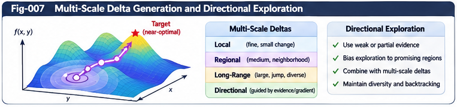

# EXT-001 — Biomimetic and Population-Based CDE

**Project:** Constrained Delta Evolution (CDE)  
**Series:** Extensions / Research Hypotheses and Architecture  
**Status:** v1.0.0 research draft; proposed, not experimentally validated  
**Date:** 2026-11-04  
**Authors:** Sizhe Tan and GPT-Obot  
**License:** Apache-2.0  
**Repository path:** `docs/extensions/EXT-001-Biomimetic-and-Population-Based-CDE.md`  
**Related foundations:** CDE-001–012, especially CDE-003, CDE-006, CDE-008, CDE-009, CDE-010, CDE-011, CDE-012  
**Related specifications:** SPEC-001–006  
**Related cases:** CASE-001–005

## Abstract

This extension develops a **biomimetic and population-based exploration profile** for Constrained Delta Evolution (CDE). The motivating intuition is that effective search may combine local exploitation, regional probing, long-range prospecting, multiple concurrent hypotheses, adaptive diversity, and communication between explorers. Such ideas have deep precedents in evolutionary algorithms, swarm intelligence, island models, and quality-diversity search. CDE's proposed role is not to replace those methods but to provide a shared **State–Delta–Constraint–Branch contract** through which their operators, evidence, solver guarantees, and governance can interoperate.

The paper formalizes individual and population State Containers, typed mutation/recombination/migration Deltas, adaptive M-to-N branching, archive and incumbent semantics, island coordination, directional weak evidence, seven Structural Relay artifact families, and controlled generator/policy evolution. It specifies five benchmark profiles, strong baselines, failure injection, 60 proposed conformance tests, 16 invariants, and a validation roadmap. Biological analogies are treated as design hypotheses rather than proofs. **No experimental performance, convergence, general intelligence, or recursive improvement claim is made.**

**Key thesis:** A population becomes a potentially useful *collective structural search system* only when its proposals, constraints, evidence, transfer conditions, costs, and learning outcomes are explicitly represented and independently validated.

---


*Figure 4. Adaptive Delta branching distinguishes M proposals, Q selected attempts, N realized transition edges, N_c committed edges, and K distinct successor states. Deduplication, invalid attempts, and uncommitted edges prevent these counts from being treated as interchangeable.*

---



*Figure 7. Local, regional, long-range, and Relay-guided Delta generators explore complementary neighborhoods. Directional fields and weak evidence guide proposal ranking while maintaining uncertainty, diversity, counterexample probes, and hard-constraint checks.*

---

## 1. Scope and Research Position

This extension examines how population-based and biologically motivated search mechanisms can be expressed as **typed, constrained Delta exploration** within CDE. The term *biomimetic* identifies a source of hypotheses about exploration, communication, diversity, and adaptation; it does not imply biological fidelity or superiority. Evolutionary algorithms, particle swarms, ant-colony optimization, artificial bee colony methods, novelty search, quality-diversity algorithms, and island models already provide substantial prior art. CDE proposes a common contract for coordinating such methods with explicit state transitions, evidence, governance, and Relay.

The focus is **operator interoperability**, not a new universal metaheuristic. A conforming implementation may use one population algorithm, several heterogeneous algorithms, or no biomimetic operators at all. Claims of improved optimization, generalization, or collective intelligence require independent evaluation.

## 2. Core Research Questions

**RQ1.** Under which landscape and constraint structures do heterogeneous populations outperform single-generator CDE or strong established population baselines at matched cost?

**RQ2.** How should local exploitation, regional migration, long-range prospecting, and directional weak evidence share finite evaluation budgets?

**RQ3.** Can diversity and novelty be retained without sacrificing hard feasibility or permitting unvalidated pruning?

**RQ4.** When do communication, method transfer, and repeated execution yield measurable cross-population learning rather than merely overhead?

**RQ5.** Can population-level generator and policy changes be governed through SPEC-006 without turning selection on training fitness into false evidence of recursive improvement?

**RQ6.** What are the limits of biological analogies when translating continuous motion, stigmergy, and reproduction into discrete or symbolic State Containers?

## 3. Falsifiable Hypotheses

**H1 — Heterogeneous search:** Mixed local/global operator portfolios may discover separated attraction basins more reliably than local-only search, conditional on budget and landscape structure.

**H2 — Diversity cost:** Explicit diversity preservation may reduce premature convergence on deceptive multimodal tasks but worsen convergence on simple unimodal tasks.

**H3 — Relay:** Independently validated operator or region evidence may reduce redundant work across related islands; unvalidated migration may cause negative transfer.

**H4 — Governance:** Version-pinned, independently validated generator promotion may reduce regressions compared with unrestricted online meta-optimization, at additional cost.

**H5 — Negative control:** A well-tuned differential evolution or CMA-ES baseline may equal or exceed a CDE portfolio on suitable continuous tasks.

All hypotheses are prospective and require preregistered experiments. No empirical results are reported here.

## 4. Biological Analogies and Their Boundaries

The design uses several analogies, each with an explicit computational translation.

| Analogy | Candidate computational mechanism | Critical limitation |
|---|---|---|
| Bees scouting | Local foraging plus long-range prospecting | Real bees are not a convergence proof |
| Ant pheromones | Shared directional evidence and path desirability | Feedback may lock onto false trails |
| Evolutionary selection | Candidate reproduction, mutation, selection | Fitness proxy may be misaligned |
| Ecological niches | Diversity and quality-diversity archives | Niche descriptors may omit important traits |
| Migration | Transfer of candidates/operators across islands | Migrants may be invalid under target constraints |
| Immune memory | Retention of successful/failed patterns | Historical success may be stale |
| Collective behavior | Multiple local decisions plus coordination | More agents do not imply collective learning |

These are **design metaphors**, not claims that the biological process has been faithfully modeled. The benchmark should also test non-biomimetic methods implementing the same functional mechanisms.

## 5. Formal Population Model

Let the population at logical epoch \(t\) be

\[
\mathcal P_t=\{(S_i,\theta_i,\pi_i,\gamma_i)\}_{i=1}^{n_t},
\]

where \(S_i\) is a versioned State Container, \(\theta_i\) a generator configuration, \(\pi_i\) a selection policy, and \(\gamma_i\) provenance/path context. Population size \(n_t\) may change if the profile permits births, retirement, or migration.

A typed Delta \(\delta\in G_{\theta_i}(S_i)\) proposes a successor under a hard constraint bundle \(C_v\). A coordinator may select \(Q\) attempts from \(M\) proposals, yielding \(N\) realized edges and \(K\) distinct successors under a declared equivalence contract.

Population fitness is **not automatically** the task's independent utility. Population selection may use heuristic scores; promotion and scientific evaluation must use independently defined criteria.

## 6. Three Layers of State

**Individual state:** candidate solution, local evidence, budget, constraint/metric/policy versions, path memory.

**Population state:** membership, diversity statistics, migration topology, archives, shared incumbent references, collective budget, and synchronization context.

**Evolution-control state:** operator library, allocation policy, evaluation protocols, generator versions, promotion decisions, and rollback checkpoints.

These layers may be stored separately and referenced immutably. A population aggregate MUST NOT overwrite individual provenance. The same candidate solution in two islands can have different evidence and future search contexts; deduplication requires a valid equivalence contract.

## 7. Canonical Population State Container

```yaml
population_id: "cde-population-001"
schema_id: "cde-population-state"
schema_version: "1.0.0"
revision: "epoch-014"
members_ref: "member-ledger-014"
member_count: 32
archive_ref: "qd-archive-014"
shared_incumbent_ref: "incumbent-014"
constraint_bundle_id: "benchmark-constraints-v2"
metric_version: "objective-metric-v3"
policy_version: "population-policy-v4"
generator_manifest_ref: "operator-portfolio-v3"
migration_topology_ref: "island-topology-v2"
budget:
  objective_evaluations_remaining: 1800
  validation_calls_remaining: 2100
  orchestration_cpu_seconds_remaining: 900
provenance_ref: "population-commit-014"
```

This is a contract example, not a record of an executed experiment. Membership and archive changes require revisioned events, especially when workers operate asynchronously.

## 8. Individual and Population Delta Taxonomy

**Individual Deltas** include local mutation, coordinate perturbation, swap, insertion, deletion, crossover-derived proposal, directional step, and long-range restart.

**Population Deltas** include migration, archive admission, niche reassignment, population split/merge, operator reallocation, selection pressure adjustment, and candidate retirement.

**Meta-Deltas** modify operator definitions, search policies, metric proposals, or governance candidates and are subject to SPEC-006.

| Delta type | Level | Validation obligation |
|---|---|---|
| `LOCAL_MUTATION` | Individual | Type, bounds, hard constraints |
| `CROSSOVER_PROPOSAL` | Individual | Parent provenance, offspring feasibility |
| `LONG_RANGE_RESTART` | Individual | Candidate semantics and budget |
| `DIRECTIONAL_PROBE` | Individual | Evidence provenance, non-certifying score |
| `MIGRATE_MEMBER` | Population | Target applicability, version coherence |
| `UPDATE_ARCHIVE` | Population | Descriptor and score consistency |
| `SPLIT_ISLAND` | Population | Budget and ownership partition |
| `REBALANCE_OPERATORS` | Population/policy | Authorized policy version |
| `EVOLVE_GENERATOR` | Meta | Independent validation and promotion |

A mutation that generates an infeasible candidate is a recorded failed proposal, not a committed feasible state.

## 9. Adaptive M-to-N Population Branching

An epoch may produce many proposals per member, select a subset for expensive validation, and retain only a fraction. Distinguish \(M\) generated proposals, \(D\) distinct Delta definitions, \(Q\) selected attempts, \(N\) realized edges, \(N_c\) committed edges, and \(K\) distinct successor states.

Retries, stochastic environmental outcomes, and multi-parent operations change cardinality relations. No unconditional \(N\le Q\le M\) claim is valid across all profiles. Each generation invocation MUST declare its accounting mode and deduplication semantics.

An adaptive selector can use improvement, novelty, uncertainty, constraint feasibility estimates, and expected cost. **Heuristic selection is not certified pruning.** Unselected proposals should be recorded as deferred, policy-excluded, or Leftover, not misrepresented as impossible.

## 10. Local Exploitation and Multi-Scale Prospecting

A population may contain specialists: local exploiters, regional explorers, global scouts, and directional investigators. For a continuous landscape, local steps may use Gaussian perturbations, regional steps wider perturbations, and global scouts domain-wide samples. In a combinatorial task, scale is structural: a stop swap, route reassignment, multi-route repair, and complete vehicle-block restructuring are progressively broader changes.

The allocation policy may be fixed, bandit-inspired, uncertainty-aware, or budget-aware. It should reserve some capacity for exploration when the coverage claim is partial. It must disclose whether a long-range transition represents abstract candidate replacement or a physically executable path.

## 11. Directional Fields and Weak Evidence

A directional field \(d(S,E_v)\) maps a state and evidence snapshot to a proposed search direction, neighborhood, or operator preference. It can be learned from recent improvements, surrogate gradients, graph relationships, or validated Relay artifacts.

The field is a **proposal guide**, not an oracle. Its evidence may be weak, correlated, stale, or systematically misleading. The benchmark should compare calibrated, noisy, and adversarial fields, and measure whether the portfolio preserves alternatives despite a strong directional recommendation.

For discrete states, direction may be a ranking over Delta classes or structural features rather than a Euclidean vector. Any distance or similarity must declare its metric and perspective.

## 12. Diversity and Quality-Diversity Archives

Diversity is useful only relative to a declared descriptor space. A quality-diversity archive might index solutions by cost, structural footprint, novelty, or region. Archive entries should retain feasibility, metric version, descriptor version, provenance, and uncertainty.

An archive cell winner under metric \(m_v\) may not remain a winner under \(m_{v+1}\). A metric change requires re-evaluation or a validated mapping before cross-version replacement. Descriptor drift can invalidate niche assignments.

Diversity maintenance may be treated as a soft objective or exploration policy; it MUST NOT override hard feasibility. High novelty is not proof of high task utility.

## 13. Selection, Elitism, and Incumbent Integrity

Selection policies may use tournament selection, rank-based selection, Pareto dominance, age layers, novelty thresholds, or hybrid rules. The policy must identify whether it selects parents, validation attempts, archive members, or final decisions.

A shared incumbent is a **verified feasible solution** under pinned constraint and metric versions. A population member's self-reported fitness cannot replace independent validation. Elitism preserves an incumbent reference under its original context; it does not guarantee monotonic performance if metrics, constraints, or environments change.

In multiobjective profiles, Pareto dominance requires compatible objective vectors and a declared comparison rule. No arbitrary scalar best is implied without authorized preferences.

## 14. Recombination and Structural Compatibility

Crossover is not universally defined. In a vector space it may combine coordinates; in routing it may splice compatible route segments; in graph matching it may combine partial correspondence sets. Recombination MUST declare parent schemas, preconditions, and repair semantics.

A feasible parent pair can produce an infeasible child. Repair is a separate operation with its own cost and provenance. A repaired child should not be represented as a direct unmodified crossover result. If repair changes the objective or constraint context, the new version must be recorded.

## 15. Island Models and Migration

An island is a logical search subpopulation with its own frontier, operator allocation, and potentially its own worker pool. Islands may exchange candidates, methods, evidence, or Leftovers. Topologies include rings, fully connected graphs, hubs, adaptive links, and opportunistic task-specific routing.

A migrant is not automatically admissible in the destination. The target must validate schema, constraints, metric compatibility, permissions, and resource availability. An island may reject a migrant while preserving the source result as evidence. Migration frequency, payload size, and synchronization costs must be measured.

## 16. Stigmergy and Shared Structural Memory

Ant-inspired stigmergy suggests that agents can leave traces affecting later exploration. In CDE, a trace is a typed evidence or policy artifact with provenance, uncertainty, time validity, and applicability scope. Examples include promising neighborhoods, rejected operator patterns, observed constraint barriers, and regions not yet explored.

Shared traces should decay or be revalidated when the environment changes. Positive feedback can amplify a mistaken early trail; negative controls should test false-trail lock-in. A registry is shared memory, not a substitute for independent governance.

## 17. Path Memory, NoSubtree, and Cycles

A population search can revisit a solution intentionally for replication, restart, or re-evaluation. This is different from repeating the same constructive decision along a fixed path. SPEC-003 distinguishes Delta identity, decision identity, state identity, and future equivalence.

For a finite fixed constructive profile, accepted and excluded decisions may be resolved once per path, with conditional finite depth. Open-ended mutation, recombination, and metric evolution do not inherit that termination proof. A tabu or revisit policy should declare its identity and expiry semantics; approximate deduplication with false positives cannot soundly exclude branches.

## 18. Constraint-Aware Population Feasibility

A population may contain unvalidated proposals, known infeasible proposals retained as evidence, and committed feasible members. These categories MUST be distinct. Hard constraints are evaluated before a candidate becomes an authorized incumbent or committed feasible solution.

Local feasibility is insufficient for coupled resources: two islands may each produce a valid bus schedule that jointly requires the same vehicle at overlapping times. A global reconciler must verify merged assignments. An infeasible candidate may be useful as a repair starting point in a sandbox, but must not be presented as an operationally valid plan.

## 19. Solver Portfolio Integration

CDE can orchestrate differential evolution, particle swarm optimization, CMA-ES, ant-colony optimization, artificial bee colony algorithms, simulated annealing, local search, constraint programming, mixed-integer optimization, and Bayesian optimization. Each adapter declares its state schema, objective and constraint semantics, budget, result type, and guarantees.

A heuristic population method generally does not provide a global optimality certificate. A bound-based solver may provide one under explicit assumptions; the orchestrator must preserve that solver-specific proof rather than attributing it to the population framework. Cross-solver comparisons require compatible metrics and constraints.

## 20. Population Budget Accounting

At minimum, record generated proposals, attempted transitions, constraint checks, objective evaluations, repair operations, agent/model calls, archive operations, migration costs, communication bytes, and total wall-clock/compute time.

A fair comparison may match objective evaluations as a primary budget while also reporting total cost. When constraint validation is expensive, equal objective evaluations alone may be misleading. Asynchronous workers must avoid double-charging idempotent retries while retaining records of actual duplicated computation.

## 21. Distributed Worker and Task Contracts

Each worker receives a version-pinned task with a source state, Delta scope, constraint bundle, metric, policy, budget, validation contract, and provenance. Leases, epochs, fencing tokens, and idempotency keys govern retries and stale work.

```yaml
task_id: "population-island-03-epoch-014"
source_population_ref: "population-001@epoch-014"
source_state_refs: ["member-009@r2", "member-011@r5"]
delta_scope: ["LOCAL_MUTATION", "DIRECTIONAL_PROBE"]
constraint_bundle_id: "benchmark-constraints-v2"
metric_version: "objective-metric-v3"
policy_version: "population-policy-v4"
worker_epoch: 14
lease_id: "lease-03-014"
idempotency_key: "island-03-epoch-014-v1"
budget: {objective_evaluations: 80, constraint_checks: 100}
validation_contract_ref: "population-worker-validation-v2"
provenance_ref: "dispatch-03-014"
```

Worker reports are evidence, not automatically committed global outcomes. A coordinator must independently verify results before shared incumbent updates.

## 22. Asynchrony, Staleness, and Reconciliation

An asynchronous population may receive a strong candidate after the source island has advanced. The result must be checked against its pinned versions and destination policy. A stale result may be archived as historical evidence, revalidated, or rejected; it must not be silently merged.

When multiple workers update the same archive cell or incumbent, use an atomic compare-and-commit or equivalent reconciliation protocol. Eventual consistency is acceptable for exploratory hints, but not for claims requiring a coherent global constraint snapshot. Termination detection must account for in-flight tasks and unresolved messages.

## 23. Seven Structural Relay Artifact Types

**Result Relay:** verified solutions, archive entries, or benchmark outcomes.

**Evidence Relay:** measurements, counterexamples, confidence intervals, and observed failures.

**Constraint Relay:** feasibility barriers and scope-specific constraint knowledge.

**Method Relay:** operator configurations, repair heuristics, or useful solver combinations.

**Policy Relay:** branch-allocation and budget policies.

**Metric Relay:** candidate evaluation functions and calibration evidence.

**Leftover Relay:** unvisited regions, deferred proposals, failed-but-informative directions, and incomplete tasks.

All artifacts carry source versions, provenance, applicability assumptions, and validation status. A source-validated artifact requires target validation before it changes target decisions.

## 24. Method Relay Lifecycle

The lifecycle is `DISCOVERED -> DOCUMENTED -> SOURCE_TESTED -> PUBLISHED -> TARGET_SCREENED -> TARGET_VALIDATED -> {ADOPTED, REJECTED, DEFERRED} -> MONITORED`.

A Method Relay is a reusable method description, not merely a winning candidate. It should specify operator semantics, applicable state schemas, constraints, expected cost, evidence quality, known failures, and reproducible configuration. Target adoption requires independent testing against the target's baselines. Failed transfers remain valuable negative evidence.

## 25. Temporal Relay and Repeated Execution

Repeated execution may improve knowledge when it yields independent stochastic samples, tests robustness, measures variance, or validates reproducibility. The event ledger should distinguish intentional replication from accidental duplicate dispatch.

Temporal Relay does not mean that every repeat is useful. A repeated deterministic evaluation under identical conditions may add little information; a noisy repeat can be valuable if uncertainty is material. Costs must be charged and observations preserved. Replication must not be mistaken for independent evidence when random seeds, models, or underlying data are shared.

## 26. Collective Learning Criteria

Define a target-task improvement measure such as held-out utility, feasible success probability, time-to-target, or cost-adjusted regret. Compare a population receiving validated Relay with an otherwise matched no-Relay control.

Shared information is not automatically validated transfer, and validated transfer is not automatically collective learning. A credible collective-learning claim needs independent target evidence, effect size, uncertainty, negative-transfer reporting, and accounting for communication and coordination cost.

## 27. Controlled Generator and Policy Evolution

Population operators and their allocation policy may evolve via meta-Deltas. Candidate changes can alter mutation scale, migration frequency, archive descriptors, operator portfolio, or exploration budget. The meta-loop is governed by SPEC-006: proposal, sandbox validation, held-out evaluation, authorization, limited deployment, monitoring, and rollback.

The metric generator must not validate its own improvement solely with its internal fitness. A new policy may improve one task family and regress on another. No monotonic RSI or general AGI/ASI claim follows from recursive operator changes.

## 28. Metric and Perspective Co-Evolution

Population diversity and quality depend on the evaluation metric. A change in metric may reorder incumbents, alter archive winners, and invalidate previously computed bounds or score caches. Therefore, every archive entry and comparison must carry metric version and perspective.

Metric Delta proposals are distinct from population mutation and require independent validation. If stakeholder objectives conflict, maintain Pareto alternatives or authorized perspective-specific metrics instead of inventing a single consensus score.

## 29. Benchmark A — Multimodal Peak Search

Reuse CASE-001 synthetic multimodal landscapes with known peak families, disconnected feasible islands, and noisy observations. Compare heterogeneous CDE populations with local-only, fixed multi-scale, multi-start local search, differential evolution, CMA-ES, particle swarm optimization, and quality-diversity variants where appropriate.

Primary outcomes: best validated feasible objective by evaluation budget, time-to-target, basin coverage, diversity, and total cost. Include a unimodal negative control where global scouting may waste evaluations. Keep hidden oracle data inaccessible to search methods.

## 30. Benchmark B — Constrained School-Bus Routing

Reuse CASE-002's fleet-first scheduling profile. Candidate populations can represent complete feasible schedules, partial assignments, repair neighborhoods, or solver-generated route blocks. Structural Deltas include student reassignment, stop exchange, route merge/split, and vehicle-block rescheduling.

The primary policy is lexicographic when authorized: minimize physical fleet count, then reduce student ride-time burden, subject to capacity, timing, and safety constraints. Populations cannot combine individually feasible route fragments without global reconciliation. Compare against strong MIP/CP and large-neighborhood search baselines; report optimality gaps only where certified.

## 31. Benchmark C — Dynamic Structural Matching

Reuse CASE-003 synthetic graph alignment. Population members are competing hypothesis portfolios, not merely isolated similarity scores. Operators propose correspondence additions, swaps, neighborhood rewires, cross-cluster probes, and evidence requests.

Measure held-out precision/recall, calibration, abstention, global consistency, evidence cost, and negative transfer. Agents sharing evidence or model weights are not automatically independent corroborators. A high structural similarity score does not establish identity or attribution.

## 32. Benchmark D — Metric Discovery

Reuse CASE-004's metric-search profiles. Separate populations may explore candidate solutions and candidate metrics on different timescales. Candidate metrics remain sandboxed until independent validation and governance promotion.

Compare fixed-metric, random metric search, Bayesian tuning, bilevel optimization, and CDE co-evolution under matched budgets. Explicitly test Goodhart effects, validation leakage, cross-version score incompatibility, and recursive overfitting.

## 33. Benchmark E — Distributed Method Transfer

Create related but nonidentical task families. Train separate islands on source tasks, publish typed Method Relay artifacts, and evaluate target tasks with and without transfer. Include a deliberately shifted target family where source heuristics become misleading.

Primary outcomes: target utility, evaluation savings, failure rate, transfer-validation cost, and negative-transfer incidence. A successful source run is not evidence that its method generalizes.

## 34. Baseline and Ablation Design

| Comparison | Mechanism isolated |
|---|---|
| Local-only vs multi-scale | Long-range prospecting |
| Fixed vs adaptive operator shares | Portfolio adaptation |
| One population vs multiple islands | Distributed decomposition |
| No archive vs diversity archive | Diversity preservation |
| No migration vs validated migration | Cross-island transfer |
| No Relay vs Method Relay | Collective learning |
| No directional field vs calibrated field | Weak-evidence guidance |
| Calibrated vs misleading field | Robustness to bad evidence |
| Fixed vs evolving generators | Meta-learning contribution |
| No independent promotion gate | Self-confirmation risk |
| No rollback vs monitored rollback | Regression recovery |
| Equal evaluations vs equal total cost | Coordination overhead |

All comparisons should report uncertainty and negative results. Parameter tuning should use separate development tasks.

## 35. Statistical Evaluation Protocol

Pre-register task families, primary outcomes, evaluation budgets, seeds, baselines, and planned comparisons. Use independent task instances and paired runs when feasible. Report medians, confidence intervals, time-to-target with censoring, and cost breakdowns.

Avoid treating all individuals within one population as independent experimental replicates. For collective-learning studies, the independent unit may be the task family or isolated population run. Correct or clearly label multiple comparisons. A small advantage on one synthetic benchmark is not evidence of universal superiority.

## 36. Reference Orchestrator Pseudocode

```text
function POPULATION_CDE(task_suite, initial_policy, budget):
    populations = initialize_islands(task_suite, versioned_contracts=True)
    archive = immutable_archive()
    relay_registry = versioned_relay_registry()

    while global_budget_remaining() and not certified_stop_condition():
        for island in eligible_islands(populations):
            snapshot = pin_state_constraint_metric_policy_versions(island)
            proposals = generate_multiscale_typed_deltas(snapshot)
            record_generation_M_and_coverage(proposals)
            attempts = select_with_diversity_and_budget(proposals)
            record_selection_Q(attempts)

            for attempt in attempts:
                if not schema_and_authorization_valid(attempt):
                    record_noncommit(attempt)
                    continue
                candidate = realize_candidate_in_sandbox(attempt)
                validation = check_hard_constraints(candidate, snapshot)
                if validation != PASS:
                    record_noncommit_with_evidence(attempt, validation)
                    continue
                observation = evaluate_under_pinned_metric(candidate, snapshot)
                commit_if_context_coherent(candidate, observation)
                update_validated_archive_and_incumbent(candidate)

            reconcile_M_Q_N_K_and_costs(island)
            publish_typed_results_evidence_and_leftovers(island)

        for relay in select_relay_candidates(relay_registry):
            if source_evidence_is_valid(relay):
                target = choose_authorized_target(relay)
                applicability = validate_target_applicability(relay, target)
                if applicability == PASS:
                    run_limited_target_validation(relay, target)
                else:
                    record_rejected_or_deferred_transfer(relay, target)

        candidate_meta_deltas = propose_generator_policy_changes()
        sandbox_and_independently_evaluate(candidate_meta_deltas)
        apply_only_authorized_promotions_with_rollback()
        reconcile_global_resources_and_inflight_tasks()

    return audited_population_report_with_leftovers()
```

This is a logical sketch. A production implementation needs atomic version-aware commits, bounded work queues, and failure handling under SPEC-001–006. The pseudocode does not guarantee termination or optimality.

## 37. Reference Method Relay Contract

```yaml
relay_id: "method-relay-031"
artifact_type: "Method"
source_task_ref: "multipeak-family-A-v2"
source_method_ref: "regional-plus-global-portfolio-v3"
source_metric_version: "peak-objective-v2"
source_constraint_bundle_id: "peak-constraints-v1"
method_contract:
  operator_types: ["REGIONAL_STEP", "LONG_RANGE_RESTART"]
  required_state_schema: "cde-continuous-state@1.0.0"
  known_cost_profile_ref: "cost-profile-031"
applicability_conditions:
  - "continuous-bounded-domain"
  - "multiple-separated-attraction-basins"
source_evidence_refs: ["validation-report-031"]
known_failure_modes: ["unimodal-overhead", "narrow-feasible-regions"]
target_validation_status: "NOT_EVALUATED"
authorization_scope: "candidate-only"
provenance_ref: "relay-event-031"
```

The method is a candidate for target evaluation, not a validated universal improvement.

## 38. Example Population Epoch Ledger

```yaml
epoch_id: "epoch-014"
population_ref: "population-001@epoch-014"
generated_proposals_M: 160
distinct_delta_definitions_D: 8
selected_attempts_Q: 64
realized_edges_N: 48
committed_edges_Nc: 45
unique_successors_K: 41
selection_dispositions:
  selected: 64
  deferred: 70
  excluded_by_policy: 26
attempt_outcomes:
  committed: 45
  infeasible: 12
  stale_context: 3
  duplicate_uncommitted: 4
metric_version: "objective-metric-v3"
constraint_bundle_id: "benchmark-constraints-v2"
coverage_claim: "partial"
provenance_ref: "epoch-ledger-014"
```

All values are illustrative. Selected, deferred, and excluded proposals partition \(M=160\). Attempt outcomes partition \(Q=64\). `realized_edges_N` depends on the declared event ontology; in this illustrative profile 48 realized edges include 45 committed and 3 realized-but-uncommitted outcomes. This distinction must be encoded in the ledger, not inferred from labels alone.

## 39. Negative Controls and Failure Injection

**NC01:** Unimodal objective, where local optimization is expected to be competitive.

**NC02:** Narrow feasible region, where uniform global scouting has low yield.

**NC03:** Misleading pheromone/directional field causing premature convergence.

**NC04:** Excessive migration homogenizing all islands.

**NC05:** Archive descriptor that rewards irrelevant novelty.

**NC06:** Incorrect shared-incumbent metric version.

**NC07:** Two locally feasible schedules that conflict globally.

**NC08:** Stale worker result accepted after constraint revision.

**NC09:** Duplicate retry producing two committed effects.

**NC10:** Relay method successful at source but harmful at target.

**NC11:** Correlated repeated runs counted as independent evidence.

**NC12:** Generator meta-evolution overfitting training tasks.

**NC13:** Validator or governance bypass by a candidate policy.

**NC14:** Coordination overhead exceeding parallel benefit.

**NC15:** False global-optimality claim from a heuristic best-so-far.

**NC16:** Infeasible offspring committed without repair validation.

**NC17:** Approximate deduplication suppressing a unique promising branch.

**NC18:** Disconnected feasible islands treated as physically traversable paths.

Each control should have a reproducible fixture and a clear expected failure or abstention behavior.

## 40. Conformance Tests — State and Delta

| ID | Scenario | Expected outcome |
|---|---|---|
| PB-001 | Valid individual State Container | Accepted |
| PB-002 | Invalid population schema | Rejected |
| PB-003 | Missing member provenance | Conformance failure |
| PB-004 | Incompatible metric version | Revalidation required |
| PB-005 | Invalid mutation parameter | Rejected |
| PB-006 | Crossover with incompatible parents | Rejected or repaired explicitly |
| PB-007 | Infeasible offspring | Not committed feasible |
| PB-008 | Unknown hard constraint result | No commit |
| PB-009 | M/Q/N/K ledger reconciliation | Correct counts |
| PB-010 | Distinct proposals same Delta type | Provenance retained |
| PB-011 | Partial generator coverage | No exhaustive claim |
| PB-012 | Heuristic low score | Not certified pruning |
| PB-013 | Long-range abstract jump | Transition semantics explicit |
| PB-014 | Same coordinate different evidence | Not automatically future-equivalent |
| PB-015 | Fixed-path repeated decision | NoSubtree policy enforced |
| PB-016 | Valid noisy re-evaluation | Explicit repeat evidence |
| PB-017 | False-positive approximate dedup | Cannot soundly exclude |
| PB-018 | Archive descriptor version changed | Re-evaluation or migration required |
| PB-019 | Incompatible Pareto vectors | Comparison blocked |
| PB-020 | Hard constraint converted to score | Unauthorized change blocked |

## 41. Conformance Tests — Distributed and Relay

| ID | Scenario | Expected outcome |
|---|---|---|
| PB-021 | Worker lease expired | Stale result handled |
| PB-022 | Duplicate dispatch retry | Idempotent committed effect |
| PB-023 | Concurrent incumbent updates | Atomic reconciliation |
| PB-024 | Global resource conflict | Invalid merged plan rejected |
| PB-025 | In-flight task at termination | No false completion claim |
| PB-026 | Missing worker result | Leftover or failure recorded |
| PB-027 | Relay schema mismatch | Target applicability fails |
| PB-028 | Source-validated method | Not auto-adopted at target |
| PB-029 | Target validation fails | Negative transfer recorded |
| PB-030 | Relay source evidence stale | Revalidation required |
| PB-031 | Unexplored region | Typed Leftover retained |
| PB-032 | Repeated execution | Distinct cost and evidence events |
| PB-033 | Correlated agent agreement | Not independent proof |
| PB-034 | Registry artifact lacks authority | No unauthorized policy change |
| PB-035 | Source-local exclusion | Not global impossibility |
| PB-036 | Population split | Budget ownership coherent |
| PB-037 | Population merge | Membership and constraints reconciled |
| PB-038 | Migration rejected | Source artifact retained |
| PB-039 | Different solver guarantee classes | Claims preserved separately |
| PB-040 | Missing communication cost | Incomplete cost report |

## 42. Conformance Tests — Evolution and Evidence

| ID | Scenario | Expected outcome |
|---|---|---|
| PB-041 | Generator meta-Delta proposed | Sandbox only |
| PB-042 | Training-only improvement | No automatic promotion |
| PB-043 | Held-out regression | Candidate rejected/deferred |
| PB-044 | Unauthorized metric change | Blocked |
| PB-045 | Missing rollback checkpoint | Promotion blocked if required |
| PB-046 | Deployment regression | Monitor/rollback policy triggered |
| PB-047 | Metric change invalidates scores | Re-scoring required |
| PB-048 | Coverage claim inherited after update | Reassessed |
| PB-049 | Evaluation budget exceeded | Typed termination |
| PB-050 | No feasible incumbent | Typed empty outcome |
| PB-051 | Numeric regret based on approximate reference | Labeled approximate |
| PB-052 | Heuristic best claimed global optimum | Unsupported claim rejected |
| PB-053 | Hidden benchmark oracle accessed | Protocol violation |
| PB-054 | Unimodal negative control underperforms | Negative result reported |
| PB-055 | Multi-agent correlated errors | Dependency documented |
| PB-056 | Self-scoring generator | Independent validation required |
| PB-057 | Privacy-restricted Relay data | Authorization enforced |
| PB-058 | Uncalibrated directional confidence | No probability claim |
| PB-059 | Incomplete validation report | No promotion |
| PB-060 | Collective-learning claim without target test | Unsupported claim |

## 43. Formal Invariants

**INV-PB-01:** Every committed member has a coherent State Container and provenance.

**INV-PB-02:** Hard constraints dominate soft selection scores.

**INV-PB-03:** Proposal, attempt, realized-edge, and committed-edge counts remain distinct.

**INV-PB-04:** Every archive comparison uses compatible metric and descriptor semantics.

**INV-PB-05:** A heuristic rank cannot be presented as a sound pruning certificate.

**INV-PB-06:** Path-local decisions are not automatically global exclusions.

**INV-PB-07:** Shared incumbents are independently validated under pinned versions.

**INV-PB-08:** Migrants are checked against target constraints and permissions.

**INV-PB-09:** Stale worker outcomes cannot silently override current authoritative state.

**INV-PB-10:** Retry and duplicate effects are separately recorded.

**INV-PB-11:** Relay source validation does not imply target validity.

**INV-PB-12:** Negative evidence and Leftovers retain scope and provenance.

**INV-PB-13:** Metric/generator/policy promotions require authorized independent validation.

**INV-PB-14:** Repeated execution is not automatically independent corroboration.

**INV-PB-15:** All material resource costs are accounted for.

**INV-PB-16:** Conformance does not imply optimality, completeness, or monotonic improvement.

These invariants are conditional on correct implementations of validators, authorization, version control, and event recording.

## 44. Conditional Correctness and Termination

**Feasibility preservation:** If the initial committed population is feasible and every newly committed member is validated by a sound checker under coherent constraint versions, then every committed member remains feasible by induction. This does not imply that every candidate proposal is feasible or that the constraints encode all real-world requirements.

**Finite constructive paths:** Under a finite fixed decision universe, fresh resolution of one previously unresolved decision per step bounds path depth. Population mutation, reconfiguration, migration, and recursive operator evolution do not inherit this proof.

**Global optimization:** A complete generator and fair exhaustive search can provide conditional completeness in a finite space; a stochastic population search under finite budget generally cannot. Solver-specific bounds may establish additional guarantees under their own assumptions.

**Distributed termination:** An empty local queue is not proof of global termination if tasks, messages, or Relay requests remain in flight.

## 45. Research Integrity and Generalization Limits

Representing a population mechanism is not evidence of effective optimization. Finding a better incumbent is not proof of global optimality. Transferring a method is not proof of generalization. A successful population experiment is not evidence of autonomous AGI or ASI.

The study must acknowledge strong prior art and compare against well-tuned established methods. It should publish failure cases, ablations, uncertainty, compute cost, and benchmark limitations. Synthetic multi-peak success does not automatically generalize to combinatorial scheduling, structural matching, scientific discovery, or real-world coordination.

## 46. Open Research Questions

1. How should Delta scale be measured in graph, routing, and symbolic spaces?
2. Can operator coverage be certified for a restricted representation grammar?
3. Which diversity descriptors best predict transferable search performance?
4. When does a multi-island system outperform a single heterogeneous population after coordination costs?
5. Can directional weak evidence be calibrated for operator selection rather than only candidate scoring?
6. How can migration be scheduled without homogenizing populations?
7. What evidence establishes that a transferred method is genuinely reusable?
8. How should source-local negative results affect target exploration?
9. Can temporal Relay distinguish informative replication from wasteful duplication?
10. How can collective learning be evaluated under changing metrics?
11. What meta-Delta search space is large enough to be useful but small enough to validate?
12. How should a population preserve minority strategies that are temporarily underperforming?
13. Can counterexample agents identify deceptive fitness landscapes early?
14. How should hard constraints interact with evolutionary repair and recombination?
15. What is the correct comparison between learned portfolios and established CMA-ES/DE variants?
16. Can CDE's structural contracts reduce engineering errors independently of performance gains?
17. When do physical movement constraints invalidate abstract long-range Delta semantics?
18. Which aspects of biological inspiration remain useful after removing the biological metaphor?

## 47. Conclusion

Biomimetic and Population-Based CDE offers a way to represent **many competing exploratory trajectories** as versioned, constraint-governed Delta processes. Local foraging, global scouting, diversity preservation, migration, and shared traces become typed operations rather than opaque metaphors. Structural Relay extends the framework from sharing candidates to sharing evidence, methods, policies, metrics, and unfinished work.

The central proposal is:

\[
\boxed{\text{Population Diversity}+\text{Multi-Scale Deltas}+\text{Hard Constraints}+\text{Validated Relay}+\text{Governed Evolution}}
\]

This combination is a research architecture, not a universal optimizer. Its merit must be established through budget-matched comparisons, counterexamples, independent validation, and negative-transfer studies. The intended contribution is to make heterogeneous population exploration **auditable, composable, and experimentally falsifiable**.

---

## Appendix A — Benchmark Manifest (Proposed)

```yaml
benchmark_id: "EXT-001-Population-CDE"
version: "1.0.0"
profiles:
  - "multimodal-peak-search"
  - "constrained-school-bus-routing"
  - "dynamic-structural-matching"
  - "metric-discovery"
  - "distributed-method-transfer"
primary_comparators:
  - "differential-evolution"
  - "CMA-ES"
  - "multi-start-local-search"
  - "fixed-heterogeneous-portfolio"
  - "cde-population-portfolio"
  - "cde-islands-with-validated-relay"
objective_evaluation_budgets: [100, 500, 2000]
replicate_target_per_configuration: 30
report:
  - "best-validated-feasible-outcome"
  - "time-to-target"
  - "diversity-and-coverage"
  - "total-compute-and-communication-cost"
  - "constraint-violation-count"
  - "relay-target-benefit-and-negative-transfer"
require_independent_validation: true
require_negative_controls: true
require_versioned_provenance: true
```

The values are planning parameters, not executed runs. Benchmark-specific budgets and baseline applicability require preregistration.

## Appendix B — Suggested Executable Companion

```text
ext-001-population-cde/
├── README.md
├── contracts/
│   ├── population-state.schema.json
│   ├── individual-state.schema.json
│   ├── population-delta.schema.json
│   └── method-relay.schema.json
├── operators/
│   ├── local_mutation.py
│   ├── regional_probe.py
│   ├── long_range_restart.py
│   ├── crossover_and_repair.py
│   └── directional_probe.py
├── populations/
│   ├── island_manager.py
│   ├── archive.py
│   ├── migration.py
│   └── branch_allocator.py
├── validation/
│   ├── hard_constraints.py
│   ├── independent_evaluator.py
│   └── promotion_gate.py
├── relay/
│   ├── artifact_registry.py
│   ├── target_applicability.py
│   └── negative_transfer.py
├── baselines/
│   ├── differential_evolution.py
│   ├── cma_es.py
│   └── multistart_local.py
├── experiments/
│   ├── preregistration.yaml
│   ├── benchmark_manifest.yaml
│   └── run.py
├── tests/
│   ├── test_contracts.py
│   ├── test_failures.py
│   └── test_negative_controls.py
└── reports/
    ├── outcomes.csv
    ├── costs.csv
    ├── transfer.csv
    └── limitations.md
```

This is a proposed structure. No executable implementation or results are claimed to have been produced by this paper.

## Appendix C — Claim and Evidence Registry

| Claim | Evidence required | Insufficient evidence alone |
|---|---|---|
| Population state conforms | Passing SPEC-001 and population tests | Valid-looking YAML |
| Delta branching is auditable | M/Q/N/K event ledger | Aggregate generation count |
| Feasible incumbent | Independent constraint validation | High fitness |
| Diverse population | Declared descriptor and coverage measurements | Many members |
| Better optimization | Held-out, budget-matched baselines | One successful run |
| Effective migration | Target improvement after costs | Source island success |
| Collective learning | Measured target-task benefit | Shared registry |
| Improved generator | Independent meta-evaluation | Training score increase |
| Global optimum | Valid solver certificate | Best observed solution |
| Recursive general intelligence | Extensive independent capability evidence | Recursive operator updates |

## Appendix D — Figure Integration Guidance

The following planned CDE figures are especially relevant:

- `Fig-004-Adaptive-M-to-N-Delta-Branching.png` — Section 9.
- `Fig-007-Multi-Scale-Delta-Generation-and-Directional-Exploration.png` — Sections 10–11.
- `Fig-009-Distributed-CDE-Orchestrator-and-Structural-Relay.png` — Sections 21–26.
- `Fig-010-Recursive-Generator-Evolution-and-Collective-Learning.png` — Sections 27–28.

No images are embedded or asserted to exist in this manuscript.

## Appendix E — Validation Roadmap

**V1 — Contracts:** Define State Containers, Delta manifests, archive entries, migration envelopes, and Relay schemas.

**V2 — Deterministic fixtures:** Test feasible commits, invalid offspring, score versioning, and exact branch accounting.

**V3 — Strong baselines:** Implement/tune established population algorithms on separate development tasks.

**V4 — Multi-scale comparisons:** Evaluate local, regional, global, and directional portfolios on held-out landscapes.

**V5 — Diversity and migration:** Measure archive effects, island topology, homogenization, and overhead.

**V6 — Negative controls:** Run unimodal, narrow-feasible, misleading-direction, and stale-context cases.

**V7 — Method Relay:** Evaluate source-to-target transfer, negative transfer, and independent applicability checks.

**V8 — Distributed faults:** Inject retries, stale epochs, concurrent updates, and worker failures.

**V9 — Recursive changes:** Sandbox generator/policy meta-Deltas with held-out promotion gates and rollback.

**V10 — Replication:** Publish code, manifests, seeds, cost ledgers, uncertainty, and negative results.

A phase is complete only when its evidence is available. The roadmap does not assert completion.

## Appendix F — Research Status and Prior Art

This document is a **hypothesis-driven architecture and validation proposal**. Relevant established fields include evolutionary computation, evolutionary strategies, differential evolution, covariance-matrix adaptation, particle swarm optimization, ant-colony optimization, artificial bee colony algorithms, memetic algorithms, island models, novelty search, quality-diversity optimization, bandit allocation, multiobjective optimization, distributed computing, and meta-learning. A publication-ready literature review should add precise primary citations and compare claims against these methods.

The proposed CDE contribution is **typed interoperability, explicit constraint and branch semantics, independently validated Structural Relay, and governed recursive adaptation**. It is not the invention of population search or swarm intelligence. No experiments were run for this manuscript; numeric examples are illustrative, and all performance hypotheses remain unverified.

**Version:** v1.0.0 draft  
**License:** Apache-2.0
