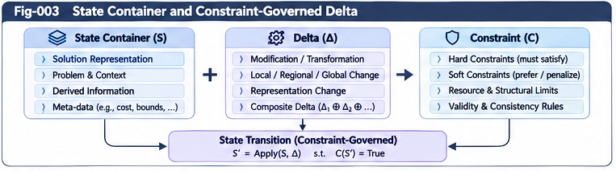
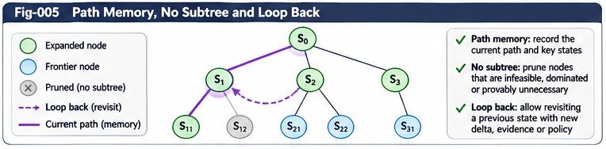
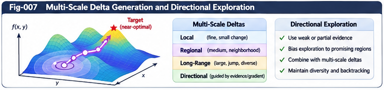
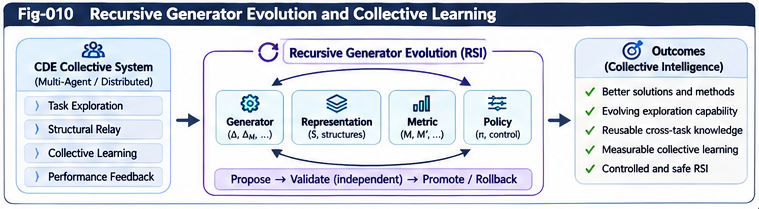

# EXT-002 — Open-Ended Delta and Representation Evolution

**Project:** Constrained Delta Evolution (CDE)  
**Series:** Extensions / Research Architecture and Validation Contracts  
**Status:** v1.0.0 research draft — proposed mechanisms, not experimentally validated  
**Date:** 2026-11-04  
**Authors:** Sizhe Tan and GPT-Obot  
**License:** Apache-2.0  
**Suggested repository path:** `docs/extensions/EXT-002-Open-Ended-Delta-and-Representation-Evolution.md`  
**Companion work:** CDE-001–012; SPEC-001–006; CASE-001–005; EXT-001  
**Primary interfaces:** SIF Localization, UIERU Structural Relay, AQSI autonomous questioning, metric and generator evolution

## Abstract

Constrained Delta Evolution (CDE) ordinarily explores a state space through typed Deltas generated by a known operator portfolio. Yet some problems cannot be solved efficiently—or even expressed faithfully—using the available state representation, Delta vocabulary, or constraint interface. This extension studies the **open-ended evolution of Delta types and State Representations**: the system may propose new operators, new abstractions, new decompositions, and new interfaces, while preserving explicit validation, provenance, and governance.

The central distinction is between *exploration within a representation* and *exploration of representations themselves*. A system may improve its search trajectory without expanding its expressive capacity; conversely, a new representation may make previously inaccessible solution structures reachable but also invalidate cached results, constraint assumptions, score comparisons, and claimed completeness. These changes cannot be treated as ordinary solution-state Deltas.

This manuscript defines typed **Representation Deltas**, **Operator-Genesis Deltas**, migration contracts, cross-representation semantic preservation, controlled generativity, novelty and utility measures, negative-transfer controls, conformance profiles, multi-agent exploration, and a staged validation roadmap. It proposes an architecture in which new representational capabilities are generated in sandboxes, tested on held-out tasks, independently validated, and only then promoted to shared registries. The work is a falsifiable research program; it does not claim an implemented open-ended intelligence system or guaranteed recursive improvement.

> **Key thesis:** An open-ended explorer must be able to change *what can be proposed*, not merely *which proposal is selected*—but every such change must make its semantic consequences explicit.

---



*Figure 3. A typed Delta proposes a transition from a versioned State Container to a candidate successor. Hard-constraint checks and coherent-version validation determine whether the transition may be committed; directional scores may prioritize attempts but cannot substitute for feasibility.*

---



*Figure 5. Path-local accepted and excluded decision sets support constructive NoSubtree semantics under fixed-context assumptions. Deferred, infeasible, and pruned branches remain distinct; controlled Loop Back may be legitimate in reconfiguration, cyclic, or representation-evolving searches.*

---



*Figure 7. Local, regional, long-range, and Relay-guided Delta generators explore complementary neighborhoods. Directional fields and weak evidence guide proposal ranking while maintaining uncertainty, diversity, counterexample probes, and hard-constraint checks.*

---



*Figure 10. Controlled recursive evolution separates task exploration (L0), generator/operator evolution (L1), policy/representation adaptation (L2), and independent validation and governance (L3). Structural Relay can transmit validated methods and evidence across tasks, but recursive improvement and collective learning must be established empirically.*

---

## 1. Motivation: The Boundary of a Fixed Delta Vocabulary

Consider a search engine that can change the assignment of one student to a bus, swap two stops, and merge two routes. It may search those neighborhoods thoroughly while missing a strategy that requires a new abstraction: grouping compatible trips into reusable vehicle blocks before assigning physical vehicles.

Similarly, a structural matcher with only pairwise `ADD_MATCH` and `RETRACT_MATCH` operators may be unable to express a composite mapping between one source concept and several target concepts. A metric optimizer that can only adjust weights cannot discover a lexicographic ordering or a new latent feature.

These are not necessarily failures of the search policy. They may be **representation and operator expressivity failures**.

A fixed generator can be complete relative to its declared operator grammar and still incomplete relative to the underlying problem. CDE should therefore distinguish:

1. exploring reachable states using current Deltas;
2. evolving parameters of existing Delta generators;
3. generating genuinely new Delta types;
4. changing the State Container representation;
5. changing the mapping between problems, capabilities, and representations;
6. validating whether the new structures preserve task semantics and hard constraints.

The last four activities are more consequential than ordinary search. They can expand reachability but can also destroy comparability and invalidate earlier proofs.

## 2. Scope and Nonclaims

This extension proposes a research architecture for controlled representational and operator evolution. It does **not** claim:

- a general algorithm that discovers every useful representation;
- guaranteed emergence of new intelligence;
- universal convergence or monotonically improving recursive self-improvement;
- an automatic proof that a new operator preserves semantics;
- completeness over an unbounded representation language;
- safe deployment of arbitrary generated code;
- superiority over program synthesis, genetic programming, automated algorithm design, or abstraction refinement.

The proposed contribution is a **contractual integration** of these established research families with CDE's State–Delta–Constraint–Branch semantics, evidence records, Structural Relay, and independent promotion governance.

## 3. Research Questions

**RQ-1:** How can a search system detect that its current Delta vocabulary is insufficient rather than merely poorly tuned?

**RQ-2:** Which mechanisms can generate useful new Delta operators, and how should their coverage and safety claims be evaluated?

**RQ-3:** When does a new State Representation expand effective reachability or reduce search cost?

**RQ-4:** What invariants and migration obligations are required when state identity, constraint semantics, or metric interpretation changes?

**RQ-5:** How can novelty be distinguished from syntactic variation, redundant operators, and benchmark-specific overfitting?

**RQ-6:** Can multiple agents generate, challenge, validate, and relay new representations without creating ungoverned self-modification?

**RQ-7:** How should old evidence, cached states, path memory, and Leftover tasks be migrated—or deliberately invalidated—across representations?

**RQ-8:** Under what conditions can recursive operator/representation evolution yield sustained, externally validated improvements?

## 4. Falsifiable Hypotheses

**H1 — Expressivity bottlenecks:** On tasks constructed to require a composite operator or representation, a controlled operator-genesis system can solve instances that a fixed, explicitly restricted operator vocabulary cannot reach.

**H2 — Search efficiency:** When a useful abstraction compresses repeated structure, a representation-evolving solver may reduce validated search cost relative to a fixed representation, after accounting for discovery and migration overhead.

**H3 — Negative control:** On tasks already well represented, representation evolution may increase cost and overfit without improving outcomes.

**H4 — Independent promotion:** Requiring semantic and held-out validation will reduce harmful operator promotions compared with self-scored adoption.

**H5 — Novelty pressure:** Unconstrained novelty maximization will produce many novel but useless or unsafe representations; utility- and conformance-aware selection will improve the fraction of useful proposals.

**H6 — Relay:** Versioned transfer of validated operators and representation adapters can improve related target tasks, while unvalidated reuse can cause negative transfer.

**H7 — Recursive evolution:** A meta-generator that evolves its operator-discovery policy may improve held-out task performance in some domains, but may also regress under distribution shift.

All hypotheses are proposed for testing; none is an observed result.

## 5. Formal Setting

Let a task be represented by:

\[
\mathcal P_v=(S_{\mathcal R_v},\Delta_{\mathcal O_v},T_v,C_v,M_v,G_v,L_v),
\]

where:

- \(\mathcal R_v\) is the versioned State Representation;
- \(S_{\mathcal R_v}\) is the state space expressible under that representation;
- \(\mathcal O_v\) is the versioned Delta operator vocabulary;
- \(\Delta_{\mathcal O_v}\) is the set of typed Delta instances;
- \(T_v\) is the transition interpretation;
- \(C_v\) is the hard-constraint bundle;
- \(M_v\) is the scoring/metric contract;
- \(G_v\) is the proposal generator;
- \(L_v\) is the path, evidence, and lineage context.

Ordinary CDE exploration uses:

\[
s_{t+1}=T_v(s_t,\delta_t),\quad \delta_t\in G_v(s_t).
\]

Open-ended evolution introduces a slower meta-transition:

\[
(\mathcal R_{v+1},\mathcal O_{v+1},T_{v+1})
=
\mathcal E(
\mathcal R_v,\mathcal O_v,T_v,\mu_v
),
\]

where \(\mu_v\) is a typed, governed meta-Delta. This equation describes a candidate transformation, **not automatic activation**.

### 5.1 Three forms of reachability

Define:

- **Representable:** a target solution can be encoded in \(S_{\mathcal R}\).
- **Generable:** a valid sequence of available Delta operators can propose it.
- **Discoverable under budget:** the search policy can find and validate it within a specified resource limit.

These are different predicates:

\[
\text{Representable}\not\Rightarrow
\text{Generable}\not\Rightarrow
\text{Discoverable within budget}.
\]

Even if a solution is generable, the system may never select the necessary sequence.

### 5.2 Representation-relative completeness

A search can be exhaustive only relative to a declared finite or otherwise well-defined candidate universe and a sound traversal policy. When \(\mathcal R\) or \(\mathcal O\) changes, previous coverage claims MUST be reconsidered.

## 6. Four-Layer Evolution Architecture

The proposed architecture has four logically separated layers.

**L0 — Task-state evolution:** Changes solution candidates within a pinned representation and operator vocabulary.

**L1 — Operator evolution:** Changes the Delta vocabulary, operator parameters, preconditions, and generation mechanisms.

**L2 — Representation evolution:** Changes State Container schemas, structural abstractions, decompositions, or equivalence relations.

**L3 — Independent validation and governance:** Evaluates semantic preservation, held-out utility, risk, authorization, promotion, monitoring, and rollback.

L1 and L2 can be proposed by agents but cannot unilaterally change L3.

### 6.1 Dependency direction

A new representation may require new operators; a new operator may expose a limitation in the current representation. The design therefore supports bidirectional discovery while retaining explicit dependency edges.

### 6.2 Multiple active representations

A system MAY maintain a portfolio of representations in parallel. A single globally canonical representation is not always necessary or desirable.

## 7. Canonical Representation Manifest

A representation is not merely a serializer. It defines how the domain's relevant distinctions are encoded and interpreted.

```yaml
representation_id: "school-bus-vehicle-block-v2"
schema_version: "2.0.0"
domain: "school-bus-routing"
state_schema_ref: "vehicle-block-state.schema.json"
semantic_interpretation_ref: "vehicle-block-semantics-v2"
entity_types:
  - "Student"
  - "Trip"
  - "VehicleBlock"
  - "PhysicalVehicle"
relation_types:
  - "assigned_to_trip"
  - "trip_in_block"
  - "block_assigned_to_vehicle"
constraint_bundle_ref: "school-bus-hard-constraints-v4"
metric_compatibility:
  - "fleet-first-metric-v3"
equivalence_contract_ref: "future-equivalence-block-v2"
migration_from:
  - "route-only-v1"
coverage_claim: "not-established"
status: "SANDBOX_CANDIDATE"
provenance_ref: "representation-proposal-031"
```

The manifest SHOULD identify semantic assumptions, supported operations, constraints, metric compatibility, and known information loss.

## 8. Representation Delta Taxonomy

| Type | Transformation | Primary concern |
|---|---|---|
| `ADD_ENTITY_TYPE` | Introduce a new entity class | New invariants |
| `ADD_RELATION_TYPE` | Introduce a new relation | Meaning and provenance |
| `SPLIT_ENTITY` | Refine one concept into several | Identity migration |
| `MERGE_ENTITIES` | Aggregate concepts | Information loss |
| `INTRODUCE_COMPOSITE` | Add macro-object/compound state | Hidden coupling |
| `FACTOR_STATE` | Separate independent dimensions | Invalid independence |
| `CHANGE_GRANULARITY` | Coarsen or refine state | Precision and completeness |
| `REPARAMETERIZE` | Change coordinates/encoding | Equivalence assumptions |
| `ADD_LATENT_VARIABLE` | Introduce inferred state | Identifiability |
| `REDEFINE_EQUIVALENCE` | Change state deduplication rule | Cache unsoundness |
| `REDEFINE_DECOMPOSITION` | Change subproblem boundaries | Global consistency |
| `ADD_VIEW` | Add alternate projection | Synchronization |
| `CHANGE_TEMPORAL_MODEL` | Add history/time dimensions | State explosion |
| `INTRODUCE_HIERARCHY` | Add multilevel abstraction | Abstraction validity |
| `CHANGE_OPERATOR_INTERFACE` | Alter operator argument types | Compatibility |
| `PROPOSE_NEW_DSL` | Introduce a domain-specific grammar | Validation surface |

A Representation Delta is a meta-operation. It is not authorized merely because it passes syntactic schema validation.

## 9. Operator-Genesis Delta Taxonomy

| Type | Proposed change | Example |
|---|---|---|
| `COMPOSE_OPERATORS` | Macro from existing operators | Swap-and-repair |
| `PARAMETERIZE_OPERATOR` | New parameter family | Variable neighborhood radius |
| `GENERALIZE_PRECONDITION` | Broader applicability | Composite match support |
| `SPECIALIZE_PRECONDITION` | Narrower, safer operator | Capacity-preserving merge |
| `INVENT_PRIMITIVE` | New transition primitive | Vehicle-block reassignment |
| `INVERT_OPERATOR` | Reversal when valid | Split after merge |
| `ADD_REPAIR_OPERATOR` | Restore feasibility | Schedule conflict repair |
| `ADD_PROSPECTING_OPERATOR` | Probe new region/structure | Cross-cluster exploration |
| `ADD_EVIDENCE_OPERATOR` | Request discriminating evidence | Counterexample probe |
| `ADD_TRANSFER_ADAPTER` | Reuse method across domains | Graph-to-schema mapping |
| `GENERATE_SEARCH_HEURISTIC` | New proposal ranking | Directional evidence model |
| `GENERATE_META_OPERATOR` | New operator-discovery strategy | Composition grammar revision |

### 9.1 Primitive versus macro

A composed macro may be syntactically new but semantically equivalent to an existing sequence. The novelty evaluator must distinguish shorter execution, better reachability, improved proof structure, and mere renaming.

### 9.2 Executable operators

Generated executable code must run in a constrained sandbox with explicit resource limits, capability restrictions, and validation. The CDE contract does not authorize arbitrary code execution.

## 10. Operator Contract

A candidate operator SHOULD declare:

```yaml
operator_id: "vehicle-block-reassign-v1"
operator_version: "1.0.0-candidate"
source_representation_ref: "vehicle-block-state-v2"
input_types:
  - "VehicleBlock"
  - "PhysicalVehicle"
precondition_contract_ref: "block-compatible-v2"
effect_contract_ref: "reassign-block-v1"
hard_constraint_dependencies:
  - "vehicle-availability-v4"
  - "capacity-v4"
  - "time-compatibility-v4"
termination_and_resource_policy_ref: "bounded-operator-v1"
reversibility: "conditional"
coverage_claim: "none"
proof_obligations:
  - "type_preservation"
  - "constraint_preservation_or_revalidation"
validation_status: "PROPOSED"
provenance_ref: "operator-genesis-018"
```

A new operator MUST NOT inherit its parent's safety or completeness claims without an applicable proof or revalidation.

## 11. Semantics-Preserving and Semantics-Changing Evolution

Representation changes fall into two broad categories.

**Semantics-preserving transformations** seek to retain the task's relevant meaning while changing encoding, decomposition, or computational structure.

**Semantics-changing transformations** introduce new concepts, distinctions, capabilities, or assumptions. These require explicit review because previous problem statements may no longer apply unchanged.

### 11.1 Semantic interpretation maps

Let \(\llbracket s\rrbracket_{\mathcal R}\) denote the domain meaning of a represented state. A migration map \(F:\mathcal R_a\to\mathcal R_b\) is semantics-preserving for a declared observable set \(\mathcal O\) if:

\[
\forall s\in D_F,\quad
\mathrm{obs}_{\mathcal O}(\llbracket s\rrbracket_{\mathcal R_a})
=
\mathrm{obs}_{\mathcal O}(\llbracket F(s)\rrbracket_{\mathcal R_b}).
\]

The equality is relative to specified observables and assumptions, not a universal assertion of semantic equivalence.

### 11.2 Lossy abstraction

A coarser representation may deliberately discard details. It can still be useful if the discarded information is irrelevant to the intended decision and can be recovered or revalidated where necessary.

### 11.3 Refinement

A refined representation may distinguish previously merged states. This can invalidate memoization based on the older coarse key.

## 12. Migration Contracts

A representation migration SHOULD specify:

- source and target schema versions;
- domain and preconditions;
- forward transformation;
- optional inverse or reconstruction map;
- information-loss declaration;
- preserved observables;
- hard-constraint revalidation;
- metric re-scoring rules;
- path memory migration;
- cache invalidation;
- evidence and provenance links;
- failure and rollback behavior.

```yaml
migration_id: "route-to-vehicle-block-v2"
source_representation_ref: "route-only-v1"
target_representation_ref: "vehicle-block-v2"
forward_adapter_ref: "route-to-block-adapter-v2"
inverse_adapter_ref: null
preserved_observables:
  - "student_assignment"
  - "trip_start_end_times"
lossy_fields: []
newly_required_fields:
  - "vehicle_block_assignment"
hard_constraint_revalidation: "MANDATORY"
metric_rescoring: "MANDATORY"
path_memory_policy: "REBASE_OR_QUARANTINE"
cache_policy: "INVALIDATE_UNPROVEN_EQUIVALENCES"
status: "SANDBOX"
provenance_ref: "migration-proposal-007"
```

### 12.1 Partial migrations

Not every state can necessarily migrate. The adapter MUST report partial coverage and preserve unmigrated states or Leftovers rather than silently dropping them.

### 12.2 Cross-version identity

State IDs, Delta IDs, and future-equivalence keys MUST remain explicitly versioned. A migrated state should reference its predecessor without pretending the two are identical.

### 12.3 Constraint and metric dependencies

If a representation changes how capacity, time, topology, or identity is encoded, hard constraints and metrics must be independently revalidated.

## 13. Discovering Representation Bottlenecks

A system should not modify its representation simply because search progress slows. Stagnation can also result from weak heuristics, insufficient budget, incorrect constraints, or an intrinsically difficult task.

Proposed diagnostic signals include:

1. repeated failure of all available operators to alter a blocking structure;
2. large numbers of equivalent or redundant candidate states;
3. systematic repair cycles that suggest a missing macro-operation;
4. infeasible combinations caused by a poor decomposition;
5. evidence that important distinctions are collapsed into one state;
6. solver-specific failures tied to representation choice;
7. persistent Leftovers describing unexpressible proposals;
8. counterexamples that violate assumptions of the current abstraction.

A **representation bottleneck hypothesis** should record the evidence and competing explanations.

### 13.1 Diagnostic contract

```yaml
bottleneck_hypothesis_id: "bottleneck-012"
representation_ref: "route-only-v1"
observed_symptoms:
  - "repeated-conflict-repair"
  - "no-operator-for-vehicle-block-reassignment"
alternative_explanations:
  - "insufficient-search-budget"
  - "incorrect-constraint-encoding"
proposed_test_ref: "compare-macro-and-vehicle-block-representation"
status: "UNVALIDATED"
provenance_ref: "diagnostic-012"
```

### 13.2 Counterfactual test

Where possible, compare the original representation with an alternative under matched solver budgets and identical task semantics. This helps separate representational gain from extra compute or information.

## 14. Open-Endedness as a Measurable Research Property

“Open-ended” is frequently used loosely. This manuscript distinguishes:

- **Open-ended candidate generation:** no fixed finite list of possible candidate operator definitions is assumed.
- **Open-ended representational expressivity:** the system can propose schemas beyond its initial vocabulary.
- **Open-ended validated utility:** useful improvements continue to appear across an extended task distribution.
- **Open-ended autonomy:** the system can initiate and evaluate changes with bounded delegated authority.

The first two are architectural properties. The latter two are empirical and governance-dependent.

### 14.1 No finite test proves unlimited growth

A long sequence of successful innovations is evidence of performance on that sequence, not proof of unbounded capability growth.

### 14.2 Innovation versus variation

A syntactically novel operator may be semantically redundant. A meaningful innovation should demonstrate at least one of:

- new representable task structures;
- new reachable states;
- lower validated cost;
- better generalization;
- improved constraint handling;
- improved evidence quality;
- reduced coordination burden.

## 15. Novelty, Utility, and Risk Metrics

A candidate representation or operator \(z\) may be evaluated through a vector:

\[
\mathbf J(z)=
\left(
N_{\mathrm{semantic}},
U_{\mathrm{heldout}},
C_{\mathrm{compute}},
R_{\mathrm{risk}},
G_{\mathrm{transfer}}
\right).
\]

Here novelty, held-out utility, compute cost, risk, and transferability are distinct dimensions. A single scalar score may be convenient but requires an explicit perspective and weighting policy.

### 15.1 Novelty

Potential novelty measures include structural edit distance, behavioral diversity on test fixtures, new reachable state categories, or semantic distinction added. Each can be gamed; novelty claims should be triangulated.

### 15.2 Utility

Measure task outcomes under independent validation, including constraint compliance and resource costs. Self-reported internal fitness is insufficient.

### 15.3 Complexity

Report description length, operator execution cost, proof burden, memory overhead, and validation cost.

### 15.4 Robustness

Test on held-out task families, shifted constraints, and adversarial counterexamples.

### 15.5 Diversity

Preserve a portfolio of distinct candidate representations rather than prematurely selecting one universal representation.

## 16. Adaptive M-to-N Meta-Branching

At the meta-level, \(M\) candidate operator/representation Deltas are proposed, \(Q\) validation attempts are selected, \(N\) candidate artifacts are realized, and \(K\) distinct successor configurations are obtained.

\[
M \to Q \to N \to K.
\]

These counts MUST remain separate from inner-loop task-state branching. A system should maintain two ledgers:

- **Task ledger:** solution Deltas, evaluations, states, costs;
- **Meta ledger:** representation/operator proposals, sandbox builds, validations, promotions, rollbacks.

### 16.1 Allocation strategies

Meta-branch selection may allocate resources to:

- exploit promising operator compositions;
- prospect for new primitives;
- refine abstractions;
- test counterexamples;
- validate transfer;
- reduce known failure modes.

### 16.2 Coverage honesty

An open-ended generator cannot claim exhaustive coverage of all possible operators. It may declare coverage only over a bounded grammar, depth, type system, or enumeration range.

## 17. Path Memory and Loop Back Across Representations

A state revisited under a different representation is not automatically equivalent to its earlier form. Similarly, a Delta operator may have changed semantics even when its name remains unchanged.

Path memory MUST record:

- representation version;
- operator version;
- constraint and metric versions;
- decision identity;
- migration lineage;
- any revalidation status.

### 17.1 NoSubtree scope

Fixed-context NoSubtree semantics may prevent repeated constructive decisions within one path. They do not prohibit legitimate reconsideration after a representation change or new evidence.

### 17.2 Cycles in the meta-graph

The system may alternate between representations A and B. A bounded budget, version-aware deduplication, tabu policy, or validated improvement threshold can prevent unproductive cycling, but no universal termination guarantee follows.

### 17.3 Cache invalidation

A change to representation, operator semantics, constraints, metric, or future-equivalence relation may invalidate cached feasibility, value estimates, bounds, or dominance claims. Cache reuse requires a specific soundness argument.

## 18. Solver Portfolio and Representation Choice

Different representations favor different solvers:

| Representation | Potentially suitable solver | Typical issue |
|---|---|---|
| Binary assignment vector | MIP, CP-SAT, local search | Combinatorial size |
| Graph matching state | Graph algorithms, ILP, probabilistic inference | Structural ambiguity |
| Hierarchical macro-state | Hierarchical search, planning | Abstraction soundness |
| Continuous parameter state | Gradient methods, evolutionary search | Local minima |
| Symbolic program/DSL | Program synthesis, SMT, enumerative search | Search grammar |
| Multiobjective metric vector | Pareto search | No unique ordering |
| Distributed task graph | Portfolio/distributed solvers | Reconciliation overhead |

The orchestrator may explore representation–solver pairs rather than representations in isolation.

### 18.1 Confounding

A better outcome after changing representation and solver does not identify which component caused the improvement. Experiments should include factorial or matched ablations.

### 18.2 Proof inheritance

An exact solver's guarantees apply only under its declared encoding and assumptions. A representation migration cannot silently inherit those guarantees.

## 19. Generating New Operators

Possible operator-genesis mechanisms include:

1. composition of known primitives;
2. anti-unification of successful operator traces;
3. inductive program synthesis from examples;
4. counterexample-guided refinement;
5. grammar-based search;
6. evolutionary program search;
7. analogy and cross-domain method transfer;
8. human-proposed operators;
9. model-generated candidate DSL programs;
10. failure-driven repair operator synthesis.

Each mechanism should produce a **typed candidate with explicit assumptions**, not an automatically trusted runtime capability.

### 19.1 Trace abstraction

Repeated successful Delta sequences may suggest a macro. A macro should be tested for correctness across the contexts where it claims applicability.

### 19.2 Counterexample-guided synthesis

A candidate operator can be tested on fixtures and refined when it violates preconditions or effects. Finite tests do not prove general correctness unless a sound verification method applies.

### 19.3 Human collaboration

A human may introduce domain abstractions that the generator has not discovered. The architecture should accept externally proposed operators through the same validation interface.

## 20. Generating New Representations

Potential mechanisms include:

- clustering frequently co-changing variables into composite units;
- factorizing independent substructures;
- inventing latent relation types;
- constructing hierarchical abstractions;
- introducing typed interfaces between domains;
- generating alternative graph views;
- extracting invariants from repeated solution traces;
- discovering sufficient statistics for a task family;
- representing unresolved evidence explicitly;
- proposing new task decompositions.

### 20.1 Compression is not sufficient

A shorter representation may discard essential distinctions. Compression gains should be assessed against semantic preservation and downstream decision quality.

### 20.2 Richer is not always better

Adding state variables may improve expressivity while making search intractable. Representational value is conditional on the task distribution and solver portfolio.

### 20.3 Multiple views

A multi-view architecture may retain both a coarse planning representation and a detailed validation representation, linked by versioned adapters.

## 21. Case Study A — School-Bus Vehicle Blocks

### 21.1 Original representation

Suppose the initial state models individual trips and route assignments, with operators for stop moves, trip swaps, and route merges.

### 21.2 Bottleneck

The system repeatedly discovers feasible trips but struggles to minimize the number of **physical vehicles** because it lacks an explicit representation of compatible trip chains.

### 21.3 Representation Delta

Introduce `VehicleBlock`, a sequence of trips executable by one physical vehicle, subject to time, location, and capacity constraints.

### 21.4 Operator Delta

Introduce `REASSIGN_VEHICLE_BLOCK`, `MERGE_COMPATIBLE_BLOCKS`, and `SPLIT_CONFLICTING_BLOCK`.

### 21.5 Validation

Compare old and new representations on identical instances with matched compute budgets. Revalidate all student assignments, route timing, physical vehicle count, and ride-time limits. The new representation should not receive credit for simply relaxing constraints.

### 21.6 Counterexample

If the original solver already optimizes physical vehicles with a strong integrated MIP formulation, the new representation may provide no benefit. This is an essential negative control.

## 22. Case Study B — Dynamic Structural Matching

### 22.1 Original representation

A matching system stores only pairwise source-target hypotheses.

### 22.2 Bottleneck

A source concept corresponds to a composite target structure, but the pairwise schema cannot express the relation faithfully.

### 22.3 Representation Delta

Introduce a `CompositeCorrespondence` entity with typed member relations, evidence references, and cardinality rules.

### 22.4 Operator Delta

Add `CREATE_COMPOSITE_MATCH`, `SPLIT_COMPOSITE_MATCH`, and `CHALLENGE_COMPONENT`.

### 22.5 Validation

Measure held-out correspondence quality, calibration, global consistency, and abstention. Compare with established one-to-many matching baselines.

### 22.6 Boundary

Structural correspondence does not establish real-world identity or causal attribution.

## 23. Case Study C — Multi-Scale Peak Search

### 23.1 Original representation

A continuous optimizer uses fixed-radius local steps in Euclidean coordinates.

### 23.2 Bottleneck

The landscape contains narrow, separated peaks or a ridge structure poorly aligned with the coordinate axes.

### 23.3 Operator Delta

Introduce a long-range prospecting operator or a ridge-following proposal.

### 23.4 Representation Delta

Propose an adaptive coordinate transformation or latent low-dimensional embedding.

### 23.5 Validation

Evaluate on held-out landscapes with matched objective budgets, including negative controls where the transformation distorts the landscape or adds overhead.

### 23.6 Caution

A coordinate change may improve a particular solver's conditioning without changing the mathematical solution space. The result should be described accurately as an efficiency or search-geometry improvement, not necessarily an expansion of expressivity.

## 24. Case Study D — Metric Representation

### 24.1 Original representation

A metric is a weighted sum of fixed features.

### 24.2 Bottleneck

The authorized decision policy is lexicographic or requires uncertainty-aware constraints, which the weighted sum cannot express without problematic tradeoffs.

### 24.3 Representation Delta

Replace the scalar metric schema with a typed lexicographic vector or partial-order representation.

### 24.4 Operator Delta

Introduce `CHANGE_AGGREGATION`, `ADD_OBJECTIVE_COMPONENT`, and `REVISE_COMPARISON_RULE`.

### 24.5 Validation

Re-evaluate prior solutions under a common pinned policy, test decision utility, and preserve cross-version incompatibility rather than directly comparing old and new scalar scores.

## 25. Case Study E — Autonomous Questioning

### 25.1 Original representation

A research agent stores questions as plain text and uses generic ranking.

### 25.2 Bottleneck

The system cannot represent relationships between assumptions, evidence gaps, answerability, methods, and follow-up questions.

### 25.3 Representation Delta

Introduce a structured Question Unit with concept graph, assumptions, evidence requirements, expected exploration value, and Relay contract.

### 25.4 Operator Delta

Add `SPLIT_QUESTION`, `GENERALIZE_QUESTION`, `GENERATE_COUNTERQUESTION`, `TRANSFER_QUESTION`, and `REQUEST_DISCRIMINATING_EVIDENCE`.

### 25.5 Validation

Measure independent research utility, question diversity, answerability, and downstream evidence generation. A larger number of questions is not itself an improvement.

## 26. Case Study F — Distributed Method Relay

A worker discovers a useful macro-operator for one task family. It publishes a Method Relay artifact containing:

- operator definition and version;
- source representation assumptions;
- preconditions and effects;
- evidence and counterexamples;
- validation scope;
- resource cost;
- target adapter requirements;
- known failure modes.

The target worker may adopt the operator only after compatibility checking and independent validation. A method's source success does not imply target applicability.

## 27. Multi-Agent Roles

A distributed research laboratory may use:

**Explorer:** searches task states under current operators.

**Bottleneck Analyst:** identifies unexpressible or inefficient search patterns.

**Operator Inventor:** proposes new typed Deltas.

**Representation Designer:** proposes new schemas and abstraction maps.

**Counterexample Agent:** challenges preservation and coverage claims.

**Constraint Validator:** checks hard constraints and migration soundness.

**Independent Evaluator:** measures held-out utility and cost.

**Governance Controller:** authorizes staged activation and rollback.

These are logical roles; several may be implemented by one process, but independence claims must reflect actual data/model dependencies.

### 27.1 Competition and diversity

Multiple candidates can coexist. A majority vote does not establish semantic correctness, especially when agents share evidence or models.

### 27.2 Authority boundaries

Proposal agents cannot bypass validation or alter the governing objective to approve their own candidates.

## 28. Structural Relay for New Capabilities

Seven Relay types remain relevant:

| Relay type | Example |
|---|---|
| Result | Validated solution under new representation |
| Evidence | Counterexample to old abstraction |
| Constraint | New type or compatibility invariant |
| Method | Reusable macro-operator |
| Policy | Validated operator-selection strategy |
| Metric | New metric representation or scoring model |
| Leftover | Unexpressible task, unresolved migration, untested operator |

An additional **Capability Manifest** may package a validated representation/operator bundle, but it should reference the established Relay types rather than silently introducing an eighth normative category.

### 28.1 Target applicability

Transfer requires checking source and target schemas, constraints, metric semantics, authority, and evidence scope.

### 28.2 Negative transfer

An operator that preserves constraints in one domain may violate them in another. Failed transfer should be recorded as negative evidence with scope, not discarded.

### 28.3 Repeated execution as Relay

Repeated application of a candidate operator can accumulate statistical evidence about its reliability and cost. This is meaningful only if executions are tracked and appropriately independent.

## 29. Capability Registries and Provenance

A Capability Registry may index:

- representation schemas;
- operator definitions;
- migration adapters;
- conformance profiles;
- validation reports;
- known counterexamples;
- compatible solvers;
- governance status;
- Relay references.

Registry publication is not automatic deployment authorization.

### 29.1 Immutable artifacts

Published versions should be immutable. Corrections require new versions and explicit supersession links.

### 29.2 Provenance graph

The system should preserve causal lineage:

```text
Task Failure
  -> Bottleneck Hypothesis
  -> Representation Proposal
  -> Operator Proposal
  -> Sandbox Evaluation
  -> Independent Validation
  -> Governance Decision
  -> Limited Promotion
  -> Target Relay
  -> Monitoring / Rollback
```

### 29.3 Leftover preservation

Unresolved migration cases, unsupported states, failed proofs, and unexplored operator families are first-class research outputs.

## 30. Independent Validation Gates

A proposed capability should pass progressively stronger gates.

**G0 — Syntax and type:** schema correctness, operator signatures, bounded execution.

**G1 — Local semantics:** precondition/effect checks and deterministic fixtures.

**G2 — Constraint integrity:** hard constraints preserved or revalidated.

**G3 — Migration integrity:** semantic observables and information loss documented.

**G4 — Held-out task utility:** measurable improvement or justified noninferiority under matched budgets.

**G5 — Robustness:** shifted tasks, adversarial counterexamples, and regression tests.

**G6 — Governance:** authority, risk, privacy, and rollback readiness.

**G7 — Limited deployment:** monitoring with scoped authorization.

Passing G0–G3 does not imply G4; passing G4 does not imply general validity beyond the tested distribution.

## 31. Promotion and Rollback Lifecycle

```text
PROPOSED
  -> TYPE_CHECKED
  -> SANDBOXED
  -> SEMANTICALLY_REVIEWED
  -> CONSTRAINT_VALIDATED
  -> HELDOUT_EVALUATED
  -> GOVERNANCE_REVIEWED
  -> APPROVED_FOR_STAGING
  -> STAGED
  -> ACTIVE_UNDER_SCOPE
  -> MONITORED
```

Side branches include `REJECTED`, `DEFERRED`, `QUARANTINED`, `ROLLED_BACK`, and `RETIRED`.

### 31.1 Promotion artifact

```yaml
promotion_id: "capability-promotion-021"
candidate_representation_ref: "vehicle-block-v2"
candidate_operator_refs:
  - "merge-compatible-blocks-v1"
source_representation_ref: "route-only-v1"
semantic_validation_ref: "semantic-report-021"
constraint_validation_ref: "constraint-report-021"
heldout_evaluation_ref: "heldout-report-021"
risk_review_ref: "risk-review-021"
authorized_scope: "synthetic-school-bus-lab"
rollback_checkpoint_ref: "route-only-v1"
decision: "STAGING_APPROVED"
provenance_ref: "promotion-event-021"
```

This is illustrative schema content, not an actual promotion.

### 31.2 Rollback semantics

Rollback may restore prior schemas, operators, and policies, but cannot always undo externally executed actions or erase downstream effects. The system must identify irreversible consequences and restrict promotion accordingly.

## 32. Benchmark Design

The proposed benchmark includes six task families corresponding to Sections 21–26, plus synthetic grammar-discovery tasks with known operator reachability.

### 32.1 Task splits

Use disjoint training, development, promotion-validation, and final-test families. Hold out structural transformations, not merely random seeds, to test generalization.

### 32.2 Budget accounting

Report separately:

- inner-loop state evaluations;
- meta-level proposals;
- operator synthesis cost;
- representation migration cost;
- validation and proof cost;
- solver tuning cost;
- coordination and Relay cost;
- total wall-clock and compute cost.

### 32.3 Primary outcomes

1. validated feasible task utility;
2. candidate coverage and reachability;
3. time/evaluations to validated solution;
4. semantic-preservation violations;
5. false capability promotions;
6. transfer benefit and negative transfer;
7. total cost-adjusted utility.

### 32.4 Replication

Use multiple independent task instances and stochastic seeds. Pre-register primary contrasts and statistical methods.

## 33. Strong Baselines

| ID | Baseline | Main comparison |
|---|---|---|
| B0 | Fixed representation and operators | No evolution |
| B1 | Fixed representation, tuned operator weights | Parameter adaptation |
| B2 | Hand-designed macro-operators | Expert abstraction |
| B3 | Genetic programming/operator synthesis | Generated operators |
| B4 | Grammar-based program synthesis | Bounded operator search |
| B5 | Counterexample-guided synthesis | Formal refinement |
| B6 | Automated representation learning | Learned encodings |
| B7 | Hierarchical planning/abstraction | Macro-state search |
| B8 | Portfolio of fixed representations | Selection without invention |
| B9 | Human-in-the-loop design | Expert intervention |
| C1 | CDE operator genesis | New typed operators |
| C2 | CDE representation evolution | New state schemas |
| C3 | CDE joint evolution | Operators and representations |
| C4 | CDE joint evolution + Relay | Cross-task reuse |
| C5 | CDE controlled recursive meta-evolution | Meta-generator updates |

Fairness requires matched information access and cost reporting. A stronger baseline may outperform CDE; such results should be reported.

## 34. Negative Controls

**NC-01:** Fixed representation already sufficient and efficient.

**NC-02:** Proposed operator is syntactic renaming of an existing operator.

**NC-03:** Macro reduces steps but violates an intermediate hard constraint.

**NC-04:** Coarse representation merges states with different feasible futures.

**NC-05:** New schema silently discards required evidence.

**NC-06:** Candidate improves training tasks but fails held-out structural variants.

**NC-07:** New operator depends on hidden oracle information.

**NC-08:** Generator repeatedly creates equivalent representations.

**NC-09:** Cross-version scores are compared without re-evaluation.

**NC-10:** Cached bounds survive an incompatible representation migration.

**NC-11:** Distributed workers use stale operator definitions.

**NC-12:** A transferred macro violates target constraints.

**NC-13:** A validator is modified by the candidate it evaluates.

**NC-14:** Recursive evolution increases complexity but reduces utility.

**NC-15:** Novelty is maximized without task benefit.

**NC-16:** A proposed abstraction cannot represent a necessary counterexample.

**NC-17:** A migration is only partial but claims complete coverage.

**NC-18:** A rollback cannot undo irreversible external effects.

## 35. Ablation Plan

| ID | Ablation | Question |
|---|---|---|
| A1 | Disable operator genesis | Value of new operators |
| A2 | Disable representation evolution | Value of new schemas |
| A3 | Disable macro composition | Value of operator reuse |
| A4 | Disable long-range meta-proposals | Need for structural jumps |
| A5 | Disable counterexample agent | Safety of proposals |
| A6 | Disable semantic migration tests | Preservation failures |
| A7 | Disable independent held-out validation | Overfitting risk |
| A8 | Disable capability registry | Reuse and traceability |
| A9 | Disable Relay | Cross-task transfer |
| A10 | Disable Leftover preservation | Lost research opportunities |
| A11 | Disable rollback | Regression recovery |
| A12 | Freeze generator policy | Meta-learning contribution |
| A13 | Remove novelty objective | Diversity effects |
| A14 | Remove cost accounting | Hidden overhead |
| A15 | Single representation only | Multi-view value |
| A16 | No solver-portfolio adaptation | Representation–solver coupling |
| A17 | No migration cache invalidation | Unsound reuse |
| A18 | No governance gate | Unauthorized activation |

## 36. Reference Algorithm — Capability Evolution

```text
function CONTROLLED_CAPABILITY_EVOLUTION(task_suite, registry, budgets):
    active = pin_authorized_representation_and_operators(registry)
    evidence = immutable_evidence_ledger()

    while meta_budget_remaining(budgets):
        diagnostics = analyze_search_bottlenecks(
            active,
            recent_task_results(),
            unresolved_leftovers()
        )

        proposals = generate_meta_delta_candidates(
            diagnostics,
            families={
                OPERATOR_GENESIS,
                REPRESENTATION_EVOLUTION,
                MIGRATION_ADAPTER,
                SOLVER_INTERFACE
            },
            budget=budgets.proposal
        )
        record_M_proposals(proposals)

        attempts = select_diverse_validation_attempts(
            proposals,
            budget=budgets.validation
        )
        record_Q_attempts(attempts)

        for attempt in attempts:
            if not schema_and_authority_valid(attempt):
                record_rejection(attempt)
                continue

            sandbox = instantiate_isolated_candidate(attempt)
            semantic_report = check_semantic_contract(sandbox)
            constraint_report = check_constraint_contract(sandbox)
            migration_report = validate_migration_if_needed(sandbox)

            if not all_required_checks_pass(
                semantic_report,
                constraint_report,
                migration_report
            ):
                record_failure_and_counterexamples(attempt)
                continue

            heldout_report = independent_task_evaluation(
                candidate=sandbox,
                baseline=active,
                fixed_budget=budgets.heldout,
                sealed_tasks=True
            )

            record_N_realizations_and_K_successors(
                attempt,
                sandbox,
                heldout_report
            )

            if eligible_for_governance_review(heldout_report):
                submit_for_scoped_promotion(attempt, heldout_report)
            else:
                preserve_as_leftover_or_rejected(attempt)

        decision = read_authorized_governance_decision()
        if decision.approved:
            active = stage_then_activate(decision)
            invalidate_incompatible_caches()
            monitor_for_regressions()

        if rollback_required():
            active = rollback_to_authorized_checkpoint()

    return report(
        active_capabilities=active,
        evidence=evidence,
        meta_branch_accounting=all_counts(),
        unresolved=leftovers(),
        costs=all_costs(),
        provenance=all_versions()
    )
```

This is a conceptual control-flow reference, not an executable implementation. It omits many details of concurrency, sandbox security, statistical testing, and distributed commit semantics.

## 37. Reference Algorithm — Migration Verification

```text
function VERIFY_MIGRATION(source_state, migration_contract):
    require_source_version(source_state, migration_contract.source)
    target = migration_contract.forward_adapter(source_state)

    if not target.schema_valid:
        return FAIL("SCHEMA")

    for observable in migration_contract.preserved_observables:
        if not equivalence_check(
            source_state,
            target,
            observable,
            migration_contract.assumptions
        ):
            return FAIL("SEMANTIC_MISMATCH", observable)

    constraint_result = validate_target_constraints(target)
    if constraint_result != PASS:
        return NOT_APPROVED(constraint_result)

    if migration_contract.is_partial:
        record_unmigrated_states_as_leftovers()

    invalidate_unproven_cache_entries()
    return CONDITIONAL_PASS(
        target=target,
        preserved_scope=migration_contract.preserved_observables,
        evidence=validation_artifacts()
    )
```

A finite test suite may support confidence but does not establish universal semantic equivalence without a sound proof.

## 38. Formal Invariants

**INV-ORE-01 — Versioned representation:** Every committed state identifies its representation and schema version.

**INV-ORE-02 — Typed operators:** Every committed Delta identifies its operator definition and applicable state schema.

**INV-ORE-03 — Hard constraints:** No new operator can bypass applicable hard-constraint validation.

**INV-ORE-04 — Migration provenance:** Every migrated state references its source and migration contract.

**INV-ORE-05 — Information-loss disclosure:** Lossy migrations declare affected observables and scope.

**INV-ORE-06 — Cache soundness:** No incompatible cached claim is reused without revalidation.

**INV-ORE-07 — Metric coherence:** Cross-version scores are not directly compared without a validated mapping.

**INV-ORE-08 — Coverage honesty:** New generators do not inherit unproved completeness claims.

**INV-ORE-09 — Authority separation:** Candidate inventors cannot self-authorize production activation.

**INV-ORE-10 — Validation independence:** Held-out outcomes are not directly exposed to candidate generation.

**INV-ORE-11 — Historical integrity:** Superseded schemas and operators remain traceable.

**INV-ORE-12 — Leftover preservation:** Failed or partial migrations retain unresolved work.

**INV-ORE-13 — Relay applicability:** Target adoption requires independent compatibility and validation.

**INV-ORE-14 — Budget accountability:** Synthesis, validation, migration, and execution costs are recorded.

**INV-ORE-15 — Reversibility honesty:** Irreversible effects are disclosed; rollback is not falsely guaranteed.

**INV-ORE-16 — No universal guarantee:** Contract conformance does not imply open-ended utility growth or AGI.

## 39. Conditional Propositions

### Proposition 1 — Constraint preservation under migrated execution

If (i) the source state is valid, (ii) migration produces a target state that passes the target's sound hard-constraint validator, and (iii) each committed target operator is atomically validated under coherent versions, then the committed target-state sequence preserves the encoded target constraints.

This does not prove that the target constraints fully express the real-world task.

### Proposition 2 — Bounded constructive depth

If the operator-decision universe is finite and fixed, each path step resolves one previously unresolved decision, and no new decisions are introduced, then constructive path depth is bounded by the initial decision-universe size.

Open-ended operator genesis violates the fixed-universe premise; the proposition cannot be applied unchanged.

### Proposition 3 — Conditional semantic preservation

If a migration map has a sound proof that it preserves all declared observables on its specified domain, then those observables are preserved for states within that domain.

The result says nothing about unlisted observables or states outside the domain.

### Proposition 4 — No general improvement theorem

Allowing arbitrary new representations increases the candidate design space but does not guarantee improved search performance, safety, or generalization. Larger design spaces can increase overfitting and evaluation cost.

## 40. Conformance Test Matrix

| ID | Test | Expected outcome |
|---|---|---|
| ORE-001 | Valid Representation Manifest | Accepted |
| ORE-002 | Missing schema version | Rejected |
| ORE-003 | Unsupported entity type | Typed failure |
| ORE-004 | Invalid operator signature | Rejected |
| ORE-005 | Operator references stale representation | Blocked |
| ORE-006 | New operator violates hard constraint | Not committed |
| ORE-007 | Operator precondition UNKNOWN | Not treated as PASS |
| ORE-008 | Syntactic duplicate operator | Novelty claim challenged |
| ORE-009 | New primitive without effect contract | Rejected |
| ORE-010 | Generated executable without sandbox | Blocked |
| ORE-011 | Resource budget exceeded | Terminated and recorded |
| ORE-012 | Partial generator claims completeness | Rejected |
| ORE-013 | M/Q/N/K meta-accounting | Reconciled |
| ORE-014 | Task/meta ledger conflation | Conformance failure |
| ORE-015 | Migration source version mismatch | Rejected |
| ORE-016 | Migration target schema invalid | Rejected |
| ORE-017 | Preserved observable changes | Failure evidence |
| ORE-018 | Lossy migration undeclared | Rejected |
| ORE-019 | Partial migration | Leftover recorded |
| ORE-020 | Cross-version state identity | Explicit lineage |
| ORE-021 | Equivalence key changes | Cache revalidation |
| ORE-022 | Bound cached under old metric | Invalidated/reproved |
| ORE-023 | Path-local NoSubtree | Scope preserved |
| ORE-024 | Legitimate revisitation | Versioned evidence |
| ORE-025 | Meta-graph cycle | Policy/budget applied |
| ORE-026 | Old score compared with new metric | Blocked or rescored |
| ORE-027 | Changed hard constraints | Separate authority |
| ORE-028 | Operator's claimed proof missing | No proof status |
| ORE-029 | Solver certificate migration | Revalidated |
| ORE-030 | Candidate lacks provenance | Rejected |
| ORE-031 | Candidate accesses sealed test labels | Blocked |
| ORE-032 | Training improvement, held-out regression | Not promoted |
| ORE-033 | Novelty without utility | No automatic promotion |
| ORE-034 | Strong fixed baseline outperforms | Negative result retained |
| ORE-035 | Stale distributed worker | Reconciliation required |
| ORE-036 | Duplicate retry | Idempotent effect |
| ORE-037 | Relay target schema incompatible | Rejected/deferred |
| ORE-038 | Source-local operator failure | No global impossibility |
| ORE-039 | Target validation fails | No promotion |
| ORE-040 | Leftover unexpressible task | Preserved |
| ORE-041 | Candidate self-approves | Blocked |
| ORE-042 | Validator change requested | Separate governance |
| ORE-043 | Promotion record incomplete | Rejected |
| ORE-044 | Missing rollback checkpoint | Scope-dependent block |
| ORE-045 | Irreversible action | No false rollback claim |
| ORE-046 | Active regression | Monitoring event |
| ORE-047 | Representation–solver confounding | Disclosed |
| ORE-048 | Unfair compute budget | Comparison flagged |
| ORE-049 | Missing negative controls | Protocol incomplete |
| ORE-050 | Incorrect generalization claim | Unsupported |
| ORE-051 | Generated macro intermediate infeasible | Rejected if required |
| ORE-052 | Composite mapping under one-to-one schema | Correct profile enforced |
| ORE-053 | Vehicle-block fleet metric | Revalidated |
| ORE-054 | Latent state unidentifiable | Uncertainty retained |
| ORE-055 | Cross-domain method adapter absent | No direct execution |
| ORE-056 | Repeated execution evidence | Distinct events |
| ORE-057 | Meta-generator version change | New validation scope |
| ORE-058 | Novelty metric changes | Versioned evaluation |
| ORE-059 | Historical operator superseded | Provenance preserved |
| ORE-060 | Claim of guaranteed open-ended improvement | Rejected |

The matrix is a proposed test suite, not evidence that the tests have been run.

## 41. Evaluation Metrics and Statistics

### 41.1 Reachability expansion

For a finite controlled fixture with known feasible targets, measure the fraction reachable under the old versus new operator grammars. The result is conditional on the fixture and search-depth bound.

### 41.2 Held-out task utility

Measure independently validated objective value or regret on tasks not used to generate the candidate representation.

### 41.3 Cost-adjusted improvement

Report benefit after including representation design, operator synthesis, migration, validation, and runtime costs.

### 41.4 False promotion rate

Measure the fraction of promoted capabilities that violate preregistered validity or utility criteria on independent tests.

### 41.5 Semantic preservation failures

Count and classify observable mismatches, hard-constraint violations, and unrecoverable information loss.

### 41.6 Transfer performance

Measure positive and negative target-task effects under independent validation.

### 41.7 Statistical protocol

Use paired task instances where possible, multiple independent seeds, confidence intervals, and preregistered primary contrasts. Do not treat repeated checkpoints within a run as independent samples.

## 42. Experimental Roadmap

**V1 — Contract fixtures:** Implement representation, operator, and migration schemas.

**V2 — Deterministic examples:** Test simple semantics-preserving and deliberately lossy transformations.

**V3 — Fixed-vocabulary baselines:** Establish reachability and cost under original operators.

**V4 — Operator genesis:** Compare composition, synthesis, and human-proposed operators.

**V5 — Representation evolution:** Evaluate new state schemas on held-out tasks.

**V6 — Joint evolution:** Test operator–representation co-adaptation and confounding.

**V7 — Counterexamples:** Introduce invalid equivalences, hidden constraints, and deceptive novelty.

**V8 — Relay transfer:** Reuse validated capabilities across compatible and incompatible task families.

**V9 — Distributed faults:** Inject stale manifests, duplicate retries, and migration conflicts.

**V10 — Recursive meta-evolution:** Propose generator/policy changes under sealed validation.

**V11 — Independent replication:** Publish code, manifests, negative results, uncertainty, and limitations.

No phase is claimed completed in this manuscript.

## 43. Proposed Executable Companion

```text
ext-002-open-ended-representation/
├── README.md
├── contracts/
│   ├── representation-manifest.schema.json
│   ├── operator-manifest.schema.json
│   ├── representation-delta.schema.json
│   ├── operator-genesis-delta.schema.json
│   ├── migration-contract.schema.json
│   └── promotion-record.schema.json
├── generators/
│   ├── operator_composition.py
│   ├── grammar_synthesis.py
│   ├── representation_refinement.py
│   └── bottleneck_diagnostics.py
├── validators/
│   ├── schema_validation.py
│   ├── semantic_preservation.py
│   ├── constraint_validation.py
│   ├── migration_validation.py
│   └── independent_utility.py
├── benchmarks/
│   ├── bus_vehicle_blocks.py
│   ├── composite_graph_matching.py
│   ├── peak_coordinate_transform.py
│   ├── metric_representation.py
│   └── question_unit_representation.py
├── experiments/
│   ├── preregistration.yaml
│   ├── training_manifest.yaml
│   ├── heldout_manifest.yaml
│   └── run.py
├── tests/
│   ├── test_conformance.py
│   ├── test_migrations.py
│   ├── test_negative_controls.py
│   ├── test_relay.py
│   └── test_governance.py
└── reports/
    ├── reachability.csv
    ├── heldout_utility.csv
    ├── semantic_failures.csv
    ├── costs.csv
    └── limitations.md
```

This is a proposed future implementation layout. No listed code or results are asserted to exist.

## 44. Reproducibility Manifest

Every experiment SHOULD record:

```yaml
run_id: string
task_family: string
task_instance_id: string
seed: integer
source_representation_ref: string
candidate_representation_ref: optional_string
source_operator_manifest_ref: string
candidate_operator_manifest_ref: optional_string
migration_contract_ref: optional_string
constraint_bundle_id: string
metric_version: string
generator_version: string
policy_version: string
validation_protocol_ref: string
meta_proposals_M: integer
meta_attempts_Q: integer
meta_realizations_N: integer
meta_successors_K: integer
task_evaluations: integer
synthesis_cost: number
migration_cost: number
validation_cost: number
total_cost: number
heldout_utility: number_or_null
semantic_preservation_status: string
hard_constraint_violations: integer
promotion_status: string
rollback_status: string
provenance_ref: string
```

Unknown values must remain explicitly unknown rather than being replaced by fabricated zeros.

## 45. SIF Localization and Structural Intelligence

The Structural Intelligence Framework (SIF) treats localization as a fundamental capability: finding the relevant problem, capability, method, evidence, or structural address.

Open-ended CDE extends localization in two directions:

1. **Search localization:** find a promising point within a known space.
2. **Representation localization:** discover a more useful coordinate system, abstraction, interface, or structural decomposition in which the problem becomes tractable.

This is not simply a larger search radius. It changes the objects and relations the system can name and manipulate.

### 45.1 Capability addressing

A generated operator can become a versioned capability with explicit input/output types and conformance evidence. SIF can then locate and dispatch it when compatible.

### 45.2 Problem–capability duality

A persistent unsolved problem may motivate a new capability; a newly available capability may make previously unrecognized problems addressable. The proposed Relay mechanism supports both directions.

## 46. Connections to UIERU, AQSI, and Controlled RSI

**UIERU:** New operators and representations can be packaged as transferable intelligence units, subject to explicit compatibility and validation.

**AQSI:** An unexpressible task or unresolved migration can generate a structured research question. Question generation can then guide representation prospecting.

**Controlled RSI:** The system may propose changes to the generator that invents new operators. Such meta-evolution requires separate held-out validation and cannot authorize itself.

**Collective Learning:** A validated new representation may benefit other agents, but shared artifacts alone do not prove collective learning. Measure independent target-task gains.

## 47. Generalization and Guarantee Boundaries

The following distinctions are essential:

\[
\boxed{
\begin{aligned}
\text{New Syntax}
&\neq \text{New Semantics}\\
&\neq \text{New Reachability}\\
&\neq \text{Validated Utility}\\
&\neq \text{Generalized Capability}
\end{aligned}
}
\]

A new operator may be syntactically different but semantically redundant. A representation may add expressive power but increase search cost. A successful benchmark result may not transfer. A validated local improvement does not imply open-ended recursive growth.

The proposed system is best understood as a **disciplined architecture for capability hypotheses**, not a proof that all capability boundaries can be crossed.

## 48. Open Research Questions

1. How can a system recognize that its representation—not its solver—is the limiting factor?
2. Can representational insufficiency be certified for restricted grammars?
3. How should semantic novelty be measured without rewarding meaningless complexity?
4. What is the minimum useful contract for a newly invented Delta primitive?
5. Can operator synthesis preserve hard constraints by construction?
6. How can lossy abstractions be used safely in multilevel search?
7. Which state equivalences survive a representation migration?
8. How should path memory and NoSubtree semantics migrate across schemas?
9. When does a macro-operator genuinely improve efficiency rather than merely hide steps?
10. How can a system detect negative transfer of a representation?
11. What are effective ways to combine symbolic and learned representations?
12. Can multi-agent competition improve discovery without producing correlated false confidence?
13. How should novel capabilities be indexed for SIF Localization?
14. Can unresolved Leftovers drive autonomous question generation?
15. Which validation gates are sufficient for low-risk sandbox promotion?
16. How should irreversible real-world effects constrain representational self-modification?
17. What evidence would justify a claim of sustained open-ended improvement?
18. Can a capability registry evolve without becoming a centralized authority bottleneck?
19. How can multiple valid perspectives and representations coexist without forced unification?
20. Which parts of this architecture remain useful when no universal objective metric exists?

## 49. Conclusion

A search framework that can only select among predefined Deltas remains limited by its original vocabulary. **Open-Ended Delta and Representation Evolution** proposes a path beyond that limitation: identify structural bottlenecks, generate new operators and representations, test their semantics and constraints, evaluate their held-out utility, and relay validated capabilities to compatible tasks.

The research loop is:

\[
\boxed{
\begin{gathered}
\text{Explore with Current Representation}\\
\downarrow\\
\text{Detect Bottleneck and Preserve Leftovers}\\
\downarrow\\
\text{Generate Operator / Representation Meta-Deltas}\\
\downarrow\\
\text{Validate Semantics, Constraints, and Migration}\\
\downarrow\\
\text{Test Independent Utility and Generalization}\\
\downarrow\\
\text{Authorize, Monitor, Roll Back, and Relay}
\end{gathered}
}
\]

The central engineering discipline is that **new expressive power must not be confused with verified correctness or improved intelligence**. Versioned contracts, counterexamples, independent evaluation, and controlled promotion are necessary precisely because representational evolution can invalidate assumptions that ordinary state search takes for granted.

The value of this extension is therefore not a promise of unlimited growth. It is a concrete, falsifiable architecture for investigating whether and when search systems can responsibly evolve the structures through which they search.

---

## Appendix A — Minimal Operator-Genesis Example

```yaml
genesis_proposal_id: "opgen-001"
source_operator_refs:
  - "route-merge-v1"
  - "time-repair-v1"
proposed_operator:
  operator_id: "merge-and-repair-v1"
  kind: "COMPOSE_OPERATORS"
  preconditions:
    - "route_pair_compatible"
    - "repair_budget_available"
  effects:
    - "candidate_route_merge"
    - "time_conflict_repair_attempt"
  atomicity: "validate_all_before_commit"
required_tests:
  - "capacity_preservation"
  - "time_window_preservation"
  - "no_hidden_intermediate_commit"
status: "PROPOSED"
```

The macro's correctness is not implied by its components; composition may introduce interactions requiring new validation.

## Appendix B — Minimal Representation Migration Example

```yaml
migration_id: "graph-pairwise-to-composite-v1"
source_representation_ref: "pairwise-match-v1"
target_representation_ref: "composite-match-v1"
preserved_observables:
  - "existing_pairwise_correspondences"
new_entities:
  - "CompositeCorrespondence"
new_relations:
  - "has_component"
hard_constraint_revalidation: "REQUIRED"
metric_rescoring: "REQUIRED"
cache_policy: "INVALIDATE_UNPROVEN"
partial_migration_policy: "PRESERVE_AS_LEFTOVER"
status: "PROPOSED"
```

## Appendix C — Claim and Evidence Registry

| Claim | Appropriate evidence | Insufficient evidence |
|---|---|---|
| Operator is well typed | Schema/type tests | Generated source text |
| Operator preserves constraints | Sound proof or scoped validation | Successful example |
| Representation preserves meaning | Declared observables and validation/proof | Similar serialization |
| New reachability | Reachability analysis on defined universe | Novel name |
| Improved efficiency | Matched-budget held-out comparison | Fewer visible macro steps |
| Generalized capability | Diverse independent target tasks | One source success |
| Safe transfer | Target compatibility and validation | Registry publication |
| Recursive improvement | Independent multi-generation evidence | Self-scored progress |
| Open-ended growth | Sustained empirical evidence with explicit scope | Finite novelty sequence |

## Appendix D — Figure Placement

Relevant planned CDE figures include:

- `Fig-003-State-Container-and-Constraint-Governed-Delta.png` — State semantics and migration.
- `Fig-004-Adaptive-M-to-N-Delta-Branching.png` — Task and meta-branch accounting.
- `Fig-007-Multi-Scale-Delta-Generation-and-Directional-Exploration.png` — Operator prospecting.
- `Fig-008-Solution-and-Metric-Co-Evolution.png` — Cross-layer evolution.
- `Fig-009-Distributed-CDE-Orchestrator-and-Structural-Relay.png` — Capability Relay.
- `Fig-010-Recursive-Generator-Evolution-and-Collective-Learning.png` — Controlled meta-evolution.

No figure is asserted to have been generated or embedded by this manuscript.

## Appendix E — Research Status and Attribution

This is a proposed research architecture, not a completed experimental study. It builds upon established ideas from program synthesis, genetic programming, automated algorithm configuration, hierarchical planning, abstraction refinement, representation learning, transfer learning, formal methods, and open-ended evolutionary computation. Its proposed contribution is the explicit CDE integration of typed operator/representation meta-Deltas, migration contracts, independent validation, and Structural Relay.

No implementation, benchmark outcome, measured speedup, proof of universal completeness, or AGI claim is made. Formal literature citations, executable artifacts, and independent replication should be added before presenting empirical conclusions.

**Version:** v1.0.0 draft  
**License:** Apache-2.0

## Appendix F — Suggested Extension Integration

Within the planned CDE publication structure:

```text
docs/extensions/
├── EXT-001-Biomimetic-and-Population-Based-CDE.md
├── EXT-002-Open-Ended-Delta-and-Representation-Evolution.md
├── EXT-003-CDE-for-Scientific-Hypothesis-and-Metric-Discovery.md
└── EXT-004-CDE-Collective-Intelligence-and-Structural-RSI.md
```

EXT-002 establishes the operator and representation evolution contracts needed by the subsequent extensions, while retaining SPEC-006's independent evaluation and promotion requirements.
