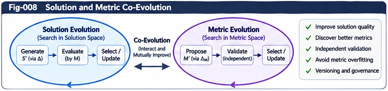

# EXT-003 — CDE for Scientific Hypothesis and Metric Discovery

**Project:** Constrained Delta Evolution (CDE)  
**Series:** Extensions / Scientific Discovery and Metric Co-Evolution  
**Status:** v1.0.0 research draft — proposed architecture, not experimentally validated  
**Date:** 2026-11-04  
**Authors:** Sizhe Tan and GPT-Obot  
**License:** Apache-2.0  
**Suggested repository path:** `docs/extensions/EXT-003-CDE-for-Scientific-Hypothesis-and-Metric-Discovery.md`  
**Companion work:** CDE-001–012; SPEC-001–006; CASE-001–005; EXT-001–002  
**Interfaces:** SIF Localization, AQSI, UIERU, Structural Relay, controlled RSI

## Abstract

Scientific discovery is an intertwined search over questions, hypotheses, experiments, evidence, explanations, representations, and evaluation metrics. **Constrained Delta Evolution (CDE)** offers a proposed common orchestration framework: represent scientific objects as versioned State Containers, generate typed Deltas at multiple structural scales, constrain transitions by methodological and safety contracts, maintain path/evidence provenance, and relay independently validated findings across tasks. This extension treats **hypothesis generation and metric discovery as separate but coupled evolutionary processes**. It emphasizes falsification, causal identifiability, measurement validity, uncertainty, negative evidence, and independent validation rather than equating internal optimization with scientific progress.

The paper defines canonical Hypothesis, Experiment, Evidence, Question, and Metric Units; Delta taxonomies; experiment-selection policies; multi-agent roles; validation gates; eight proposed testable hypotheses; eight benchmark scenarios; strong baselines, negative controls, ablations, 60 proposed conformance tests, and a staged research roadmap. It does **not** report empirical experiments or claim scientific breakthroughs, universal optimization, or autonomous AGI.

> **Research principle:** Better scientific search is not merely the generation of more hypotheses; it is the disciplined generation, discrimination, revision, and validation of claims and the measurements used to judge them.

---



*Figure 8. Solutions and metrics evolve through separate, versioned candidate loops. Improved solution scores under a metric do not certify that the metric itself is better; metric changes require independent decision-utility validation, held-out evidence, and governance before promotion.*

---

## 1. Motivation and Research Position

Scientific discovery is not merely optimization of a known objective. The researcher must decide what to ask, which hypotheses deserve attention, what observations would distinguish them, which instruments are trustworthy, and whether the chosen metric measures the phenomenon of interest. CDE provides a candidate coordination language for these interacting searches, not a replacement for scientific reasoning or domain expertise.

A fixed hypothesis vocabulary can omit the true explanation. A powerful search policy can optimize a misleading proxy. An informative experiment can still be ethically impermissible or operationally infeasible. These limitations motivate a typed, constraint-governed scientific discovery loop with explicit uncertainty and independent verification.

The principal research contribution proposed here is an integration of **hypothesis Deltas, experiment Deltas, evidence Deltas, metric Deltas, and representation Deltas** under one auditable orchestration framework. These Delta classes have different authorization, validity, and proof obligations.

## 2. Scope and Nonclaims

This is a conceptual research architecture and a proposed empirical validation program. It does not report executed experiments, discovered scientific laws, laboratory data, verified speedups, or guaranteed scientific breakthroughs. It does not claim that an LLM-generated hypothesis is true, that a high-scoring experiment is informative, or that CDE supersedes Bayesian experimental design, causal inference, active learning, automated laboratories, or scientific method.

A candidate scientific claim remains provisional until supported by appropriate evidence, replication, and domain-specific review. In safety-critical domains, especially human-subject and biological research, authorized oversight and independent review remain mandatory.

## 3. Research Questions

**RQ1.** Can typed Hypothesis Units improve traceability and counterexample coverage over free-form brainstorming?

**RQ2.** Under matched resources, can multi-scale hypothesis Deltas produce more independently useful hypotheses than fixed-template generation?

**RQ3.** Can an experiment-selection portfolio improve discrimination among competing hypotheses without sacrificing safety or cost accounting?

**RQ4.** How can CDE distinguish evidence of fit, causal identification, predictive validity, and scientific explanation?

**RQ5.** Can metric co-evolution discover better measurement protocols without exploiting the evaluation criterion?

**RQ6.** What can be safely transferred between scientific domains through Structural Relay, and what fails under distribution shift?

**RQ7.** Can a multi-agent system learn from negative results and unresolved questions rather than only successful discoveries?

**RQ8.** Which claims of recursive scientific improvement survive independent held-out validation?

## 4. Falsifiable Hypotheses

**H1 — Structured hypothesis quality.** Relative to a matched unstructured baseline, typed Hypothesis Units improve the completeness of assumptions, falsifiers, and provenance as rated by blinded domain evaluators.

**H2 — Discovery yield.** On synthetic scientific worlds with known mechanisms, multi-scale Delta generation increases the proportion of valid, nonredundant mechanism hypotheses found per unit total cost in at least some task families.

**H3 — Discriminating experiments.** A version-pinned experiment-selection policy improves posterior discrimination or expected decision utility compared with random experiment choice on preregistered tasks.

**H4 — Metric independence.** Independently validated metric evolution reduces false promotion of self-serving proxies compared with self-scored metric updates.

**H5 — Negative evidence.** Preserving and relaying scoped negative results reduces repeated failed experiments on related tasks without incorrectly suppressing viable alternatives.

**H6 — Negative control.** On domains where a strong conventional Bayesian design or causal discovery method is already sufficient, CDE orchestration may add cost without benefit.

**H7 — Transfer.** Validated method transfer can improve target tasks when assumptions match; unvalidated transfer can worsen performance.

**H8 — Recursive improvement.** Generator/policy evolution may improve independent discovery utility over several generations, but monotonic improvement is not expected as a general guarantee.

All eight statements are proposed tests, not empirical findings.

## 5. Formal Scientific Discovery State

Let the versioned scientific exploration state be

\[\mathcal S_t=(\mathcal H_t,\mathcal E_t,\mathcal X_t,\mathcal M_t,\mathcal A_t,\mathcal Q_t,\mathcal P_t,\mathcal B_t,\mathcal L_t).\]

Here \(\mathcal H\) denotes hypothesis portfolio, \(\mathcal E\) evidence ledger, \(\mathcal X\) experiment designs and outcomes, \(\mathcal M\) measurement/metric contracts, \(\mathcal A\) assumptions and causal models, \(\mathcal Q\) open questions, \(\mathcal P\) policies and authorization, \(\mathcal B\) budgets, and \(\mathcal L\) lineage/path memory.

A candidate Delta \(\delta\) produces a proposed state \(T(\mathcal S_t,\delta)\). Only a validated and authorized transition may be committed. The State Container is logical: it may be implemented as a graph, database, notebook, event log, or distributed registry.

Hypothesis truth is not a mutable boolean chosen by the agent. The state stores **claims, confidence representations, evidence, and decision status**, with explicit uncertainty.

## 6. Hypothesis Unit Contract

A canonical Hypothesis Unit (HU) contains a stable ID, version, claim in a formal or operational language, domain, scope, assumptions, variables, proposed mechanism, observable consequences, falsifiers, alternatives, evidence references, uncertainty model, provenance, status, and permitted next experiments.

Hypotheses must distinguish *correlation*, *prediction*, *intervention effect*, and *causal mechanism*. A causal claim should not be promoted from observational fit alone. A hypothesis can be syntactically valid yet scientifically empty, untestable, or redundant.

A negative result should update only the hypothesis and scope actually tested, not all semantically adjacent claims.

## 7. Hypothesis Delta Taxonomy

Proposed typed operators include `PROPOSE_HYPOTHESIS`, `SPECIALIZE`, `GENERALIZE`, `SPLIT`, `COMBINE`, `ADD_MECHANISM`, `REVISE_ASSUMPTION`, `INTRODUCE_LATENT_VARIABLE`, `TRANSFER_ANALOGY`, `GENERATE_COUNTERHYPOTHESIS`, `PROPOSE_FALSIFIER`, `REQUEST_EVIDENCE`, `RETRACT`, `REINSTATE_WITH_NEW_EVIDENCE`, `CHANGE_REPRESENTATION`, and `DEFER`.

`COMBINE` may produce a genuinely new causal structure or merely a conjunction of existing claims; novelty requires independent assessment. `RETRACT` must preserve historical provenance. `REINSTATE` requires a new evidence or assumption context, not a superficial version increment.

Hypothesis Deltas are not observations: an agent may propose an explanation but cannot fabricate supporting measurements.

## 8. Multi-Scale Hypothesis Exploration

**Local Deltas** refine parameter values, boundary conditions, or individual assumptions. **Regional Deltas** restructure a mechanism within a domain. **Long-range Deltas** import alternative model families, ontologies, or explanatory principles. **Directional Deltas** use weak evidence, analogies, or unresolved residuals to guide generation.

The scale distinction concerns the *semantic distance and structural consequences* of a change, not the length of the generated text. Long-range proposals may be valuable but carry greater validation and negative-transfer risk.

A portfolio should preserve both high-probability incremental hypotheses and low-probability but discriminating alternatives. Directional scoring is a proposal prioritizer, not a proof of truth.

## 9. Adaptive M-to-N Branching for Scientific Candidates

Record **M** proposed hypothesis or experiment Deltas, **D** distinct definitions, **Q** selected attempts, **N** realized candidate transitions, **Nc** committed transitions, and **K** unique successor scientific states. Retry and stochastic-outcome modes may alter simple count inequalities.

Scientific novelty, evidential support, feasibility, expected discrimination, and ethical risk should be separately recorded. Filtering a candidate for low priority is not equivalent to refuting it. Exhaustive coverage claims require a bounded hypothesis grammar and a complete generator/traversal contract.

## 10. Competing Hypotheses and Epistemic Status

Use statuses such as `PROPOSED`, `OPERATIONALIZED`, `TESTABLE`, `SUPPORTED_IN_SCOPE`, `CHALLENGED`, `INCONCLUSIVE`, `REFUTED_UNDER_ASSUMPTIONS`, `RETRACTED`, and `SUPERSEDED`. These statuses are not a total ordering of truth.

Two hypotheses may both fit current data while implying different interventions. The system must preserve observational equivalence and identify discriminating tests rather than prematurely choosing a winner.

Probability estimates should specify whether they are Bayesian posteriors, calibrated frequencies, subjective confidence, or heuristic scores. They are not interchangeable.

## 11. Evidence Units and Provenance

An Evidence Unit should include observation/experiment ID, protocol, data source, instrument calibration, timestamps, sample frame, preprocessing, missingness, uncertainty, consent/authorization where applicable, analysis code version, chain of custody, and claim-specific relevance.

Evidence quality is contextual. Independent replication is stronger than correlated restatements of the same dataset. Model-generated citations or summaries are not measurements. Negative evidence should identify which prediction was tested, with what statistical power and measurement sensitivity.

Evidence may support one hypothesis while challenging another; the relationship is a typed edge, not a global scalar truth label.

## 12. Experimental Design Deltas

Experiment Deltas may `CHANGE_INTERVENTION`, `CHANGE_CONTROL`, `CHANGE_SAMPLE_SIZE`, `CHANGE_SAMPLING_FRAME`, `ADD_MEASUREMENT`, `CHANGE_INSTRUMENT`, `ADD_REPLICATION`, `CHANGE_RANDOMIZATION`, `ADD_BLINDING`, `CHANGE_TIMING`, `ADD_NEGATIVE_CONTROL`, `ADD_POSITIVE_CONTROL`, `ADD_ADVERSARIAL_TEST`, `STOP`, or `DEFER`.

A valid design must declare estimand or target contrast, experimental units, assignment mechanism, outcome variables, confounders, expected resource use, safety constraints, and stopping rules. For observational studies, describe the identification assumptions and limits explicitly.

Experiment generation and experiment execution are different authority levels. A candidate design cannot initiate an unapproved real-world intervention.

## 13. Expected Information Gain and Its Limits

For a Bayesian model with hypotheses \(H\), design \(e\), and prospective observation \(Y\), expected information gain may be defined as

\[\operatorname{EIG}(e)=\mathbb E_{Y\mid e,D}\!\left[\mathrm{KL}\big(p(H\mid D,Y,e)\Vert p(H\mid D)\big)\right].\]

This is useful only if likelihoods, priors, and observation models are appropriate. An experiment can have high EIG yet be too costly, unethical, poorly calibrated, or irrelevant to the final decision.

CDE may compare EIG with expected value of information, expected utility, power, falsification potential, robustness, and cost; the selection policy must declare the chosen objective and constraints.

Information gain should not be conflated with proof, discovery significance, or practical utility.

## 14. Causal Inference Boundaries

Observational correlation alone does not establish causation. Proposed causal diagrams should specify nodes, arrows, interventions, confounding assumptions, selection mechanisms, and measurement error.

An experiment may identify a local treatment effect under randomization, yet fail to establish a universal mechanism or transportability to another population. A causal discovery algorithm may output a Markov equivalence class rather than one uniquely identified graph.

CDE must preserve equivalence classes, unresolved causal directions, and counterfactual assumptions. It must not turn a heuristic directional score into a causal certificate.

## 15. Measurement and Metric Discovery

A metric is an operational contract mapping observations and context into a score, estimate, interval, or decision relation. Metric discovery can involve selecting new observables, building composite measures, refining instruments, changing normalization, introducing uncertainty estimates, or replacing a scalar objective with a vector/partial order.

The metric used to rank hypotheses may differ from the metric used to evaluate experiments and from the external scientific criterion. Keeping these roles separate is a central defense against self-confirmation.

A proposed metric should specify construct validity, measurement reliability, calibration, invariance across groups/contexts, uncertainty, sensitivity, and decision relevance.

## 16. Metric Delta Taxonomy

Define `ADD_OBSERVABLE`, `REMOVE_UNRELIABLE_OBSERVABLE`, `CHANGE_WEIGHT`, `CHANGE_AGGREGATION`, `ADD_LATENT_CONSTRUCT`, `REVISE_NORMALIZATION`, `CHANGE_UNCERTAINTY_MODEL`, `CHANGE_INSTRUMENT_CALIBRATION`, `ADD_PERSPECTIVE`, `CHANGE_DECISION_THRESHOLD`, `ADD_FAIRNESS_CONSTRAINT`, `CHANGE_TEMPORAL_WINDOW`, `REVISE_CAUSAL_ESTIMAND`, `ADD_VALIDATION_SET`, `CHANGE_COMPARISON_RULE`, and `REPLACE_PROXY`.

Metric Deltas can be more dangerous than solution Deltas because they may alter what counts as success. Every candidate must carry a metric version and independent validation contract. Changing hard safety constraints through a metric update is prohibited unless separately authorized.

## 17. Solution–Hypothesis–Experiment–Metric Co-Evolution

A useful conceptual model is

\[\begin{aligned}H_{t+1}&=F_H(H_t,E_t,M_t,\delta_H),\\X_{t+1}&=F_X(X_t,H_{t+1},C_t,\delta_X),\\E_{t+1}&=F_E(E_t,\mathrm{observations}(X_{t+1})),\\M_{t+1}&=F_M(M_t,E_{t+1},\delta_M).\end{aligned}\]

The equations describe coupled candidate processes, not a single synchronous algorithm. In practice, experiment outcomes arrive asynchronously and may be missing or disputed. Metric updates must not retroactively relabel old outcomes without preserving original evaluations.

The key separation is **better hypothesis under a metric** versus **better metric for scientific inquiry**. The latter requires independent construct/decision validation.

## 18. Goodhart, Reward Hacking, and Circular Validation

If an agent can redesign both its scoring metric and the benchmark on which it is judged, it can manufacture apparent improvement without learning more about the world. Typical failures include proxy gaming, cherry-picked experiments, repeated testing without correction, leakage from sealed validation data, instrument drift, p-hacking, and publication bias.

Controls include immutable raw data, preregistration, independent held-out tasks, blinded evaluation, explicit multiple-testing policies, metric version pinning, negative-result publication, adversarial counterexamples, and governance separation.

A high internal score is neither evidence of scientific truth nor evidence that the metric itself is valid.

## 19. Scientific Question Units and AQSI Interface

A structured Question Unit can express the target uncertainty, candidate hypotheses, discriminating observations, known assumptions, estimated answerability, evidence gaps, and expected follow-up questions.

CDE may generate Question Deltas: `SPLIT_QUESTION`, `GENERALIZE_QUESTION`, `ASK_FOR_COUNTEREXAMPLE`, `REQUEST_REPLICATION`, `CHANGE_PERSPECTIVE`, and `TRANSFER_QUESTION`. AQSI supplies a complementary question-generation layer; CDE supplies typed exploration, constraints, evidence and validation.

A question's apparent novelty should not substitute for answerability or scientific relevance. Preserve unanswered questions as Leftovers rather than silently closing them.

## 20. SIF Localization and Problem–Capability Mapping

The SIF Localization interface can address a scientific problem to candidate hypotheses, evidence sources, instruments, experiment methods, solver capabilities, or known counterexamples. A failed localization may indicate missing evidence or an inadequate representation rather than absence of a solution.

CDE can explore both the *location of an answer* and the *representation in which the answer becomes expressible*. EXT-002's Representation Deltas therefore form an important prerequisite for genuinely new scientific concepts.

The architecture supports bidirectional mapping: a scientific problem requests a capability; a newly validated capability may expose new investigable questions.

## 21. Path Memory, NoSubtree, and Loop Back

A hypothesis decision key is not the same as its text string. Rephrased duplicates should be recognized where semantic equivalence is justified. Within a fixed constructive profile, NoSubtree may prevent repeated resolution of the same decision key.

Scientific reasoning legitimately revisits earlier hypotheses after new observations, revised assumptions, or metric changes. Such Loop Back must be versioned and evidence-driven; merely incrementing a version to evade deduplication is invalid.

Global hypothesis caches require future-equivalence, including relevant evidence, constraints, experiment opportunities, and metric versions. A false cache merge can suppress a valid scientific path.

## 22. Solver and Method Portfolio

Possible portfolio members include Bayesian experimental design, active learning, symbolic regression, constraint solving, causal discovery, mechanistic modeling, simulation, optimal design, model checking, graph search, evolutionary search, and human expert review.

Each method has different assumptions and guarantees. A simulator result is not an empirical observation. A symbolic-regression equation may fit data but lack causal interpretation. A formal proof is conditional on the formal model.

CDE's proposed role is to dispatch and reconcile these methods with pinned contracts, not to erase their distinctions.

## 23. Distributed Scientific Agents

Logical roles include **Question Agent**, **Hypothesis Generator**, **Mechanism Critic**, **Experiment Designer**, **Safety/Feasibility Reviewer**, **Evidence Curator**, **Statistical Analyst**, **Metric Auditor**, **Replication Agent**, and **Governance Controller**.

Role separation alone does not guarantee independence when agents share models, training data, or prompts. Independent evaluation should disclose common dependencies and, when possible, involve external instruments or human experts.

Workers should receive scoped, versioned tasks with resource budgets and return typed reports. Local claims must not be promoted to global scientific conclusions without reconciliation.

## 24. Structural Relay and Collective Learning

Scientific Relay artifacts include **Result** (validated result), **Evidence** (data/negative evidence), **Constraint** (new domain limitation), **Method** (validated experiment or inference procedure), **Policy** (tested selection strategy), **Metric** (validated measurement contract), and **Leftover** (unresolved question or incomplete test).

A result is transferable only when source and target assumptions align. A failed experiment may be informative for one mechanism but irrelevant to another. A method validated in a simulation may fail in a physical laboratory.

Collective Learning requires measured target-task benefit from validated transfer; shared documents alone do not establish it.

## 25. Negative Results as First-Class Knowledge

A failed test may mean a hypothesis is wrong, an instrument is insensitive, the sample is too small, the design is confounded, or the experiment was not executed as specified. The result must preserve these distinctions.

Negative Evidence Units should record target prediction, protocol, power/sensitivity, uncertainty, deviations, and scope. A negative result should not become a universal exclusion rule without a valid inference.

Explicit Leftovers include unresolved discrepancies, insufficiently powered studies, missing controls, unreplicated claims, and rejected but potentially valuable hypotheses.

## 26. Scientific Novelty and Discovery Utility

Novelty can be syntactic, semantic, explanatory, predictive, methodological, or instrumental. Only some forms advance scientific understanding.

Possible utility dimensions are predictive calibration, causal discrimination, explanatory compression, robustness, reproducibility, cost, and downstream decision relevance. No universal scalar utility is assumed.

Human experts may disagree on scientific significance; such disagreements should be recorded as perspectives, not erased by an arbitrary aggregate score.

## 27. Case A — Synthetic Causal Mechanism Discovery

Construct a synthetic world with a known structural causal model and controlled confounders. Provide observational data and a menu of permitted interventions.

The system proposes competing causal hypotheses, chooses experiments, and updates evidence. Compare with causal discovery and Bayesian design baselines under identical intervention budgets.

Primary outcomes: correct identification of identifiable effects, calibration, false causal assertions, and total cost. Negative control: observationally equivalent models that cannot be distinguished without intervention. No synthetic success implies real-world causal validity.

## 28. Case B — Physical-Law Candidate Discovery

Generate trajectories from known dynamical systems with noise, missing data, and changing measurement precision. Candidate Deltas modify equation structures, terms, parameterizations, and assumptions.

Compare with symbolic regression and sparse-identification baselines. Evaluate held-out extrapolation, dimensional consistency, uncertainty, and robustness under noise.

A compact equation fitting training trajectories is not automatically a physical law; alternative mechanisms and identifiability limits remain explicit.

## 29. Case C — Metric Discovery Under Proxy Misalignment

Construct a task with observable proxies and a sealed ground-truth utility used only for independent evaluation. Let candidate Metric Deltas change feature sets, aggregation, calibration, or uncertainty handling.

Compare fixed metric, weight tuning, multiobjective selection, and CDE metric evolution under matched budgets. Measure held-out utility, proxy exploitation, and false promotion.

Negative control: a proxy whose correlation with true utility reverses after agents optimize it. This directly tests Goodhart-related failure.

## 30. Case D — School-Bus Service Quality Measurement

Use a synthetic school-bus scheduling benchmark where fleet count is the primary objective and hard ride-time limits protect students. Secondary measures include total ride time, maximum ride time, lateness, accessibility, and distributional fairness.

Metric discovery may propose better ride-burden measures, but it must not silently trade away the primary fleet objective or weaken hard safety constraints. Compare lexicographic policies with arbitrary weighted sums.

Independent validation checks whether a new metric improves service quality and preserves policy priorities, not merely whether its own score increases.

## 31. Case E — Structural Matching and Evidence Scoring

A structural matcher produces hypotheses about correspondences among concepts, schemas, or processes. The system can evolve evidence aggregation and uncertainty metrics while generating counterexamples.

Evaluate on labeled synthetic correspondences and independently curated held-out sets, including one-to-many mappings and ambiguous structures.

Avoid inferring real-world identity, guilt, or intent from structural similarity. Similarity is evidence for a hypothesis, not proof of attribution.

## 32. Case F — Cross-Domain Scientific Method Relay

A method discovered in one synthetic domain is packaged with assumptions, evidence, cost, and known failure cases. A target task receives it only after compatibility checking and independent evaluation.

Test positive transfer between structurally related systems and negative transfer between superficially similar but causally different systems. Measure target improvement net of adaptation cost.

Method Relay may transfer experimental design principles without transferring domain-specific factual conclusions.

## 33. Case G — Autonomous Question-to-Experiment Loop

Start with a domain knowledge graph and a portfolio of unanswered questions. An AQSI-style generator proposes questions; CDE transforms them into competing hypotheses and experiment candidates.

Independent evaluation measures how often the loop yields answerable, discriminating, and scientifically relevant tests rather than a larger volume of questions.

The benchmark should include questions that are unanswerable with available instruments; successful behavior may be explicit deferral and a request for new capabilities.

## 34. Case H — Distributed Replication and Contradiction

Multiple workers independently analyze the same or overlapping evidence. Introduce controlled instrument drift, corrupted data, stale model versions, and correlated analyst errors.

The reconciliation layer must preserve contradictions and avoid majority-vote truth. Measure detection of inconsistent claims, resolution time, false consensus, and provenance completeness.

Repeated experiments can become temporal Relay if they contribute independent information; correlated repetitions should not be counted as independent replications.

## 35. Safety, Ethics, and Governance

This architecture is intended first for synthetic or low-risk computational research. Human-subject research, medical experiments, environmental interventions, and potentially hazardous laboratory procedures require domain-specific authorization, ethics review, and operational safeguards.

Agent-generated experiments must not automatically control physical instruments or access sensitive datasets. Least-privilege authorization, sandboxing, audit trails, privacy controls, and explicit stop conditions are mandatory where applicable.

Scientific uncertainty should be communicated without exaggeration. The system must never fabricate measurements, citations, approvals, or completed replications.

## 36. Reproducibility and Data Management

Record dataset hashes, generation code, random seeds, simulator versions, instrument calibration, experiment protocols, preregistered hypotheses, analysis scripts, metric versions, constraint bundles, model versions, worker provenance, compute budgets, and negative outcomes.

Separate raw observations from derived analyses. Preserve corrections through append-only lineage. Maintain explicit data licensing and access controls; public reproducibility does not justify disclosure of private or restricted records.

When data cannot be shared, publish metadata, permitted summaries, synthetic substitutes, and independent validation procedures where feasible.

## 37. Evaluation Design and Statistical Discipline

Use preregistered primary outcomes, sealed held-out task families, matched total cost, multiple independent seeds, confidence intervals, and appropriate multiplicity correction. Report failure rates and overhead, not just best-run discoveries.

Distinguish hypothesis generation yield from truth, experiment selection utility from observed significance, and metric prediction from construct validity. Calibration and out-of-distribution testing are essential.

Ablations should isolate hypothesis generation, experiment selection, metric evolution, Relay, and governance; otherwise performance changes are confounded.

## 38. Conditional Correctness and Guarantee Boundaries

If a committed scientific state transition passes a sound validator for a declared formal constraint bundle, it preserves those **encoded** constraints. This does not establish the adequacy of the scientific model or real-world safety.

If a hypothesis grammar is finite and exhaustively enumerated, coverage may be established relative to that grammar. It does not establish coverage of all scientific explanations.

A Bayesian posterior is conditional on priors, likelihoods, and data assumptions. A valid experimental randomization supports certain causal estimands under specified conditions, not unrestricted causal explanation.

No guarantee of scientific truth, complete discovery, efficient search, or recursive improvement follows from CDE orchestration.

## 39. Independent Validation Gates

**G0 — Syntax:** typed contracts and provenance.

**G1 — Operationalization:** hypotheses and metrics have observable meanings.

**G2 — Design validity:** experiment feasibility, identification assumptions, and safety.

**G3 — Data integrity:** measurements, calibration, and reproducibility.

**G4 — Statistical evaluation:** uncertainty, calibration, and multiple testing.

**G5 — Independent replication:** fresh data or genuinely independent evidence.

**G6 — Transfer validation:** target assumptions and held-out utility.

**G7 — Governance:** authorization, scope, monitoring, and rollback where possible.

The gates do not form a universal ladder of scientific truth; different domains require different standards.

## 40. Promotion, Rejection, and Retraction

Candidate artifacts move through `PROPOSED → OPERATIONALIZED → SANDBOX_EVALUATED → INDEPENDENTLY_REVIEWED → APPROVED_IN_SCOPE → MONITORED`. Alternatives include `DEFERRED`, `REJECTED`, `CHALLENGED`, `RETRACTED`, and `SUPERSEDED`.

Promotion records must identify the approving authority, evidence, scope, assumptions, versioned metric, and known counterexamples. A retracted claim remains historically visible, with correction and supersession links.

Scientific corrections should not be treated as a failure of the audit system; untraceable silent revisions are the failure.

## 41. Meta-Evolution and Controlled Scientific RSI

A meta-generator may propose new hypothesis operators, experiment-selection policies, representation languages, or metric-evaluation methods. These are meta-Deltas requiring stronger validation than ordinary hypothesis proposals.

Use frozen training data, sealed validation, independent evaluators, immutable checkpoints, rollback, and explicit cost accounting. Credit assignment is difficult: improvements may arise from additional compute, changed datasets, or a better solver rather than the new meta-policy.

Recursive self-improvement is a research hypothesis. No monotonic performance or autonomous general intelligence claim is justified without independent longitudinal evidence.

## 42. Open Questions

1. How can a system measure scientific relevance without circularly defining it by its own metric?
2. When should a failed experiment trigger a new hypothesis versus a new measurement instrument?
3. How can weak directional evidence guide discovery without becoming a hidden proof claim?
4. What is the smallest useful formal language for testable scientific hypotheses?
5. Can causal and explanatory hypotheses share a safe common interface?
6. How should unknown unknowns be represented without pretending exhaustive coverage?
7. How can active learning distinguish measurement noise from model misspecification?
8. How should contradictory independent results be reconciled?
9. When is a negative result transferable across domains?
10. What evidence establishes that a new metric measures a better scientific construct?
11. How can a system discover that an instrument is inadequate?
12. How should hypothesis portfolios preserve minority explanations?
13. Can method Relay improve replication rates without biasing research agendas?
14. What are safe authority boundaries for autonomous laboratory agents?
15. How can discovery utility be evaluated when ground truth is not available?
16. Which components of CDE add value over strong conventional scientific workflows?
17. How can scientific Leftovers drive structured autonomous questioning?
18. What constitutes convincing evidence of cross-domain scientific generalization?
19. Can representation evolution improve mechanistic understanding rather than just prediction?
20. How should scientific communities govern shared metric evolution?

## 43. Conclusion

CDE offers a candidate architecture for scientific discovery as a constrained, evidence-bearing exploration process. Hypotheses, experiments, metrics, methods, and representations can each evolve, but their changes have different semantics and validation obligations.

The proposed loop is **Question → Hypothesis Portfolio → Discriminating Experiment → Evidence → Independent Evaluation → Metric/Representation Revision → Structural Relay → New Questions**. The loop can be recursive without being self-certifying.

The most important boundary is: **a plausible hypothesis is not a verified explanation; an informative experiment is not necessarily an ethical or decisive one; a higher internal metric score is not a better scientific metric; and shared results are not automatically Collective Learning.**

This manuscript supplies contracts, counterexamples, baselines, and a validation roadmap for investigating these possibilities. It makes no empirical discovery claims.

## 44. Normative Scientific Unit Schemas

The following YAML illustrates *proposed* interfaces, not deployed software.

### 44.1 Hypothesis Unit

```yaml
hypothesis_id: "HU-0001"
version: "1.0.0"
claim: "Under intervention X, observable Y changes under conditions Z"
claim_type: "causal_candidate"
domain: "synthetic-mechanism-lab"
scope_ref: "scope-001"
assumptions:
  - "measurement_model_v1"
  - "no_unmeasured_confounder_under_design_A"
predictions:
  - outcome_ref: "Y"
    contrast: "do(X=1) versus do(X=0)"
falsifiers:
  - "effect_outside_preregistered_tolerance"
alternative_hypotheses:
  - "HU-0002"
evidence_refs: []
uncertainty_kind: "UNESTIMATED"
status: "PROPOSED"
metric_version: "metric-v1"
constraint_bundle_ref: "lab-policy-v1"
provenance_ref: "proposal-event-001"
```

### 44.2 Experiment Unit

```yaml
experiment_id: "EX-0001"
version: "1.0.0"
target_hypotheses: ["HU-0001", "HU-0002"]
design_type: "randomized_synthetic_intervention"
estimand: "mean_difference_Y"
experimental_unit: "simulated_entity"
assignment_policy_ref: "randomization-v1"
control_condition: "X=0"
treatment_condition: "X=1"
outcome_measurement_ref: "instrument-v2"
pre_registered_analysis_ref: "analysis-plan-001"
stopping_rule_ref: "fixed-budget-001"
safety_policy_ref: "synthetic-only-v1"
authorization_status: "PROPOSAL_ONLY"
expected_cost_units: 100
provenance_ref: "design-event-001"
```

### 44.3 Evidence Unit

```yaml
evidence_id: "EV-0001"
source_experiment_ref: "EX-0001"
raw_data_ref: "content-addressed-artifact"
protocol_version: "protocol-v1"
instrument_version: "instrument-v2"
quality_status: "PENDING_REVIEW"
claim_relations:
  - hypothesis_ref: "HU-0001"
    relation: "INCONCLUSIVE"
uncertainty_report_ref: "analysis-pending"
replication_status: "NOT_REPLICATED"
provenance_ref: "observation-event-001"
```

### 44.4 Metric Unit

```yaml
metric_id: "scientific-utility-v2"
metric_version: "2.0.0-candidate"
construct: "independent-discriminating-utility"
inputs: ["heldout_predictive_calibration", "experiment_cost", "false_discovery_rate"]
aggregation: "explicit_multiobjective"
uncertainty_handling: "required"
validation_dataset_ref: "sealed-test-family-001"
comparability_with_previous_version: "NOT_ESTABLISHED"
hard_constraints_ref: "scientific-governance-v1"
status: "SANDBOX_CANDIDATE"
provenance_ref: "metric-proposal-001"
```

## 45. Proposed Experiment-Selection Reference Algorithm

```text
function SCIENTIFIC_CDE_CYCLE(state, task_budget, governance):
    pin_versions(state.constraints, state.metrics, state.representations)
    questions = locate_unresolved_questions(state)
    hypothesis_deltas = generate_multiscale_hypothesis_deltas(questions, state)
    record_proposal_counts(hypothesis_deltas)

    candidates = typecheck_and_deduplicate(hypothesis_deltas)
    for hypothesis in candidates:
        preserve_assumptions_and_falsifiers(hypothesis)
        if not operationalizable(hypothesis):
            record_leftover(hypothesis, reason="not_testable_with_current_capabilities")
            continue
        experiments = generate_discriminating_experiment_deltas(hypothesis, state)
        for design in experiments:
            if not independently_feasible_and_authorized(design):
                record_rejection_or_deferral(design)
                continue
            score = estimate_information_and_decision_value(design)
            queue_scoped_candidate(design, score)

    selected = select_portfolio_under_budget_and_safety(task_budget)
    for design in selected:
        if not governance.authorizes_execution(design):
            record_leftover(design, reason="execution_not_authorized")
            continue
        outcome = execute_in_authorized_environment(design)
        evidence = validate_and_register_observation(outcome)
        update_hypothesis_status_with_uncertainty(evidence)
        publish_scoped_relay_artifacts(evidence)

    proposed_metrics = propose_metric_deltas_from_residuals(state)
    for metric in proposed_metrics:
        if independently_validated_on_sealed_tasks(metric):
            submit_for_governance_review(metric)
        else:
            preserve_negative_evidence(metric)

    return immutable_report_of_claims_costs_versions_and_leftovers()
```

This is pseudocode. It does not implement statistical inference, laboratory control, or independent review. A real deployment would require domain-specific validators and safeguards.

## 46. Conformance Test Matrix

| Test ID | Scenario | Required outcome |
|---|---|---|
| SHM-001 | Hypothesis has stable identity | Accepted |
| SHM-002 | Missing hypothesis version | Rejected |
| SHM-003 | Claim lacks scope | Deferred or rejected |
| SHM-004 | Causal claim with no assumptions | Flagged |
| SHM-005 | Hypothesis has no observable consequence | Marked not operationalized |
| SHM-006 | Syntactic paraphrase duplicates prior claim | Semantic review |
| SHM-007 | Novel claim has fabricated evidence | Rejected |
| SHM-008 | Falsifier is missing | Validation incomplete |
| SHM-009 | Inconclusive test | Not automatically refuted |
| SHM-010 | Negative result with inadequate power | Scoped uncertainty retained |
| SHM-011 | Contradictory independent evidence | Conflict preserved |
| SHM-012 | Correlated evidence double counted | Blocked or corrected |
| SHM-013 | Source data hash mismatch | Quarantined |
| SHM-014 | Instrument calibration missing | Quality warning |
| SHM-015 | Experiment design lacks control | Design flagged |
| SHM-016 | Experiment lacks estimand | Design incomplete |
| SHM-017 | Intervention unauthorized | Execution blocked |
| SHM-018 | Unsafe design scores high EIG | Still blocked |
| SHM-019 | Randomization assumption violated | Inference revised |
| SHM-020 | Unmeasured confounding present | Causal limitation disclosed |
| SHM-021 | Observational equivalence | Alternative models retained |
| SHM-022 | Simulation mistaken for observation | Provenance check fails |
| SHM-023 | Experiment budget exceeded | Stopped and logged |
| SHM-024 | Duplicate worker execution | Idempotent evidence handling |
| SHM-025 | Hypothesis Delta schema mismatch | Rejected |
| SHM-026 | New mechanism changes representation | Migration contract required |
| SHM-027 | NoSubtree under fixed decision scope | Path decision not repeated |
| SHM-028 | New evidence justifies Loop Back | Versioned revisit |
| SHM-029 | Artificial version increment to evade cache | Rejected |
| SHM-030 | M/Q/N/Nc/K accounting | Counts reconciled |
| SHM-031 | Partial generator claims exhaustive coverage | Rejected |
| SHM-032 | Directional score used as proof | Claim rejected |
| SHM-033 | Metric changes without new version | Rejected |
| SHM-034 | Cross-version scores directly compared | Blocked or rescored |
| SHM-035 | Metric promotes itself | Independent gate required |
| SHM-036 | Sealed validation data leaked | Experiment invalidated |
| SHM-037 | Proxy improves, true utility declines | Not promoted |
| SHM-038 | Multiple testing ignored | Statistical review fails |
| SHM-039 | Metric drops protected hard constraint | Blocked |
| SHM-040 | Instrument drift | Detected or flagged |
| SHM-041 | Uncertainty omitted | Incomplete evidence |
| SHM-042 | Held-out structural shift | Generalization re-evaluated |
| SHM-043 | Relay target assumptions mismatch | Transfer rejected |
| SHM-044 | Negative result transferred globally | Scope violation |
| SHM-045 | Method artifact lacks provenance | Rejected |
| SHM-046 | Leftover question silently discarded | Conformance failure |
| SHM-047 | Stale distributed metric | Reconciliation required |
| SHM-048 | Independent replication absent | No replication claim |
| SHM-049 | Shared agent model claimed independent | Dependency disclosed |
| SHM-050 | Governance decision absent | No promotion |
| SHM-051 | Retracted hypothesis | History preserved |
| SHM-052 | New evidence after retraction | New scoped review |
| SHM-053 | Unknown scientific truth | Unknown retained |
| SHM-054 | Unsafe real-world instrument action | Authorization blocked |
| SHM-055 | Dataset privacy restriction | Access enforced |
| SHM-056 | Claim of universal discovery | Unsupported |
| SHM-057 | Meta-generator self-approves | Blocked |
| SHM-058 | Compute overhead omitted | Comparison flagged |
| SHM-059 | Strong baseline outperforms CDE | Negative result retained |
| SHM-060 | Experiment results never executed | No empirical claim permitted |

The table defines proposed conformance tests. No test execution is claimed.

## 47. Negative Controls

1. A high-fit observational hypothesis with an unmeasured confounder.
2. Two observationally equivalent causal mechanisms.
3. A statistically significant but scientifically trivial effect.
4. An underpowered experiment that fails to reject a false hypothesis.
5. A simulator that omits the actual causal mechanism.
6. A metric proxy whose optimization reverses correlation with utility.
7. An experiment that gains information but violates an ethical constraint.
8. An invented citation that appears plausible.
9. Multiple analysts sharing the same erroneous source.
10. An apparently novel hypothesis equivalent to a known claim.
11. A transferred method whose assumptions fail in the target domain.
12. A representation that hides an important confounder.
13. A sealed benchmark contaminated during metric evolution.
14. An instrument that drifts after calibration.
15. A replication using the same data rather than independent observations.
16. A recursive generator that overfits to a small family of tasks.
17. A hypothesis generator rewarded for sheer output volume.
18. A false claim of universal completeness from a bounded grammar.

Each control should be instantiated in at least one executable benchmark fixture and evaluated with preregistered expected failure behavior.

## 48. Ablation Studies

| ID | Disabled or modified component | Main question |
|---|---|---|
| A01 | Typed Hypothesis Units | Does structure improve auditability? |
| A02 | Multi-scale Delta generation | Does structural range matter? |
| A03 | Directional weak-evidence ranking | Does guidance help net of bias? |
| A04 | Counterhypothesis generator | Does adversarial exploration improve coverage? |
| A05 | Experiment-design portfolio | Does method diversity help? |
| A06 | Expected information gain | Does formal design utility help? |
| A07 | Causal-assumption tracking | Does explicit identifiability reduce false claims? |
| A08 | Independent evidence validation | Does it reduce erroneous promotion? |
| A09 | Metric evolution | When are fixed metrics sufficient? |
| A10 | Independent metric audit | Does self-scoring lead to proxy gaming? |
| A11 | Negative-result Relay | Does preserving failure evidence improve efficiency? |
| A12 | Leftover preservation | Does it improve later discovery? |
| A13 | Multi-agent competition | Does role diversity help? |
| A14 | Cross-task method transfer | Does Relay yield target benefit? |
| A15 | Representation evolution | Does new expressivity improve discovery? |
| A16 | Versioned cache invalidation | How much unsound reuse occurs? |
| A17 | Governance promotion gate | What unsafe or invalid updates arise? |
| A18 | Recursive meta-policy evolution | Is there validated learning beyond tuning? |

## 49. Strong Baselines and Comparison Protocol

| Baseline | Comparison target | Required fairness condition |
|---|---|---|
| Random hypothesis and experiment selection | Basic exploration | Equal observation and compute budget |
| Domain expert-designed workflow | Human scientific process | Report expert time and information |
| Bayesian experimental design | Information-efficient experiments | Same likelihood and prior access |
| Active learning | Sample selection | Same data pool and label cost |
| Causal discovery algorithms | Causal hypotheses | Same assumptions and interventions |
| Symbolic regression | Mechanistic equations | Same trajectories and model grammar |
| Evolutionary program search | Hypothesis structure search | Same synthesis and evaluation cost |
| Fixed-metric CDE | Metric evolution | Same hypothesis and experiment budgets |
| Fixed-operator CDE | Hypothesis Delta evolution | Same candidate-generation resources |
| Independent research teams | Replication and review | Disclose team dependence |
| Distributed solver portfolio | Orchestration and Relay | Same workers and hardware |
| Full CDE scientific orchestration | Integrated process | Account for all coordination overhead |

The framework should report baseline wins and inconclusive results. No universal superiority is predicted.

## 50. Validation Roadmap

**Phase 1 — Formal contracts.** Define machine-readable Hypothesis, Experiment, Evidence, Metric, Question, and Relay schemas; implement all 60 conformance fixtures.

**Phase 2 — Synthetic causal worlds.** Establish known-ground-truth mechanism benchmarks and identifiability counterexamples.

**Phase 3 — Measurement benchmarks.** Introduce noisy sensors, proxy misalignment, instrument drift, and calibration changes.

**Phase 4 — Strong baselines.** Run Bayesian design, active learning, symbolic regression, and fixed-operator CDE with matched total budgets.

**Phase 5 — Hypothesis and experiment Deltas.** Evaluate novelty, validity, discriminating power, and resource cost.

**Phase 6 — Metric co-evolution.** Test independent metric validation, Goodhart counterexamples, and cross-version comparability.

**Phase 7 — Multi-agent Relay.** Study negative evidence, replication, method transfer, and reconciliation under stale versions.

**Phase 8 — Recursive meta-evolution.** Freeze sealed validation families, require independent promotion, and measure regressions.

**Phase 9 — Independent replication.** Publish synthetic generators, code, seeds, manifests, preregistration, negative results, and limitations.

These are proposed future phases; none is claimed completed.

## 51. Research Status and Attribution

This extension is an original *proposed integration* within the CDE research series. It draws conceptually on established traditions including scientific hypothesis testing, Bayesian experimental design, active learning, causal inference, symbolic regression, automated science, metrology, formal verification, and multi-agent research. The manuscript does not claim invention of these traditions. A formal literature review and verified bibliographic references should accompany any later empirical publication.

No experiments, simulations, measurements, model comparisons, or independent replications are reported as completed here.

---

## Appendix A — Reference Repository Layout

```text
docs/extensions/
├── EXT-001-Biomimetic-and-Population-Based-CDE.md
├── EXT-002-Open-Ended-Delta-and-Representation-Evolution.md
├── EXT-003-CDE-for-Scientific-Hypothesis-and-Metric-Discovery.md
└── EXT-004-CDE-Collective-Intelligence-and-Structural-RSI.md

proposed-companion-lab/
├── contracts/
│   ├── hypothesis-unit.schema.json
│   ├── experiment-unit.schema.json
│   ├── evidence-unit.schema.json
│   ├── metric-unit.schema.json
│   └── relay-artifact.schema.json
├── synthetic-worlds/
├── causal-discovery/
├── metric-discovery/
├── experiments/
├── baselines/
├── conformance/
├── reports/
└── governance/
```

The companion laboratory is a proposed future implementation, not an existing deliverable.

## Appendix B — Reproducibility Manifest

```yaml
run_id: string
task_family: string
synthetic_world_version: string
random_seed: integer
hypothesis_generator_version: string
experiment_policy_version: string
metric_version: string
representation_version: string
constraint_bundle_version: string
authorization_scope: string
baseline_method: string
hypothesis_proposals_M: integer
selected_attempts_Q: integer
realized_edges_N: integer
committed_edges_Nc: integer
unique_successors_K: integer
experiment_count: integer
observation_cost: number
compute_cost: number
validation_cost: number
coordination_cost: number
heldout_utility: number_or_null
calibration_report_ref: optional_string
causal_identification_status: string
replication_status: string
negative_result_refs: []
leftover_refs: []
provenance_ref: string
```

Missing values should remain `UNKNOWN` or null, never be silently replaced by zero.

## Appendix C — Claim–Evidence Matrix

| Claim | Appropriate evidence | Insufficient evidence |
|---|---|---|
| Hypothesis is well formed | Schema and semantic checks | Fluent prose |
| Hypothesis is testable | Operationalization and feasible protocol | Confidence score |
| Hypothesis predicts well | Independent predictive evaluation | Training fit |
| Causal effect identified | Valid identification design | Correlation |
| Experiment is informative | Valid information/decision analysis | High novelty |
| Metric is better | Construct and held-out decision validation | Higher self-score |
| Discovery generalizes | Diverse independent target tasks | One synthetic example |
| Relay works | Validated target-task improvement | Artifact publication |
| Collective Learning occurs | Measured net cross-task benefit | Multiple agents |
| Recursive improvement occurs | Independent longitudinal evidence | Self-reported progress |

## Appendix D — Figure Integration Guidance

Potential references to the planned CDE figure set:

- `Fig-003-State-Container-and-Constraint-Governed-Delta.png`: Section 5 and scientific transition validation.
- `Fig-004-Adaptive-M-to-N-Delta-Branching.png`: Section 9 hypothesis and experiment branching.
- `Fig-007-Multi-Scale-Delta-Generation-and-Directional-Exploration.png`: Section 8 hypothesis prospecting.
- `Fig-008-Solution-and-Metric-Co-Evolution.png`: Sections 15–18 metric discovery.
- `Fig-009-Distributed-CDE-Orchestrator-and-Structural-Relay.png`: Sections 23–25 scientific Relay.
- `Fig-010-Recursive-Generator-Evolution-and-Collective-Learning.png`: Section 41 controlled scientific RSI.

These are suggested placements; no figure is embedded or claimed generated by this document.

## Appendix E — Distinguishing Scientific Claims

**Predictive success** means forecasts match observations under a specified distribution and metric. **Causal identification** means a causal estimand is supported under declared assumptions and design. **Mechanistic explanation** proposes a process that may or may not be uniquely identified. **Scientific validity** includes replication, construct validity, uncertainty, and the broader research context. **Decision utility** concerns downstream actions under values and constraints. These properties can diverge; CDE must not collapse them into one score.

## Appendix F — Terminology and Integration Map

| Term | Meaning in EXT-003 | Related CDE work |
|---|---|---|
| State Container | Versioned scientific research state | CDE-002, SPEC-001 |
| Hypothesis Delta | Typed candidate change to scientific claim portfolio | CDE-003, SPEC-002 |
| Experiment Delta | Typed candidate change to study design | CDE-006, SPEC-002 |
| Path Memory | Scientific decision/evidence lineage | CDE-004, SPEC-003 |
| Solver Portfolio | Heterogeneous design/inference methods | CDE-005, SPEC-004 |
| Metric Delta | Proposed measurement or scoring revision | CDE-007, SPEC-006 |
| Structural Relay | Transfer of scoped evidence and methods | CDE-009–010, SPEC-005 |
| Controlled RSI | Independently governed meta-policy evolution | CDE-011, SPEC-006 |
| Generalization Boundaries | Conditional scientific and algorithmic claims | CDE-012 |
| Representation Evolution | New scientific variables and schemas | EXT-002 |
| Population Exploration | Parallel diverse hypothesis portfolios | EXT-001 |

**Version:** v1.0.0 research draft  
**License:** Apache-2.0
