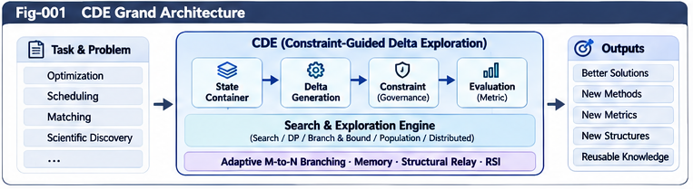
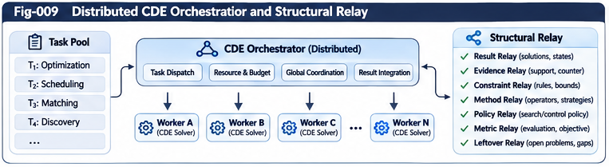
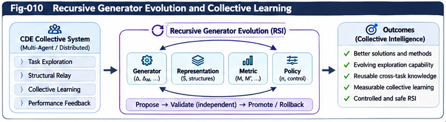

# EXT-004 — CDE Collective Intelligence and Structural RSI

**Project:** Constrained Delta Evolution (CDE)  
**Series:** Extensions — Final Research Paper  
**Status:** v1.0.0 research draft; proposed architecture and validation protocol  
**Date:** 2026-11-04  
**Authors:** Sizhe Tan and GPT-Obot  
**License:** Apache-2.0  
**Suggested repository location:** `docs/extensions/EXT-004-CDE-Collective-Intelligence-and-Structural-RSI.md`  
**Related:** CDE-001–012; SPEC-001–006; CASE-001–005; EXT-001–003; SIF, UIERU, AQSI, SSICR, and Structural Relay research.

## Abstract

Constrained Delta Evolution (CDE) provides a framework for exploring states under typed transitions, explicit constraints, versioned metrics, adaptive branching, and auditable evidence. Previous extensions considered population-based exploration, open-ended operator and representation evolution, and scientific hypothesis and metric discovery. This final extension asks how these capabilities can become a **collective, recursively improvable intelligence system** without conflating parallel activity with learning, shared artifacts with validated transfer, or self-modification with improvement.

We propose a **Collective CDE–Structural RSI architecture** in which heterogeneous agents and solvers explore tasks, publish typed Structural Relay artifacts, challenge each other's claims, and evaluate candidate changes to search generators, policies, representations, metrics, and collaboration protocols. A separate validation and governance layer determines which changes may be promoted. The architecture supports competition, cooperation, repeated execution as temporal evidence accumulation, explicit Leftovers, and cross-domain method transfer. Its central operational discipline is that a locally successful artifact must be revalidated in its target context before it becomes a shared capability.

This document defines the state and relay contracts, distributed coordination model, recursive evolution levels, portfolio scoring, independence requirements, safety and failure boundaries, benchmark families, experimental baselines, ablations, 64 proposed conformance tests, and an incremental validation roadmap. No implementation, empirical performance gain, sustained recursive improvement, or AGI capability is claimed.

**Central proposition:** Collective intelligence is a measured property of the system's ability to accumulate, validate, and reuse useful knowledge across tasks—not a synonym for agent count, message volume, or the number of iterations.

---



*Figure 1. Conceptual architecture of Constrained Delta Evolution. A versioned State–Delta–Constraint core supports adaptive proposal generation and solver portfolios; optional orchestration, independent validation, Structural Relay, and controlled meta-evolution extend the system without weakening hard-constraint governance.*

---



*Figure 9. A logical CDE orchestrator dispatches version-pinned exploration contracts to heterogeneous workers, reconciles global constraints and evidence, and publishes typed Structural Relay artifacts. Shared results and methods require target-side validation before being counted as transferable capabilities.*

---



*Figure 10. Controlled recursive evolution separates task exploration (L0), generator/operator evolution (L1), policy/representation adaptation (L2), and independent validation and governance (L3). Structural Relay can transmit validated methods and evidence across tasks, but recursive improvement and collective learning must be established empirically.*

---

## 1. Research Motivation

A single solver may discover a useful search path. A population of solvers may cover more territory. A distributed system may execute more trials. None of these facts alone establishes that the system has learned collectively. For collective learning, a discovery made in one context must improve subsequent behavior elsewhere, under appropriate validation and cost accounting.

The problem becomes more difficult when the system also changes its own search strategy. A new Delta generator can improve one benchmark while overfitting the benchmark suite; a new metric can make its own preferred solutions look better; a new representation can invalidate cached proofs; a new relay policy can amplify correlated errors; and an apparent speedup may be entirely explained by greater compute consumption.

CDE offers an opportunity to address these issues through explicit contracts. The proposed system separates (i) task-state exploration, (ii) transfer of evidence and methods, (iii) evolution of capability generators and policies, and (iv) independent evaluation and promotion. The separation is an architectural requirement, not a guarantee of good outcomes.

## 2. Research Questions

**RQ-1:** What operational evidence distinguishes distributed execution from collective learning?

**RQ-2:** How should Result, Evidence, Constraint, Method, Policy, Metric, and Leftover artifacts be represented and validated across heterogeneous agents?

**RQ-3:** When do competition, cooperation, and specialization improve solution quality relative to equally funded independent solvers?

**RQ-4:** Can repeated execution accumulate useful evidence without creating false confidence from correlated trials?

**RQ-5:** Which generator, representation, metric, and policy modifications can be safely proposed and tested as recursive self-improvement candidates?

**RQ-6:** How should task-level and meta-level progress be measured without allowing a candidate system to redefine its own success criteria?

**RQ-7:** How can distributed reconciliation, versioning, and governance prevent stale or locally valid artifacts from corrupting global decisions?

**RQ-8:** Under what conditions does Structural Relay generalize to new domains, and how can negative transfer be recognized early?

## 3. Falsifiable Hypotheses

**H1 — Validated transfer:** For related task families, a system with typed, target-validated Method Relay may achieve better held-out cost-adjusted utility than a no-relay system.

**H2 — Negative transfer:** Unrestricted artifact reuse will cause more target-context failures than reuse gated by applicability checks and independent validation.

**H3 — Diversity:** A heterogeneous solver portfolio may outperform a homogeneous population on task distributions with varied structure, but can underperform on narrowly specialized distributions.

**H4 — Temporal evidence:** Repeated execution with appropriately independent seeds or contexts can improve confidence and failure detection; repeated identical or dependent trials need not.

**H5 — Recursive improvement:** Controlled generator and policy changes may yield positive held-out meta-level gains, but self-scored promotion will increase overfitting and false improvements.

**H6 — Leftover intelligence:** Explicitly preserving unsolved cases and failed methods may improve future question generation and capability discovery compared with discarding failures.

**H7 — Governance cost:** Independent validation can reduce harmful promotions but may lower throughput; net utility must include validation overhead.

**H8 — Saturation:** Additional agents and relay traffic may show diminishing or negative returns due to coordination cost and evidence correlation.

These are testable hypotheses, not reported results.

## 4. Conceptual Distinctions

The following chain is deliberately non-equivalent:

\[
\boxed{\text{Parallel Execution}\ne\text{Coordination}\ne\text{Validated Transfer}\ne\text{Collective Learning}\ne\text{Structural RSI}}.
\]

- **Parallel execution** means concurrent work occurs.
- **Coordination** means work is allocated and reconciled coherently.
- **Validated transfer** means an artifact has demonstrated target-context applicability.
- **Collective learning** means accumulated shared knowledge measurably improves subsequent system behavior.
- **Structural RSI** means candidate modifications to the system's own capabilities or policies are independently evaluated and, when justified, authorized for use.

A single project can exhibit some properties without the others.

## 5. Formal Model

Let the collective system at logical epoch \(t\) be:

\[
\mathcal C_t=(\mathcal A_t,\mathcal T_t,\mathcal R_t,\mathcal K_t,\mathcal P_t,\mathcal V_t,\mathcal G_t),
\]

where \(\mathcal A\) is the set of agents/solvers, \(\mathcal T\) task portfolio, \(\mathcal R\) versioned Relay registry, \(\mathcal K\) validated capability registry, \(\mathcal P\) coordination and exploration policies, \(\mathcal V\) independent validation apparatus, and \(\mathcal G\) governance constraints.

For task \(i\), an agent explores a state under pinned task versions:

\[
s_{i,k+1}=T_{i,v}(s_{i,k},\delta_{i,k}),\quad \delta_{i,k}\in G_{i,v}(s_{i,k}),
\]

subject to \(C_{i,v}(s_{i,k+1})=\mathrm{PASS}\) before commitment. A candidate collective update \(\mu_t\) proposes:

\[
\widetilde{\mathcal C}_{t+1}=E(\mathcal C_t,\mu_t).
\]

The tilde denotes a **sandbox candidate**. It becomes an authorized successor only after the independent promotion contract succeeds. No general monotonicity follows from these equations.

## 6. Four Nested Learning Levels

**L0 — Task learning:** Explore and improve a particular task state, such as a bus schedule, graph correspondence, or scientific hypothesis.

**L1 — Method learning:** Identify reusable Deltas, solver configurations, heuristics, proof tactics, counterexample generators, or representation adapters.

**L2 — System policy learning:** Improve agent allocation, solver selection, branching budgets, relay routing, diversity preservation, and monitoring.

**L3 — Governance and independent validation:** Define and enforce authorized objectives, evaluation protocols, evidence independence, safety boundaries, promotion and rollback.

The first three layers may generate candidate changes. L3 must not be under unilateral control of the candidate being evaluated. A further meta-level can propose changes to L3, but such proposals require an independent external authority and fresh validation rather than self-approval.

## 7. Collective State Container

A collective state includes both task data and coordination data. It SHOULD carry:

```yaml
collective_state_id: "collective-epoch-004"
schema_version: "cde-collective-state@1.0.0"
epoch: 4
agent_registry_ref: "agents-v3"
task_portfolio_ref: "tasks-v5"
capability_registry_ref: "capabilities-v2"
relay_registry_ref: "relay-v6"
constraint_bundle_ref: "global-constraints-v4"
metric_bundle_ref: "independent-evaluation-v3"
policy_version: "allocation-policy-v2"
validation_protocol_ref: "heldout-suite-v3"
governance_version: "governance-v2"
resource_budget_ref: "budget-epoch-004"
provenance_ref: "collective-event-004"
```

Task-specific state, metric, constraint, and representation versions remain pinned within each task. A collective snapshot does not replace those task-level contracts.

## 8. Agent Roles and Separation of Duties

The proposed architecture includes logical roles:

| Role | Responsibility | Authority limit |
|---|---|---|
| Task Explorer | Generate and evaluate solution Deltas | Cannot certify global optimality without proof |
| Solver Specialist | Run MIP, CP-SAT, graph, local, or evolutionary methods | Cannot override hard constraints |
| Directional Scout | Prospect using weak evidence | Cannot convert weak evidence into proof |
| Counterexample Agent | Challenge candidate solutions and methods | Reports must be validated |
| Metric Analyst | Propose metric candidates and diagnostics | Cannot authorize own metric |
| Representation Designer | Propose state/operator evolution | Cannot deploy without migration validation |
| Relay Curator | Package and index artifacts | Publication is not promotion |
| Global Reconciler | Check cross-task consistency | Must use coherent versions |
| Independent Evaluator | Test held-out outcomes and regressions | Must avoid candidate-controlled evaluation |
| Governance Authority | Approve scope, activation, and rollback | Must be explicit and accountable |

One software process may perform multiple roles, but then the system must not claim independence that does not exist.

## 9. Seven Structural Relay Artifact Types

The core Relay taxonomy is:

1. **Result Relay:** solutions, partial solutions, certified bounds, and observed outcomes.
2. **Evidence Relay:** measurements, counterexamples, uncertainty, replication records, and provenance.
3. **Constraint Relay:** applicability conditions, newly discovered incompatibilities, and validated feasibility rules.
4. **Method Relay:** algorithms, Delta operators, heuristics, representation adapters, and procedural tactics.
5. **Policy Relay:** task selection, budget allocation, solver routing, and stopping policies.
6. **Metric Relay:** scoring functions, calibration models, objective hierarchies, and validation metadata.
7. **Leftover Relay:** unresolved tasks, partial migrations, failed proof obligations, missing evidence, and negative results.

These are distinct artifact semantics. A single package may reference several types but must not blur their validation status.

## 10. Canonical Relay Envelope

```yaml
relay_id: "relay-method-028"
relay_type: "Method"
artifact_schema_version: "cde-relay@1.0.0"
artifact_ref: "operator-block-reassign-v2"
source_task_ref: "school-bus-instance-family-a"
source_representation_ref: "vehicle-block-v2"
source_constraint_bundle_ref: "bus-constraints-v4"
source_metric_ref: "fleet-first-v3"
source_validation_ref: "source-heldout-report-028"
applicability_contract_ref: "vehicle-block-compatible-v2"
known_failure_modes:
  - "incompatible-school-time-windows"
  - "insufficient-reposition-time"
target_validation_status: "NOT_EVALUATED"
authorization_scope: "candidate-only"
provenance_ref: "relay-event-028"
```

A Relay envelope MUST distinguish *source validation* from *target validation*. The source artifact may be valid while target adoption remains unauthorized.

## 11. Relay Lifecycle

A recommended lifecycle is:

```text
DISCOVERED
  -> PACKAGED
  -> TYPE_VALIDATED
  -> SOURCE_EVIDENCE_REVIEWED
  -> INDEXED_AS_CANDIDATE
  -> TARGET_COMPATIBILITY_CHECKED
  -> TARGET_SANDBOX_EVALUATED
  -> {REJECTED, DEFERRED, ELIGIBLE}
  -> AUTHORIZED_FOR_SCOPE
  -> MONITORED
  -> {RETAINED, ROLLED_BACK, RETIRED}
```

The registry may preserve rejected and deferred artifacts for later reconsideration when evidence, representations, or constraints change. A rejection in one target is not a proof of universal invalidity.

## 12. Method Relay as a First-Class Learning Mechanism

A reusable method should contain its **operational semantics**, not merely a narrative description. The minimum package includes:

- method/operator ID and version;
- input/output types and compatible representations;
- preconditions, effects, and required invariants;
- constraint and metric dependencies;
- source task family and evidence;
- expected cost and resource bounds;
- known counterexamples and failure modes;
- target adaptation contract;
- conformance tests and promotion status.

A method's portability depends on matching these conditions. Reusing a function name or code snippet is not validated transfer.

## 13. Evidence Relay and Epistemic Independence

Evidence from different agents may be highly correlated because they share data, initial states, models, random seeds, or upstream assumptions. A relay system SHOULD record dependency provenance and avoid treating repeated dependent claims as independent confirmations.

For a set of evidence events \(e_1,\ldots,e_n\), the system may estimate uncertainty with an appropriate dependence model; it MUST NOT assume \(n\) independent trials solely because there are \(n\) agents. When independence cannot be established, the report should preserve that uncertainty.

**Negative evidence** is particularly valuable: failed transfer, contradictory outcomes, and rejected methods can constrain future exploration. Negative evidence must also be scoped; one failed context does not establish global impossibility.

## 14. Temporal Relay: Repeated Execution as Learning

Repeated execution can be a form of Relay when it accumulates new information. Examples include independent reruns of a stochastic solver, repeated evaluation under shifted inputs, monitoring of a deployed policy, or deliberate counterexample probing.

A temporal Relay event SHOULD record:

```yaml
temporal_relay_id: "temporal-eval-017"
method_ref: "solver-portfolio-v2"
task_family_ref: "matching-shift-b"
seed: 417
input_snapshot_ref: "instance-017"
metric_version: "matching-metric-v3"
constraint_version: "matching-constraints-v4"
result_ref: "result-017"
independence_group: "replicate-group-5"
evidence_role: "replication"
provenance_ref: "run-event-017"
```

Repetition is not automatically informative. Exact duplicate work with no new independent observation may only increase cost. The distinction must be measurable.

## 15. Collective Learning Criterion

Define a task distribution \(D\), a baseline system \(\mathcal C_0\), and a candidate collective system \(\mathcal C_1\). Let \(U\) denote an independently specified task outcome and \(K\) total cost. A possible comparison is:

\[
\Delta U_D = \mathbb E_{\tau\sim D}[U(\mathcal C_1,\tau)-U(\mathcal C_0,\tau)],
\]

with corresponding \(\Delta K_D\) and uncertainty intervals. A collective learning claim requires evidence that previously acquired shared artifacts improve **future, held-out tasks**, not just the tasks that produced those artifacts.

A cost-adjusted evaluation may use a preregistered utility function \(J(U,K)\), but the choice of weights or constraints must be authorized and versioned. A positive \(\Delta U_D\) does not automatically justify unlimited coordination cost.

## 16. The Collective Intelligence Frontier

The system may occupy different points on a frontier of solution quality, coverage, latency, compute cost, reliability, and transferability. A single scalar “collective intelligence score” is not assumed.

A multiobjective evaluation can report:

\[
\mathbf J(\mathcal C)=
(Q_{\mathrm{heldout}},R_{\mathrm{transfer}},C_{\mathrm{coverage}},
-L_{\mathrm{latency}},-K_{\mathrm{cost}},-F_{\mathrm{failure}}).
\]

The interpretation of each component and the selection rule must be explicit. Pareto superiority on a declared benchmark is not universal superiority.

## 17. Adaptive M-to-N Branching at Multiple Levels

CDE retains the distinction among:

- \(M\): generated Delta proposals;
- \(Q\): selected attempts;
- \(N\): realized transition/evaluation outcomes;
- \(K\): distinct successors.

For collective systems, these counts exist at separate scopes:

| Scope | Proposal | Successor |
|---|---|---|
| Task | Solution Delta | Candidate task state |
| Method | Operator/method Delta | Candidate capability |
| Representation | Schema/adapter Delta | Candidate representation |
| Policy | Routing/budget Delta | Candidate policy |
| Metric | Evaluation Delta | Candidate metric |
| Collective | Collaboration/relay Delta | Candidate system configuration |

A ledger MUST retain scope and version. Summing incompatible branch counts without normalization or interpretation is misleading.

## 18. Solver Portfolio and Specialization

A collective CDE system can combine exact, approximate, heuristic, and learned solvers. Examples include branch-and-bound, dynamic programming, MIP, CP-SAT, graph algorithms, local search, evolutionary optimization, Bayesian optimization, and program synthesis.

A solver may be specialized by domain, representation, objective, constraint structure, or available evidence. The Orchestrator SHOULD dispatch according to declared capabilities and measured costs, not brand or agent identity alone.

**Proof status remains solver-specific.** A heuristic improvement is not a certified bound; a worker's claimed optimum is not accepted without a valid certificate or applicable independent verification.

## 19. Cooperation, Competition, and Adversarial Review

Cooperation may share intermediate solutions, methods, and evidence. Competition may maintain diverse hypotheses or solver strategies. Adversarial review can search for constraint violations, reward hacking, and false generalization.

A healthy architecture preserves **productive disagreement**. Consensus among agents is not proof when agents are correlated. The system should preserve minority hypotheses and counterexamples when they meet relevance and evidence thresholds.

### 19.1 Competitive Relay

Competing methods may be evaluated on identical held-out tasks and matched budgets. A method that wins one task family can be retained for that family rather than promoted globally.

### 19.2 Counterexample priority

A validated counterexample to a safety claim may outweigh many successful demonstrations, depending on the claim's quantifiers. The system should not use simple vote counts to override hard violations.

## 20. Distributed Coordination Contract

A task envelope SHOULD include:

```yaml
task_id: "cde-distributed-042"
task_epoch: 8
source_state_ref: "snapshot-042"
representation_version: "graph-matching-v3"
delta_scope_ref: "regional-search-v2"
constraint_bundle_ref: "constraints-v5"
metric_version: "metric-v4"
policy_version: "policy-v3"
solver_contract_ref: "solver-graph-v2"
validation_contract_ref: "independent-check-v4"
resource_budget:
  evaluations: 2000
  wall_time_seconds: 900
lease_id: "lease-042-8"
idempotency_key: "task-042-epoch-8"
provenance_ref: "dispatch-042"
```

The coordinator MUST handle stale epochs, expired leases, retries, partial results, worker failures, duplicate messages, and conflicting updates. Distributed termination requires accounting for in-flight tasks, unresolved obligations, and admissible proof conditions where applicable.

## 21. Local Feasibility Is Not Global Feasibility

Two workers may produce locally feasible solutions that conflict when merged. Examples include two bus schedules requiring the same physical vehicle at overlapping times, two structural match partitions assigning the same one-to-one target, or two research agents double-counting the same evidence.

Global reconciliation must revalidate cross-partition constraints and resource budgets. A local `PASS` cannot be promoted into a global `PASS` without an appropriate composition theorem or independent global check.

## 22. Shared Incumbents and Proof Integrity

In optimization tasks, workers may share best-known feasible solutions (incumbents), bounds, and search-space exclusions. Every artifact must carry the objective, constraint, representation, and solver versions.

A candidate incumbent is accepted only after feasibility validation. A bound may be used for pruning only if its admissibility is established under the pinned objective and search semantics. Stale or incompatible bounds are quarantined. Heuristic low priority is not proof of infeasibility.

## 23. Structural RSI: What Is Being Improved?

The term **Structural Recursive Self-Improvement (Structural RSI)** is used narrowly: the system proposes modifications to the structures that generate, select, validate, coordinate, or transfer future work.

Candidate targets include:

- Delta generator operators and sampling distributions;
- state representation and abstraction interfaces;
- solver portfolio composition;
- task dispatch and resource allocation policies;
- method discovery and relay routing policies;
- evidence aggregation and uncertainty models;
- metric proposals, under independent metric governance;
- question-generation and counterexample policies;
- monitoring and rollback procedures, subject to separate authority.

Not every update is recursive. A one-time task solution or a cached answer does not itself constitute RSI.

## 24. RSI Candidate Lifecycle

```text
BOTTLENECK_OR_OPPORTUNITY
  -> META_DELTA_PROPOSAL
  -> TYPE_AND_AUTHORITY_CHECK
  -> SANDBOX_INSTANTIATION
  -> HELDOUT_META_EVALUATION
  -> COUNTEREXAMPLE_AND_SHIFT_TESTS
  -> INDEPENDENT_GOVERNANCE_REVIEW
  -> {REJECTED, DEFERRED, STAGED}
  -> LIMITED_ACTIVATION
  -> MONITORING
  -> {RETAINED, ROLLED_BACK, RETIRED}
```

A candidate that improves training performance but fails held-out evaluation must not be described as validated self-improvement. A staged candidate is not automatically authorized for production.

## 25. Meta-Delta Contract

```yaml
meta_delta_id: "meta-policy-015"
meta_delta_type: "REVISE_SOLVER_ALLOCATION"
source_policy_ref: "allocation-policy-v3"
candidate_policy_ref: "allocation-policy-v4-candidate"
change_scope:
  - "task-family-routing"
  - "budget-fraction"
precondition_contract_ref: "policy-inputs-v3"
unchanged_authorities:
  - "hard-constraint-validation"
  - "independent-evaluation"
  - "promotion-governance"
required_evidence:
  - "heldout-task-utility"
  - "total-cost-accounting"
  - "shift-tests"
  - "negative-controls"
authorization_scope: "sandbox-only"
rollback_checkpoint_ref: "allocation-policy-v3"
provenance_ref: "meta-proposal-015"
```

The candidate must not alter its own validation protocol, hide failures, or rewrite historical scores.

## 26. Recursive Improvement Versus Recursive Self-Confirmation

A dangerous feedback loop arises when a system generates a new policy, evaluates it with a metric it also modified, selects only favorable cases, and then declares improvement. This is self-confirmation, not independently demonstrated RSI.

A defensible evaluation pins:

1. task distribution or held-out suite;
2. primary outcome and cost accounting;
3. constraint and metric versions;
4. candidate and baseline information access;
5. statistical analysis plan;
6. promotion authority and rollback rules.

Adaptive validation-set reuse should be tracked and controlled. A sealed final test should not become a repeated tuning signal.

## 27. Metric Evolution and Governance

Metrics are particularly sensitive because they define what counts as success. The collective system may propose new metrics, but the metric generator cannot be its own final judge. Cross-version scores are not automatically comparable; comparisons require a common pinned metric or a validated mapping.

Where stakeholders have conflicting preferences, the system should preserve perspective-specific metrics or a Pareto set rather than invent a universal scalar objective. Hard safety and authorization constraints must not be traded away through arbitrary weights.

## 28. Representation and Operator Evolution

Open-ended capability evolution may introduce new State Containers, Delta types, macros, decomposition schemes, or solver interfaces. Every change needs typed migration and semantic validation.

A new representation may make previously unexpressible solutions representable, yet it may also invalidate state equivalence, path memory, caches, admissible bounds, and metric interpretation. New operators do not inherit old proofs automatically. The system should preserve both the old and candidate representations until migration obligations are resolved.

## 29. Autonomous Questioning as a Collective Input

AQSI-style Question Units can identify unresolved gaps, missing evidence, untested assumptions, and candidate experiments. A Leftover from one agent can become a structured question for another.

Example:

```yaml
question_unit_id: "question-bridge-012"
origin_leftover_ref: "unresolved-matching-schema-009"
question: "Does a composite correspondence representation reduce false matches under schema drift?"
assumptions:
  - "source-and-target-graphs-have-ground-truth-correspondences"
proposed_evidence:
  - "heldout-graph-benchmark"
  - "false-match-rate"
  - "cost-adjusted-utility"
relay_target: "representation-research-portfolio"
status: "PROPOSED"
```

More generated questions do not imply better research. Question quality must be evaluated by downstream information gain, answerability, or validated task utility.

## 30. Scientific Discovery and Collective Evidence

Scientific hypothesis exploration is a demanding test case because it combines uncertain evidence, competing explanations, experiment selection, and measurement evolution.

Agents may specialize in hypothesis generation, experimental design, counterexample search, statistical evaluation, and replication. Evidence Relay must preserve causal assumptions, experimental conditions, provenance, and uncertainty. Correlation is not causal identification; predictive accuracy is not scientific confirmation.

A collective system should reward discriminating experiments and replication, not merely publication volume or internal hypothesis scores.

## 31. Case Family A — Multi-Scale Peak Search

Use synthetic multi-peak landscapes with known reference values. Assign workers different local, regional, and long-range Delta policies. Compare independent solvers, shared incumbents, directional scouts, and validated Method Relay.

Primary outcomes: best feasible value, evaluation count, wall-clock time, coverage, diversity, and total coordination overhead. Negative controls include smooth unimodal landscapes where one strong solver may be sufficient.

## 32. Case Family B — Constrained School-Bus Scheduling

Use synthetic school districts with route assignments, school windows, student ride-time caps, vehicle capacity, physical vehicle reuse, and driver/resource constraints where declared.

Agent roles may include assignment, routing, vehicle-block scheduling, constraint validation, and strategy search. The global reconciler checks fleet reuse and timing. The objective must distinguish **physical vehicle count** from route count.

Method Relay can transfer a useful block-reassignment heuristic across district instances, but target timing and compatibility must be revalidated. Compare with strong integrated optimization baselines under matched budgets.

## 33. Case Family C — Dynamic Structural Matching

Use synthetic graph/entity matching with controlled attribute noise, relation ambiguity, one-to-one versus many-to-one profiles, and explicit abstention.

Competing agents generate match hypotheses and counterexamples; evidence agents evaluate provenance and dependence; a global reconciler enforces cardinality and consistency. Relay can share structural matching methods, not unsupported claims about real-world identities.

Privacy-preserving synthetic data should be preferred. Public keys, network metadata, or shared infrastructure are not by themselves proof of a human identity. The benchmark should not facilitate unauthorized identification of real persons.

## 34. Case Family D — Metric Co-Evolution

Multiple agents propose metric candidates, evaluate proxy failures, and search for counterexamples. The independent evaluator measures held-out decision utility and robustness. The governance controller authorizes any metric change.

Negative controls include a correct fixed metric, a manipulable proxy, validation leakage, and metric scale incompatibility. A candidate that improves its own score without improving independent utility must not be promoted.

## 35. Case Family E — Open-Ended Operator and Representation Discovery

One group diagnoses expressivity bottlenecks; another generates candidate operators or schemas; another tests semantic preservation and counterexamples. Target tasks include vehicle-block abstractions, composite graph correspondences, and adaptive coordinate transformations.

Compare with program synthesis, genetic programming, hand-designed macros, and fixed representation portfolios. Include all synthesis and migration costs.

## 36. Case Family F — Scientific Hypothesis Relay

Use synthetic scientific domains with controlled ground truth, competing hypotheses, experimental costs, and evidence noise. Agents may generate questions, propose experiments, run simulated trials, and challenge conclusions.

The primary measure is independent hypothesis discrimination or decision utility, not the count of hypotheses or papers generated. Include negative controls for correlated replication and p-hacking-like adaptive selection.

## 37. Case Family G — Cross-Domain Method Transfer

Construct related and unrelated task pairs. For example, a neighborhood-search strategy discovered in bus scheduling may be abstracted and tested on constrained allocation; a counterexample-generation method may transfer from graph matching to hypothesis testing.

Each target task requires a compatibility adapter and independent evaluation. Report positive, neutral, and negative transfer. A useful analogy is a hypothesis, not a guarantee.

## 38. Case Family H — Longitudinal Collective Learning

Present tasks sequentially over many epochs. The system may accumulate validated methods and evidence, while a matched baseline either resets its registry or uses a restricted memory policy.

Measure future-task utility, transfer benefit, storage and retrieval cost, registry growth, failure rate, and performance under task-distribution shift. Separate gains from increased compute, larger context windows, or repeated exposure to the same instances.

## 39. Strong Baselines

| ID | Baseline | Main distinction |
|---|---|---|
| B0 | Best available single solver | No collective layer |
| B1 | Independent parallel solvers | Parallelism without relay |
| B2 | Shared incumbent only | Minimal cooperation |
| B3 | Centralized portfolio selection | No open method registry |
| B4 | Homogeneous multi-agent system | No specialization |
| B5 | Heterogeneous agents without Relay | Specialization alone |
| B6 | Unrestricted message sharing | Communication without validation |
| B7 | Static method library | No method evolution |
| B8 | Population-based training/search | Established adaptation baseline |
| B9 | Human-designed workflow | Expert orchestration |
| C1 | CDE + validated Result Relay | Result sharing |
| C2 | CDE + Method/Evidence Relay | Transferable knowledge |
| C3 | CDE + full seven-type Relay | Broad structural memory |
| C4 | CDE + controlled policy evolution | Governed meta-learning |
| C5 | CDE + controlled generator/representation evolution | Structural RSI candidate |

Baselines must receive comparable data access and total budgets. Where a baseline is stronger, the negative result is part of the research contribution.

## 40. Ablation Matrix

| ID | Ablation | Mechanism tested |
|---|---|---|
| A01 | Remove Result Relay | Shared incumbents |
| A02 | Remove Evidence Relay | Cross-agent verification |
| A03 | Remove Constraint Relay | Compatibility knowledge |
| A04 | Remove Method Relay | Reusable capabilities |
| A05 | Remove Policy Relay | Coordination knowledge |
| A06 | Remove Metric Relay | Evaluation transfer |
| A07 | Remove Leftover Relay | Failure-driven discovery |
| A08 | Disable target validation | Negative transfer risk |
| A09 | Disable counterexample agent | Error detection |
| A10 | Homogeneous solvers only | Diversity |
| A11 | No competition | Strategy diversity |
| A12 | No cooperation | Coordination |
| A13 | No temporal replication | Evidence accumulation |
| A14 | No dependence tracking | False confidence |
| A15 | Freeze generator | Operator RSI |
| A16 | Freeze policy | Policy RSI |
| A17 | Freeze representation | Expressivity evolution |
| A18 | Freeze metric | Metric evolution |
| A19 | Remove governance gate | Unauthorized promotion |
| A20 | Remove rollback | Recovery from regression |
| A21 | Remove cost accounting | Hidden overhead |
| A22 | Remove global reconciliation | Cross-partition conflicts |
| A23 | Remove diversity reserve | Premature convergence |
| A24 | Remove cross-domain validation | Generalization claims |

## 41. Negative Controls and Failure Injection

**NC-01:** Independent parallel solvers already achieve the same result with lower overhead.

**NC-02:** Two agents independently report the same upstream evidence and it is incorrectly counted twice.

**NC-03:** A method successful in one domain violates target constraints.

**NC-04:** A worker returns a stale metric version with an apparently superior score.

**NC-05:** Local feasible solutions conflict on a global resource.

**NC-06:** A heuristic exclusion is mistaken for certified infeasibility.

**NC-07:** A metric candidate improves its own score while independent utility decreases.

**NC-08:** A generator overfits a public validation suite.

**NC-09:** A candidate edits the validator used to approve itself.

**NC-10:** A representation migration invalidates a cached proof.

**NC-11:** A Relay artifact omits known counterexamples.

**NC-12:** A registry fills with syntactic duplicates but reports innovation growth.

**NC-13:** Repeated executions share a seed and are treated as independent.

**NC-14:** A negative transfer is suppressed from future agent retrieval.

**NC-15:** Coordination cost exceeds any measured improvement.

**NC-16:** Agent count increases but effective coverage falls due to duplicated work.

**NC-17:** A stale lease is retried and commits twice.

**NC-18:** A partial distributed result is reported as exhaustive.

**NC-19:** A safety constraint is converted into a soft penalty by a policy update.

**NC-20:** A rollback checkpoint cannot undo an external action.

**NC-21:** A question-generation agent produces many questions with no downstream information gain.

**NC-22:** An apparent multi-generation RSI gain disappears on a sealed task distribution.

**NC-23:** An old method is reused after feature semantics change.

**NC-24:** A collective score hides severe degradation on a minority task family.

## 42. Evaluation Measures

Primary outcomes should be preregistered and independently measured:

1. **Held-out feasible utility:** quality under declared hard constraints.
2. **Transfer gain:** target-task improvement attributable to previously learned artifacts.
3. **Cost-adjusted gain:** outcome improvement net of compute, validation, coordination, and storage costs.
4. **Time to validated solution:** elapsed time until an independently accepted result.
5. **Coverage and diversity:** validated exploration breadth under a declared state/strategy grammar.
6. **False promotion rate:** promoted methods/policies that fail independent criteria.
7. **Negative transfer rate:** harmful target adoptions under specified tests.
8. **Evidence quality:** provenance completeness, dependence handling, and replication.
9. **Reliability:** stale commits, conflicts, constraint violations, and rollback failures.
10. **Longitudinal gain:** future-task improvement across epochs with uncertainty intervals.

No single metric should silently stand in for all ten dimensions.

## 43. Attribution and Causal Evaluation

Observed gains may arise from additional compute, larger task coverage, better base models, solver specialization, better metrics, or Structural Relay. To attribute gains, compare matched-budget ablations and randomized or paired task allocations where possible.

A useful design randomizes whether compatible target tasks receive a validated Relay artifact, holding other information constant. Measure the average target-task effect and uncertainty. This is still conditional on task selection, artifact quality, and the evaluation environment.

Avoid using the same task both to discover a method and to claim independent transfer success.

## 44. Statistical Protocol

Use multiple independent task instances and stochastic seeds. Pre-register primary contrasts, minimum meaningful effect sizes, budget limits, and stopping rules. Report paired differences and confidence intervals; account for hierarchical dependence when multiple tasks share source artifacts or model families.

Adaptive selection across many candidate policies can bias the best observed result. Use development sets for tuning, promotion validation for controlled selection, and a sealed final test for claims. Report unsuccessful candidates and multiple-testing caveats.

An exploratory target of 30 independent replicates per configuration may be used for planning, but required sample size depends on variance and desired statistical power.

## 45. Resource Accounting

Every run SHOULD report:

```yaml
resource_ledger:
  task_evaluations: 12000
  agent_calls: 740
  method_proposals: 95
  validation_attempts: 42
  successful_target_transfers: 7
  total_cpu_seconds: null
  total_gpu_seconds: null
  coordination_seconds: null
  storage_bytes: null
  monetary_cost: null
  unresolved_tasks: 18
```

These values are illustrative, not observed. Null indicates unknown; unknown costs must not be treated as zero. Cost-adjusted claims require sufficient measurement coverage.

## 46. Reference Algorithm — Collective CDE Epoch

```text
function COLLECTIVE_CDE_EPOCH(collective_snapshot, task_portfolio, budget):
    pin_versions(collective_snapshot)
    validate_global_policy_and_constraints()
    registry = read_authorized_capability_registry()

    tasks = select_tasks_with_diversity_and_budget(task_portfolio)
    assignments = dispatch_by_capability_contract(tasks, registry)
    track_M_Q_N_K_by_scope(assignments)

    for result in receive_worker_results(assignments):
        if stale_or_duplicate_or_unauthorized(result):
            quarantine_and_record(result)
            continue
        if not verify_local_contract(result):
            record_failure_and_leftover(result)
            continue
        stage_for_global_reconciliation(result)

    reconciled = independently_reconcile_global_constraints()
    commit_only_validated_results(reconciled)

    relay_candidates = package_typed_artifacts(
        results=reconciled,
        evidence=counterexamples_and_replications(),
        methods=method_candidates(),
        leftovers=unresolved_work()
    )
    index_candidates_without_automatic_promotion(relay_candidates)

    for transfer in select_target_transfer_trials(relay_candidates):
        if not compatibility_check(transfer):
            record_negative_or_deferred_transfer(transfer)
            continue
        report = independent_target_evaluation(transfer)
        submit_validated_report_for_governance(report)

    monitor_costs_regressions_and_unresolved_tasks()
    return immutable_epoch_report()
```

The pseudocode is conceptual. A production implementation needs explicit concurrency control, secure execution, data access restrictions, and precise commit protocols.

## 47. Reference Algorithm — Controlled Structural RSI

```text
function CONTROLLED_STRUCTURAL_RSI(system_snapshot, meta_budget):
    baseline = pin_authorized_system_and_evaluation_protocol()
    bottlenecks = analyze_failures_costs_and_leftovers()
    proposals = generate_typed_meta_deltas(bottlenecks, meta_budget)
    record_meta_branch_accounting(proposals)

    for candidate in select_diverse_proposals(proposals):
        if not type_and_authority_check(candidate):
            reject_and_record(candidate)
            continue
        sandbox = instantiate_isolated_candidate(candidate)
        if not validate_semantics_constraints_and_migrations(sandbox):
            preserve_counterexamples(candidate)
            continue

        report = evaluate_on_heldout_tasks(
            candidate=sandbox,
            baseline=baseline,
            matched_total_budget=True,
            independent_evaluator=True
        )
        report = augment_with_shift_and_negative_controls(report)
        record_complete_evidence(candidate, report)

        if report.meets_preregistered_criteria:
            submit_to_external_promotion_authority(candidate, report)
        else:
            retain_as_rejected_or_leftover(candidate)

    decision = read_authorized_decision()
    if decision.approved:
        stage_with_checkpoint_and_monitoring(decision)
    if regression_or_safety_trigger():
        rollback_where_reversible_and_escalate()
    return audited_meta_evolution_report()
```

A candidate's own evaluation code must not unilaterally determine `meets_preregistered_criteria`.

## 48. Independent Governance Model

Governance covers authorization boundaries, evaluation criteria, data access, privacy, safety, resource limits, and rollback. A collective system may propose governance changes, but it cannot self-authorize them.

At minimum, promotion requires:

- an immutable candidate and baseline definition;
- a pinned, independently controlled validation protocol;
- evidence of hard-constraint preservation;
- held-out outcome and cost comparisons;
- failure and shift analysis;
- authorized scope and monitoring conditions;
- a rollback or containment plan;
- an accountable decision record.

Governance is a constraint on capability deployment, not a substitute for empirical evaluation.

## 49. Security, Privacy, and Misuse Boundaries

A distributed collective system may process sensitive task data or generate powerful capabilities. Apply least privilege, sandboxing, data minimization, audit logs, and explicit authorization. Relay artifacts should not leak private source records, credentials, or proprietary information into shared registries.

Where matching or attribution tasks involve people, use synthetic or authorized datasets, minimize identity inference, and avoid treating weak technical correlations as definitive identity evidence. Where generated operators can act on external systems, use bounded permissions and human authorization for consequential or irreversible actions.

The framework does not authorize autonomous modification of its own security or governance controls.

## 50. Failure Modes and Recovery

**F1 — Coordination collapse:** Too many agents duplicate work. Remedy: coverage accounting and diversity-aware dispatch.

**F2 — Evidence echo chamber:** Correlated reports amplify false confidence. Remedy: provenance dependency graph and independent replication.

**F3 — Relay contamination:** An invalid method spreads across tasks. Remedy: candidate-only registry status and target validation.

**F4 — Global constraint conflict:** Local solutions cannot coexist. Remedy: independent reconciliation.

**F5 — Stale-version acceptance:** Old metrics or schemas appear valid. Remedy: version-pinned commits and cache invalidation.

**F6 — Metric capture:** Candidate changes its own success measure. Remedy: independent metric governance.

**F7 — Generator overfitting:** Meta-learning specializes to public benchmarks. Remedy: sealed held-out tasks and negative controls.

**F8 — False completeness:** Partial exploration is described as exhaustive. Remedy: solver-specific proof obligations.

**F9 — Unbounded relay growth:** Registry becomes costly and noisy. Remedy: provenance-preserving indexing, deduplication, and retention policies.

**F10 — Irreversible regression:** Rollback cannot undo external effects. Remedy: staging, permissions, and explicit irreversibility analysis.

**F11 — Negative transfer:** Source method fails in target. Remedy: compatibility checks and scoped rejection evidence.

**F12 — Validation bottleneck:** Promotion queues overwhelm evaluators. Remedy: tiered risk-based evaluation without relaxing hard safety gates.

## 51. Formal Invariants

**INV-CI-01:** Every committed task state is validated under a coherent constraint/version snapshot.

**INV-CI-02:** Every Relay artifact carries type, provenance, source context, and validation status.

**INV-CI-03:** Source validation never automatically implies target authorization.

**INV-CI-04:** Local feasibility is not promoted to global feasibility without reconciliation.

**INV-CI-05:** Independent evidence claims account for shared dependencies.

**INV-CI-06:** Method, metric, representation, and policy versions are preserved in result records.

**INV-CI-07:** Incompatible scores are not directly compared without a valid mapping.

**INV-CI-08:** Heuristic exclusions are not treated as certified infeasibility.

**INV-CI-09:** Stale and duplicate distributed results cannot create duplicate committed effects.

**INV-CI-10:** Candidate meta-Deltas cannot authorize their own promotion.

**INV-CI-11:** Hard constraints cannot be silently weakened through metric or policy evolution.

**INV-CI-12:** Historical evidence is not rewritten by subsequent metric changes.

**INV-CI-13:** Failed and partial work remains traceable as Leftover or negative evidence.

**INV-CI-14:** Resource and validation costs are included in performance claims.

**INV-CI-15:** Promotion scope, monitoring, and rollback obligations are explicit.

**INV-CI-16:** No conformance result is misrepresented as proof of AGI or unbounded RSI.

## 52. Conditional Propositions

### Proposition 1 — Conditional global constraint preservation

If all committed local results are validated under coherent task versions, the global reconciler soundly checks all cross-task constraints, and the commit mechanism is atomic with respect to the relevant shared resources, then committed collective states preserve the encoded global constraints.

This does not prove the encoded constraints are complete or correctly model the real world.

### Proposition 2 — Conditional transfer validity

If a Method Relay artifact satisfies a target's applicability contract and an independent target evaluator establishes the declared success criterion under the target's versions and distribution, then the method has validated applicability **within that tested scope**.

The conclusion does not generalize automatically to other targets or future shifts.

### Proposition 3 — Evidence dependence

If two purported confirmations derive deterministically from the same underlying observation and processing pipeline, counting them as two independent observations is unjustified. Correct uncertainty estimation must represent or bound that dependence.

### Proposition 4 — No automatic RSI theorem

Even if every promoted candidate improves a finite validation suite, it does not follow that performance improves monotonically on all future tasks. Distribution shift, selection bias, cost, and representation changes can break the implication.

## 53. Conformance Test Matrix

| ID | Test | Expected behavior |
|---|---|---|
| CI-001 | Valid collective state manifest | Accepted |
| CI-002 | Missing epoch/version | Rejected |
| CI-003 | Unknown agent capability | No unsupported dispatch |
| CI-004 | Incompatible task schema | Rejected/deferred |
| CI-005 | Missing hard-constraint bundle | No commit |
| CI-006 | Invalid task Delta | Rejected |
| CI-007 | Task M/Q/N/K counts | Reconciled |
| CI-008 | Meta M/Q/N/K counts | Separate ledger |
| CI-009 | Heuristic prune claims proof | Rejected |
| CI-010 | Worker returns feasible candidate | Independent check |
| CI-011 | Local-global conflict | Global rejection/repair |
| CI-012 | Shared resource double booking | Prevented |
| CI-013 | Stale worker epoch | Quarantined |
| CI-014 | Expired lease | Revalidated/reassigned |
| CI-015 | Duplicate retry | Idempotent commit |
| CI-016 | Partial result | Typed partial status |
| CI-017 | Distributed termination | In-flight obligations accounted |
| CI-018 | Invalid incumbent | Not shared as feasible |
| CI-019 | Stale optimization bound | Not used for certified prune |
| CI-020 | Result Relay missing provenance | Rejected |
| CI-021 | Evidence Relay missing dependency | Flagged |
| CI-022 | Constraint Relay wrong version | Not applied |
| CI-023 | Method Relay missing preconditions | Candidate only/rejected |
| CI-024 | Policy Relay unauthorized | No activation |
| CI-025 | Metric Relay incomparable scores | Re-score or block |
| CI-026 | Leftover Relay partial task | Preserved |
| CI-027 | Source-valid target-unknown | No target promotion |
| CI-028 | Target schema incompatible | Transfer blocked |
| CI-029 | Target validation fails | Negative transfer recorded |
| CI-030 | Known counterexample omitted | Evidence integrity failure |
| CI-031 | Correlated evidence treated independent | Flagged |
| CI-032 | Independent replication | Distinct provenance |
| CI-033 | Identical repeat | No false evidence gain |
| CI-034 | Relay duplicate | Dedup without evidence loss |
| CI-035 | Method registry supersession | Lineage retained |
| CI-036 | Method execution over budget | Stopped/reported |
| CI-037 | Candidate metric self-scores | No promotion |
| CI-038 | Metric version changes | Historical scores intact |
| CI-039 | Candidate weakens hard constraint | Separate authority required |
| CI-040 | Representation migration changes equivalence | Cache invalidation |
| CI-041 | Operator semantic change | New version and tests |
| CI-042 | Meta-Delta missing contract | Rejected |
| CI-043 | Candidate edits validator | Blocked |
| CI-044 | Held-out validation unavailable | No unsupported claim |
| CI-045 | Validation UNKNOWN | Not PASS |
| CI-046 | Candidate improves training only | Not automatically promoted |
| CI-047 | Negative-control regression | Recorded |
| CI-048 | Shift test failure | Scope restricted/rejected |
| CI-049 | Governance decision absent | No activation |
| CI-050 | Promotion record incomplete | Rejected |
| CI-051 | Rollback checkpoint missing | Risk-dependent block |
| CI-052 | Irreversible external effect | Disclosed and gated |
| CI-053 | Monitoring detects regression | Trigger/escalation |
| CI-054 | Budget accounting incomplete | Cost claim qualified |
| CI-055 | Additional agents reduce utility | Negative result retained |
| CI-056 | Unmatched baseline resources | Comparison flagged |
| CI-057 | Shared method leaks restricted data | Blocked |
| CI-058 | Identity inference from weak signals | No unsupported attribution |
| CI-059 | Question volume used as science quality | Invalid metric claim |
| CI-060 | Source success claimed universal | Rejected |
| CI-061 | Multi-generation RSI claimed from self-score | Rejected |
| CI-062 | False AGI inference | Unsupported claim |
| CI-063 | Repeated execution lacks independence | Dependence disclosed |
| CI-064 | Leftover leads to new testable question | Provenance preserved |

These are proposed conformance tests. They have not been executed for this manuscript.

## 54. Experimental Roadmap

**V1 — Contract review:** Define collective state, task, relay, meta-Delta, and promotion schemas.

**V2 — Deterministic fixtures:** Test distributed state reconciliation, stale results, and version semantics.

**V3 — Solver baselines:** Establish strong single-solver and independent parallel baselines.

**V4 — Seven-type Relay:** Implement typed artifact packaging, indexing, and target validation.

**V5 — Negative transfer:** Evaluate compatible and incompatible task families.

**V6 — Temporal evidence:** Test replication and dependence-aware aggregation.

**V7 — Longitudinal learning:** Measure future-task gains over multiple epochs.

**V8 — Meta-Delta sandbox:** Test generator and policy evolution with fixed independent criteria.

**V9 — Metric and representation evolution:** Add separate governance and migration checks.

**V10 — Distributed fault injection:** Test leases, retries, global conflicts, and partial failures.

**V11 — Security and governance:** Review permissions, data access, rollback, and irreversible effects.

**V12 — External replication:** Publish code, preregistered analyses, negative results, uncertainty, and limitations.

No phase is asserted completed.

## 55. Proposed Implementation Layout

```text
ext-004-collective-cde-rsi/
├── README.md
├── contracts/
│   ├── collective-state.schema.json
│   ├── distributed-task.schema.json
│   ├── relay-envelope.schema.json
│   ├── meta-delta.schema.json
│   └── promotion-record.schema.json
├── agents/
│   ├── task_explorer.py
│   ├── method_inventor.py
│   ├── counterexample_agent.py
│   ├── relay_curator.py
│   └── global_reconciler.py
├── orchestration/
│   ├── task_dispatch.py
│   ├── leases_and_retries.py
│   ├── global_commit.py
│   └── resource_accounting.py
├── relay/
│   ├── registry.py
│   ├── compatibility.py
│   ├── target_validation.py
│   └── negative_transfer.py
├── meta_evolution/
│   ├── generator_deltas.py
│   ├── policy_deltas.py
│   ├── sandbox_evaluation.py
│   └── governance_gate.py
├── benchmarks/
│   ├── peak_search.py
│   ├── school_bus.py
│   ├── structural_matching.py
│   ├── metric_evolution.py
│   ├── scientific_discovery.py
│   └── longitudinal_transfer.py
├── tests/
│   ├── test_conformance.py
│   ├── test_fault_injection.py
│   ├── test_negative_controls.py
│   └── test_relay_integrity.py
└── reports/
    ├── heldout_utility.csv
    ├── transfer_effects.csv
    ├── resource_costs.csv
    ├── promotion_audit.csv
    └── limitations.md
```

This is a proposed companion layout, not a claim that the implementation exists.

## 56. Run Manifest

```yaml
run_id: string
collective_epoch: integer
task_family: string
task_instance_id: string
seed: integer
agent_portfolio_ref: string
solver_portfolio_ref: string
constraint_bundle_ref: string
metric_bundle_ref: string
representation_version: string
policy_version: string
relay_registry_version: string
validation_protocol_ref: string
task_proposals_M: integer
task_attempts_Q: integer
task_realizations_N: integer
task_successors_K: integer
meta_proposals_M: integer
meta_attempts_Q: integer
meta_realizations_N: integer
meta_successors_K: integer
relay_candidates: integer
target_validated_transfers: integer
negative_transfers: integer
heldout_utility: number_or_null
total_cost: number_or_null
constraint_violations: integer
false_promotions: integer
unresolved_leftovers: integer
provenance_ref: string
```

Unknown data must remain explicitly unknown; fabricated values are prohibited.

## 57. Relationship to the CDE Research Corpus

**Foundations CDE-001–012** define State–Delta–Constraint exploration, path semantics, solver integration, directional fields, metric co-evolution, orchestration, distribution, Structural Relay, recursive evolution, and generalization limits.

**Specifications SPEC-001–006** define the contracts for state, Delta, path, solver, distributed relay, and metric/recursive evolution.

**Cases CASE-001–005** provide controlled testbeds for multi-scale peak search, school-bus scheduling, dynamic structural matching, metric discovery, and distributed Method Relay.

**EXT-001** introduces population-based and biomimetic exploration.

**EXT-002** studies open-ended operator and representation evolution.

**EXT-003** studies scientific hypothesis, experiment, evidence, and metric discovery.

**EXT-004** integrates those mechanisms into a collective, governed RSI research architecture.

The corpus is a research design and specification collection. Its breadth does not substitute for experimental validation.

## 58. Relationship to SIF, UIERU, AQSI, and SSICR

**SIF Localization:** Collective CDE can prospect for promising solutions, methods, representations, metrics, evidence, and capability addresses. Dynamic localization extends static retrieval but requires explicit validation of discovered candidates.

**UIERU:** A validated method or operator can become a portable intelligence unit with contracts and Relay lineage. Portability is conditional on target compatibility.

**AQSI:** Leftovers, contradictory evidence, and unexpressible tasks can generate structured questions that guide new experiments and capability development.

**SSICR:** Competitive strategies and counterexample agents can challenge proposals and maintain diversity. Competition is evaluated by outcomes, not rhetoric or agent count.

**Structural RSI:** Changes to generators, policies, representations, and metrics are evaluated as meta-level candidates with independent promotion boundaries.

These interfaces are proposed architectural correspondences, not proven interoperable implementations.

## 59. Generalization Boundaries

The following implications are invalid without additional evidence:

\[
\begin{aligned}
\text{More Agents} &\not\Rightarrow \text{More Intelligence},\\
\text{More Relay} &\not\Rightarrow \text{Better Transfer},\\
\text{More Iterations} &\not\Rightarrow \text{Independent Evidence},\\
\text{Better Self-Score} &\not\Rightarrow \text{Better System},\\
\text{Local Gain} &\not\Rightarrow \text{Global Gain},\\
\text{Finite RSI Success} &\not\Rightarrow \text{Open-Ended RSI or AGI}.
\end{aligned}
\]

The architecture may help organize and test hypotheses about collective intelligence. It does not establish a universal law of intelligence growth, guarantee safe autonomous self-modification, or demonstrate AGI.

## 60. Open Research Questions

1. What is the smallest set of Relay contracts sufficient for measurable collective learning?
2. How can method compatibility be checked without solving the entire target problem first?
3. When is centralized orchestration preferable to decentralized coordination?
4. Can negative evidence be compressed without losing essential context?
5. How should shared evidence dependencies be represented at scale?
6. How much agent diversity is useful before coordination overhead dominates?
7. Can agent specialization emerge from validated task outcomes rather than fixed role labels?
8. What are sound rules for distributed proof and incumbent sharing?
9. How can Leftovers be prioritized for autonomous questioning?
10. When does repeated execution produce genuinely new evidence?
11. How should metric governance operate across conflicting perspectives?
12. Which meta-Deltas improve held-out capability generation rather than benchmark fit?
13. Can operator genesis be made constraint-preserving by construction?
14. How should representation migrations affect Relay compatibility?
15. How can long-term collective learning be separated from growing compute budgets?
16. What evidence would establish robust multi-generation RSI on shifting tasks?
17. How should irreversible actions constrain recursive policy updates?
18. Can the system detect when a transferred method becomes stale?
19. What are the appropriate stopping rules for open-ended exploration under finite resources?
20. How can external researchers independently reproduce and challenge collective-learning claims?

## 61. Conclusion

The proposed Collective CDE–Structural RSI architecture treats intelligence growth as a sequence of **explicitly proposed, validated, and conditionally transferable structural changes**. Agents may search, compete, collaborate, and generate new methods. Their outputs become collective knowledge only when the system can preserve context, verify applicability, measure downstream benefit, and retain negative evidence.

The essential cycle is:

\[
\boxed{
\begin{gathered}
\text{Explore Tasks and Preserve Leftovers}\\
\downarrow\\
\text{Generate Results, Evidence, Methods, and Questions}\\
\downarrow\\
\text{Package Typed Structural Relay Artifacts}\\
\downarrow\\
\text{Validate in Target Contexts}\\
\downarrow\\
\text{Measure Collective Learning on Held-Out Tasks}\\
\downarrow\\
\text{Propose Generator, Policy, and Representation Meta-Deltas}\\
\downarrow\\
\text{Independently Evaluate, Authorize, Monitor, or Roll Back}
\end{gathered}}
\]

The decisive distinction is not whether a system changes itself, but whether the change produces **independently validated, appropriately scoped improvements**. In that sense, Structural Relay provides a possible mechanism for collective accumulation, while CDE provides a disciplined exploration and control framework. Their integration is a substantial research hypothesis, not an already established outcome.

---

## Appendix A — Minimal Collective Learning Benchmark

```yaml
benchmark_id: "EXT-004-COLLECTIVE-CDE-RSI"
version: "1.0.0"
profiles:
  - "peak-search"
  - "school-bus"
  - "structural-matching"
  - "metric-evolution"
  - "operator-representation-discovery"
  - "scientific-hypothesis"
  - "cross-domain-transfer"
  - "longitudinal-learning"
primary_outcomes:
  - "independent-heldout-utility"
  - "target-transfer-effect"
  - "total-resource-cost"
  - "constraint-violation-rate"
  - "false-promotion-rate"
controls:
  - "best-single-solver"
  - "independent-parallel"
  - "shared-incumbent-only"
  - "no-relay"
  - "no-meta-evolution"
validation:
  sealed_final_test: true
  matched_budgets: true
  negative_controls: true
  provenance_required: true
  independent_promotion: true
```

This configuration is illustrative and has not been executed.

## Appendix B — Method Relay Acceptance Example

```yaml
transfer_trial_id: "transfer-035"
source_method_ref: "adaptive-regional-delta-v3"
source_validation_ref: "source-report-035"
target_task_ref: "constrained-allocation-family-b"
compatibility_checks:
  representation: "PASS"
  operator_preconditions: "PASS"
  hard_constraints: "PASS"
  metric_semantics: "PASS"
independent_target_evaluation: "PENDING"
promotion_status: "NOT_AUTHORIZED"
known_limitations:
  - "not-tested-under-distribution-shift"
provenance_ref: "transfer-event-035"
```

Compatibility alone is insufficient to claim target benefit.

## Appendix C — Claim-to-Evidence Registry

| Claim | Minimum evidence | Insufficient evidence |
|---|---|---|
| Distributed execution | Verified concurrent task logs | Agent names |
| Coherent coordination | Global reconciliation and consistency tests | Local PASS reports |
| Validated transfer | Independent target outcomes | Source success |
| Collective learning | Future-task gains under matched budgets | Shared messages |
| Temporal evidence accumulation | Distinct observations and dependence model | Duplicate reruns |
| Better policy | Held-out utility and cost | Self-scored improvement |
| Better generator | Meta-level independent task suite | More candidate Deltas |
| Safe activation | Constraints, authorization, monitoring | Positive benchmark score |
| Generalized RSI | Multi-generation external validation | Finite self-reported gains |
| AGI | Broad independent capability evidence and clear criteria | Architecture diagram |

## Appendix D — Suggested Figures

The existing CDE figure plan contains several relevant illustrations:

- `Fig-004-Adaptive-M-to-N-Delta-Branching.png` — task/meta branching.
- `Fig-007-Multi-Scale-Delta-Generation-and-Directional-Exploration.png` — specialized exploration.
- `Fig-008-Solution-and-Metric-Co-Evolution.png` — metric governance.
- `Fig-009-Distributed-CDE-Orchestrator-and-Structural-Relay.png` — collective architecture.
- `Fig-010-Recursive-Generator-Evolution-and-Collective-Learning.png` — RSI and validation gates.

Suggested new conceptual figure for a future revision: *Collective CDE Evidence-to-Capability Loop*, with separate lanes for task execution, typed Relay, target validation, meta-Delta proposals, and independent governance. No figure is claimed generated here.

## Appendix E — Publication and Reproducibility Checklist

- [ ] Validate links to CDE-001–012, SPEC-001–006, CASE-001–005, EXT-001–003.
- [ ] Add formal literature references for multi-agent learning, distributed optimization, program synthesis, and RSI.
- [ ] Publish executable contracts and fixtures.
- [ ] Publish preregistered baseline and ablation protocols.
- [ ] Document privacy and access-control requirements.
- [ ] Implement negative controls and fault injection.
- [ ] Publish independent held-out results and uncertainty.
- [ ] Report all relevant costs and negative outcomes.
- [ ] Separate proposed claims from empirically established findings.
- [ ] Update README, CONTENTS, GLOSSARY, FIGURE-INDEX, and release assets.

## Appendix F — Research Status and Attribution

This document is a proposed research framework. It integrates established concepts from distributed optimization, multi-agent systems, population-based search, transfer learning, meta-learning, program synthesis, scientific discovery, causal evaluation, and governance of adaptive systems. The proposed contribution is their explicit integration through CDE State–Delta–Constraint contracts, versioned Structural Relay, target-context validation, and controlled structural recursive evolution.

No benchmark results, speedups, validated collective learning effects, sustained RSI, or AGI capabilities are asserted. Future work should include independent implementation, comparative studies, uncertainty reporting, and external replication.

**Version:** v1.0.0 research draft  
**License:** Apache-2.0
