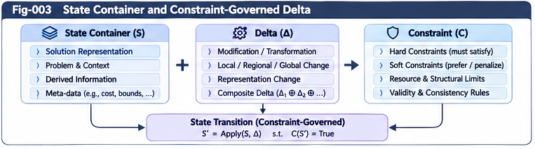

# CDE-002 — State Containers and Constraint-Governed Transitions

**Series:** Constrained Delta Evolution (CDE) — Foundations  
**Status:** Foundational research proposal, v1.0.0 draft  
**Date:** 2026-11-04  
**Authors:** Sizhe Tan and GPT-Obot  
**License:** Apache-2.0  
**Companion:** [CDE-001 — From BTP and D-BTP to Constrained Delta Evolution](CDE-001-From-BTP-and-D-BTP-to-Constrained-Delta-Evolution.md)

## Abstract

Constrained Delta Evolution (CDE) treats a state as a **logical container** rather than a prescribed bucket, tree node, or implementation data structure. A Delta is a proposed transformation; constraints determine its admissibility and the validity of resulting states; a transition relation specifies its effects. This paper formalizes state identity, context, constraint scope, transition semantics, candidate versus realized transformations, and the distinction between hard feasibility, soft preferences, and search policy. It defines a minimal CDE-Core contract that supports constructive search, reconfiguration, cyclic state spaces, heterogeneous solvers, and optional distributed orchestration without requiring any one of them. It also distinguishes representability, reachability, termination, completeness, and optimization guarantees; outlines validation obligations; and connects constraint-guided state evolution to exploratory localization in the Structural Intelligence Framework (SIF). The framework is a proposed unifying specification, not a claim of algorithmic superiority.

**Keywords:** state container; constrained transition systems; delta semantics; feasibility; state identity; search graph; constraint propagation; structural localization; CDE-Core

## 1. The Design Problem

The historical BTP representation makes branching decisions visible and auditable, but its bucket-oriented and often binary structure is not intrinsic to every problem. A scheduling configuration, graph hypothesis, metric definition, search policy, and scientific model have different internal shapes. They can nevertheless share a computational pattern: represent a current configuration, propose a change, check the relevant constraints, apply a transition, and evaluate or explore the result.

CDE therefore starts from an intentionally modest principle:

> A state is any logical container whose contents and interpretation are sufficiently specified to support constraint checking, Delta application, and meaningful comparison or continuation.

“Container” is a semantic abstraction, **not** a requirement to use a mutable object, a database row, a tree, or a particular serialization. An implementation may use immutable records, persistent graphs, symbolic expressions, relational tables, distributed objects, or compact encoded states.

This paper addresses five questions:

1. What information must a state expose for a valid transition?
2. What does it mean for a Delta to be admissible?
3. How should constraints with different scopes be represented?
4. When are two states equivalent for future exploration?
5. What can be guaranteed by the core model, and what requires a particular solver or policy?

## 2. Minimal Formal Model

Define a CDE problem instance as

$$
\mathcal P=(\mathcal S,\mathcal D,\mathcal K,G,T,I,\mathcal O),
$$

where:

- $\mathcal S$: a set of admissible **state representations**, not necessarily all feasible states;
- $\mathcal D$: a universe of typed Delta descriptions;
- $\mathcal K$: a family of constraint predicates and policies with explicit scope;
- $G(s,c)\subseteq\mathcal D$: a candidate Delta generator for state $s$ and relevant context $c$;
- $T\subseteq\mathcal S\times\mathcal D\times\mathcal S$: a transition relation;
- $I\subseteq\mathcal S$: permitted initial states;
- $\mathcal O$: optional objectives, observations, and evaluation protocols.

The transition relation is deliberately more general than a deterministic function. It can express multiple successors from one Delta, nondeterministic outcomes, and partial knowledge. In deterministic cases, $T(s,\delta)=s'$ is convenient shorthand for $(s,\delta,s')\in T$.

A run is a sequence

$$
\rho=s_0\xrightarrow{\delta_0}s_1\xrightarrow{\delta_1}s_2\xrightarrow{\delta_2}\cdots
$$

such that $s_0\in I$ and every edge satisfies the relevant transition and constraint contracts.

**Important separation:** the model defines *possible* transitions; a solver or orchestrator decides which transitions to generate, evaluate, retain, defer, or explore. Neither exhaustive enumeration nor any particular optimization algorithm is built into CDE-Core.



*Figure 3. A typed Delta proposes a transition from a versioned State Container to a candidate successor. Hard-constraint checks and coherent-version validation determine whether the transition may be committed; directional scores may prioritize attempts but cannot substitute for feasibility.*

## 3. The Logical State Container

A useful conceptual state view is

$$
S=(X,C,E,H,M;v),
$$

with:

- $X$: domain configuration (assignments, route plan, graph, hypothesis, metric, etc.);
- $C$: constraint references or locally materialized constraint information;
- $E$: observations, evidence, and uncertainty relevant to decisions;
- $H$: history or path-dependent decision information, **when future behavior depends on it**;
- $M$: operational metadata, including budgets or policy context **when semantically relevant**;
- $v$: versions of schemas, constraints, metrics, or relevant models.

This tuple is a **conceptual decomposition**, not a mandate that every state physically duplicate all six fields. Global immutable constraints may be referenced by version; evidence may live in a separate store; a solver may keep path history outside the domain state. The central requirement is that every transition can access the context needed to determine its validity and continuation semantics.

### 3.1 Three distinct state notions

It is useful to distinguish:

1. **Domain state** $X$: the actual problem configuration.
2. **Search state** $\hat S=(X,H,B,\ldots)$: the domain configuration plus future-relevant search memory and budgets.
3. **System state** $\Sigma$: a collection of search states, workers, queues, shared incumbents, policies, and evidence repositories.

Two workers can hold the same domain state yet have different search states. A distributed orchestrator can manage many search states without making its entire global system state part of each domain transition.

### 3.2 Examples

| Domain | State contents | Typical Delta |
|---|---|---|
| Assignment | selected pairs, remaining capacities | assign or revoke a pair |
| School-bus routing | routes, stops, vehicle availability | insert stop, exchange stops, reroute |
| Structural matching | partial correspondences and exclusions | accept or reject a correspondence |
| Metric discovery | features, weights, scoring structure, validation version | add feature, change weight, replace metric |
| Scientific hypotheses | candidate model, assumptions, evidence links | refine hypothesis, add explanatory relation |
| Search governance | generator portfolio and resource allocations | adjust exploration budget or replace generator |

The last row is typically a **meta-state** transition, not the same operation as moving a bus or accepting an assignment. A CDE implementation should type these levels explicitly.

## 4. Delta: Proposal, Decision, and Effect

A Delta is an *intended change* described independently of whether it is executed. For example,

$$
\delta=\mathrm{Assign}(\text{vehicle}_3,\text{route}_7).
$$

A Delta record may include a type, operands, preconditions, estimated cost, provenance, and generator identity. The canonical identity of a Delta should reflect its **meaningful operation**, not an arbitrary newly assigned UUID.

Distinguish four events:

1. **Generate:** a generator proposes $\delta$.
2. **Check:** feasibility and policy checks classify the proposal.
3. **Decide:** a search policy selects an action such as apply, exclude, or defer.
4. **Realize:** an accepted action produces an actual transition $(s,\delta,s')$.

A rejected proposal need not produce a new domain state. In constructive Yes/No BTP, the No decision *does* create a new search state because the exclusion changes the set of future permitted decisions. This is a search-state transition even if $X$ is unchanged.

A useful edge record is

$$
e=(\mathrm{parent\_id},\delta,a,\mathrm{successor\_id},\pi),
$$

where $a$ denotes transition/decision semantics and $\pi$ captures provenance and validation information. The Delta belongs naturally to the **edge**, not necessarily to the successor node: multiple distinct edges can lead to the same state.

## 5. Constraints: Scope, Hardness, and Time

The term “constraint” can hide several distinct meanings. CDE should distinguish at least the following:

| Kind | Meaning | Example | Treatment |
|---|---|---|---|
| Hard invariant | must hold for every committed reachable state | vehicle capacity | reject or repair invalid transition |
| Transition precondition | must hold before an operation is applied | route exists | prohibit that application in this context |
| Path constraint | depends on decisions already made | pair already accepted/rejected | check path memory |
| Temporal constraint | restricts sequences or deadlines | visit before cutoff | check trace or temporal monitor |
| Global coupling | relates multiple subproblems | one vehicle cannot serve two simultaneous routes | reconcile globally |
| Soft preference | desirable but violable | shorter average travel time | include in objective, not feasibility |
| Exploration policy | allocates search effort | try top 20 candidates first | schedule or defer; not a proof of impossibility |

Let $K_h(s,c)$ be hard state feasibility and $K_t(s,\delta,s',c)$ transition admissibility. A committed edge must satisfy

$$
(s,\delta,s')\in T\ \land\ K_h(s',c')\ \land\ K_t(s,\delta,s',c).
$$

Here $c'$ is the applicable post-transition context. If constraints can change, their effective version and time must be recorded. A result feasible under constraint version $v_1$ is not automatically feasible under $v_2$.

**Soft scores are not hard constraints.** A low-scoring candidate can be deprioritized; it cannot be safely removed from an exhaustive search unless an independent sound pruning argument exists.

## 6. Constraint-Governed Transition Lifecycle

A minimal transition pipeline is:

```text
State + Context
      |
      v
Generate candidate Delta(s)
      |
      v
Normalize and type-check Delta
      |
      v
Check preconditions and path restrictions
      |
      v
Construct or predict successor(s)
      |
      v
Validate hard state and transition constraints
      |
      +--> invalid: reject with reason / evidence
      |
      v
Commit labeled transition and provenance
      |
      v
Evaluate, schedule, relay, or continue
```

The pipeline is logical; an optimized solver may fuse operations or propagate constraints before constructing full successors. What matters is observational equivalence to the stated contracts.

### 6.1 M candidate Deltas, N realized branches

If

$$
G(s,c)=\{\delta_1,\ldots,\delta_M\},
$$

then the realized successor-edge set is

$$
B(s)=\{(s,\delta_j,a_j,s'_j):\text{selected and valid}\}.
$$

Let $N=|B(s)|$. **In general, $N$ need not equal $M$**: candidates may be invalid, deferred, or collapsed through equivalent successors; conversely a nondeterministic Delta can have multiple successors, so $N>M$ is also possible. Thus $N\le M$ requires the extra assumption of at most one realized edge per candidate.

A finite branching budget is an engineering policy, not a universal mathematical requirement. If $G$ can enumerate infinitely many candidates, a solver needs a computable scheduling or sampling discipline to make finite progress.

## 7. State Identity, Equivalence, and Canonicalization

A domain snapshot is not necessarily a complete search-state key. Define a canonical key

$$
\kappa(\hat S)=\mathrm{Canonicalize}(X,H_{\mathrm{relevant}},C_{\mathrm{version}},E_{\mathrm{relevant}},B_{\mathrm{relevant}}).
$$

Two states may be merged for a given algorithm only if their future behavior is equivalent for that algorithm's purposes. For exact dynamic programming, a strong condition is that equivalent states have the same feasible continuations and compatible future costs/objective values, accounting for any accumulated cost needed for dominance comparisons.

For example, two school-bus plans with identical current vehicle locations but different remaining student obligations are **not** equivalent. Likewise, identical assignments with different path exclusions may have different legal next decisions.

State identity can be layered:

- **Exact identity:** bytewise or canonical structural equality.
- **Semantic equivalence:** different representations encode the same relevant configuration.
- **Future-equivalence:** identical continuation possibilities and relevant future rewards/costs.
- **Approximate similarity:** useful for heuristics or retrieval but generally unsafe for exact deduplication.

The equivalence relation and its proof obligations belong to the solver contract, not to a universal CDE assertion.

## 8. Path Memory and the No-Subtree Distinction

In constructive BTP, a candidate assignment can be decided Yes or No. Let

$$
A_t=\{\text{accepted canonical decisions}\},\quad
R_t=\{\text{excluded canonical decisions}\},\quad
U_t=A_t\cup R_t.
$$

For a one-time-decision constructive search, require

$$
\mathrm{key}(\delta_{t+1})\notin U_t.
$$

The No branch must update $R_t$, even when the underlying assignment configuration $X$ does not change. Otherwise a solver may repeatedly propose a decision it already excluded along that path.

However, this is a **subfamily contract**, not a universal CDE invariant. In reconfiguration or cyclic systems, applying the same operation again can be legitimate. Moreover:

- **Permanent exclusion:** a decision is forbidden for the remainder of this path.
- **Contextual infeasibility:** a Delta fails now but may become feasible after conditions change.
- **Defer:** a candidate is not explored yet; it has not been rejected.
- **Evidence-based rejection:** a hypothesis is discounted under an evidence version and may be revisited after new evidence.

These statuses must not be conflated. Canonical Delta keys must include the context required for their semantics, but arbitrary version increments must not be used to bypass genuine duplicate-decision restrictions.

## 9. Loop Back and Graph Semantics

Nonrepetition of Delta descriptions does **not** imply nonrepetition of states. Different sequences may reach the same configuration:

$$
S_0\xrightarrow{\delta_a}S_1\xrightarrow{\delta_b}S_0.
$$

Some problems require such reconfiguration. CDE therefore permits a **Delta-labeled state graph** rather than requiring a tree. A solver may adopt one of several explicit policies:

1. **Acyclic constructive:** forbid repeated path decisions and use a well-founded progress measure.
2. **Visited-state pruning:** skip a previously seen future-equivalent state when sound.
3. **Dominance-aware revisitation:** reopen a state if a better cost or newly relevant evidence changes its prospects.
4. **Budgeted cyclic exploration:** allow revisits under depth, time, resource, or cycle budgets.
5. **Convergence-based iteration:** continue toward a limit under a stated convergence criterion.

Finite state space alone does not ensure termination if cycles may be revisited indefinitely. Conversely, finite branching plus finite depth or a strictly decreasing natural-number rank can ensure termination under suitable assumptions. Convergence in the limit is not the same as halting after a finite number of transitions.

## 10. Feasibility, Reachability, and Optimality Are Different Claims

Define the reachable set under a generator/policy pair $(G,P)$:

$$
\mathrm{Reach}(I;G,P)=\{s:\text{there is a permitted finite run from }I\text{ to }s\}.
$$

Three distinctions matter:

- **Representable:** a target can be encoded as a state.
- **Reachable:** permitted Delta transitions can generate a path to it.
- **Discoverable within budget:** the actual algorithm can find it under specified computational limits.

If a globally optimal solution lies outside $\mathrm{Reach}(I;G,P)$, better scoring cannot recover it. Generator evolution may enlarge reachability, but does not automatically make the search complete.

For an objective $f$, the statement

$$
\max_{s\in\mathrm{Reach}(I;G,P)} f(s)
$$

is not necessarily the same as optimization over all feasible states. Any completeness or global optimality claim must identify its feasible domain, generator coverage, pruning soundness, and stopping rule.

## 11. A Minimal CDE-Core Contract

The following interface is **illustrative**, not an imposed programming language or wire format:

```text
StateDescriptor:
  state_id
  domain_payload_or_reference
  schema_version
  constraint_context_ref
  future_relevant_context_ref

DeltaDescriptor:
  delta_key
  delta_type
  operands
  preconditions
  generator_provenance

TransitionRecord:
  parent_state_id
  delta_key
  decision_or_action
  successor_state_id
  constraint_version
  validation_status
  provenance

Core operations:
  generate(state, context, budget) -> candidates
  validate_delta(state, delta, context) -> status + reasons
  transition(state, delta, context) -> zero or more successors
  validate_successor(parent, delta, successor, context) -> verdict
  canonicalize(search_state, equivalence_contract) -> key
```

**Minimum conformance expectations:**

- Every committed edge identifies its parent, Delta, successor, and applicable constraint version.
- Every committed successor satisfies declared hard invariants or is explicitly marked provisional/unverified.
- Rejection, exclusion, and deferral have distinct semantics.
- A state merge uses an explicit equivalence or dominance contract.
- Transition determinism or nondeterminism is declared.
- Provenance and version references permit audit and replay where the domain allows it.

A solver can implement only the subset it needs; a distributed orchestrator can require additional task, evidence, idempotency, and reconciliation contracts.

## 12. Examples and Counterexamples

### 12.1 Constructive assignment

State: selected actor–job pairs, capacities, accepted and excluded decision sets. Delta: `Assign(actor, job)`. Hard constraints: actor/job uniqueness and compatibility. A No branch records `Exclude(actor, job)` in search memory. The domain assignment may remain unchanged while the search state changes.

### 12.2 School-bus reconfiguration

State: current routes, vehicle assignments, student coverage, service constraints. Delta: swap two stops or reassign a route. A repeated operation may be legal after intervening changes. The path-unique-decision rule from constructive BTP must **not** be blindly imposed. Feasible local routes cannot necessarily be merged into a feasible global schedule because vehicles and time windows are shared.

### 12.3 Metric evolution

State: metric structure, features, weights, training and validation protocol identifiers. Delta: add a feature or change a weighting rule. A metric that improves its own internal score is not thereby better; evaluation requires independent criteria such as held-out predictive performance, stability, or task utility. Comparing scores across metric versions without calibration is invalid.

### 12.4 Counterexample: unsafe state merging

Two paths produce identical visible assignment sets but different permanent No-branch exclusions. Merging on the assignment payload alone may erase a legitimate continuation or reintroduce an excluded decision. Correctness requires retaining relevant history or proving it irrelevant.

### 12.5 Counterexample: unsafe heuristic pruning

A directional score ranks Delta $\delta_a$ above $\delta_b$. Permanently discarding $\delta_b$ on that basis alone can remove the globally optimal solution. Prioritization is not a mathematical upper bound.

## 13. CDE as an Exploratory Localization Method in SIF

Structural Intelligence Framework (SIF) includes localization/addressing as a major functional concern: finding relevant problem, capability, or structural units. CDE offers a **candidate additional localization pillar** by turning localization into constrained exploration rather than restricting it to lookup against an existing index.

A localization process can be expressed as:

$$
S_0\xrightarrow{\delta_0}S_1\xrightarrow{\delta_1}\cdots\xrightarrow{\delta_k}S_k,
$$

where each state represents a current localization hypothesis, search region, structural mapping, or evidence configuration. Deltas refine, expand, redirect, or restructure the search. Constraints rule out incompatible candidates; directional scores prioritize promising regions; evidence relay updates the shared map.

This interpretation supports a useful distinction:

- **Address-based localization:** identify a known target using an existing representation or index.
- **Exploratory localization:** construct and test candidate paths toward a target whose location, representation, or existence is uncertain.

CDE is a plausible framework for the latter and may complement the former. This is a research proposition requiring comparisons with established graph search, planning, constraint-based retrieval, and other localization techniques. It should not be described as proven superior.

## 14. Validation and Falsifiable Hypotheses

**H1 — Semantic portability.** The same CDE-Core transition/constraint contract can represent assignment, routing, structural matching, and metric evolution without domain-specific changes to the core semantics. *Test:* implement adapters and count required contract exceptions.

**H2 — Path-history correctness.** Explicit accepted/rejected decision memory prevents repeated Yes/No decisions in constructive BTP-style search. *Test:* compare against a baseline that tracks only accepted decisions, using exhaustive small instances.

**H3 — Graph-aware efficiency.** Sound future-equivalence and dominance rules reduce redundant exploration on selected cyclic or convergent benchmarks without changing exact results. *Test:* exhaustive reference solver versus graph-aware variants, including adversarial cases.

**H4 — Constraint governance.** Separating hard invariants from heuristic preferences prevents invalid pruning or misleading feasibility claims. *Test:* inject low-scoring but optimal branches and measure false pruning.

**H5 — Exploratory localization.** Under specified problem families and budgets, CDE-style Delta generation and constraint guidance can improve target discovery or evidence efficiency relative to chosen baselines. *Test:* controlled localization tasks with fixed budgets, independent success criteria, and negative cases.

Measure validity rate, solution quality, reachable-state coverage, node expansions, wall time, memory, replayability, and contract violations. Publish failed hypotheses and counterexamples alongside successes.

## 15. Boundaries and Open Questions

1. **Canonicalization:** what is the weakest future-equivalence relation sufficient for safe merging in each solver family?
2. **Dynamic constraints:** how should previously valid results be revalidated after constraint or evidence updates?
3. **Partial observability:** should uncertain environments use explicit belief states or external observation contracts?
4. **Infinite generators:** what fairness or sampling conditions are needed to avoid permanently starving useful Delta families?
5. **Stochastic transitions:** how should probabilities, seeds, and observation provenance be represented for reproducible runs?
6. **Cross-level Deltas:** when a Delta changes a metric or generator, what prevents circular evaluation or unvalidated self-modification?
7. **Distributed execution:** which consistency guarantees are essential for shared bounds, deduplication, and global constraint reconciliation?
8. **Complexity:** when does generic orchestration add overhead without measurable improvement over a specialized solver?

CDE does not solve undecidable problems by virtue of its representation, does not guarantee termination in cyclic spaces, and does not guarantee a globally optimal answer without solver-specific assumptions.

## 16. Relationship to the CDE Series

- **CDE-001:** conceptual origin, lineage, and overall architecture.
- **CDE-002 (this paper):** minimal state, constraint, and transition semantics.
- **CDE-003:** detailed Delta identity, generation, and adaptive M-to-N branching.
- **CDE-004:** path memory, No-subtree decisions, loop-back, and termination.
- **CDE-005:** Search, DP, and Branch-and-Bound integration.
- **CDE-006:** directional fields and multi-scale Delta generation, including exploratory localization.
- **CDE-007:** solution and metric co-evolution.
- **CDE-008–011:** orchestration, distributed execution, structural relay, and controlled recursive improvement.
- **CDE-012:** guarantees, generalization boundaries, and open research.

The planned **SPEC-001 — State Container and Constraint Contract** should turn this paper's semantic requirements into explicit conformance criteria and testable interface examples.

## 17. Conclusion

CDE-Core is best understood as a **constraint-governed transition abstraction**: states are logical containers; Deltas describe proposed changes; constraints determine admissibility; labeled transitions record realized evolution; and solver-specific policies decide what to explore. Its utility lies in making the boundaries between representation, generation, validation, execution, and evaluation explicit. The abstraction accommodates BTP-style constructive decisions, D-BTP dynamic generation, reconfigurable optimization, and exploratory localization without treating any of those applications as universal requirements. Whether this common language produces practical gains is an empirical question, to be answered through conformance tests, comparative benchmarks, and open structural relay.

---

### Research and citation note

This is a foundational proposal in the CDE research series. It is intended for critical evaluation, reproducible testing, and collective learning. Claims of novelty, formal guarantees, or performance improvements should be assessed against established work in transition systems, constraint programming, search, planning, and optimization. Repository DOI and release-specific citation metadata should be inserted only after publication.
