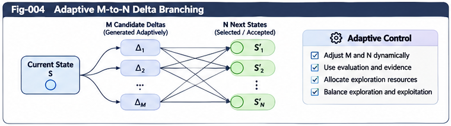
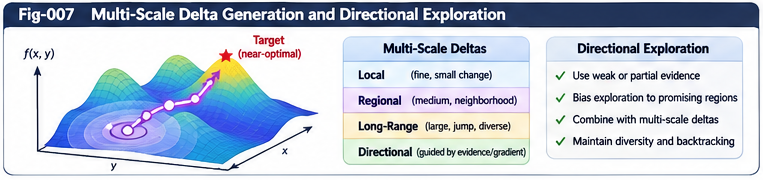

# CDE-006 — Directional Fields and Multi-Scale Delta Generation

**Series:** Constrained Delta Evolution (CDE) — Foundations  
**Status:** Foundational research proposal, v1.0.0 draft  
**Date:** 2026-11-04  
**Authors:** Sizhe Tan and GPT-Obot  
**License:** Apache-2.0  
**Companions:** [CDE-001](CDE-001-From-BTP-and-D-BTP-to-Constrained-Delta-Evolution.md), [CDE-002](CDE-002-State-Containers-and-Constraint-Governed-Transitions.md), [CDE-003](CDE-003-Delta-Semantics-and-Adaptive-M-to-N-Branching.md), [CDE-004](CDE-004-Path-Memory-No-Subtree-Semantics-and-Loop-Back-Control.md), [CDE-005](CDE-005-Search-Dynamic-Programming-and-Branch-and-Bound-Integration.md)  
**Related specifications (planned):** `../specifications/SPEC-001-State-Container-and-Constraint-Contract.md`, `../specifications/SPEC-002-Delta-Generation-and-Branch-Contract.md`, `../specifications/SPEC-004-Solver-and-Optimization-Contract.md`, `../specifications/SPEC-005-Distributed-Exploration-and-Relay-Contract.md`

## Abstract

Constrained Delta Evolution (CDE) treats state transitions as constraint-governed, explicitly identified Delta operations. Its usefulness depends not only on evaluating proposed transitions but also on *which transitions can be generated*, at what scale, and under which evidence and resource budgets. This paper proposes a solver-neutral account of directional fields and multi-scale Delta generation. A directional field is defined as context-dependent information that influences candidate-generation or exploration priority without, by itself, certifying feasibility, admissible bounds, or optimality. Generators may propose local modifications, regional restructurings, long-range jumps, or cross-domain relay-based transformations; a policy allocates effort across them and records both explored and deferred candidates. The paper distinguishes candidate reachability from ranking quality, separates hard constraints from directional preferences, and defines conditional properties for coverage, fairness, termination, and reproducibility. It also develops an exploratory-localization interpretation within the Structural Intelligence Framework (SIF): CDE can help locate or construct promising structural regions when direct addressing is unavailable, while retaining explicit evidence and verification requirements. Worked examples, counterexamples, interface sketches, and a validation roadmap clarify the proposal's scope and its relationship to existing search, optimization, and adaptive sampling methods.

**Keywords:** Constrained Delta Evolution; CDE; directional field; Delta generation; multi-scale exploration; reachability; adaptive search; exploration–exploitation; Structural Intelligence Framework; localization; distributed relay; collective learning

---



*Figure 4. Adaptive Delta branching distinguishes M proposals, Q selected attempts, N realized transition edges, N_c committed edges, and K distinct successor states. Deduplication, invalid attempts, and uncommitted edges prevent these counts from being treated as interchangeable.*

---



*Figure 7. Local, regional, long-range, and Relay-guided Delta generators explore complementary neighborhoods. Directional fields and weak evidence guide proposal ranking while maintaining uncertainty, diversity, counterexample probes, and hard-constraint checks.*

---


## 1. Motivation: Candidate Generation Is a First-Class Problem

An optimizer cannot select a transformation that its generator never proposes. This simple observation is especially consequential in structural search, where candidate transformations may range from changing one assignment to replacing an entire decomposition, revising a metric, or transferring a method from another domain.

The BTP lineage supplies a useful progression:

1. **BTP:** constructive Yes/No decisions over a constrained assignment or permutation space.
2. **D-BTP:** dynamic structural candidate generation and directional exploration, with explicit branch decisions and feedback.
3. **CDE:** a general State–Delta–Constraint model in which candidate generation, selection, execution, and even the generators themselves may be modular and adaptive.

CDE does not require a bucket representation, a binary tree, a fixed neighborhood, or a single solver. Its central research question here is: *How can an exploration system generate structurally diverse, constraint-compatible candidates across multiple scales, while preserving the distinction between heuristics and correctness guarantees?*

The answer is not a universal search algorithm. It is a set of separable interfaces, policies, and testable hypotheses.

## 2. Formal Setting and Notation

Let a CDE problem instance be

$$
\mathcal{P}=(\mathcal{S},\mathcal{D},T,C,\mathcal{O},\mathcal{E}),
$$

where $\mathcal{S}$ is a state space; $\mathcal{D}$ is a space of Delta descriptions; $T$ is a potentially partial or stochastic transition mechanism; $C$ is a collection of constraints; $\mathcal{O}$ describes objectives or evaluation; and $\mathcal{E}$ describes available evidence and observations. An exploration context may include

$$
q_t=(s_t,h_t,e_t,m_t,v_t,b_t),
$$

with state $s_t$, path/decision history $h_t$, evidence $e_t$, evaluation specification $m_t$, version identifiers $v_t$, and remaining budget $b_t$.

A Delta proposal is not yet a transition. A generator $G_k$, indexed by family or scale $k$, produces candidate descriptions:

$$
D_{t,k}=G_k(q_t;\theta_{t,k},\xi_{t,k}),
$$

where $\theta_{t,k}$ are generator parameters and $\xi_{t,k}$ captures randomness or external input. For deterministic generators, $\xi$ can be omitted.

A validator determines whether a proposal is applicable under the declared context:

$$
\mathrm{Valid}(q_t,\delta)\in\{\mathrm{true},\mathrm{false},\mathrm{unknown}\}.
$$

An actual transition is recorded as an edge

$$
e=(s_t,\delta,a,s_{t+1},\pi_e),
$$

where $a$ is the decision or execution action and $\pi_e$ is provenance, including relevant constraint and metric versions. If a transition is stochastic, the same Delta can produce several distinct successor edges. Candidate count, realized-edge count, and distinct-successor count are not interchangeable.

**Separation principle.** Generation proposes; validation checks; selection prioritizes; transition execution changes state; evidence updates beliefs; the solver decides whether a branch can be soundly pruned.

## 3. What Is a Directional Field?

A **directional field** is context-dependent information that favors some Delta proposals, regions, or exploration trajectories over others. The term *field* is intentionally general: it need not be a Euclidean vector field, differentiable gradient, or even a scalar function over a geometric domain.

A practical directional interface can be represented as

$$
\mathfrak{F}_t:(q_t,\delta,k)\mapsto (r_t,u_t,\rho_t),
$$

where $r_t$ is a priority or preference signal, $u_t$ expresses uncertainty or calibration information, and $\rho_t$ records the source and validity scope of the signal. Depending on the problem, $r_t$ may be a scalar, vector, partial order, preference relation, or structured explanation.

Examples include:

- a gradient estimate suggesting a local move;
- a learned prediction of improvement;
- a weak-evidence direction derived from historical cases;
- a Pareto preference over cost, fairness, and robustness;
- an information-gain estimate for hypothesis discovery;
- a structural similarity or perspective-aware score;
- a rule that directs exploration toward an unresolved capability gap.

The same field can influence **proposal distribution**, **priority**, **budget**, or **selection**, but these roles must be identified explicitly.

### 3.1 Direction is not proof

A high directional score does **not** establish:

1. that a Delta satisfies hard constraints;
2. that its successor is reachable or well defined;
3. that it improves the true objective;
4. that low-scored alternatives can be safely discarded;
5. that the field remains calibrated after the metric or domain changes.

A directional field is ordinarily a heuristic or a probabilistic estimate. Only a separately justified mathematical property can elevate it to a certified bound or sound exclusion rule.

### 3.2 Fields may conflict

Suppose $\mathfrak{F}^{(1)}$ favors lower cost while $\mathfrak{F}^{(2)}$ favors equitable service. An aggregator may use weights, a Pareto frontier, a lexicographic policy, or a constrained objective. No one aggregator is universally correct; its authority and version must be declared. Conflicting fields are often useful evidence of tradeoffs rather than noise to be hidden.

## 4. The Four Scales of Delta Generation

Scale is defined relative to the problem's structural representation, not simply by physical distance.

### 4.1 Local generation

Local Deltas make small changes within the current structural neighborhood: swapping two assignments, adjusting a route stop, changing a single metric weight, or replacing one rule. They are usually inexpensive and support exploitation, but can become trapped in local basins.

### 4.2 Regional generation

Regional Deltas modify a connected subsystem: reassigning several jobs, redesigning a route cluster, revising a subtree, or restructuring a feature group. They may escape local traps while retaining much of the current solution.

### 4.3 Global or long-range generation

Global Deltas propose qualitatively different regions, decompositions, initializations, or structural representations. A long-range Delta may be expensive to validate, and it may require reconstructing constraints or path memory. It is valuable when local reachability is narrow or misleading.

### 4.4 Relay-driven or cross-domain generation

Relay-driven Deltas are derived from methods, counterexamples, or candidate structures discovered by another worker or domain. They require translation and conformance checks: a useful routing heuristic does not automatically become a valid chip-placement transformation. Provenance and applicability conditions are mandatory.

These are **generator families**, not mutually exclusive categories. One candidate may be local under one representation and global under another. Scale labels should therefore be treated as declared metadata rather than intrinsic mathematical properties.

## 5. Candidate Reachability versus Selection Intelligence

Let $\mathcal{R}_G(s_0)$ denote the states reachable from $s_0$ under the support of generator family $G$, valid transitions, and the permitted horizon. A globally optimal feasible state $s^*$ cannot be found through those transitions if

$$
s^*\notin\mathcal{R}_G(s_0).
$$

This is a **reachability limitation**, not a ranking failure. Better scoring cannot repair an absent transition path.

Conversely, broad generator support does not guarantee efficient discovery: the probability of visiting a valuable region may be vanishingly small. It is useful to distinguish:

- **support coverage:** whether a candidate or path can ever be proposed;
- **sampling mass:** how often the generator proposes it;
- **selection fidelity:** whether the policy recognizes its promise;
- **validation fidelity:** whether constraints and outcomes are checked correctly;
- **resource feasibility:** whether the required exploration fits the budget.

### 5.1 A simple counterexample

Consider a one-dimensional state space $\{0,1,\ldots,100\}$ with a local generator proposing only $s\mapsto s+1$ or $s\mapsto s-1$, subject to a rule forbidding traversal of states 40–60. Starting at 0, the local generator cannot reach 100. A long-range Delta $\delta_{\mathrm{jump}}:0\mapsto 80$, if permitted by the domain's transition contract, changes reachability. If such a jump is *not* a valid domain operation, introducing it would merely falsify the model. Long-range proposals must remain grounded in legal transitions or explicitly represent higher-level plans whose constituent steps are validated.

### 5.2 Coverage is not completeness

A generator that assigns nonzero probability to every finite candidate may be *probabilistically complete* under additional conditions, such as persistent sampling, valid feasibility checks, and an appropriate infinite-horizon limit. Finite-time discovery is not guaranteed. An adaptive policy that drives the sampling probability of a necessary candidate toward zero may destroy even asymptotic coverage.

## 6. Adaptive M-to-N Branching

At state $q_t$, a mixture of generators produces $M_t$ candidate proposals. Validation, deduplication, resource limits, and selection yield $N_t$ realized exploration edges:

$$
\bigcup_k G_k(q_t)\xrightarrow{\text{validate, rank, schedule}}\{e_{t,1},\ldots,e_{t,N_t}\}.
$$

There is no general requirement that $N_t=M_t$, that each candidate produce one successor, or that every candidate be executed immediately. The branch ledger should distinguish:

- **proposed:** generated but not yet validated;
- **invalid:** rejected by a sound, scoped constraint check;
- **selected:** scheduled for exploration;
- **deferred:** retained for possible future exploration;
- **executed:** transition attempted or completed;
- **dominated/pruned:** removed only under an explicitly recorded proof obligation;
- **abandoned by policy:** not explored, with no completeness claim.

A hard budget may enforce $N_t\le B_t$. If the system is intended to be complete over a finite search space, deferred candidates must eventually receive fair consideration or be excluded by a sound proof.

### 6.1 Adaptive branch budgets

A policy may choose the per-generator budgets

$$
(b_{t,1},\ldots,b_{t,K})=\mathrm{Allocate}(q_t,\mathcal{H}_t,B_t),
\quad \sum_k b_{t,k}\le B_t,
$$

using evidence $\mathcal{H}_t$ about recent improvements, novelty, uncertainty, and execution cost. Adaptive allocation should be compared with fixed-allocation baselines to determine whether its extra complexity is justified.

## 7. Exploration–Exploitation without a Universal Schedule

Local search tends to exploit current knowledge; global and relay-driven generators can broaden exploration. The right balance depends on the landscape, transition costs, available evidence, and objective stability.

Possible policies include:

- fixed mixtures with reserved budgets for each generator family;
- contextual bandit allocation using observed improvement per unit cost;
- novelty or diversity bonuses;
- uncertainty-aware sampling;
- restart and basin-escape policies;
- Pareto-based portfolios across several objectives;
- scheduled coverage sweeps for completeness-sensitive tasks.

A simple conceptual priority is

$$
P_t(\delta)=\alpha_t\widehat{I}_t(\delta)
+\beta_t\widehat{N}_t(\delta)
+\gamma_t\widehat{U}_t(\delta)
-\lambda_t\widehat{K}_t(\delta),
$$

where predicted improvement $\widehat I$, novelty $\widehat N$, uncertainty-related exploration value $\widehat U$, and expected cost $\widehat K$ are normalized and calibrated for the chosen domain. This expression is **illustrative**, not a universally valid objective. A policy must not silently equate uncertainty with positive value, or mix incomparable scales without calibration.

## 8. Directional Weak Evidence and Reliability

Directional hints may be obtained from small samples, partial observations, analogies, previous solver traces, or reputation-weighted sources. Such evidence can be valuable for deciding *where to probe next* even when it is too weak to establish a conclusion.

A CDE evidence record should distinguish:

$$
E=(\text{claim},\text{source},\text{context},\text{method},\text{uncertainty},\text{version},\text{tests}).
$$

A directional estimate should be updated or downgraded when counterexamples arrive. Evidence from the same underlying source should not be counted as independent corroboration merely because multiple agents relay it. This is especially important in collective learning, where copied errors can acquire artificial credibility.

### 8.1 Negative evidence as a generator signal

Failed transitions, infeasible regions, and disproved assumptions can help steer generation away from unproductive areas. Yet an observed failure may be local to a particular state, constraint version, or execution budget. It must not be promoted to a universal exclusion without a sound generalization argument.

## 9. Constraints, Decision Memory, and Loop-Back

Directional generation does not override the path and state semantics developed in CDE-003 and CDE-004.

For constructive BTP-like search, accepted and rejected decisions may jointly form a path-local decided set $U_t$, with a policy that forbids reconsidering the same canonical decision on the same path. In reconfigurable or cyclic-state CDE, a Delta or state may legitimately recur under changed context. Consequently:

$$
\text{Delta identity}\ne\text{decision identity}\ne\text{state identity}.
$$

A generator must consult the applicable decision-memory contract rather than apply a universal no-repeat rule. Canonicalization must include future-relevant context; artificial version changes must not be used to evade deduplication.

A revisited state may still be useful if it has a better accumulated cost, stronger evidence, a different remaining budget, or different permitted actions. Such cases require a documented dominance or revisit policy. Otherwise, uncontrolled loop-back can consume unbounded resources.

## 10. CDE as an Exploratory Localization Method within SIF

The Structural Intelligence Framework (SIF) includes localization and addressing among its functional domains. CDE offers a complementary research direction: **exploratory localization** through constraint-guided structural transformations.

### 10.1 Addressing versus exploration

- **Direct localization:** retrieve or address a known entity, capability, or structural position through an existing index, map, or relation.
- **Exploratory localization:** progressively generate, test, and refine candidate regions or structures when the target is not directly addressable.
- **Constructive localization:** produce a new feasible structural configuration that realizes a target property rather than merely locate a preexisting item.

The latter two are promising roles for CDE. They do not imply that every localization task should be solved by CDE; conventional indexing and retrieval may be faster and more reliable when the target is already well specified.

### 10.2 A localization contract

A proposed SIF–CDE localization task can be represented as

$$
L=(\text{target predicate},\text{starting context},\text{constraints},
\text{candidate operators},\text{evidence rule},\text{budget}).
$$

The output should be more than a location guess:

$$
R_L=(\text{candidate},\text{path},\text{supporting evidence},
\text{verification status},\text{remaining uncertainty}).
$$

This makes a localization result inspectable and relayable. A promising direction can be reported without claiming that the target has been found.

### 10.3 Localization can be multi-scale

A system may first identify a broad capability region, then a candidate subsystem, then a particular component or configuration. Regional-to-local refinement resembles hierarchical search, while long-range Deltas allow escape from an incorrect region. The useful distinction is not *coarse versus fine* alone, but **what transformations are legal, what evidence supports the next move, and what constitutes verified localization**.

### 10.4 SIF integration hypothesis

**H-SIF:** For localization tasks lacking an efficient direct address, a CDE-compatible exploratory interface can improve coverage, traceability, or resource efficiency relative to a specified baseline under some problem distributions. This is a research hypothesis, not an established general performance claim. The evaluation must also include tasks where direct indexing decisively outperforms exploration.

## 11. Distributed Multi-Swarm Generation and Structural Relay

A distributed CDE Orchestrator can dispatch different generator families to heterogeneous workers. One worker may exploit a promising region; another may search distant regions; a third may test alternative metrics; a fourth may transfer a previously successful structural method.

A minimal exploration contract is

$$
W=(\text{state reference},\text{Delta scope},\text{constraint version},
\text{metric version},\text{policy},\text{budget},\text{validation rule}).
$$

Workers return a result envelope containing generated proposals, realized transitions, evaluation evidence, provenance, and any claimed bound certificates. A control plane can then redistribute effort.

### 11.1 What can be merged?

For independent best-candidate searches under the **same objective and feasible domain**, choosing the best verified candidate may be straightforward. For coupled assignment, routing, or resource-allocation problems, locally good solutions may conflict. Combining them requires global constraint reconciliation, potentially another difficult optimization problem.

Relay therefore includes distinct artifacts:

1. **Result relay:** candidate states and verified scores.
2. **Evidence relay:** supporting observations and counterexamples.
3. **Constraint relay:** scoped feasibility rules and discovered conflicts.
4. **Method relay:** reusable Delta generators and search strategies.
5. **Policy relay:** validated resource-allocation and selection improvements.

The last two are especially relevant to collective learning, but require independent validation before deployment.

### 11.2 Asynchronous updates

Workers may operate on different state, metric, and constraint versions. Returned evidence must carry version identifiers, and stale results must be revalidated where necessary. A changed metric may invalidate score comparisons without invalidating the underlying candidate state. A changed hard constraint may invalidate feasibility itself.

## 12. Generator Evolution and Controlled RSI

Generator parameters can adapt from observed outcomes:

$$
\theta_{t+1}=U(\theta_t,\mathcal{F}_t),
$$

where $\mathcal{F}_t$ contains validated feedback. More ambitious structural adaptation may create new generator families, replace representations, or alter exploration policies.

It is important to distinguish:

- **parameter tuning:** adjust weights or proposal distributions;
- **method adaptation:** select or compose existing generators;
- **structural generator evolution:** create new transformation operators or search decompositions;
- **recursive system improvement:** propose changes to the process that generates and evaluates future improvements.

These are not equivalent capabilities. Each escalation requires stronger conformance and regression checks. A proposed generator that improves its own training score but fails independent evaluation must not be accepted as an improvement.

### 12.1 Safe rollout protocol

1. Preserve the current validated generator and its test suite.
2. Generate a candidate revision with explicit change provenance.
3. Run syntax, type, and constraint-conformance checks.
4. Compare against fixed baselines and held-out problem instances.
5. Test adverse cases, diversity, and computational overhead.
6. Promote only under declared acceptance criteria; retain rollback.

CDE provides an organizing interface for this workflow, not a proof that RSI will succeed.

## 13. Worked Example A: Multi-Peak Exploration

Consider a synthetic landscape with multiple separated high-value regions. Let states encode current sample locations and observations, while Deltas encode local steps, regional restarts, or long-range probes. The objective is to find a high-valued location under a finite evaluation budget.

**Baseline:** local-only hill climbing.  
**CDE portfolio:** local refinement plus reserved long-range probes and feedback-based regional allocation.

Measure best verified objective value, number of evaluations, region coverage, time-to-threshold, and sensitivity to initial conditions. A critical ablation removes long-range generation while keeping the scoring policy fixed; another removes directional guidance while preserving the same generator support.

This case demonstrates a distinction between *having access to a region* and *ranking candidates within it*. It does not establish universal superiority of multi-scale search: on unimodal smooth landscapes, local methods may be more efficient.

## 14. Worked Example B: School-Bus Scheduling

A school-bus state may encode route assignments, capacities, time windows, travel estimates, and student ride times. Local Deltas change individual assignments or stops; regional Deltas redesign route clusters; global Deltas alter fleet allocations or the route decomposition.

Hard constraints can include capacity, pickup eligibility, and safety rules. Objectives may include fleet count, total ride time, worst-case ride time, and fairness. Because these objectives may conflict, a candidate's evaluation must retain the metric definition and version.

Distributed workers can explore disjoint route clusters, but their solutions cannot necessarily be concatenated: a bus or driver may be allocated twice, and timing constraints may cross cluster boundaries. Global reconciliation and revalidation are required. This example is particularly useful for evaluating the benefit and cost of long-range Deltas, constraint propagation, and method relay.

## 15. Worked Example C: Metric Discovery

Let a metric be a structured object $m$, with Deltas such as weight adjustment, feature addition, feature removal, or scoring-tree restructuring. A metric generator proposes candidates, and an independent validation protocol evaluates their predictive value, robustness, calibration, or decision utility.

A **metric Delta** is different from a **solution Delta**. The two may be coordinated, but changing the metric changes the basis for ranking candidate solutions. Every evaluation record must preserve the metric version; historical scores should be recomputed or normalized only under an explicit comparability rule.

A useful benchmark compares fixed metrics, local metric tuning, and multi-scale structural metric generation. The main failure mode is metric gaming: the generator finds a metric that makes its own favored solutions look good without improving externally measured outcomes.

## 16. Worked Example D: Exploratory SIF Localization

Suppose a capability request cannot be matched directly to a known module. The state represents the current capability map, unresolved requirements, and candidate structural relationships. A local Delta probes nearby capability nodes; a regional Delta examines a different subsystem; a relay Delta imports a mapping hypothesis from another domain.

A successful output is not merely the highest-scored candidate. It must identify a capability or construction path satisfying the target predicate, with evidence and remaining uncertainty. Compare against direct retrieval, exhaustive graph search, and a fixed-neighborhood baseline. Report both correct localization and false-positive rates.

## 17. A Minimal Generator and Branching Interface

The following pseudocode is illustrative and deliberately solver-neutral:

```text
function CDE_EXPAND(context, generator_portfolio, budget):
    proposals = []
    for family in generator_portfolio:
        quota = ALLOCATE_BUDGET(family, context, budget)
        proposals += family.PROPOSE(context, quota)

    ledger = CANONICALIZE_AND_RECORD(proposals, context.versions)
    for candidate in ledger:
        candidate.validation = VALIDATE_APPLICABILITY(candidate, context)
        candidate.direction = ESTIMATE_DIRECTION(candidate, context)
        candidate.cost = ESTIMATE_COST(candidate, context)

    selected, deferred = SELECT_WITH_BUDGET(ledger, context.policy)
    results = []
    for candidate in selected:
        if candidate.validation != VALID:
            continue  # UNKNOWN may instead be routed to a verification worker
        if not PATH_DECISION_ALLOWED(candidate, context):
            continue
        results += EXECUTE_AND_RECORD(candidate, context)

    return {
        edges: results,
        deferred: deferred,
        proposal_ledger: ledger,
        coverage_status: ASSESS_COVERAGE(ledger, context)
    }
```

The interface does not imply that selecting $N$ branches preserves completeness. Completeness-sensitive solvers must add a fairness, exhaustive-enumeration, or sound-pruning obligation. Likewise, stochastic transitions require outcome-specific records rather than treating one proposal as one edge.

## 18. Proposed Conformance Requirements

A reusable generator should declare:

| Field | Required meaning |
|---|---|
| `generator_id`, `version` | Stable identity and revision |
| `delta_schema` | Canonical proposal format |
| `applicability_scope` | Domains, state versions, and constraints supported |
| `scale_descriptor` | Local/regional/global/relay interpretation |
| `coverage_claim` | Exact enumeration, partial coverage, stochastic support, or unknown |
| `randomness_contract` | Seed, sampling method, and reproducibility limits |
| `cost_model` | Estimated generation, validation, and execution cost |
| `directional_evidence` | Score meaning, uncertainty, and provenance |
| `failure_semantics` | Invalid, unknown, timed out, and deferred outcomes |
| `relay_permissions` | Which artifacts may be shared or reused |

**Minimum tests:**

1. A high directional score cannot bypass a hard constraint.
2. A candidate marked `UNKNOWN` is not silently treated as feasible.
3. Duplicate proposals retain correct identity and provenance.
4. M candidate proposals may yield fewer, equal, or more realized edges under declared transition semantics.
5. Local-only generation fails on a known unreachable-region benchmark.
6. A valid long-range Delta changes reachability on that benchmark.
7. An invalid long-range jump is rejected, regardless of predicted benefit.
8. Deferred branches remain distinguishable from soundly pruned branches.
9. A changing metric invalidates unsupported cross-version score comparisons.
10. A path-local No decision is not automatically promoted to a global ban.
11. A loop-back is handled according to the selected state-revisit policy.
12. A relayed method is checked against the receiving domain's contract.
13. Stale worker results carry sufficient versions for revalidation.
14. A generator update can be rejected and rolled back after regression.
15. Identical random seeds reproduce traces only where the generator declares deterministic reproducibility.
16. A claimed exhaustive generator passes a small finite-domain coverage check.

## 19. Testable Hypotheses and Ablation Design

**H1 — Reachability expansion.** Adding valid regional or global Delta families increases reachable coverage on selected disconnected or multimodal benchmarks, relative to a local-only generator.

**H2 — Budget efficiency.** An adaptive mixture reaches a predefined quality threshold with fewer evaluations than a fixed mixture on some heterogeneous benchmark families, after accounting for policy overhead.

**H3 — Directional calibration.** Directional estimates with explicit uncertainty and feedback calibration produce more reliable candidate ordering than uncalibrated scores under distribution shift.

**H4 — Relay transfer.** Validated method relay improves performance on related tasks compared with independent workers, while showing limited or negative transfer on unrelated tasks.

**H5 — Exploratory localization.** CDE-based localization improves traceability or coverage on tasks without efficient direct addresses, compared with specified search and retrieval baselines.

**H6 — Robustness of coverage reservation.** Reserving a nonzero budget for alternative generator families reduces catastrophic exploration collapse on selected adversarial landscapes.

**H7 — Metric evolution discipline.** Versioned external validation reduces false claims of progress during solution–metric co-evolution relative to unversioned internal scoring.

**H8 — Distributed overhead.** Distributed multi-scale generation yields net speedup only above a workload-dependent threshold determined by task granularity, communication, and reconciliation cost.

For each hypothesis, report the benchmark distribution, baseline algorithms, resource parity, independent random seeds, effect sizes, uncertainty intervals, and failure cases. Include ablations for scale diversity, directional scoring, adaptive allocation, relay, and constraint validation. Avoid claiming success from a single favorable demonstration.

## 20. Conditional Properties and Proof Obligations

### 20.1 Feasibility preservation

**Proposition (conditional).** If the initial state satisfies all required invariants, every executed Delta is validated against a sound transition relation that preserves those invariants, and no external mutation bypasses validation, then every reached state satisfies the invariants.

*Reason.* Induction on the length of the executed transition sequence. This says nothing about whether a feasible target exists or will be found.

### 20.2 Finite exploration

**Proposition (conditional).** If the reachable canonical exploration states are finite, each is expanded at most finitely many times, each expansion terminates, and the scheduler eventually exhausts or soundly closes all queued work, then the exploration process terminates.

A finite Delta vocabulary alone is insufficient: generators may repeat operations, loop-back may revisit states, and recursive structural evolution may create new contexts.

### 20.3 Optimality

No optimality guarantee follows from directional guidance or multi-scale generation alone. Such a guarantee requires an appropriate objective, sufficient search coverage, valid pruning/bounds, and a termination or convergence argument tied to the chosen solver.

### 20.4 Probabilistic coverage

A positive sampling probability for a required move at each step does not, by itself, imply eventual discovery if those probabilities decay too rapidly. Any probabilistic completeness claim must state conditions on cumulative sampling, dependencies, transition feasibility, and search horizon.

## 21. Failure Modes and Counterarguments

**F1 — Directional overconfidence.** A strong-looking field consistently favors a misleading basin. *Response:* uncertainty calibration, diversity reservations, and counterexample testing.

**F2 — Illegal macro-Deltas.** A generator proposes a convenient global jump that the domain cannot execute. *Response:* transition contracts and validated decomposition of macro-operations.

**F3 — Metric drift.** Changing scoring rules makes historical candidates appear comparable when they are not. *Response:* versioned evaluation and independent criteria.

**F4 — Generator collapse.** Adaptive allocation eliminates exploration families needed for reachability. *Response:* coverage budgets and explicit completeness caveats.

**F5 — Relay amplification of error.** Multiple workers repeat the same unsupported hypothesis. *Response:* source lineage and evidence independence checks.

**F6 — False global exclusions.** A local NoSubtree rejection is broadcast as universally invalid. *Response:* scope-tagged decisions and proof-carrying constraints.

**F7 — Distributed inconsistency.** Workers optimize under incompatible constraints or metric versions. *Response:* versioned contracts and revalidation.

**F8 — Excessive orchestration cost.** A sophisticated portfolio is slower than a simple domain solver. *Response:* lightweight deployment modes and direct baseline comparisons.

**F9 — Relabeling existing methods.** CDE risks being merely new vocabulary for established adaptive search. *Response:* identify concrete interoperable contracts, cross-solver experiments, and falsifiable claims; acknowledge prior algorithm families.

## 22. Relation to Existing Research Traditions

Directional and multi-scale exploration have substantial precedents: neighborhood search, variable-neighborhood search, evolutionary computation, swarm intelligence, simulated annealing, Bayesian optimization, multi-armed bandits, portfolio search, constraint programming, hierarchical planning, and distributed optimization. CDE does **not** claim to have invented local/global search, adaptive sampling, or metaheuristic coordination.

Its proposed contribution is a coherent, inspectable *integration layer* around constraint-governed Delta transitions: explicit proposal and edge identities; scoped decisions and loop semantics; separation of directional heuristics from sound pruning; solver-neutral state contracts; metric versioning; and evidence/method relay across heterogeneous workers. Whether this integration yields measurable benefits is an empirical question.

## 23. Open Research Questions

1. Which domain-independent Delta descriptors are expressive without being too costly to validate?
2. When does a macro-Delta preserve the semantics of its decomposed sequence?
3. How can directional fields be calibrated across incompatible objectives or perspectives?
4. What minimal generator-support assumptions are sufficient for probabilistic completeness?
5. How should coverage budgets be allocated when the generator portfolio changes online?
6. When can structural similarity support safe method transfer between domains?
7. Can a localization result include a compact, independently checkable evidence certificate?
8. What is the correct state key for DP reuse when generator state and evidence evolve?
9. Which forms of negative evidence can be shared globally without unsound pruning?
10. How should a distributed CDE system detect global quiescence or termination?
11. Can metric evolution and solution evolution be jointly optimized without circular self-evaluation?
12. Which tasks favor CDE orchestration, and which are better served by a standalone solver?
13. How can exploration policies improve recursively while preserving conformance and rollback?
14. What is the smallest useful CDE–SIF Localization interoperability contract?

## 24. Research Roadmap

**Stage A — Formal contracts.** Define State/Delta schemas, generator-support declarations, directional-evidence semantics, path memory, and branch ledgers. Validate on finite synthetic domains with exhaustive ground truth.

**Stage B — Multi-scale benchmarks.** Compare local, regional, global, and mixed generators under equal budgets. Measure coverage, solution quality, feasibility, and overhead. Introduce adversarial landscapes and metric shifts.

**Stage C — SIF localization prototype.** Construct a small capability graph with deliberately missing direct addresses. Compare direct retrieval, exhaustive graph search, and CDE exploratory localization; record evidence paths and false positives.

**Stage D — Distributed relay.** Dispatch versioned exploration contracts to heterogeneous workers. Measure communication, stale-result handling, method transfer, reconciliation cost, and end-to-end speedup.

**Stage E — Controlled generator evolution.** Introduce candidate generator revisions under held-out validation, conformance tests, and rollback. Distinguish parameter adaptation from structural RSI.

The order is deliberate: establish semantic correctness before asserting adaptive or distributed benefits.

## 25. Conclusion

Directional fields and multi-scale Delta generation address a central limitation of structural exploration: a system cannot discover promising regions or structures if its candidate-generation process never reaches them. CDE treats generation as a first-class, constraint-governed interface rather than a hidden detail of a particular solver. Local, regional, global, and relay-driven generators can coexist, with explicit provenance, budget policies, and evidence-based feedback. Directional signals may improve exploration, but they remain distinct from feasibility certificates, admissible bounds, and optimality proofs.

Within SIF, this suggests an additional localization pillar: when a target cannot be directly addressed, CDE may provide an auditable route for exploring, constructing, and validating candidate structural locations. In distributed systems, the same Delta exploration contracts can support heterogeneous workers and method relay. These are promising, testable architectural directions—not guaranteed performance gains. The durable contribution sought here is a minimal common language through which problems, generators, solvers, metrics, and evidence can be coordinated and improved collectively.

## References and Research Context

The following are relevant research traditions and established reference works; their inclusion indicates conceptual context, not a claim that CDE supersedes them.

- R. Bellman, *Dynamic Programming*, Princeton University Press, 1957.
- A. H. Land and A. G. Doig, “An Automatic Method of Solving Discrete Programming Problems,” *Econometrica*, 1960.
- J. Pearl, *Heuristics: Intelligent Search Strategies for Computer Problem Solving*, Addison-Wesley, 1984.
- P. Hansen and N. Mladenović, “Variable Neighborhood Search: Principles and Applications,” *European Journal of Operational Research*, 2001.
- M. Dorigo and T. Stützle, *Ant Colony Optimization*, MIT Press, 2004.
- J. Kennedy and R. Eberhart, “Particle Swarm Optimization,” *Proceedings of ICNN*, 1995.
- D. P. Bertsekas and J. N. Tsitsiklis, *Parallel and Distributed Computation: Numerical Methods*, Prentice Hall, 1989.
- The companion CDE foundations listed in the document header and the broader Structural Intelligence Framework (SIF), Dynamic BTP, and Structural Relay research series.

---

**Research note:** This document is a theoretical and architectural proposal. Its propositions are conditional, its algorithms illustrative, and its performance claims hypotheses to be tested. The document is intended to support reproducible critique, extension, and collective learning.
