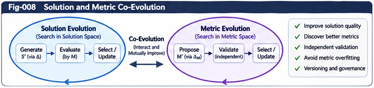

# CDE-007 — Solution-Space and Metric-Space Co-Evolution

**Series:** Constrained Delta Evolution (CDE) — Foundations  
**Status:** Foundational research proposal, v1.0.0 draft  
**Date:** 2026-11-04  
**Authors:** Sizhe Tan and GPT-Obot  
**License:** Apache-2.0  
**Companions:** [CDE-001](CDE-001-From-BTP-and-D-BTP-to-Constrained-Delta-Evolution.md), [CDE-002](CDE-002-State-Containers-and-Constraint-Governed-Transitions.md), [CDE-003](CDE-003-Delta-Semantics-and-Adaptive-M-to-N-Branching.md), [CDE-004](CDE-004-Path-Memory-No-Subtree-Semantics-and-Loop-Back-Control.md), [CDE-005](CDE-005-Search-Dynamic-Programming-and-Branch-and-Bound-Integration.md), [CDE-006](CDE-006-Directional-Fields-and-Multi-Scale-Delta-Generation.md)  
**Related specifications (planned):** `../specifications/SPEC-001-State-Container-and-Constraint-Contract.md`, `../specifications/SPEC-002-Delta-Generation-and-Branch-Contract.md`, `../specifications/SPEC-004-Solver-and-Optimization-Contract.md`, `../specifications/SPEC-006-Metric-and-Recursive-Evolution-Contract.md`  
**Related case (planned):** `../cases/CASE-004-Metric-Discovery-and-Co-Evolution.md`

## Abstract

Many optimization systems assume a fixed objective function and seek better solutions under that objective. In practical engineering, however, the evaluation model itself may be incomplete, disputed, changing, or structurally improvable. Constrained Delta Evolution (CDE) offers a common representation for exploring both solution states and candidate metrics through constraint-governed Delta operations. This paper proposes a *solution-space and metric-space co-evolution* framework with two distinct forms of improvement: optimization within a specified metric, and evidence-based improvement of the metric used to evaluate solutions. The proposal formalizes solution and metric Deltas, evaluation records, versioned comparisons, external validation, metric governance, multi-objective tradeoffs, and the feedback loops connecting both spaces. It distinguishes objective optimization from metric discovery, and emphasizes that metric self-optimization cannot establish validity without independent criteria. We examine distributed metric exploration, Structural Relay, metric-aware localization within the Structural Intelligence Framework (SIF), and controlled recursive evolution of evaluation and generation policies. Counterexamples, a minimal interface, conformance tests, falsifiable hypotheses, and a validation roadmap delimit the proposed framework. CDE is presented as a modular coordination abstraction, not as a claim to have invented metric learning, multi-objective optimization, bilevel optimization, or guaranteed global search.

**Keywords:** Constrained Delta Evolution; CDE; metric evolution; objective design; solution optimization; co-evolution; Goodhart's law; evaluation governance; multi-objective optimization; evidence; structural relay; localization; collective learning

---

## 1. Motivation: The Objective Is Not Always Given

The canonical optimization formulation is

\[
x^* \in \arg\max_{x\in\mathcal X,\;C(x)} f(x),
\]

where the feasible set and objective \(f\) are treated as fixed. This is a useful abstraction for routing, scheduling, matching, planning, and many scientific problems. Yet the abstraction conceals an important engineering activity: deciding *which* objective should be used, *which* measurements are trustworthy, and *which* tradeoffs deserve priority.

Consider a school-bus scheduling problem. A first metric minimizes vehicle count. A revised metric includes total student travel time. A third penalizes the worst individual ride, and a fourth adds service equity. These are not merely alternative numerical weights: they may encode different values, stakeholders, and admissible compromises. A schedule optimized under one metric can be unacceptable under another.

Likewise, a structural-matching system may improve its matching score without improving true identification accuracy. A stock-market indicator may look predictive in historical data but fail out of sample. A scientific hypothesis score may reward novelty while neglecting reproducibility. A distributed multi-agent system may learn to maximize a proxy that does not track the intended real-world outcome.

These examples motivate a distinction:

- **Solution exploration:** search for better states under a specified evaluation regime.
- **Metric exploration:** search for better representations, measurements, objective structures, or decision criteria, subject to independently specified validity requirements.

CDE provides a potential common language for both activities. It does not erase their differences. In particular, metric improvement requires external evidence, a normative decision, or a higher-level validation contract; no system can establish that a metric is *good* solely because it scores itself highly.

## 2. Scope and Research Position

This paper develops the metric-evolution branch of the CDE foundations. The previous papers establish State Containers, Delta transitions, adaptive M-to-N branching, path memory, Loop Back control, heterogeneous solver integration, and directional multi-scale generation.

Our contributions are proposals for:

1. A typed, versioned **Solution–Metric State Container**.
2. Distinct **solution Deltas** and **metric Deltas** with explicit governance.
3. A **two-loop co-evolution architecture** that permits asynchronous or staged improvement.
4. A **metric-validity contract** separating task score from evidence that the metric is fit for purpose.
5. **Comparable evaluation records** with provenance, constraint version, dataset version, and uncertainty.
6. An interface for **distributed metric exploration and Structural Relay**.
7. Testable properties, counterexamples, and experimental designs.

The research claim is architectural and methodological: CDE may organize these activities under common Delta and Relay contracts. The paper does **not** claim that all objective functions can be automatically discovered, that subjective values can be deduced from data alone, or that simultaneous co-evolution guarantees improvement.

## 3. Formal Model: Two Spaces and Two Kinds of Improvement

Let:

\[
\mathcal X=\text{solution-state space}, \qquad
\mathcal M=\text{metric-candidate space}.
\]

Let \(c\in\mathcal C\) denote a versioned constraint specification, \(d\in\mathcal D\) an evidence dataset or observation context, and \(p\in\mathcal P\) an exploration policy.

A metric \(m\in\mathcal M\) is not necessarily a scalar function. It may produce a vector, ordering, probability distribution, calibrated prediction, or partial comparison:

\[
m:\mathcal X\times\mathcal Z\rightarrow\mathcal Y_m,
\]

where \(\mathcal Z\) contains evaluation context and \(\mathcal Y_m\) is the metric-specific output type. When a scalar optimization objective is required, an explicit decision rule \(a_m\) maps the metric output into a preference or utility relation:

\[
x \succeq_{m,z} y
\quad\Longleftrightarrow\quad
a_m(m(x,z),m(y,z),z)\ge 0.
\]

This avoids assuming that every metric is a comparable real number.

A **solution improvement** is always relative to an evaluation regime:

\[
x_{t+1}\succ_{m_v,c_v,z_v}x_t.
\]

A **metric improvement** must instead be defined relative to a separate validation criterion \(V\):

\[
m_{k+1}\succ_{V,\mathcal D_{\rm test}}m_k.
\]

The criterion \(V\) may assess predictive validity, decision regret, calibration, stability, fairness, measurement error, or other externally chosen properties. If \(V\) itself changes, its version and authorization must also be tracked.

---



*Figure 8. Solutions and metrics evolve through separate, versioned candidate loops. Improved solution scores under a metric do not certify that the metric itself is better; metric changes require independent decision-utility validation, held-out evidence, and governance before promotion.*

---

### 3.1 A joint state

One possible logical CDE Container is

\[
S_t=(x_t,m_t,c_t,d_t,h_t,g_t,p_t,r_t),
\]

where \(h_t\) is decision and evaluation history, \(g_t\) is generator configuration, and \(r_t\) is resource and provenance state.

This is a *logical contract*, not a mandatory in-memory tuple. The solution state may reside in one service, the metric registry in another, and evidence in an external store. A reproducible transition must nevertheless identify the relevant versions and dependencies.

### 3.2 Distinct transition families

A solution Delta \(\delta_x\) changes a candidate solution:

\[
x' = T_x(x,\delta_x\mid m,c,z).
\]

A metric Delta \(\delta_m\) changes a metric candidate:

\[
m' = T_m(m,\delta_m\mid V,d,\gamma).
\]

Here \(\gamma\) represents governance requirements, such as permitted features, authorized stakeholders, evaluation protocols, and deployment approval.

Some operations modify both spaces:

\[
(x',m')=T_{xm}((x,m),\delta_{xm}),
\]

but a coupled operation should be decomposable into auditable subevents wherever possible. This permits attribution of improvement or failure.

## 4. Metric Taxonomy: What Exactly Is Evolving?

The term *metric* is often used ambiguously. CDE should distinguish at least the following types:

| Metric role | Question answered | Example | Primary risk |
|---|---|---|---|
| Observation metric | What was measured? | Ride duration, sensor error | Measurement bias |
| Predictive metric | What is likely to happen? | Estimated delay, default risk | Miscalibration or drift |
| Similarity metric | How alike are two entities? | Structural distance | Spurious resemblance |
| Ranking metric | Which candidate is preferable? | Weighted score | Preference mismatch |
| Objective or utility model | What outcome should be optimized? | Fleet-cost and equity tradeoff | Value misalignment |
| Validation metric | Does the method generalize? | Held-out decision regret | Evaluation leakage |
| Governance constraint | What is non-negotiable? | Maximum legal ride time | Improper relaxation |

A metric candidate may combine multiple roles. Nonetheless, **hard constraints are not automatically soft metric terms**. A prohibited action should not become permissible merely because its penalty is outweighed by a high reward, unless the governing contract explicitly allows such a tradeoff.

### 4.1 Metric identity and equivalence

Two metric implementations may yield identical scores on a sample but differ elsewhere. Therefore metric identity should include at least:

\[
K_m=(\text{definition},\text{features},\text{parameters},
\text{preprocessing},\text{dependencies},\text{version}).
\]

Functional equivalence is stronger than sample agreement. Two metrics may be rank-equivalent under a specified domain while numerically different; for example, a strictly increasing transform of a scalar score preserves ordering but changes numerical bounds. Such transformations are not automatically safe for B&B bounds, threshold rules, or calibration.

## 5. A Taxonomy of Metric Deltas

Metric-space exploration becomes concrete when its transformations are explicit and typed.

### 5.1 Parameter Deltas

Adjust weights, thresholds, or calibration parameters:

\[
m_w(x)=\sum_{i=1}^n w_i\phi_i(x),\qquad
\delta_m=\operatorname{AdjustWeight}(i,\Delta w_i).
\]

An update may need to preserve \(w_i\ge0\), \(\sum_i w_i=1\), monotonicity, or stakeholder-approved ranges.

### 5.2 Feature Deltas

Add, remove, replace, or transform an input feature:

\[
\delta_m=\operatorname{AddFeature}(\phi_{\rm equity}).
\]

The feature must have a defined measurement method, missing-data behavior, provenance, and permitted use. A feature that improves training accuracy may be rejected for leakage, instability, or prohibited discrimination.

### 5.3 Structural Deltas

Change the scoring architecture: linear to hierarchical, scalar to vector-valued, flat to perspective-aware, or additive to interaction-aware. A structural Delta may introduce a scoring tree, conditional branch, or aggregation operator.

### 5.4 Perspective Deltas

Change the explicitly represented decision perspective or stakeholder weighting. Such changes are *normative choices*, not automatically empirical discoveries. An authorized decision process must govern them.

### 5.5 Evidence and Validation Deltas

Change the evaluation dataset, measurement protocol, uncertainty model, or validation method. These Deltas affect what is known about a metric, and must not be confused with an improvement in the metric itself.

### 5.6 Replacement and Composition Deltas

Replace a metric with an independently developed candidate, or compose multiple metrics into a portfolio. Composition requires a declared combination rule and compatibility checks; averaging incompatible quantities without normalization or semantic justification is invalid.

### 5.7 Generator Deltas

Change the method that proposes metric candidates, including its feature library, mutation operators, sampling distribution, or search budget. This introduces a third, meta-level space without making it compulsory for CDE-Core.

## 6. Two Coupled Evolution Loops

A useful reference architecture consists of two loops.

**Solution loop:**

\[
\delta_x\sim G_x(x_t\mid m_k,c,z),\quad
x_{t+1}=T_x(x_t,\delta_x),
\]

followed by feasibility checks and evaluation under the *current fixed metric version* \(m_k\).

**Metric loop:**

\[
\delta_m\sim G_m(m_k\mid E_k,V,\gamma),\quad
\widetilde m_{k+1}=T_m(m_k,\delta_m),
\]

followed by independent validation. Only a candidate that passes the promotion contract becomes \(m_{k+1}\).

The loops need not advance at the same speed. A metric can remain frozen across thousands of solution evaluations; a metric-research worker can test many candidates without altering production optimization. This separation helps preserve comparability.

### 6.1 A versioned iteration

1. Freeze metric \(m_k\), constraints \(c_k\), and evaluation protocol \(V_k\).
2. Optimize or sample candidate solutions under \(m_k\).
3. Collect outcomes, counterexamples, uncertainty, and failure evidence.
4. Propose metric Deltas using a research generator.
5. Evaluate metric candidates against independent validation criteria.
6. Reject, defer, or promote metric changes through governance.
7. If a new metric is promoted, re-evaluate retained candidate solutions where feasible.
8. Continue solution search with the new metric version, preserving historical records.

This sequence is a safe default, not a universal requirement. Fully asynchronous implementations are possible but demand stronger consistency rules.

## 7. The Crucial Distinction: Optimization Score versus Metric Validity

Suppose a metric generator seeks

\[
m^*=\arg\max_{m\in\mathcal M}Q(m).
\]

What is \(Q\)? If \(Q(m)\) is computed by \(m\) itself, the search is circular. A metric can assign itself the highest score by construction. Even a held-out dataset is not independent if it was repeatedly used to choose and tune candidates.

A credible metric-validity contract must specify:

- **Target:** what real-world property, decision quality, or stakeholder preference is intended.
- **Evidence:** how that property is observed or adjudicated.
- **Evaluation protocol:** datasets, splits, counterfactuals, experiments, or expert review.
- **Uncertainty:** confidence intervals, measurement error, and sensitivity.
- **Generalization:** whether gains persist on unseen conditions.
- **Governance:** who may redefine the target or accept tradeoffs.

For predictive metrics, proper scoring rules, calibration, and held-out testing may be appropriate. For operational objectives, decision regret and controlled trials may matter more. For ethical or policy objectives, stakeholder deliberation cannot be replaced by numerical optimization.

**CDE can organize metric discovery; it cannot manufacture an authoritative objective from an underspecified problem.**

## 8. Goodhart Effects, Reward Hacking, and Metric Gaming

When a measure becomes a target, agents may exploit gaps between the measure and the underlying objective. CDE's ability to generate sophisticated Deltas makes this risk more important, not less.

### 8.1 A minimal counterexample

Suppose a school-bus metric is

\[
m(x)=-\text{number of buses used}.
\]

An optimizer may consolidate routes aggressively, increasing student travel times. The metric improves while service quality deteriorates. This is not a failure of the search algorithm relative to its objective; it is a failure of the objective contract relative to the actual task.

### 8.2 Metric hacking during co-evolution

A more subtle failure occurs when metric and solution generators collaborate implicitly:

1. The solution generator discovers a behavior that exploits a scoring loophole.
2. The metric generator learns to reward the resulting behavior because the same biased feedback drives both loops.
3. Internal scores improve while external outcomes stagnate or worsen.

Mitigations include independent validation, adversarial counterexample generation, metric freezes, shadow evaluation, provenance, external review, and controlled deployment.

### 8.3 Do not confuse metric stability with metric quality

A stable metric can be consistently wrong. A volatile metric can reflect genuine changes in context. Stability is one validation dimension, not the sole objective.

## 9. Metric Versioning and Cross-Version Comparability

Every evaluation result should be interpreted as a typed record:

\[
R=(\mathrm{id}_x,\mathrm{id}_m,\mathrm{id}_c,\mathrm{id}_d,
\mathrm{id}_V,y,u,t,\pi),
\]

where \(y\) is the metric output, \(u\) is uncertainty or supporting evidence, \(t\) is time, and \(\pi\) is provenance.

The version identifiers must be immutable or content-addressed. A score without a metric version is not a reliable comparison artifact.

### 9.1 Comparison rules

- **Same metric and context:** compare scores if the metric's comparison rule permits it.
- **Different metric versions:** do not compare raw values unless a validated mapping or common reference evaluation exists.
- **Different constraints:** report feasibility and objective differences separately.
- **Different evidence regimes:** report uncertainty and distribution shift; avoid false equivalence.
- **Different stakeholders:** preserve perspective labels rather than silently collapsing preferences.

### 9.2 Re-evaluation and historical preservation

When \(m_k\) becomes \(m_{k+1}\), historical candidate solutions can be re-scored. Their original evaluation records must remain intact. Re-scoring is a new event, not a retroactive overwrite.

A historical incumbent under \(m_k\) is not automatically the incumbent under \(m_{k+1}\). In B&B, bounds and pruning certificates tied to the old objective may become invalid and must be recomputed or explicitly proven transferable.

## 10. Multi-Objective and Perspective-Aware Evaluation

Many real problems have no universally correct scalar metric. Let

\[
\mathbf f(x)=(f_1(x),\ldots,f_q(x)).
\]

A candidate \(x\) Pareto-dominates \(y\) when it is no worse in every relevant objective and strictly better in at least one, under a declared orientation and feasibility regime.

CDE can maintain a Pareto archive rather than immediately forcing all values into a single score. Metric Deltas may change the objective set, the scalarization rule, the stakeholder perspective, or the admissible tradeoff region.

However, changes to the objective set create a new comparison regime. A Pareto frontier in two objectives is not directly interchangeable with one in three objectives.

### 10.1 Perspective contracts

A perspective-aware metric should identify:

\[
P=(\text{stakeholder},\text{scope},\text{priority rules},
\text{authorization},\text{version}).
\]

This connects to earlier research on perspective-aware scoring and universal control planes, while preserving a crucial distinction: empirical measurement can inform value choices but does not independently authorize them.

### 10.2 Robust optimization across metrics

When metric uncertainty is substantive, a system may seek solutions that perform acceptably under a set \(\mathcal M_{\rm plausible}\), rather than optimizing one fragile proxy:

\[
\max_{x\in\mathcal X_C}\min_{m\in\mathcal M_{\rm plausible}}U_m(x),
\]

provided utilities have been placed on a justified common scale. Otherwise use ordinal robustness, regret analysis, or a multi-criteria decision procedure.

## 11. Metric Deltas, Constraints, and M-to-N Branching

At metric state \(m_k\), a generator proposes \(M\) typed metric Deltas:

\[
G_m(m_k)=\{\delta_m^1,\ldots,\delta_m^M\}.
\]

After syntactic validation, hard-constraint checking, resource selection, and duplicate handling, the system may realize \(N\) transition edges. As established in CDE-003:

\[
M\ne N\ne |\text{unique successor metrics}|
\]

in general. Multiple Deltas can produce equivalent metric candidates; one stochastic Delta can produce multiple outcomes; some proposals are deferred without creating a state transition.

### 11.1 Hard constraints on metric evolution

Examples include feature-use restrictions, monotonicity, bounded computational cost, calibration obligations, and mandatory fairness review. A metric candidate failing a hard contract is not rescued by a high exploratory score.

### 11.2 Path memory and revisiting

A constructive metric search may record each proposal as accepted or excluded, enforcing path-local decision uniqueness. A reconfigurable metric search may revisit a previous metric after new evidence or under a different validation context.

Therefore:

\[
\text{Metric Identity}\neq\text{Decision Identity}\neq\text{Evaluation Context}.
\]

Global deduplication by metric hash alone may suppress legitimate re-evaluation under new evidence. Conversely, arbitrarily changing version labels must not defeat meaningful duplicate detection.

## 12. Search, DP, and B&B over the Metric Space

Metric exploration can employ ordinary search methods. CDE does not require a special optimizer.

**Search:** enumerate or prioritize candidate metric Deltas; retain rejected and deferred candidates with reasons.

**Dynamic programming:** cache metric subproblems only when their future-relevant context, validation budget, and dependencies are equivalent. Two identical parameter vectors may not define equivalent subproblems if their evidence histories differ.

**Branch-and-Bound:** prune a metric branch only when a valid bound proves that it cannot outperform the incumbent under a fixed external validation objective. Heuristic estimates of metric quality are not safe pruning certificates.

**Bayesian optimization or black-box search:** propose expensive metric candidates using uncertainty-aware surrogates. These methods can serve as generators without changing CDE's state/transition contract.

**Evolutionary or population methods:** maintain multiple metric candidates, mutations, and recombination operations. The relevant provenance and governance checks still apply.

The value of CDE is interoperability and auditability, not replacement of these mature techniques.

## 13. Solution–Metric Feedback and Coupled Failure Modes

Co-evolution is not automatically beneficial. Consider the following loop:

\[
m_k \rightarrow \operatorname{Optimize}(m_k)
\rightarrow X_k \rightarrow \operatorname{Evidence}(X_k)
\rightarrow m_{k+1}.
\]

The evidence generated by the optimizer may be highly selective. A metric trained only on states visited by the current optimizer can fail on unexplored regions. The solution generator may then become increasingly specialized to a narrow, self-confirming metric.

Possible safeguards include:

1. Preserve exploration independent of the current metric.
2. Maintain challenge sets and counterexamples.
3. Include random or stratified probes where appropriate.
4. Separate training, model selection, and final evaluation.
5. Track coverage and uncertainty, not just best score.
6. Permit rollback to a prior metric and solver policy.
7. Compare against fixed-metric and fixed-generator baselines.

This makes co-evolution a controlled research program rather than a presumption of monotonic progress.

## 14. Distributed CDE: Parallel Metric Research

A CDE Orchestrator can dispatch different metric-exploration tasks to heterogeneous workers:

\[
W_i=(m_k,\Delta_i,C_i,V_i,D_i,B_i,\pi_i),
\]

where \(\Delta_i\) is a candidate Delta scope, \(C_i\) is the governing constraint context, \(V_i\) is the validation protocol, \(D_i\) is the evidence snapshot, \(B_i\) is a resource budget, and \(\pi_i\) is provenance and execution policy.

For example:

- Worker A explores weight adjustments.
- Worker B explores feature combinations.
- Worker C explores alternative metric structures.
- Worker D searches for adversarial counterexamples.
- Worker E tests decision regret on independent scenarios.

These workers need not use the same search algorithm.

### 14.1 Results are not always directly mergeable

A valid metric found on one dataset may not generalize to another. Two locally good metrics may conflict in stakeholder priorities. Combining their coefficients or averaging their scores may be meaningless.

Therefore distinguish:

- **Candidate Relay:** transmit metric definitions and supporting evidence.
- **Evidence Relay:** transmit data lineage, counterexamples, uncertainty, and failed tests.
- **Method Relay:** transmit useful feature operators, validation procedures, or search heuristics.
- **Constraint Relay:** transmit newly discovered restrictions or incompatibilities.
- **Policy Relay:** transmit independently validated improvements in exploration strategy.

A central or federated validation function should reconcile incompatible evidence and preserve dissenting results when no justified synthesis exists.

### 14.2 Asynchronous updates

Metric workers can operate asynchronously, but every result must name its baseline and evaluation versions. Promotion should use compare-and-swap semantics, explicit review, or another concurrency-safe procedure; a late result must not silently overwrite a newer validated metric.

## 15. CDE as an Exploration and Metric-Evolution Orchestrator

CDE-Core defines legal Delta transitions. CDE-Orchestrator coordinates tasks, evidence, metric versions, solver portfolios, and governance.

A minimal control-plane cycle is:

```text
Receive problem, constraints, metric regime, and validation contract
  -> Identify solution and metric exploration opportunities
  -> Allocate budgets and dispatch typed Delta tasks
  -> Collect results, evidence, uncertainty, and provenance
  -> Verify feasibility and compare within valid evaluation regimes
  -> Promote, reject, defer, or request additional evidence
  -> Relay reusable methods and update exploration priorities
  -> Repeat or terminate according to explicit criteria
```

The control plane may be logically unified without being physically centralized. Distributed governance is possible, provided authorization and conflict-resolution semantics are explicit.

The orchestrator should avoid conflating four different claims:

1. A solution scores better under a fixed metric.
2. A metric better predicts or measures an independently defined target.
3. A generator discovers useful candidates more efficiently.
4. A coordination policy improves system-level outcomes.

Each claim needs its own evidence.

## 16. Structural Intelligence Framework: Localization across Solution and Metric Spaces

Within the Structural Intelligence Framework (SIF), Localization concerns finding, addressing, or constructing relevant structural regions, capability units, and problem–method connections.

CDE offers a candidate *exploratory localization* mechanism when the desired location is not already known. Metric co-evolution extends that idea:

- **Solution localization:** where are feasible or promising candidate solutions?
- **Metric localization:** where are useful scoring structures, features, or validation criteria?
- **Method localization:** which generator or solver is effective in this region?
- **Evidence localization:** where are counterexamples, uncertainty, and unresolved conflicts?

A localization result should carry a typed target, confidence or evidence, constraint context, and provenance. A directional score may guide where to probe but is not proof that the target is present.

### 16.1 A bidirectional localization hypothesis

A better metric may reveal previously overlooked solution regions. Conversely, difficult solution regions may expose defects in the current metric. CDE can coordinate these two directions through versioned Delta tasks.

This is a plausible research hypothesis, not an established performance guarantee. It should be tested against independent solution-only and metric-only baselines.

## 17. Worked Example A: School-Bus Scheduling

Let \(x\) encode route assignments, bus usage, and pickup sequences. Hard constraints include vehicle capacity, legal safety limits, service coverage, and schedule feasibility.

A metric portfolio may contain:

\[
\mathbf f(x)=
\bigl(
B(x),\;
T_{\rm total}(x),\;
T_{\max}(x),\;
E_{\rm inequity}(x)
\bigr),
\]

where \(B\) counts vehicles, \(T_{\rm total}\) is total travel time, \(T_{\max}\) is maximum individual ride time, and \(E_{\rm inequity}\) is a defined equity indicator.

**Solution Deltas:** move a student between routes, swap stops, reassign a vehicle, or restructure a route.

**Metric Deltas:** change authorized weights, add a tail-risk penalty, adopt lexicographic priorities, or replace a scalar score with Pareto analysis.

A practical protocol is:

1. Find feasible schedules under a fixed objective.
2. Evaluate them under a richer metric portfolio.
3. Inspect tradeoffs and stakeholder feedback.
4. Propose metric revisions.
5. Validate revisions against explicitly agreed service outcomes.
6. Re-evaluate archived schedules and restart or continue optimization.

**Failure case:** a new scalar metric reduces average ride time but increases the longest ride beyond a hard safety limit. The candidate must be rejected regardless of its score.

**Research question:** does controlled metric evolution improve real-world service outcomes compared with fixed, well-designed multi-objective optimization, after accounting for additional computation and governance cost?

## 18. Worked Example B: Structural Matching and Behavioral Attribution

Suppose a matching system estimates whether observations belong to the same underlying entity. Candidate metrics may combine temporal consistency, network topology, behavioral patterns, and other legally and ethically permitted signals.

A metric Delta might alter feature weights, introduce an uncertainty-aware similarity term, or replace a distance measure with a calibrated likelihood ratio.

Important cautions:

- Correlation is not identity.
- Shared infrastructure, keys, devices, or network metadata do not by themselves establish a unique actor.
- Evaluation should use independently verified ground truth where available.
- Privacy, data-use authorization, and false-positive costs must be explicit.
- Weak evidence should update uncertainty rather than be promoted to certainty.

CDE can organize metric experiments and evidence provenance; it cannot turn ambiguous evidence into a reliable identification merely by searching more extensively.

## 19. Worked Example C: Scientific Hypothesis Scoring

A scientific exploration system may rank hypotheses by explanatory coverage, novelty, testability, evidence quality, and expected experimental value.

Here the metric itself is an object of scientific scrutiny. A metric that over-rewards novelty may favor speculative hypotheses; one that over-rewards current evidence may suppress fruitful but testable ideas.

CDE may generate Metric Deltas such as adding a falsifiability component, modifying uncertainty penalties, or using separate exploration and confirmation scores.

The validation contract should prioritize independent experiments, replication, and predictive performance. Peer or agent consensus is useful evidence but is not a substitute for empirical validation.

This case naturally connects to autonomous questioning and evidence-driven Structural Relay.

## 20. Worked Example D: A Minimal Numerical Counterexample

Consider three feasible solutions with two measured attributes, benefit \(b\) and cost \(c\):

| Solution | Benefit \(b\) | Cost \(c\) |
|---|---:|---:|
| A | 10 | 8 |
| B | 8 | 3 |
| C | 6 | 1 |

Define a metric family

\[
m_\lambda(x)=b(x)-\lambda c(x), \qquad \lambda\ge0.
\]

At \(\lambda=0.2\):

\[
m_{0.2}(A)=8.4,\quad m_{0.2}(B)=7.4,\quad m_{0.2}(C)=5.8,
\]

so A ranks first.

At \(\lambda=1\):

\[
m_1(A)=2,\quad m_1(B)=5,\quad m_1(C)=5,
\]

so B and C tie for first.

At \(\lambda=2\):

\[
m_2(A)=-6,\quad m_2(B)=2,\quad m_2(C)=4,
\]

so C ranks first.

Nothing about the physical solutions changed. The metric changed, and therefore the ranking changed. The scores across different \(\lambda\) values should not be treated as a single consistent leaderboard.

The example illustrates why a CDE evaluation record must carry the metric version and why a metric Delta is not equivalent to a solution Delta.

## 21. A Minimal Metric-Evolution Contract

The following pseudocode is illustrative, not a complete runtime standard.

```text
MetricCandidate:
    metric_id
    parent_metric_id
    definition
    feature_dependencies
    parameters
    output_type
    comparison_semantics
    constraint_version
    provenance

MetricDelta:
    delta_id
    delta_type
    source_metric_id
    transformation
    preconditions
    declared_effects
    provenance

EvaluationRecord:
    solution_id
    metric_id
    constraint_version
    dataset_version
    validation_protocol_id
    outcome
    uncertainty
    evidence_refs
    timestamp
    provenance

MetricPromotionDecision:
    candidate_metric_id
    baseline_metric_id
    validation_report_id
    authorized_decision
    effective_version
    rollback_target
```

### 21.1 Proposed transition protocol

```text
function PROPOSE_METRIC_EVOLUTION(metric, generator, context):
    candidates = generator.propose(metric, context)
    for delta in candidates:
        if not syntax_valid(delta):
            record_rejection(delta, "invalid_delta")
            continue
        if not authorized(delta, context.governance):
            record_rejection(delta, "unauthorized_change")
            continue
        candidate = apply_metric_delta(metric, delta)
        if not metric_constraints_hold(candidate, context):
            record_rejection(delta, "constraint_violation")
            continue
        enqueue_validation(candidate, delta, context)
    return validation_queue

function CONSIDER_PROMOTION(candidate, baseline, validation):
    if not validation.is_independent_and_current():
        return DEFER
    if not validation.passes_required_thresholds():
        return REJECT
    if not governance_approves(candidate, validation):
        return DEFER
    return PROMOTE_WITH_VERSION_AND_ROLLBACK(candidate)
```

The protocol deliberately separates candidate generation from deployment approval.

## 22. Conformance Requirements and Test Cases

A conforming metric-evolution implementation should satisfy the following proposed requirements. These are *draft contracts*, not claims of an existing standard.

| ID | Requirement | Test |
|---|---|---|
| MET-CONF-01 | Every metric has a stable identity and version | Same content resolves consistently |
| MET-CONF-02 | Every evaluation names its metric version | Reject an unversioned score |
| MET-CONF-03 | Hard constraints remain authoritative | High-scoring infeasible solution rejected |
| MET-CONF-04 | Metric Deltas are typed and auditable | Unknown Delta type rejected |
| MET-CONF-05 | Candidate and promoted metrics are distinct | Failed candidate never becomes active |
| MET-CONF-06 | Metric promotion has external validation evidence | Self-scoring-only promotion blocked |
| MET-CONF-07 | Cross-version score comparison is guarded | Incompatible score comparison refused |
| MET-CONF-08 | Historical evaluation records are immutable | Re-score appends, never overwrites |
| MET-CONF-09 | Validation datasets and protocols are versioned | Stale report detected |
| MET-CONF-10 | Solver bounds identify their objective version | Old-objective bound invalidated |
| MET-CONF-11 | Repeated metric candidates preserve context | New evidence may trigger re-evaluation |
| MET-CONF-12 | Worker results carry provenance | Missing lineage flagged |
| MET-CONF-13 | Governance changes require authorization | Unauthorized perspective change rejected |
| MET-CONF-14 | Rollback is possible after metric promotion | Prior metric restored with audit trail |
| MET-CONF-15 | Metric uncertainty is represented | Unsupported certainty claims rejected |
| MET-CONF-16 | Multiple objectives retain declared semantics | Pareto archive not flattened silently |
| MET-CONF-17 | Duplicate Delta decisions follow path policy | Constructive path rejects repeated decision |
| MET-CONF-18 | Relay artifacts distinguish result from method | Method cannot masquerade as validated result |

A test suite should include negative tests, not merely successful transitions.

## 23. Testable Hypotheses

The following are falsifiable research hypotheses, not established findings.

**H1 — Validated co-evolution:** Under a fixed compute budget, controlled solution–metric co-evolution improves independently measured decision quality over fixed-metric optimization in selected tasks.

**H2 — Metric diversity:** Maintaining multiple validated metric candidates improves robustness under distribution shift compared with maintaining only the current highest-scoring proxy.

**H3 — Counterexample relay:** Sharing adversarial and failure evidence between metric workers reduces recurrence of known metric failures.

**H4 — Versioned evaluation:** Strict metric versioning reduces incorrect cross-run comparisons and stale-bound errors in heterogeneous solver portfolios.

**H5 — Adaptive generator:** A validated metric-Delta generator reaches useful metric structures with fewer evaluations than a fixed generator on selected benchmarks.

**H6 — Exploration localization:** Metric-space Delta exploration discovers effective scoring structures outside the initial local parameter neighborhood more often than local-only search, under comparable budgets.

**H7 — Distributed method relay:** Reusing validated metric-search operators across related domains improves sample efficiency compared with isolated workers.

**H8 — Governance cost:** Stronger metric validation improves external reliability but may increase computation and review latency; the tradeoff can be quantified.

**H9 — Failure of unconstrained co-evolution:** Removing independent validation increases proxy exploitation or overfitting in deliberately constructed benchmark environments.

**H10 — SIF localization:** Joint solution and metric localization improves discovery of useful problem–method correspondences on specified structural tasks relative to either localization loop alone.

Every hypothesis should specify datasets, baselines, primary metrics, confidence intervals, stopping rules, and failure criteria before evaluation.

## 24. Validation Roadmap

### Phase I — Formal semantics and reproducibility

Build toy examples with known optimal solutions and known metric families. Verify metric identity, Delta application, versioned evaluation, cross-version comparison guards, and objective-bound invalidation. Include cases where metric improvement is impossible because no independent validation target is supplied.

### Phase II — Controlled single-domain experiments

Use school-bus scheduling, structural matching, and metric-selection benchmarks. Compare:

1. Fixed metric + fixed solver.
2. Fixed metric + adaptive solution generator.
3. Metric search + fixed solution generator.
4. Controlled solution–metric co-evolution.
5. Unconstrained co-evolution as a failure-oriented baseline.

Hold total compute, data access, and validation opportunities as comparable as possible. Report feasibility, independent decision quality, generalization, runtime, and evaluation cost.

### Phase III — Distributed relay

Partition metric search across workers with different Delta families. Measure parallel speedup, redundant work, evidence-transfer overhead, stale results, promotion conflicts, and the net value of Method Relay.

### Phase IV — Controlled recursive evolution

Permit generator or policy changes only after separate validation. Evaluate whether improvements survive new tasks, distribution shifts, and adversarial counterexamples. Require rollback and preserve immutable audit records.

### Phase V — Cross-domain transfer

Test whether a metric-search operator learned in one domain transfers to another without leaking task-specific labels or assumptions. Compare transfer against a domain-native baseline and report negative transfer explicitly.

## 25. Conditional Properties and Proof Obligations

### 25.1 Feasibility preservation

If the initial state satisfies \(C\), every applied solution Delta is checked against \(C\), and the transition implementation is sound, then all committed solution states remain feasible under the same constraint version. This property does not imply that the solution is optimal.

### 25.2 Version-safe comparisons

If the comparison API rejects incompatible evaluation regimes unless an approved translation or common re-evaluation is provided, then an accepted comparison is *semantically well-typed*. This does not establish that the underlying metric is valid or unbiased.

### 25.3 Termination under finite candidate sets

If metric and solution candidate sets are finite, each path forbids repeated decisions under a sound canonical identity, and the expansion policy exhausts or explicitly stops within a finite budget, the resulting bounded search terminates. Termination does not imply completeness when heuristic filtering permanently excludes candidates.

### 25.4 No automatic monotonicity

A new metric may reverse rankings; a better-validated metric may reduce the incumbent's score; and a new generator may perform worse on unseen tasks. Thus a general theorem of monotonic improvement across metric versions is unavailable without strong assumptions and a common external objective.

### 25.5 Optimality under a changing metric

An optimality certificate for \(m_k\) is not automatically valid for \(m_{k+1}\). Reuse requires proof that the relevant objective ordering and bounds are preserved, or a fresh optimization certificate.

### 25.6 Independent validation cannot be inferred

No structural property of CDE guarantees that a validation dataset is independent, representative, or ethically adequate. These are external experimental and governance obligations.

## 26. Failure Modes and Counterarguments

**F1 — Infinite regress of metrics.** If every metric needs a meta-metric, and every meta-metric needs another, no ultimate numerical criterion emerges. CDE addresses this operationally through explicit external goals and governance, not through a universal mathematical resolution.

**F2 — Overfitting the validator.** Repeated metric search on the same validation set leaks information. Use nested evaluation, fresh holdouts, preregistration, or controlled trials where practical.

**F3 — Hidden objective changes.** Changing feature preprocessing or stakeholder weights without versioning can invalidate all historical comparisons.

**F4 — False metric equivalence.** Similar observed rankings do not prove two metrics equivalent under unseen states or different constraint contexts.

**F5 — Expensive co-evolution.** Metric exploration may consume more resources than it saves. Report total system cost, not only best-found quality.

**F6 — Objective laundering.** A normative preference can be presented as an empirical metric improvement. Separate stakeholder decisions from statistical evidence.

**F7 — Distributed inconsistency.** Workers can use different baselines or validation protocols, producing incomparable claims. Require immutable versions and explicit reconciliation.

**F8 — Feedback lock-in.** Solution and metric generators can reinforce each other's blind spots. Preserve independent probes and challenge sets.

**F9 — Weak-evidence overreach.** A directional hint or similarity score may guide exploration but is not proof of truth, causality, or identity.

**F10 — Framework inflation.** If CDE is defined to include every optimizer and every learning system, the proposal loses explanatory value. Its useful content should reside in precise State–Delta–Constraint contracts, versioned evaluation, and interoperable Relay interfaces.

## 27. Relationship to Existing Research

This proposal overlaps with established traditions and should be evaluated against them rather than claiming novelty by renaming.

- **Multi-objective optimization:** Pareto search, scalarization, preference elicitation, and tradeoff analysis.
- **Bilevel and meta-optimization:** outer-loop objective or hyperparameter selection with inner-loop solution optimization.
- **Metric learning:** data-driven similarity, distance, ranking, and representation learning.
- **AutoML and neural architecture search:** automated selection of model structures, features, and evaluation configurations.
- **Bayesian optimization and evolutionary computation:** candidate generation under expensive or black-box objectives.
- **Goodhart and reward-design research:** failures of proxy objectives and reward hacking.
- **Robust and distributionally robust optimization:** performance under uncertain models or shifting data.
- **Multi-agent and distributed optimization:** asynchronous workers, portfolio search, and knowledge exchange.
- **Decision theory and measurement theory:** semantics, comparability, values, and validity of evaluations.

The proposed CDE-specific synthesis is a solver-neutral, typed Delta framework linking *solution search*, *metric search*, *evidence governance*, and *Structural Relay* through shared contracts. Whether this synthesis produces measurable engineering benefits remains a question for the validation program.

## 28. Open Research Questions

1. What is the smallest metric contract that supports scalar, vector, ordinal, and probabilistic evaluations without erasing their semantics?
2. Which metric Deltas preserve useful solver bounds or state dominance relations?
3. How should a CDE orchestrator budget computation between solution search and metric search?
4. When should metric updates trigger full re-optimization versus selective re-evaluation?
5. How can validation protocols resist adaptive overfitting when metric candidates are numerous?
6. What constitutes a safe cross-domain transfer of a metric-search operator?
7. How should partially incompatible stakeholder perspectives be represented without false aggregation?
8. Can negative evidence and counterexamples be packaged as reusable, privacy-preserving Relay units?
9. Which state equivalence conditions permit DP-style caching during metric co-evolution?
10. How can a distributed system prove that no worker used an obsolete metric or constraint version for a claimed optimality certificate?
11. When does metric-space exploration improve SIF exploratory localization rather than merely increase search cost?
12. Which parts of metric governance can be automated, and which require authorized human or institutional judgment?
13. How can evolving metrics coexist with reproducible scientific benchmarks?
14. What are useful impossibility or lower-bound results for jointly learning objectives and solutions from incomplete evidence?

## 29. Research Implications

CDE can be interpreted as a framework for three coupled questions:

1. **Where should we search?** — solution-state exploration and localization.
2. **How should we judge what we find?** — metric discovery, comparison, and governance.
3. **How should we improve the search process?** — generator and policy evolution.

These questions interact but are not interchangeable. A better solution under a flawed metric may be worse in practice. A better metric may require a different solution. A faster generator may explore the wrong region more efficiently. A successful relay must therefore transmit not only a result but the evaluation regime and evidence that support it.

The long-term opportunity is an open, Collective Learning-friendly ecosystem in which engineers contribute problem contracts, candidate metrics, counterexamples, search operators, and validation methods that other domains can inspect and reuse. The central discipline is to preserve the difference between *exploratory direction* and *validated improvement*.

## 30. Conclusion

Solution-Space and Metric-Space Co-Evolution extends the CDE research program beyond fixed-objective search without abandoning formal constraints or evaluation rigor. Solution Deltas transform candidate answers; metric Deltas transform how those answers are measured, ranked, or judged. A CDE Orchestrator may coordinate both loops, but every claimed improvement remains conditional on a declared evaluation regime and independent evidence.

The most important design rule is straightforward:

> **Evolve solutions and metrics through explicit Deltas, but never allow a metric to certify its own validity merely by assigning itself a higher score.**

With versioned evaluation, typed contracts, negative evidence, distributed Relay, and controlled promotion, CDE offers a plausible architecture for reusable metric research and collective structural learning. Its generality and practical advantage are research hypotheses to be tested, not assumed.

---

## Appendix A. Compact Notation Reference

| Symbol | Meaning |
|---|---|
| \(\mathcal X\) | Solution-state space |
| \(\mathcal M\) | Metric-candidate space |
| \(x\) | Candidate solution |
| \(m\) | Metric candidate |
| \(C\) | Hard-constraint specification |
| \(V\) | Independent validation contract |
| \(G_x,G_m\) | Solution and metric Delta generators |
| \(\delta_x,\delta_m\) | Solution and metric Deltas |
| \(T_x,T_m\) | Typed transition functions |
| \(R\) | Versioned evaluation record |
| \(\gamma\) | Governance and authorization context |
| \(\succeq_m\) | Preference relation under metric \(m\) |
| \(W_i\) | Distributed exploration task |

## Appendix B. Recommended Cross-References

- **CDE-001:** BTP → D-BTP → CDE generalization and research position.
- **CDE-002:** State Container and constraint-governed transition semantics.
- **CDE-003:** Delta identity and adaptive M-to-N branching.
- **CDE-004:** Path memory, NoSubtree, Loop Back, and decision uniqueness.
- **CDE-005:** Solver portfolios, DP equivalence, and safe B&B pruning.
- **CDE-006:** Directional fields, multi-scale generators, and exploratory SIF localization.
- **CDE-008 (planned):** General Exploration and Optimization Orchestrator.
- **CDE-009 (planned):** Distributed CDE and Delta Exploration Contracts.
- **CDE-010 (planned):** Structural Relay and Collective Learning.
- **CDE-011 (planned):** Recursive Generator and Policy Evolution.
- **SPEC-006 (planned):** Metric and Recursive Evolution Contract.
- **CASE-004 (planned):** Metric Discovery and Co-Evolution.

## Appendix C. Suggested Figure Placement

**Fig-008 — Solution and Metric Co-Evolution** should illustrate the solution loop and metric loop with a validation gate between candidate metric generation and metric promotion. It should distinguish immutable evaluation records from mutable active policies, and show evidence flowing from solution search back into metric research. The figure should explicitly label external validation, metric versioning, and rollback.

## References and Research Context

This manuscript is a conceptual synthesis, not an empirical review. The following established research lines provide comparison points for future scholarly expansion:

- Multi-objective optimization and Pareto efficiency.
- Bilevel optimization and hyperparameter optimization.
- Statistical metric learning and representation learning.
- Measurement theory, calibration, and proper scoring rules.
- Robust optimization, distribution shift, and decision regret.
- Goodhart effects, reward hacking, and specification gaming.
- Distributed optimization and asynchronous portfolio methods.
- Structural Intelligence Framework (SIF), Universal Control Planes and Scoring Folding (UCPSF), and the preceding CDE foundations.

Formal bibliographic entries and precise priority claims should be added only after source verification.

---

**Research status:** Directional framework and proposed contracts. No universal optimality, convergence, or cross-domain transfer guarantee is asserted.  
**Version:** v1.0.0 draft  
**License:** Apache-2.0
