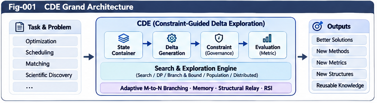
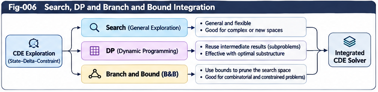

# CDE-008 — CDE as a General Exploration and Optimization Orchestrator

**Series:** Constrained Delta Evolution (CDE) — Foundations  
**Status:** Foundational research proposal, v1.0.0 draft  
**Date:** 2026-11-04  
**Authors:** Sizhe Tan and GPT-Obot  
**License:** Apache-2.0  
**Position:** CDE-Core / CDE-Orchestrator architectural boundary

## Abstract

Constrained Delta Evolution (CDE) generalizes constraint-governed structural transformation beyond the original binary branching and permutation-oriented settings of BTP and D-BTP. A central implication is that the resulting framework need not be a monolithic solver: it can serve as an exploration and optimization **orchestrator** that coordinates heterogeneous algorithms, adaptive Delta generators, evolving metrics, distributed workers, and evidence-driven Structural Relay. This paper proposes an architectural contract for CDE-Orchestrator, separating a minimal State–Delta–Constraint transition core from policies governing task decomposition, solver selection, validation, resource allocation, feedback, and collective learning. We define exploration units, control-plane responsibilities, result and method relay, versioned evidence, conflict reconciliation, asynchronous operation, and optional recursive policy improvement. We also position CDE as a candidate dynamic and constructive Localization method within the Structural Intelligence Framework (SIF). The contribution is a falsifiable systems-design proposal, not a claim that coordination is universally beneficial or that CDE subsumes the correctness guarantees of constituent algorithms. Formal invariants, failure cases, conformance tests, and a staged experimental roadmap are included.

**Keywords:** Constrained Delta Evolution; orchestration; exploration control plane; heterogeneous solver portfolio; Delta Exploration Contract; Structural Relay; metric evolution; distributed optimization; collective learning; SIF Localization; recursive self-improvement

---

## 1. Why an Orchestrator Rather Than One More Solver?

A practical constrained problem may be addressed through depth-first search, best-first search, dynamic programming (DP), branch-and-bound (B&B), constraint programming, local improvement, population-based heuristics, or a domain-specific algorithm. These methods have different strengths, state representations, completeness conditions, resource profiles, and failure modes. Requiring all computation to run through a single search algorithm would unnecessarily narrow CDE.

The motivating proposal is instead to treat CDE as a **common exploration contract** and, optionally, an **upper-layer coordination mechanism**. An engineer can bring a problem, identify a logical State Container, define admissible Delta operations, specify hard constraints and evaluation criteria, and expose exploration tasks to one or more solvers. Different workers may generate different Deltas, visit different regions, and return results with different degrees of certainty. The orchestrator determines how these contributions are assigned, checked, compared, and reused.

This is useful only if the integration overhead is justified. For small or tightly coupled problems, a specialized solver may remain simpler and faster. CDE-Orchestrator is therefore an optional layer, not a prerequisite for every CDE implementation.

## 2. Scope and Claims

This paper proposes:

1. A strict separation between **CDE-Core**, **solver adapters**, and **CDE-Orchestrator**.
2. A portable **Delta Exploration Unit** for assigning and relaying work.
3. A **control-plane model** for constraint, metric, budget, and validation governance.
4. A heterogeneous **solver portfolio** with explicit guarantee preservation.
5. A **Result–Evidence–Method–Policy Relay** architecture.
6. A model of **asynchronous distributed coordination** and reconciliation.
7. A candidate link between CDE and **exploratory SIF Localization**.
8. Testable hypotheses and concrete engineering conformance requirements.

The paper does not establish a universal optimality theorem, universal speedup, automatic discovery of valid objectives, or reliable RSI without independent evaluation. Its claims concern architectural coherence and potential engineering utility.

## 3. The Three-Layer Architecture

### 3.1 CDE-Core: the semantic foundation

A minimal CDE problem can be represented by

$$
\mathcal P=(\mathcal S,\mathcal D,G,T,C,E,L),
$$

where $\mathcal S$ is the logical state space, $\mathcal D$ is the Delta space, $G$ proposes Deltas, $T$ defines transitions, $C$ determines constraint validity, $E$ defines evaluation under a versioned regime, and $L$ defines termination or progress conditions. Implementations may require richer context, stochastic transitions, and observations.

CDE-Core specifies **what constitutes a legal transition**, how a Delta and its provenance are recorded, and which history or identity conditions must be respected. It does not mandate DFS, B&B, DP, or a central scheduler.

### 3.2 Solver adapters: computational specialization

A solver adapter maps a CDE task to a particular algorithm and returns typed artifacts. For example:

- Search adapter: frontier expansion, candidate paths, visited-state policy.
- DP adapter: subproblem equivalence, memoization, recurrence semantics.
- B&B adapter: incumbent, objective-specific admissible bounds, pruning certificates.
- Constraint solver adapter: propagation, satisfiability, feasibility proofs.
- Local or evolutionary adapter: neighborhood generation, population search, approximate outcomes.
- Domain adapter: specialized routing, matching, planning, or metric-learning algorithms.

Adapters must report what their guarantees actually mean. An approximate heuristic cannot inherit the completeness claim of a different exact solver merely because both use a CDE interface.

### 3.3 CDE-Orchestrator: coordination and governance

The orchestrator manages the exploration portfolio: which tasks to generate, which workers to use, what budgets to assign, which evidence to accept, and which policies to update. It may be centralized, federated, or hierarchically distributed. **Logical coordination does not require one physical controller.**

A compact decomposition is:

$$
\text{CDE System}=\text{Core Contracts}+\text{Solver Portfolio}+\text{Optional Orchestration}.
$$

---



*Figure 1. Conceptual architecture of Constrained Delta Evolution. A versioned State–Delta–Constraint core supports adaptive proposal generation and solver portfolios; optional orchestration, independent validation, Structural Relay, and controlled meta-evolution extend the system without weakening hard-constraint governance.*

---

## 4. State Containers and the Orchestrator's View

A State Container is a logical collection of all information relevant to a transition, not necessarily a single memory object or a tree node. A useful operational state is

$$
S_t=(X_t,C_t,M_t,H_t,E_t,P_t,R_t),
$$

where $X_t$ denotes domain state, $C_t$ constraint context, $M_t$ metric regime, $H_t$ path/decision history, $E_t$ evidence, $P_t$ policy, and $R_t$ resources and provenance.

The orchestrator should not copy all state data into every worker. A task can refer to immutable snapshots, content-addressed artifacts, or authorized data services. However, any information affecting future legal actions, evaluation, or pruning must be recoverable through the task's declared dependencies.

**State identity**, **decision identity**, and **Delta identity** remain distinct. State equivalence sufficient for memoization is stronger than equality of a few visible fields: it must preserve all future-relevant consequences under the chosen solver contract.

## 5. Delta-Labeled Adaptive M-to-N Exploration

At state $S$, a generator may propose $M$ candidate Deltas:

$$
G(S)=\{\delta_1,\ldots,\delta_M\}.
$$

Constraint checking, branching policy, deduplication, and stochastic outcomes may yield $N$ realized transition edges. In general,

$$
M\neq N\neq |\mathrm{UniqueSuccessors}(S)|.
$$

A realized edge is identified by

$$
e=(S_i,\delta,a,S_j,\pi),
$$

where $a$ is the decision/transition semantics and $\pi$ is provenance. This representation supports trees, DAGs, and cyclic state graphs. The **Delta belongs to the transition edge**, not necessarily to the successor state.

The orchestrator can allocate exploration budgets per Delta family, region, uncertainty class, solver, or domain. It must distinguish a *deferred* candidate from a permanently excluded one; neither is automatically a realized state transition.

## 6. Delta Exploration Units: the Portable Work Contract

A proposed unit of distributed work is

$$
W=(\mathrm{id},S_0,\Delta_{\rm scope},C_v,M_v,P_v,B,V,\Gamma,\pi),
$$

with:

| Field | Meaning |
|---|---|
| `id` | Stable task identifier and idempotency key |
| `S0` | Immutable initial state snapshot or reference |
| `Delta_scope` | Permitted transformations or candidate-generation region |
| `C_v` | Versioned hard-constraint contract |
| `M_v` | Versioned metric or comparison regime |
| `P_v` | Solver/search policy and permitted adaptations |
| `B` | Time, compute, memory, and exploration budgets |
| `V` | Validation, reporting, and proof requirements |
| `Gamma` | Authorization, privacy, and execution governance |
| `pi` | Parent task, provenance, dependencies, and lineage |

A worker may subdivide $W$ into child units if policy permits. Subdivision should retain sufficient ancestry to enforce path-local decisions and prevent duplicate assignment of exclusive work. It should not assume that a globally identical Delta is invalid in all contexts.

### 6.1 Minimal task lifecycle

`Proposed -> Validated -> Queued -> Assigned -> Running -> Completed | Failed | Cancelled | Expired`

A completed task may return a solution, proof, counterexample, negative evidence, or a useful method without producing a better incumbent. Every terminal status should include a reason and audit record.

### 6.2 Partial and speculative work

Tasks can emit checkpoints, partial results, and tentative hypotheses. These must not be silently promoted to validated outcomes. Duplicate execution may be deliberate for fault tolerance or independent verification, but accounting should distinguish deliberate replication from wasted work.

## 7. Control-Plane Responsibilities

The proposed CDE control plane has six primary responsibilities.

### 7.1 Exploration governance

Define goals, admissible Delta families, priority regions, stopping criteria, and what counts as evidence of progress. Separate exploratory hypotheses from proven constraints.

### 7.2 Constraint governance

Maintain hard constraints, scope, versions, and authorized changes. A heuristic cannot relax a hard constraint simply because it predicts higher utility.

### 7.3 Metric governance

Select active metric regimes, track evaluation versions, and require independent validation before promoting a new metric. Scores under incompatible metric versions are not directly comparable.

### 7.4 Dispatch and budget governance

Allocate workers, compute time, memory, network bandwidth, and validation effort. Reallocate based on observed progress while retaining some diversity to avoid premature concentration.

### 7.5 Evidence governance

Check provenance, uncertainty, proof certificates, counterexamples, and conflicts. Negative results may be reusable knowledge even when no solution is found.

### 7.6 Evolution governance

Propose, test, approve, and roll back generator or policy changes. Improvement is a measured hypothesis, not an entitlement of recursive modification.

## 8. Solver Portfolio and Algorithm Selection




*Figure 6. CDE acts as a contract-driven exploration interface over solver families. General search proposes candidates; dynamic programming requires valid future-equivalence keys; branch-and-bound requires admissible bounds and sound pruning. Solver-specific certificates remain distinct from heuristic best-known solutions.*

Different workers may use different algorithms over a shared task space. A portfolio policy can select a solver according to features such as branching factor, constraint tightness, known bounds, subproblem overlap, objective smoothness, and historical evidence.

$$
\mathrm{SelectSolver}(W,\mathcal A,\mathcal H)
\rightarrow (A_i,B_i),
$$

where $\mathcal A$ is the available solver set and $\mathcal H$ contains validated performance history. Selection may itself be adaptive, but cross-problem transfer of performance estimates must be tested.

### 8.1 Search

Search workers enumerate or prioritize states and Deltas. Heuristic filtering may improve efficiency but can forfeit completeness if excluded branches are never revisited.

### 8.2 Dynamic programming

DP workers exploit equivalent subproblems. The orchestrator must preserve the equivalence contract; caching by an incomplete state key can cause unsound reuse.

### 8.3 Branch-and-bound

B&B workers maintain valid objective-specific bounds and incumbents. A bound derived for metric version $m_k$ cannot automatically prune under $m_{k+1}$. A shared incumbent must be feasible under the exact governing constraint and objective regime.

### 8.4 Approximate and learning-based solvers

These workers may propose high-quality candidates rapidly, but their reported confidence, feasibility checks, and optimization guarantees must remain explicit. The orchestrator may combine exact and heuristic solvers without conflating their claims.

## 9. Directional Fields and Multi-Scale Dispatch

Directional fields guide where to generate or allocate Delta candidates. They may derive from geometric distance, structural similarity, learned utility, weak evidence, uncertainty, or domain knowledge. Their scores are **search priorities**, not proofs of feasibility or optimality.

A multi-scale portfolio might include:

- Local refinement near strong candidates.
- Regional exploration of neighboring structural families.
- Long-range jumps into underexplored regions.
- Relay-driven exploration based on findings from other workers.
- Counterexample-driven probes that challenge the current scoring model.

The mountain-and-bee-swarm analogy illustrates this diversity, but CDE is not restricted to geographic search. The same mechanism applies to abstract solution spaces, metric spaces, hypothesis spaces, and method spaces.

### 9.1 Generation reachability versus selection quality

If the generator's support excludes a useful region, perfect ranking of generated candidates cannot discover it. Therefore generator diversity, reachability audits, and adaptive Delta-family selection are first-class research concerns.

## 10. Solution and Metric Co-Evolution in the Orchestrator

A traditional solver optimizes $x$ under a fixed metric $m$. CDE may also explore candidate metrics:

$$
\delta_x:\ x\mapsto x',\qquad \delta_m:\ m\mapsto m'.
$$

These are distinct transition types. A better score under a metric is not evidence that the metric itself is better. Metric promotion requires a separate validation objective or authorized decision process, as developed in CDE-007.

The orchestrator can run solution and metric loops asynchronously, provided every result carries the relevant metric, constraint, evidence, and protocol versions. When a metric changes, previous incumbent rankings, B&B bounds, and cached value estimates may need re-evaluation or invalidation.

### 10.1 Four independent improvement claims

1. **Solution improvement:** a candidate is better under a fixed evaluation regime.
2. **Metric improvement:** a metric is better supported by independent validation.
3. **Generator improvement:** candidate generation improves measured discovery performance.
4. **Coordination improvement:** orchestration improves system-level results net of overhead.

None implies the others automatically.

## 11. Result, Evidence, Method, Constraint, and Policy Relay

Structural Relay should transmit more than a winning solution.

| Relay artifact | Contents | Acceptance condition |
|---|---|---|
| Result Relay | Candidate solution, score, feasibility | Validated under named versions |
| Evidence Relay | Observations, uncertainty, counterexamples | Provenance and scope preserved |
| Method Relay | Delta generator, heuristic, decomposition rule | Reproducible and separately benchmarked |
| Constraint Relay | Newly found conflict or domain restriction | Soundness or authorization checked |
| Policy Relay | Resource allocation or solver-selection strategy | Evaluated on independent tasks |
| Leftover Relay | Unfinished search regions, deferred candidates | Explicit remaining work and dependencies |

**Leftover Relay** is important: incomplete computation can still provide an addressable continuation point. Repeated execution can also yield useful data, provided duplicate observations and independence assumptions are correctly represented.

### 11.1 Relay is not automatic merging

For a maximum-of-independent-candidates problem, aggregation may be as simple as selecting the highest verified value. For globally coupled assignments, independently feasible local results may conflict. Combining them may require a new constrained optimization problem.

Thus:

$$
\mathrm{Merge}(R_1,\ldots,R_k;C_{\rm global})
$$

is an operation with its own correctness obligations, not an unconditional union.

## 12. Distributed Execution and Asynchronous Coordination

A distributed CDE deployment may have many autonomous workers, each with local queues and solver-specific state. The control plane can be centralized, federated, or hierarchical.

### 12.1 Necessary distributed-systems concerns

- **Task identity:** idempotency keys and explicit parent–child lineage.
- **Versioning:** immutable constraint, metric, and policy references.
- **Concurrency:** lease, ownership, or compare-and-swap protocols where needed.
- **Stale results:** late reports must not silently overwrite newer validated state.
- **Failure recovery:** checkpoints, retries, cancellation, and bounded duplicate work.
- **Termination detection:** account for in-flight tasks and asynchronous message delays.
- **Provenance:** distinguish measured outcomes from inferred or unverified claims.
- **Security:** enforce data access and resource permissions at worker boundaries.

### 12.2 Shared incumbent example

A worker discovers a feasible solution with objective value $u$ under metric version $m_v$ and constraint version $c_v$. It submits `(solution, u, m_v, c_v, proof_of_feasibility)`. The control plane checks the versions and feasibility before publishing a new incumbent. Other workers may use the incumbent for pruning only if their bound contracts are compatible.

### 12.3 What is and is not embarrassingly parallel

Independent peak-search regions can be distributed with low reconciliation cost. Coupled routing, scheduling, or shared-resource assignments may require frequent communication and global conflict resolution. Distributed speedup is therefore workload-dependent and must be measured net of coordination overhead.

## 13. Memory, Loop Back, and Search-Space Correctness

The orchestrator must preserve the distinctions established in CDE-004:

$$
\text{Delta uniqueness}\ne\text{Decision uniqueness}\ne\text{State uniqueness}.
$$

In a constructive Yes/No search, both accepted and excluded decisions belong in path memory. In reconfigurable search, revisiting a state can be legitimate when costs, evidence, or resources differ. In cyclic graphs, a bounded revisit policy, ranking function, or another termination mechanism may be necessary.

A global cache should not prune a branch merely because a visible state appears elsewhere. Safe reuse requires a canonical key that preserves future-relevant context. A local exclusion decision is not automatically a globally valid constraint.

## 14. Orchestrator Policy as an Explicit Object

Define a policy $P$ that maps system observations to scheduling and exploration actions:

$$
P:(\mathcal Q,\mathcal E,\mathcal B,\mathcal V)
\longrightarrow\{\text{dispatch, defer, cancel, validate, relay, promote}\},
$$

where $\mathcal Q$ is the task queue, $\mathcal E$ is evidence, $\mathcal B$ is resource state, and $\mathcal V$ is the active version registry.

Possible strategies include static partitions, work stealing, bandit-style portfolio allocation, uncertainty-aware sampling, priority queues, and policy-learning agents. Each introduces different bias and overhead.

### 14.1 Exploration versus exploitation

An orchestrator that allocates all resources to the currently best region may never discover distant better regions. Conversely, unrestricted exploration may waste resources. The correct allocation depends on the objective, available evidence, and budget.

### 14.2 Validation budget

Validation itself consumes resources. The orchestrator should reserve budget for independent checking rather than treating validation as free or optional.

## 15. Recursive Generator and Policy Evolution

CDE may evolve the mechanisms that produce Deltas or select tasks:

$$
G_{t+1}=U_G(G_t,F_t),\qquad
P_{t+1}=U_P(P_t,F_t),
$$

where $F_t$ is validated feedback. This supports a research path toward Structural RSI, but it is essential to distinguish three levels:

1. **Parameter adaptation:** tune weights, probabilities, or budgets.
2. **Structural method evolution:** add or replace Delta operators, decompositions, or solver combinations.
3. **Governed recursive redesign:** propose changes to evaluation, control, or architecture itself.

Higher levels require stronger testing and governance. A policy may generate its own replacement candidate, but should not be the sole authority certifying that replacement.

### 15.1 Promotion gate

A proposed update should pass compatibility checks, conformance tests, independent benchmarks, regression tests, and rollback readiness before deployment. Improvement on one task does not imply broad generalization.

## 16. SIF Localization: A Candidate New Pillar

The Structural Intelligence Framework (SIF) includes Localization as a core function: addressing problems, capabilities, structural nodes, and relevant methods. CDE may supply an additional **dynamic, constructive, and exploratory Localization** method.

Conventional localization often starts with a relatively stable index or mapping. CDE can instead construct candidate paths toward a target whose exact address is not known, using constraint-guided Delta generation and feedback.

### 16.1 Four localization targets

- **Solution localization:** find promising feasible regions.
- **Metric localization:** find useful scoring or measurement structures.
- **Method localization:** identify effective solvers and Delta generators.
- **Evidence localization:** locate missing information, counterexamples, or uncertainty hotspots.

### 16.2 Bidirectional problem–capability mapping

A problem may trigger a search for an applicable method; a newly discovered method may suggest additional problem classes where it could apply. CDE tasks can record both directions as addressable Relay artifacts.

### 16.3 Boundary of the claim

This is a proposed contribution to SIF Localization, not a proof that CDE is superior to indexing, retrieval, nearest-neighbor search, constraint solving, or established planning methods. Comparative benchmarks should test whether exploratory localization adds value when target locations or representations are incomplete.

## 17. A Minimal Reference Architecture

```text
Problem / Objective / Stakeholder Context
                  |
                  v
          CDE Control Plane
  +-----------------------------------+
  | Constraint & Metric Registry      |
  | Task Generator / Budget Manager   |
  | Solver Portfolio / Dispatch       |
  | Validation / Evidence Governance  |
  | Relay / Policy Update / Rollback   |
  +-----------------------------------+
        |          |           |
        v          v           v
    Worker A    Worker B     Worker N
    Search      DP / B&B     Metric / AI
        |          |           |
        +----------+-----------+
                   |
                   v
      Typed Results / Evidence / Methods
                   |
                   v
      Validate -> Reconcile -> Relay
                   |
                   +----> New Tasks / Policies
```

This is a logical architecture. Components may be combined in one process for small tasks or distributed across services for large workloads.

## 18. Orchestrator Algorithm Sketch

```text
function ORCHESTRATE(problem, initial_state, contracts, budget):
    registry = freeze_versions(contracts)
    frontier = seed_exploration_units(problem, initial_state, registry)
    evidence_store = empty_append_only_log()

    while budget.available() and not termination_certified(frontier):
        ready = select_ready_tasks(frontier, registry, budget)
        assignments = dispatch_to_compatible_workers(ready)

        for report in receive_reports(assignments):
            if not verify_task_lineage(report):
                quarantine(report, "invalid provenance")
                continue
            if not versions_compatible(report, registry):
                archive_as_stale_or_revalidate(report)
                continue
            evidence_store.append(report)

            if report.contains_candidate_solution():
                validate_feasibility_and_evaluation(report)
            if report.contains_bound_or_proof():
                verify_certificate_scope(report)
            if report.contains_method_or_metric_delta():
                enqueue_independent_validation(report)
            if report.contains_children_or_leftovers():
                validate_and_enqueue(frontier, report.children)

        reconcile_global_constraints_and_incumbents()
        relay_validated_artifacts()
        consider_policy_updates_only_after_validation()
        update_budget_and_termination_accounting()

    return auditable_result_bundle(frontier, evidence_store, registry)
```

This pseudocode omits network faults, authorization details, and exact termination algorithms. It is an interface sketch, not a proven implementation.

## 19. Case A: Multi-Region Peak Search

The bee-swarm analogy gives a transparent benchmark. Different workers search local basins, distant regions, or uncertain terrain using different Delta generators. Each reports candidate positions, objective values, coverage estimates, and search methods.

If the objective is a fixed scalar function and candidates are independent, selecting the best validated value is straightforward. Method Relay may transfer effective jump distributions or region-selection policies to other workers.

**Experiment:** compare static equal partitioning, adaptive CDE allocation, and a strong conventional parallel optimizer under equal wall-clock and total-compute budgets. Measure best value, coverage, communication, and reproducibility. Include multimodal landscapes where local-only exploration fails.

## 20. Case B: School-Bus Assignment and Routing

A school district seeks feasible routes while minimizing fleet size and controlling travel time, safety, and equity. Delta operators may reassign students, swap stops, split routes, or change vehicle allocation.

Different workers may use exact B&B, local improvement, and constraint propagation. Their local solutions cannot necessarily be combined because buses, drivers, routes, and students share global resources. The orchestrator therefore treats reconciliation as a constrained operation with independent feasibility checks.

Metric revisions, such as adding a worst-ride-time objective, create new evaluation regimes. Previous solutions must be re-scored; prior optimality certificates may no longer apply.

**Experiment:** report fleet count, total and maximum ride times, fairness indicators, feasibility, time to incumbent, total compute, and reconciliation cost. Compare with a domain-native solver.

## 21. Case C: Dynamic Structural Matching

Matching problems connect CDE to its BTP and D-BTP lineage. A constructive worker may use Yes/No decisions with path-local uniqueness. A reconfigurable worker may undo and reassign matches. A DP worker may cache equivalent residual subproblems if equivalence is proven.

The orchestrator must not export a NoSubtree exclusion as a global impossibility without a valid context-independent certificate. Counterexamples and rejected hypotheses are valuable Relay artifacts even if they do not improve the current solution.

**Experiment:** measure repeated decisions, invalid merges, proof correctness, node expansions, and the effect of shared negative evidence.

## 22. Case D: Metric Discovery and Co-Evolution

One group of workers searches solutions under a fixed metric. Another explores metric structures, weights, features, or perspective-aware scoring. A third independently validates proposed metrics on held-out tasks and counterexamples.

A metric candidate is not promoted merely because it increases its own score or makes the current incumbent look better. The orchestrator preserves immutable evaluation records and prevents raw cross-version comparisons.

**Experiment:** compare fixed-metric optimization, metric-only adaptation, coupled co-evolution, and coupled co-evolution with independent validation. Measure real-world decision quality, overfitting, metric stability, and governance overhead.

## 23. Case E: Distributed Method Relay and Controlled RSI

Workers try distinct Delta generators or solver policies. A successful method can be packaged as a typed, versioned Method Relay unit, tested on independent tasks, and selectively adopted by other workers.

A method that excels in one region may fail elsewhere; therefore the Relay contract should include domain assumptions, training conditions, negative cases, and confidence intervals. A failed transfer is itself useful evidence.

**Experiment:** compare isolated workers, result-sharing only, evidence-sharing, and full method-sharing under equal resource budgets. Measure transfer gains, negative transfer, verification costs, and rollback frequency.

## 24. Interface Contracts and Data Schemas

The following compact schemas are illustrative. Detailed contracts belong in the planned specification papers.

```yaml
ExplorationUnit:
  task_id: immutable-id
  parent_task_id: optional-id
  state_snapshot: content-addressed-ref
  delta_scope: typed-generator-or-candidate-set
  constraint_version: immutable-ref
  metric_version: immutable-ref
  policy_version: immutable-ref
  solver_capabilities: required-capabilities
  budget: {compute: limit, time: limit, memory: limit}
  validation_contract: immutable-ref
  governance: {authorization: ref, privacy_scope: ref}
  lineage: [ancestor-refs]

WorkerReport:
  task_id: immutable-id
  worker_id: authenticated-id
  status: completed-or-partial-or-failed
  state_and_delta_refs: [refs]
  result_refs: [refs]
  evidence_refs: [refs]
  proof_or_bound_refs: [refs]
  method_refs: [refs]
  leftovers: [task-refs]
  versions: {constraint: ref, metric: ref, policy: ref}
  resource_usage: measured-usage
  provenance: signed-or-auditable-record
```

A `WorkerReport` is not itself a correctness certificate. The validator must interpret each artifact under its own declared contract.

## 25. Conformance Tests

| ID | Test | Expected behavior |
|---|---|---|
| ORCH-01 | Dispatch with missing constraint version | Reject or quarantine |
| ORCH-02 | Two workers return same task result | Idempotent accounting, provenance retained |
| ORCH-03 | Worker returns high-scoring infeasible candidate | Reject as incumbent |
| ORCH-04 | B&B bound from obsolete metric | Do not reuse without proof |
| ORCH-05 | Local NoSubtree exclusion relayed globally | Require scope and soundness evidence |
| ORCH-06 | Metric candidate self-certifies validity | Do not promote |
| ORCH-07 | Worker returns partial task | Preserve continuation/leftover contract |
| ORCH-08 | Two local schedules conflict globally | Invoke reconciliation; no blind merge |
| ORCH-09 | State appears twice with different history | Check future-relevant equivalence |
| ORCH-10 | Candidate Delta deferred | Do not record as executed transition |
| ORCH-11 | Generator produces multiple stochastic successors | Preserve per-edge outcome provenance |
| ORCH-12 | Late worker report after version update | Archive, revalidate, or reject |
| ORCH-13 | Method Relay claims transfer benefit | Require independent benchmark |
| ORCH-14 | Policy update fails regression tests | Roll back or withhold promotion |
| ORCH-15 | Worker crashes with outstanding tasks | Recover without losing lineage |
| ORCH-16 | Task cancellation races with completion | Deterministic resolution and audit |
| ORCH-17 | Exhausted frontier but messages in flight | Do not falsely certify termination |
| ORCH-18 | Shared incumbent updated concurrently | Enforce versioned atomic acceptance |
| ORCH-19 | Unverified negative evidence used for pruning | Prevent unsafe pruning |
| ORCH-20 | Incompatible metric scores aggregated | Reject or re-evaluate on common regime |
| ORCH-21 | Worker accesses unauthorized data | Enforce authorization and log failure |
| ORCH-22 | Different solver types report guarantees | Preserve solver-specific semantics |
| ORCH-23 | Relay artifact omits source assumptions | Mark nonportable / request evidence |
| ORCH-24 | No orchestrator deployed | CDE-Core and single solver still function |

Conformance is about protocol correctness; it does not establish empirical performance superiority.

## 26. Testable Hypotheses

**H1 — Portfolio value:** On a diverse benchmark suite, a CDE solver portfolio outperforms a fixed single-solver baseline on a prespecified aggregate quality–cost measure, after including coordination overhead.

**H2 — Multi-scale dispatch:** Directionally guided allocation with reserved exploratory capacity improves coverage of hard multimodal spaces compared with local-only allocation at equal budgets.

**H3 — Evidence Relay:** Sharing validated counterexamples reduces repeated invalid branches across workers without reducing correctness.

**H4 — Method Relay:** Validated reusable Delta generators improve performance on related tasks compared with result-sharing alone, with negative transfer reported.

**H5 — Metric governance:** Independent metric promotion reduces proxy exploitation relative to self-evaluating metric evolution.

**H6 — Asynchronous operation:** Asynchronous dispatch improves utilization on heterogeneous workloads without increasing stale-result errors when version checks are enforced.

**H7 — SIF Localization:** CDE exploratory localization discovers useful problem–method links not found by static addressing within the same evaluation budget on selected tasks.

**H8 — Adaptive budgets:** Evidence-driven resource reallocation improves time to validated solution over static allocation on some workload families.

**H9 — Leftover Relay:** Explicit continuation contracts reduce lost work and duplicate recomputation after interruption.

**H10 — Controlled RSI:** Generator and policy changes that pass independent tests produce transferable improvements more often than unvalidated self-modification.

**H11 — Overhead boundary:** Below a measurable problem-size or coupling threshold, a direct specialized solver outperforms CDE-Orchestrator, identifying where orchestration should be bypassed.

**H12 — Constraint reconciliation:** Explicit reconciliation avoids invalid global compositions that arise from naive aggregation of locally feasible results.

Every hypothesis requires prespecified datasets, baseline algorithms, metrics, budgets, statistical procedures, and failure criteria.

## 27. Validation Roadmap

### Phase I — Contract-first reference implementation

Implement a small CDE-Core, a task schema, and two solver adapters. Verify edge-level Delta provenance, state/decision identity, path memory, constraint checks, and metric versioning. Use tiny problems with known solutions and intentionally malformed reports.

### Phase II — Solver portfolio comparison

Compare search, DP, B&B, and a heterogeneous portfolio on common instances. Report correctness, objective quality, expanded states, runtime, memory, and coordination cost. Do not treat approximate and exact certificates as equivalent.

### Phase III — Distributed dispatch and relay

Add multiple workers, asynchronous queues, checkpointing, duplicate task handling, and shared evidence. Measure scaling curves, communication overhead, stale updates, failure recovery, and reconciliation accuracy.

### Phase IV — Metric and method evolution

Introduce candidate metric and generator Deltas with independent validation and rollback. Measure actual out-of-sample benefit, not only internal scores.

### Phase V — SIF Localization and cross-domain transfer

Test whether CDE-based exploratory localization and Method Relay transfer to new domains. Compare against strong static retrieval, planning, and domain-native methods. Record negative transfer and cases where no orchestrator is preferable.

## 28. Conditional Guarantees and Proof Obligations

### 28.1 Feasibility preservation

If initial states satisfy a fixed hard-constraint contract and every committed transition is soundly checked against it, committed states remain feasible under that contract. This does not imply optimality or termination.

### 28.2 Solver guarantees do not compose automatically

An exact subsolver can certify its own subproblem under stated assumptions. The global orchestrator inherits a global guarantee only if decomposition coverage, pruning, reconciliation, and termination conditions are also established.

### 28.3 Safe pruning

A pruning decision is safe only if a valid certificate establishes that the pruned region cannot contain a relevant better feasible solution under the active objective and constraints. A directional score or learned priority is not such a certificate by itself.

### 28.4 Finite termination

A finite task tree with finite work per task and reliable completion accounting terminates under fair scheduling. Cyclic task creation, unbounded generators, or continuously changing policies require additional ranking, budget, or stopping assumptions.

### 28.5 Parallel speedup

Parallel execution can reduce elapsed time when work is sufficiently separable. No universal speedup follows: communication, synchronization, shared-resource conflicts, and reconciliation can dominate.

### 28.6 Recursive improvement

A method update that passes tests is only validated relative to those tests. General improvement across all future tasks is not guaranteed.

## 29. Failure Modes and Counterarguments

**F1 — Orchestration overhead:** Coordination consumes more resources than it saves. Mitigation: direct-solver bypass and workload-sensitive thresholds.

**F2 — Framework inflation:** Every algorithm is labeled CDE without useful contracts. Mitigation: require explicit State, Delta, constraints, transition semantics, and verifiable interfaces.

**F3 — False state equivalence:** Shared caches merge semantically different subproblems. Mitigation: canonical keys and proof obligations.

**F4 — Unsafe distributed pruning:** Local heuristic exclusions become global constraints. Mitigation: scope-aware proof and evidence governance.

**F5 — Metric drift:** Scores from incompatible versions are compared or reused. Mitigation: immutable metric IDs and re-evaluation.

**F6 — Coupled local solutions:** Independent results cannot be assembled into a globally feasible solution. Mitigation: reconciliation as a first-class constrained task.

**F7 — Feedback lock-in:** Successful regions receive all resources, suppressing distant exploration. Mitigation: diversity budgets and uncertainty probes.

**F8 — Method overgeneralization:** A useful heuristic transfers poorly across domains. Mitigation: domain assumptions and independent transfer tests.

**F9 — Stale asynchronous results:** Late updates overwrite valid newer decisions. Mitigation: versioned promotion and conflict resolution.

**F10 — Self-validation loops:** RSI updates optimize their own evaluators. Mitigation: independent test suites and authorized promotion.

**F11 — Security and privacy:** Distributed workers receive excessive data or authority. Mitigation: least privilege, scoped artifacts, and auditable access.

**F12 — Ambiguous ownership:** Federated control planes issue conflicting policy changes. Mitigation: explicit authority and consensus/conflict contracts.

## 30. Relationship to Existing Work

CDE-Orchestrator should be compared with established approaches including distributed task schedulers, workflow engines, portfolio algorithms, blackboard systems, multi-agent coordination, constraint programming, parallel search, AutoML, hyperparameter optimization, adaptive experiment design, and hierarchical planning.

Its proposed distinct emphasis is a **typed Delta-centered, constraint-governed, evidence-relay interface** spanning solution exploration, metric evolution, method discovery, and optional recursive policy updates. This is a systems synthesis and research agenda, not a claim that orchestration, distributed search, or adaptive optimization were invented here.

The broader Structural Intelligence research lineage provides complementary motivations: BTP and D-BTP for branching and structural matching; SIF for problem–capability localization; UCPSF for scoring and control planes; UIERU for structural relay; AQSI for autonomous question generation; and related work on dynamic structural intelligence. These connections should be cited precisely in a final scholarly release.

## 31. Open Research Questions

1. What is the smallest CDE-Orchestrator interface that yields genuine cross-solver interoperability?
2. Which parts of task lineage must be retained for sound DP caching and distributed pruning?
3. Can task decomposition be learned without losing global constraint coverage?
4. How should budget allocation balance solution, metric, method, and validation exploration?
5. What evidence supports transferring a Delta generator across unrelated domains?
6. How can a federated control plane resolve conflicting metric or constraint versions?
7. Which asynchronous consistency model best balances correctness and throughput?
8. When is global result reconciliation itself the dominant optimization problem?
9. How should exploratory localization quantify coverage of unknown structural regions?
10. Can negative evidence be relayed without exposing sensitive domain data?
11. What is the right unit of reusable learning: Delta operator, method, policy, or full task contract?
12. How can a system detect when its current metric is encouraging search in the wrong region?
13. What are useful theoretical limits on coordination overhead and portfolio advantage?
14. How should CDE represent stochastic transitions and partially observed states?
15. What constitutes a robust, externally validated recursive improvement of the orchestrator?
16. How can a domain engineer adopt CDE incrementally without implementing the full ecosystem?

## 32. Engineering Adoption: Start Small, Remain Composable

A practical adoption path is deliberately incremental:

1. Define the problem's State, admissible Deltas, hard constraints, and evaluation regime.
2. Wrap one existing solver as a CDE-compatible worker.
3. Record Delta-labeled transitions and versioned outcomes.
4. Add a second solver or Delta generator only when a concrete benefit is hypothesized.
5. Introduce task dispatch and evidence relay for separable workloads.
6. Add metric evolution and policy updates only with independent validation.

An organization should be able to use CDE-Core without adopting distributed execution or RSI. Conversely, a distributed research system can adopt the task and relay contracts without claiming that its existing algorithms have changed.

A concise invitation to contributors is:

> Bring your problem, define your State, Deltas, Constraints, and Evaluation — then explore, optimize, and learn collectively.

## 33. Conclusion

CDE-Orchestrator is proposed as an upper-layer framework for organizing constrained exploration rather than replacing established solvers. CDE-Core defines state transitions and semantic contracts; heterogeneous solver adapters perform specialized computation; an optional orchestrator governs task decomposition, resource allocation, evaluation, validation, and Structural Relay. The same architecture can coordinate solution search, metric discovery, method transfer, and carefully validated generator or policy evolution.

The most important boundary is that **coordination is not proof**. A distributed result remains subject to its constraints, evaluation regime, evidence quality, and solver-specific guarantees. A metric or method does not become better merely because the orchestrator promotes it. A collection of local solutions does not automatically constitute a globally feasible solution.

With these distinctions preserved, CDE may provide a useful shared language for engineers and researchers to connect their own optimization problems and algorithms to an open, Collective Learning-friendly ecosystem. Its potential role as a dynamic Localization pillar within SIF is a promising, testable extension of that architecture.

---

## Appendix A. Reference Contracts and Related Papers

**Prior CDE foundations:**

- `CDE-001-From-BTP-and-D-BTP-to-Constrained-Delta-Evolution.md`
- `CDE-002-State-Containers-and-Constraint-Governed-Transitions.md`
- `CDE-003-Delta-Semantics-and-Adaptive-M-to-N-Branching.md`
- `CDE-004-Path-Memory-No-Subtree-Semantics-and-Loop-Back-Control.md`
- `CDE-005-Search-Dynamic-Programming-and-Branch-and-Bound-Integration.md`
- `CDE-006-Directional-Fields-and-Multi-Scale-Delta-Generation.md`
- `CDE-007-Solution-Space-and-Metric-Space-Co-Evolution.md`

**Planned subsequent papers:**

- `CDE-009-Distributed-CDE-and-Delta-Exploration-Contracts.md`
- `CDE-010-Structural-Relay-and-Collective-Learning.md`
- `CDE-011-Recursive-Generator-and-Policy-Evolution.md`
- `CDE-012-Generalization-Boundaries-Guarantees-and-Open-Research.md`

**Planned specifications:**

- `SPEC-001-State-Container-and-Constraint-Contract.md`
- `SPEC-002-Delta-Generation-and-Branch-Contract.md`
- `SPEC-003-Path-Memory-and-Loop-Control-Contract.md`
- `SPEC-004-Solver-and-Optimization-Contract.md`
- `SPEC-005-Distributed-Exploration-and-Relay-Contract.md`
- `SPEC-006-Metric-and-Recursive-Evolution-Contract.md`

## Appendix B. Suggested Figure Placement

- **Fig-001 — CDE Grand Architecture:** after Section 3, emphasizing Core, Solver Portfolio, and Orchestrator boundaries.
- **Fig-009 — Distributed CDE Orchestrator and Structural Relay:** after Section 17, showing task dispatch, worker autonomy, validation, and multiple Relay artifact types.
- **Fig-010 — Recursive Generator Evolution and Collective Learning:** after Section 15, including independent validation and rollback gates.

## Appendix C. Publication and Validation Note

This document is a **directional research framework**. It specifies proposed abstractions and tests; it does not report completed benchmark results. Prior-art comparisons, empirical claims, and scholarly references should be verified before a formal release. No universal optimality, completeness, convergence, parallel-speedup, or recursive-improvement guarantee is asserted.

**Version:** v1.0.0 draft  
**License:** Apache-2.0
