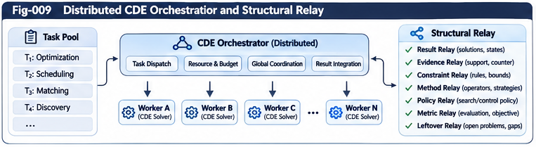

# CDE-009 — Distributed CDE and Delta Exploration Contracts

**Series:** Constrained Delta Evolution (CDE) — Foundations  
**Version:** v1.0.0 research draft  
**Date:** 2026-11-04  
**Authors:** Sizhe Tan and GPT-Obot  
**License:** Apache-2.0  
**Status:** Proposed architecture and testable contracts; not a verified distributed runtime

## Abstract

Constrained Delta Evolution (CDE) models exploration as constraint-governed transformations of logical state containers. Its Delta-labeled branching structure provides a natural unit for distributed work, but distribution does not by itself solve consistency, global constraint coupling, result reconciliation, or convergence. This paper proposes **Delta Exploration Contracts (DECs)** as portable, versioned units of work that connect CDE-Core to heterogeneous workers and an optional distributed orchestrator. It defines task identity, immutable snapshots, Delta scopes, constraint authority, evaluation regimes, budgets, evidence provenance, completion semantics, retry behavior, and structural relay. It distinguishes independently comparable candidates from composable partial solutions and globally coupled subproblems; formalizes the conditions for safe result reuse and pruning; and describes asynchronous coordination, failure recovery, termination detection, distributed method learning, and controlled policy evolution. A reference architecture, pseudocode, conformance tests, falsifiable hypotheses, and benchmark plans are provided. The contribution is a research proposal for interoperable orchestration contracts, not a claim of universal parallel speedup or automatic merging of local optima.

**Keywords:** CDE; Constrained Delta Evolution; distributed search; Delta Exploration Contract; heterogeneous solver; asynchronous optimization; structural relay; constraint reconciliation; provenance; collective learning; fault tolerance; RSI.

---



*Figure 9. A logical CDE orchestrator dispatches version-pinned exploration contracts to heterogeneous workers, reconciles global constraints and evidence, and publishes typed Structural Relay artifacts. Shared results and methods require target-side validation before being counted as transferable capabilities.*

---

## 1. Research Motivation

A single CDE state may generate a set of candidate Deltas and expand into a selected set of successor transitions. Those transitions can be explored by separate processes, machines, organizations, or agents. A useful analogy is dispatching multiple exploratory swarms to different regions and collecting their observations. The analogy highlights parallelism, but its apparent simplicity hides several distinct computational problems:

1. **Decomposition:** Which subproblems are sufficiently independent to dispatch?
2. **Execution:** What must a worker know to interpret a Delta correctly?
3. **Comparison:** Can returned scores be compared under the same metric and constraints?
4. **Reconciliation:** Can partial results coexist in one feasible global solution?
5. **Learning:** Can failures, bounds, or useful methods be reused elsewhere?
6. **Termination:** How does a distributed system know exploration is complete?

CDE should provide explicit contracts for these questions without requiring every worker to implement the same solver or every deployment to use a centralized coordinator.

### 1.1 Main thesis

> A CDE branch is a candidate unit of distributed exploration; a Delta Exploration Contract makes that unit portable, auditable, and interoperable. Correct aggregation depends on the semantics of the problem and cannot be inferred from portability alone.

### 1.2 Position relative to prior CDE foundations

- **CDE-001:** From BTP and D-BTP to a general State–Delta–Constraint framework.
- **CDE-002:** Logical state containers and legal transitions.
- **CDE-003:** Adaptive M-to-N branching and Delta-labeled state graphs.
- **CDE-004:** Path-local decisions, NoSubtree semantics, Loop Back, and termination.
- **CDE-005:** Search, dynamic programming, and branch-and-bound integration.
- **CDE-006:** Directional fields and multi-scale Delta generation.
- **CDE-007:** Solution–metric co-evolution and version-safe evaluation.
- **CDE-008:** CDE as an exploration and optimization orchestrator.

This paper supplies the distributed execution and contract layer that the previous architecture motivates. The planned `SPEC-005-Distributed-Exploration-and-Relay-Contract.md` will turn the proposed requirements into a more concise normative specification.

## 2. Architectural Separation

The proposed distributed architecture separates three responsibilities:

**CDE-Core** defines states, Delta proposals, transition legality, constraints, path and decision semantics, and evaluation identity. It does not require network communication.

**Solver adapters and workers** execute bounded tasks using DFS, best-first search, DP, B&B, stochastic search, metric search, domain-specific optimization, or combinations of these methods. Workers are not necessarily agents and need not share an implementation language.

**CDE-Orchestrator** is an optional logical coordination layer for task dispatch, budgets, version management, evidence validation, reconciliation, checkpointing, and structural relay. Its services may be centralized, federated, hierarchical, or peer-to-peer.

A fourth, cross-cutting concern is **governance**: which actors may change constraints, metrics, search policy, and promotion criteria. Worker autonomy does not confer authority to alter global requirements.

### 2.1 Logical versus physical centralization

A single logical task registry can be implemented by replicated services. A logically unified metric regime may be maintained by versioned immutable artifacts rather than a continuously connected central controller. A deployment should specify the consistency model of each shared resource rather than merely calling the system “distributed.”

## 3. Formal Distributed CDE Model

Let the CDE problem be

$$
\mathcal P=(\mathcal S,\Delta,T,C,G,E,L),
$$

where $\mathcal S$ is the logical state space, $\Delta$ the Delta space, $T$ the transition relation, $C$ the constraint regime, $G$ the candidate generator, $E$ the evaluation regime, and $L$ the lifecycle and stopping semantics.

At state $s$, a generator proposes $M$ candidates:

$$
G(s)=\{\delta_1,\ldots,\delta_M\}.
$$

A branch policy selects and realizes $N$ transition edges, potentially with $N\neq M$. The number of *distinct* successor states may differ from both counts. A distributed worker need not receive an entire branch subtree; it may receive a Delta scope, a state region, a metric family, or a solver portfolio assignment.

Let $W_i$ denote a portable exploration task:

$$
W_i=(I_i,S_i,\Omega_i,C_i,E_i,P_i,B_i,V_i,H_i),
$$

where:

- $I_i$: task identity, lineage, and attempt identity;
- $S_i$: starting state or immutable state reference;
- $\Omega_i$: authorized Delta or search-region scope;
- $C_i$: versioned constraints and authority;
- $E_i$: evaluation regime, metric, and validation protocol;
- $P_i$: allowed solver and search policy;
- $B_i$: resource, time, and exploration budget;
- $V_i$: verification and acceptance obligations;
- $H_i$: relevant path decisions, history, and loop-control context.

The tuple is a conceptual model. Implementations may reference large immutable artifacts by content hash rather than copying them.

## 4. Delta Exploration Contract (DEC)

A **Delta Exploration Contract** is a versioned declaration of what a worker may explore, how it must interpret the task, what evidence it must return, and how its results may be consumed.

### 4.1 Required fields

| Contract field | Meaning | Failure if absent |
|---|---|---|
| `contract_schema_version` | Interpretation of the DEC | Incompatible readers silently disagree |
| `task_id`, `parent_task_id` | Logical work identity and lineage | Duplicate or orphaned work |
| `attempt_id` | Physical execution attempt | Retries mistaken for distinct tasks |
| `problem_id`, `state_ref` | Exact problem and state snapshot | Worker solves the wrong state |
| `delta_scope` | Allowed transformations or region | Unauthorized exploration |
| `constraint_ref` | Hard constraints and version | Infeasible results accepted |
| `metric_ref` | Metric, orientation, comparison semantics | Invalid score comparisons |
| `decision_context_ref` | Relevant accepted/rejected path decisions | NoSubtree or revisit errors |
| `solver_capabilities` | Required execution semantics | Incompatible worker selection |
| `budget` | Time, compute, memory, and depth limits | Unbounded or unfair work |
| `validation_contract` | Proof, replay, or checking requirements | Unsupported result claims |
| `result_schema` | Required output and provenance | Unusable Relay artifacts |
| `expiry_or_revocation` | Validity and cancellation semantics | Stale work promoted |

A DEC may also declare confidentiality, permitted data access, locality restrictions, sandbox requirements, and allowable subcontracting.

### 4.2 Minimal example

```yaml
contract_schema_version: "cde-dec/0.1"
task_id: "task-0042"
parent_task_id: "task-0010"
attempt_id: "task-0042/attempt-1"
problem_id: "school-bus-routing/demo-01"
state_ref: "sha256:<immutable-state-digest>"
delta_scope:
  kind: "route-reassignment-neighborhood"
  allowed_operations: [move-stop, swap-stops, reassign-vehicle]
constraint_ref: "constraints/demo-01/v3"
metric_ref: "fleet-time-equity/v2"
decision_context_ref: "history/task-0010/v1"
solver_capabilities: [feasible-solution-search]
budget:
  wall_time_seconds: 120
  max_nodes: 50000
validation_contract: "feasibility-replay/v1"
result_schema: "cde-result/0.1"
expiry_or_revocation: "cancel-on-constraint-change"
```

This example is illustrative, not an implementation-ready universal schema. A production standard must specify canonical encodings, schema evolution, authentication, and field semantics.

## 5. Task Identity, Delta Identity, and State Identity

Distributed execution magnifies distinctions established in CDE-003 and CDE-004:

$$
\text{Task Identity}\neq\text{Delta Identity}\neq\text{Decision Identity}\neq\text{State Identity}.
$$

Two tasks may explore the same state under different budgets or metrics. Two Deltas may lead to equivalent states. One logical task may be attempted several times after failure. A repeated No decision may be forbidden within a constructive path while the same proposal remains legitimate in another independent path.

### 5.1 Idempotency

Workers and coordinators should assume **at-least-once delivery** unless stronger guarantees are established. A result submission must therefore be idempotent with respect to logical task and result identity. Exactly-once *effects* may be implemented through deduplication and transactional commits, but exactly-once message delivery should not be casually assumed.

### 5.2 Canonicalization

Canonical Delta and state keys must include every future-relevant dependency needed for the intended equivalence relation. A mere serialization hash does not prove semantic equivalence. In particular, path history, remaining resource budgets, constraint versions, and metric versions may affect valid future transitions.

## 6. Task Lifecycle and State Machine

A proposed lifecycle is:

```text
CREATED -> VALIDATED -> QUEUED -> LEASED -> RUNNING
                                      |         |
                                      |         +-> CHECKPOINTED -> QUEUED
                                      |         +-> COMPLETED -> VERIFIED -> ACCEPTED
                                      |         +-> FAILED -> RETRYABLE -> QUEUED
                                      |         +-> CANCELLED
                                      +-> LEASE_EXPIRED -> QUEUED
```

`COMPLETED` means a worker submitted an output; `VERIFIED` means the required checks passed; `ACCEPTED` means the result was admitted into the appropriate shared registry or portfolio. These statuses are not interchangeable.

A result can be **valid but obsolete**: for example, a candidate solution computed under a previous metric version may remain useful as evidence, but cannot automatically become the new incumbent.

### 6.1 Lease and checkpoint policy

A lease bounds the time during which a worker owns a task attempt. Expiry may trigger a duplicate attempt; therefore the coordinator must tolerate overlapping execution and use idempotent commits. Checkpoints should identify the exact state, frontier, solver configuration, random seed if applicable, and versions of all relevant artifacts.

### 6.2 Cancellation and revocation

Constraint changes, policy revocations, or security concerns may invalidate tasks. Cancellation is not equivalent to deletion: audit records and already-produced evidence should remain available subject to data-retention rules. A cancelled worker result cannot bypass revalidation merely because it is high scoring.

## 7. Three Distinct Result-Aggregation Regimes

A central engineering distinction is the semantics of combining distributed work.

### 7.1 Independent best-candidate selection

When every worker returns a complete feasible candidate evaluated under the same objective, the orchestrator may select

$$
x^*\in\arg\max_i f(x_i),
$$

provided feasibility, metric versions, and evaluation contexts are comparable. This resembles independent peak search. It does not imply global optimality unless search coverage and bounds establish it.

### 7.2 Composable partial results

When workers solve independent components with a proven composition operator $\oplus$, the orchestrator may construct

$$
x=x_1\oplus\cdots\oplus x_k.
$$

This is safe only if component compatibility and global constraints are preserved by $\oplus$. A proof or explicit global validation is required. Partitioning by geography or data shard alone does not establish composability.

### 7.3 Globally coupled results

When tasks share resources or constraints, the orchestrator must solve a reconciliation problem:

$$
x^*=\mathrm{Reconcile}(x_1,\ldots,x_k;C_{\mathrm{global}}).
$$

Reconciliation may be as hard as the original problem. For example, two locally optimal school-bus schedules may both allocate the same vehicle or exceed a shared fleet limit. Their local scores cannot simply be summed to produce a feasible global solution.

### 7.4 Knowledge aggregation is different

Even when partial solutions cannot be merged, counterexamples, learned constraints, useful heuristics, and certified bounds may still be valuable. Their reuse conditions must be stated explicitly.

## 8. Global Constraints and Local Autonomy

A distributed task may have local constraints $C_i$ and global constraints $C_G$. A locally feasible state satisfies $C_i$, but a globally acceptable solution must satisfy

$$
C_G(x)\land\bigwedge_i C_i(x).
$$

Not every global constraint can be checked locally. Options include:

- conservative resource reservations;
- decomposable constraint certificates;
- global reconciliation after local search;
- dual or price-based coordination;
- shared constraint propagation;
- conflict-driven refinement and re-dispatch.

A worker should not silently relax a hard global constraint to improve its local score. If a constraint is proposed for revision, that is a separate, authorized governance Delta.

### 8.1 Constraint Relay

A worker may discover a conflict or a derived constraint. The orchestrator must distinguish:

1. **Globally valid derived constraints**, with an adequate proof or verification procedure;
2. **Context-conditional constraints**, valid only under a specified state or path;
3. **Heuristic exclusions**, which may guide search but are not safe pruning rules.

Publishing a context-conditional exclusion as a global fact can destroy completeness.

## 9. Evaluation Regimes and Distributed Incumbents

A distributed incumbent is meaningful only relative to a declared metric and constraint version. Define an evaluation record:

$$
R=(x,m_v,C_v,D_v,\mathrm{score},\mathrm{evidence},\mathrm{provenance}).
$$

Results under incompatible versions cannot be compared by raw score alone. A metric change may require re-evaluating archived candidates and invalidating B&B bounds tied to the old objective.

### 9.1 Safe incumbent updates

For a maximization problem, an accepted incumbent update requires:

- a complete candidate;
- feasibility under the active constraint regime;
- a comparable evaluation under the active metric;
- score improvement according to the declared comparison rule;
- a concurrency-safe update or versioned append.

A stale worker may return a valuable candidate, but its score should be recomputed or its regime preserved rather than silently treated as current.

### 9.2 Certified bounds

In a maximization B&B system, an upper bound $U(R)$ for region $R$ permits pruning when $U(R)\le f(x_{\rm incumbent})$, assuming the bound is sound under the same objective and constraints. Heuristic estimates are not substitutes for certified bounds. Distributed bound updates must carry the problem, region, metric, and constraint versions on which they depend.

## 10. Heterogeneous Solver Portfolios

A DEC may request a capability rather than a specific algorithm. Workers might implement:

- exhaustive or heuristic state-space search;
- DP with sound subproblem equivalence;
- B&B with valid bounds;
- local search or metaheuristics;
- exact constraint programming or mixed-integer optimization;
- metric search and validation;
- simulation or adversarial counterexample discovery.

The orchestrator may route tasks by domain, estimated difficulty, hardware, observed reliability, or budget. Solver diversity is useful only when outputs share interoperable contracts and validation semantics.

### 10.1 Capability descriptors

A worker declaration should distinguish **claimed capabilities** from **verified capabilities**. For example, `returns_feasible_candidate` is weaker than `proves_global_optimum`; `provides_heuristic_bound` is weaker than `provides_certified_upper_bound`.

### 10.2 Portfolio policy

An allocation policy $\pi$ chooses workers and budgets:

$$
\pi(W_i,\mathcal R_t)\rightarrow(\mathrm{worker},\mathrm{budget},\mathrm{priority}),
$$

where $\mathcal R_t$ summarizes current resources and evidence. Policy adaptation should be evaluated on system-level outcomes, including scheduling overhead and communication costs.

## 11. Asynchronous Distributed Exploration

Synchronous rounds are easy to reason about but may waste resources waiting for slow workers. Asynchronous CDE can accept independently validated results as they arrive and redistribute effort without a global barrier.

A typical loop:

1. Dispatch independent Delta scopes or search regions.
2. Workers explore locally and publish progress or evidence.
3. The orchestrator validates and records submissions.
4. Updated incumbents or useful constraints are disseminated.
5. Workers revise priorities while preserving necessary diversity.
6. Completed, failed, and unstarted tasks are accounted for.

### 11.1 Staleness

A result may be computed against an old incumbent without being invalid. However, it may be suboptimal or redundant. A result computed against an old **constraint or metric** may be semantically incompatible with the active regime. The contract must specify which changes require cancellation, revalidation, or re-optimization.

### 11.2 Event ordering

Distributed event timestamps do not necessarily define causal order. Use task lineage, version numbers, logical sequence identifiers, or causal metadata as needed. A deterministic replay should not depend on arrival order unless arrival order is explicitly part of the policy.

## 12. Duplicate Work, Frontier Ownership, and Coverage

Parallel branches may overlap. Duplicate exploration is sometimes acceptable, especially when independent methods provide useful corroboration, but accidental duplication wastes resources.

Possible controls include:

- partitioning by canonical Delta or state region;
- work stealing with explicit ownership transfer;
- memoization and transposition tables;
- bloom filters as advisory hints, never sole completeness-preserving pruning proof;
- coverage certificates for exhausted regions;
- task leases and deduplicated result commits.

### 12.1 Coverage versus sampling

A worker that samples 1,000 candidates has not necessarily exhausted a region. A worker declaring a region `EXHAUSTED` must provide the required coverage evidence under the relevant generator and branching semantics. Adaptive generators may expand the reachable set, invalidating earlier claims of exhaustive coverage unless their scope is carefully defined.

## 13. Path Memory and NoSubtree in Distributed Execution

A worker exploring a constructive BTP-derived path must inherit the path's accepted and rejected decisions. For a one-time decision model, both Yes and No choices count toward the decided set:

$$
D_t=A_t\cup R_t.
$$

A new decision on $\delta$ may be disallowed if its canonical decision key is already in $D_t$. This rule is specific to constructive semantics; reconfigurable and cyclic CDE modes may allow legitimate revisits.

**Critical rule:** a path-local No decision is not automatically a global prohibition. Propagating it to unrelated workers can incorrectly remove feasible solutions.

### 13.1 Loop Back

A task may revisit a state through different Deltas. A distributed state registry should therefore distinguish:

- exact repeated transitions;
- equivalent states with equivalent future-relevant context;
- states revisited with new evidence, cost, or budget;
- allowed cyclic transitions subject to an explicit loop policy.

Termination and pruning depend on these distinctions.

## 14. Structural Relay as a First-Class Output

The output of a distributed task should not be limited to its best solution. A proposed Relay taxonomy is:

| Relay type | Artifact | Reuse condition |
|---|---|---|
| Result Relay | Candidate solution, score, feasibility proof | Comparable metric and constraints |
| Evidence Relay | Observations, failures, uncertainty | Provenance and permitted data use |
| Constraint Relay | Conflicts, derived constraints, counterexamples | Scope and proof/verification |
| Method Relay | Search operator, heuristic, Delta generator | Compatibility and independent testing |
| Policy Relay | Budget or routing policy | System-level evaluation and governance |
| Leftover Relay | Unexplored frontier, deferred Delta, partial state | Replayable context and budget semantics |
| Metric Relay | Candidate metric, validation report | Metric versioning and external validation |

**Leftover Relay** is especially important: an interrupted task can hand off its remaining search frontier rather than discard useful partial work. Repeated execution can also accumulate evidence, but a repeated run must be distinguished from independent corroboration.

### 14.1 Relay packaging

A reusable artifact should carry its type, scope, dependencies, version, provenance, validation status, and known limitations. A heuristic should never be labeled as a proof simply because it performed well on previous tasks.

## 15. Distributed Collective Learning

Collective Learning is more than pooling final answers. Workers can exchange improvements to the way they search:

$$
G_{t+1}=U(G_t,F_t),\qquad P_{t+1}=V(P_t,F_t),
$$

where $G_t$ is a Delta generator, $P_t$ a coordination policy, and $F_t$ validated feedback. These updates may be local, global, or domain-specific.

A useful **Method Relay** should include:

- method definition and version;
- applicability conditions;
- source task distribution;
- benchmark evidence and uncertainty;
- observed failures and counterexamples;
- resource costs;
- rollback instructions.

Method transfer can be negative. A scheduling heuristic that works for a sparse routing graph may fail on a dense one. Collective Learning must preserve such counterevidence instead of promoting a single winner everywhere.

## 16. Controlled Recursive Self-Improvement

Distributed CDE may support recursive improvement of its own generators, solvers, and coordination policies. This is a research direction, not an automatic consequence of task parallelism.

A controlled improvement cycle is:

```text
Propose a new generator or policy
    -> Run static and conformance checks
    -> Evaluate on held-out tasks and adversarial cases
    -> Compare total system cost and independent outcomes
    -> Approve, reject, or shadow-deploy
    -> Monitor and retain rollback capability
```

Self-modifying systems must not redefine their own success criteria without authorization. A policy that improves internal throughput while worsening external decision quality is not a validated improvement.

## 17. Failure Recovery and Reproducibility

Distributed search is vulnerable to machine failure, network partition, transient data unavailability, and nondeterministic execution.

### 17.1 Recovery principles

1. Preserve immutable task and artifact references.
2. Separate logical task identity from execution attempt identity.
3. Record checkpoints with compatible solver and metric versions.
4. Make result commits idempotent.
5. Detect lost leases and orphaned work.
6. Revalidate late results before promotion.
7. Retain enough event history for audit and replay.

### 17.2 Determinism

A stochastic solver may be reproducible only under a fixed random seed, software version, execution schedule, and environment. Full bit-for-bit replay may be impractical on heterogeneous hardware. The contract should specify the promised reproducibility level: exact, statistically reproducible, or independently verifiable result.

## 18. Global Termination Detection

A worker reporting `DONE` does not imply that the distributed CDE run is complete. A termination claim must account for queued tasks, leased tasks, in-flight messages, deferred frontiers, retries, and possible new tasks generated by adaptive exploration.

Different stopping claims require different evidence:

- **Budget exhausted:** an explicit compute or time limit was reached.
- **No active work:** the current task set is quiescent; this does not prove global completeness if new generators may introduce work.
- **Search region exhausted:** all authorized candidates in a specified finite region have been accounted for.
- **Global optimum certified:** a valid proof or exhaustive bound argument establishes optimality under a fixed objective and constraints.
- **Converged empirically:** a statistical or heuristic stopping criterion was met; no proof of optimality follows.

A distributed termination detector must account for tasks and messages in transit. For dynamic generators, the definition of the searched space and generator version must be frozen or otherwise bounded before claiming exhaustive coverage.

## 19. Security, Trust, and Data Governance

Distributed workers may be untrusted, fallible, or differently authorized. A robust design should address:

- authenticated task assignment and signed or authenticated results;
- least-privilege access to state and evidence;
- privacy-preserving sharing of sensitive observations;
- sandboxed execution for external solver plugins;
- validation of externally supplied code and method artifacts;
- integrity of constraint and metric registries;
- protection against fabricated proofs or manipulated scores;
- auditability of governance decisions.

Consensus among workers is not a substitute for correctness. Replicated results can detect some failures but may share systematic bias or correlated errors.

## 20. SIF Localization and Distributed Prospecting

Within the Structural Intelligence Framework (SIF), Localization includes finding, addressing, or constructing relevant structural regions, capabilities, and problem–method connections. Distributed CDE can serve as an **exploratory Localization** mechanism:

1. Partition or sample a large structural possibility space.
2. Dispatch Delta exploration tasks to heterogeneous workers.
3. Collect directional evidence about promising and unpromising regions.
4. Refine location hypotheses, generators, and search budgets.
5. Relay verified discoveries and reusable methods to other structural units.

This is not limited to physical space. A “location” may be a metric structure, solver configuration, hypothesis family, capability interface, or feasible assignment region.

The key limitation is **reachability**: if the available generators cannot produce or access a region, improved ranking cannot discover it. Cross-region and cross-domain Delta generation may enlarge coverage, but neither guarantees completeness nor superior performance.

## 21. Worked Case A — Independent Multi-Region Peak Search

Consider a finite collection of regions $R_1,\ldots,R_k$ with a common scalar objective $f$. Each worker returns a feasible candidate $x_i\in R_i$, its score, and its coverage status.

A coordinator can select the best returned candidate by comparing $f(x_i)$. If every region has been exhaustively explored and the regions cover the full feasible domain, the result can support a global optimum claim. If workers use heuristic sampling, the same aggregation yields only the best *observed* candidate.

**Learning opportunity:** workers can relay effective long-range Delta generators or region-selection heuristics. Their transfer value should be tested on new landscapes, not assumed from the originating region.

## 22. Worked Case B — School-Bus Routing with Global Coupling

Let workers optimize routes for different school zones. Each local DEC includes stop assignments, vehicle capacity, route duration, and available buses. Global constraints include total fleet size, shared vehicles, driver availability, and service equity.

Two workers may return locally feasible schedules that use the same bus or exceed the district's total fleet. A global reconciliation stage must resolve these conflicts, possibly re-dispatching revised subproblems.

A useful result contract separates:

- locally feasible route set;
- global resources claimed;
- local metric and version;
- unresolved cross-zone conflicts;
- certified bounds or heuristic estimates;
- alternative routes and unexamined frontiers.

**Failure test:** submit two locally optimal schedules with conflicting vehicle reservations. The coordinator must not label their union globally feasible without reconciliation.

## 23. Worked Case C — Distributed Metric Discovery

Worker A proposes feature Deltas, B adjusts metric weights, C searches for alternative scoring structures, and D performs adversarial validation. All candidates name the baseline metric, evidence snapshot, and validation protocol.

A candidate metric that scores well on its own training set is not automatically promotable. The orchestrator must apply an independent validation contract, detect incompatible versions, and preserve unsuccessful experiments as evidence.

**Failure test:** a late worker returns a metric optimized against a superseded validation protocol. The result may be archived, but promotion requires current authorized validation.

## 24. Worked Case D — Mixed Exact and Heuristic Solvers

An exact B&B worker explores one region and publishes a certified upper bound. A heuristic worker searches for a strong feasible incumbent. A DP worker caches equivalent subproblems. These methods can collaborate if they agree on objective orientation, state semantics, and constraint versions.

The heuristic incumbent may improve pruning efficiency. The certified bound may justify skipping a region. The DP cache may accelerate repeated subproblems. None of these artifacts can be reused blindly after an objective change or across nonequivalent path histories.

## 25. Reference Orchestration Algorithm

```text
function DISTRIBUTED_CDE(problem, policy, budget):
    registry = initialize_versioned_registry(problem)
    frontier = create_initial_delta_tasks(problem)
    incumbent = NONE

    while not stopping_condition(registry, frontier, budget):
        for task in dispatchable(frontier, policy, budget):
            assert validate_DEC(task, registry)
            lease_to_compatible_worker(task)

        for submission in receive_available_submissions():
            record_attempt_and_provenance(submission)
            if not schema_and_version_valid(submission):
                quarantine(submission)
                continue
            checked = independently_validate(submission, registry)
            if not checked.acceptable:
                record_failure_evidence(checked)
                continue
            archive_relay_artifacts(checked)
            if checked.is_complete_feasible_candidate:
                incumbent = compare_and_commit(incumbent, checked)
            if checked.contains_safe_derived_constraint:
                publish_with_scope_and_proof(checked)
            if checked.contains_new_frontier:
                enqueue_with_lineage(checked.new_frontier)

        recover_expired_leases()
        reconcile_globally_coupled_results()
        update_dispatch_priorities_from_validated_feedback()

    return final_report(
        incumbent=incumbent,
        coverage=registry.coverage,
        unresolved=registry.leftovers,
        stopping_reason=registry.stopping_reason,
        evidence=registry.evidence
    )
```

This pseudocode omits concurrency control, durable storage, security, and message transport. It is a reference lifecycle, not a proof of distributed correctness.

## 26. Proposed Conformance Tests

| ID | Test | Expected result |
|---|---|---|
| DEC-001 | Missing state version | Task rejected or quarantined |
| DEC-002 | Missing constraint version | No result promotion |
| DEC-003 | Unsupported solver capability | Worker not assigned |
| DEC-004 | Retry same logical task | Distinct attempts, idempotent commit |
| DEC-005 | Duplicate result delivery | No duplicate incumbent update |
| DEC-006 | Expired lease and late completion | Result revalidated; no blind overwrite |
| DEC-007 | Local solution violates global resource limit | Reconciliation required |
| DEC-008 | Incompatible metric versions | Raw scores not directly compared |
| DEC-009 | Heuristic bound presented as proof | Safe-pruning claim rejected |
| DEC-010 | Context-local No decision shared globally | Global exclusion blocked |
| DEC-011 | New evidence revisits same state | Context-aware revisit policy applied |
| DEC-012 | Old-objective B&B bound | Bound invalidated or re-proven |
| DEC-013 | Worker reports exhausted after sampling | Exhaustion claim rejected |
| DEC-014 | Cancelled task submits valid candidate | Archived or revalidated, not auto-promoted |
| DEC-015 | In-flight task during termination check | No premature global completion |
| DEC-016 | Unverifiable method artifact | Method not promoted as validated |
| DEC-017 | Missing provenance on evidence | Evidence flagged as untrusted |
| DEC-018 | Checkpoint resumed under changed constraints | Resume requires compatibility check |
| DEC-019 | Two partial results with conflicting resources | Union rejected pending reconciliation |
| DEC-020 | Stale metric candidate passes old validation | New promotion review required |
| DEC-021 | Duplicate states with different path histories | Unsafe DP merge prevented |
| DEC-022 | Faulty worker fabricates score | Independent evaluation detects discrepancy |
| DEC-023 | Work stealing transfers task | Ownership and attempt lineage preserved |
| DEC-024 | Leftover frontier exported | Reconstructible task with scope and versions |

These tests should be supplemented by fault injection, network partition tests, property-based testing, and replay checks.

## 27. Testable Hypotheses

**H1 — Branch portability.** A common DEC schema reduces adapter work required to connect heterogeneous solvers, relative to ad hoc integration, on selected tasks.

**H2 — Parallel efficiency.** Independent Delta-region dispatch improves time-to-best-feasible-solution on suitable decomposable problems after accounting for orchestration overhead.

**H3 — Coupling penalty.** The benefit of naive partitioning declines as cross-task global constraint coupling increases.

**H4 — Method Relay.** Sharing validated search operators improves sample efficiency on related held-out problem distributions compared with isolated workers.

**H5 — Negative-evidence Relay.** Reusing verified counterexamples reduces repeated invalid exploration without suppressing legitimate candidates.

**H6 — Asynchronous benefit.** Asynchronous dispatch reduces idle time under heterogeneous worker speeds compared with synchronous rounds, but may increase stale or redundant work.

**H7 — Contract safety.** Versioned task and result contracts reduce false score comparisons, stale-bound errors, and incorrect global merges.

**H8 — Solver diversity.** A heterogeneous solver portfolio improves robustness across problem families relative to any single included solver, under a matched budget.

**H9 — Checkpoint Relay.** Portable leftover frontiers reduce work lost to interruption relative to restart-only execution.

**H10 — Localization.** Distributed multi-scale Delta prospecting discovers useful structural regions more efficiently than local-only search on selected SIF localization benchmarks.

**H11 — Governance.** Independent promotion gates reduce unsafe generator or metric updates relative to unconstrained self-updating policies.

**H12 — Overhead boundary.** For sufficiently small or tightly coupled tasks, distributed CDE performs worse than a well-engineered single-node baseline.

Each hypothesis requires predeclared workloads, independent outcome measures, uncertainty estimates, and negative-result reporting.

## 28. Benchmark and Validation Roadmap

### Phase I — Contract semantics

Implement a single-process DEC interpreter and reference validators. Verify identity, versioning, lifecycle, path memory, constraint scope, and idempotent result handling before adding network distribution.

### Phase II — Controlled distribution

Distribute independent search regions with fixed metrics and constraints. Compare one worker, homogeneous workers, and heterogeneous portfolios. Measure wall time, CPU time, network overhead, duplicate work, solution quality, and coverage.

### Phase III — Coupled constraints

Use assignment and routing instances with shared resources. Measure reconciliation cost, infeasible merge attempts, cross-worker conflict discovery, and effect of constraint propagation.

### Phase IV — Evidence and Method Relay

Introduce verified counterexample sharing, method reuse, and leftover transfer. Compare against no-Relay baselines under equal compute and data access. Report negative transfer and artifact-validation cost.

### Phase V — Adaptive orchestration and controlled RSI

Permit dispatch-policy and generator updates under separate validation gates. Test distribution shifts, adversarial workers, stale metrics, task cancellations, and rollback. Evaluate independent outcomes rather than only internal throughput.

### 28.1 Suggested measurements

- Time to first feasible solution and time to target quality.
- Best feasible objective under a fixed evaluation regime.
- Proof gap or bound quality where applicable.
- Worker utilization and speedup efficiency.
- Duplicate exploration rate and checkpoint recovery savings.
- Reconciliation cost and global feasibility failure rate.
- Network and storage overhead per accepted result.
- Validated Method Relay transfer benefit and negative transfer rate.
- Termination correctness under injected faults.
- External decision quality when metrics or policies evolve.

## 29. Conditional Correctness Claims

**Claim A — Feasible incumbent preservation.** If every committed incumbent is independently checked against the active hard constraints and versioned evaluation contract, then committed incumbents satisfy those checked constraints. This does not imply global optimality.

**Claim B — Idempotent acceptance.** If result commits use stable logical identities and atomic deduplication, repeated delivery of the same result does not create duplicate logical acceptance events. The underlying computation may still execute multiple times.

**Claim C — Safe distributed pruning.** If a shared pruning certificate is sound for the target region, metric, constraints, and state context, then applying it to that region preserves the associated exact-search guarantee. A certificate from a different regime does not inherit that guarantee.

**Claim D — Correct partial composition.** If a composition operator is proven to preserve every global hard constraint for the declared decomposition, combining locally feasible components using that operator yields a globally feasible candidate. Without the preservation condition, no such inference follows.

**Claim E — Bounded termination.** If the task space is finite, generation is frozen or finitely bounded, task creation and retries are bounded, and the termination detector accounts for all queued, leased, and in-flight work, then the distributed execution can terminate after processing or explicitly abandoning the bounded workload. This is not a universal guarantee for open-ended CDE.

## 30. Counterarguments and Limitations

**L1 — Distribution is not automatically faster.** Communication, serialization, contention, and reconciliation may dominate small tasks.

**L2 — Independent tasks are not always available.** Some optimization problems are globally coupled, leaving little useful decomposition.

**L3 — Local success may mislead.** Local optima and partial solutions may not compose into a good or feasible global result.

**L4 — Generator evolution complicates completeness.** Adaptive search changes what is reachable and what counts as exhausted.

**L5 — Reuse can be unsafe.** Cached states, bounds, or learned exclusions may rely on unrecorded path or metric context.

**L6 — Distributed governance has costs.** Authentication, audit, validation, and rollback require infrastructure and human attention.

**L7 — Structural Relay may transfer failure.** A heuristic can be useful in one domain and harmful in another; provenance and counterexamples matter.

**L8 — Architectural breadth is not algorithmic novelty.** Work queues, distributed search, portfolio solvers, checkpointing, and fault tolerance are established techniques. CDE must demonstrate value through precise interoperable contracts and empirical outcomes.

## 31. Relationship to Existing Research

Distributed CDE overlaps with parallel tree search, distributed branch-and-bound, constraint programming, work stealing, task scheduling, portfolio optimization, multi-agent coordination, distributed constraint optimization, asynchronous algorithms, checkpoint/restart systems, and provenance-aware scientific workflows.

The proposed CDE contribution is a unified **Delta-labeled, constraint-aware exploration contract** that can carry both solver tasks and structural learning artifacts across heterogeneous workers. This synthesis should be compared with established frameworks rather than portrayed as replacing them.

A formal literature review and precise priority claims should be added after source verification. No performance or novelty claim in this manuscript should be interpreted as experimentally established.

## 32. Open Research Questions

1. What is the smallest DEC schema that remains useful across exact, heuristic, stochastic, and metric-search workers?
2. How should semantic state equivalence be represented without forcing every domain into one canonicalization scheme?
3. Which global constraints admit provably safe decomposition or compact reconciliation certificates?
4. When is distributing Delta generation more useful than distributing state evaluation?
5. Can portable proof artifacts support cross-solver B&B pruning without a common internal representation?
6. How should a distributed orchestrator allocate exploration budgets under uncertain worker performance?
7. How can method transfer be validated with minimal leakage from the originating task distribution?
8. What is the right consistency model for shared incumbents, constraint registries, and metric versions?
9. How should path-local No decisions be compressed and transmitted without accidental globalization?
10. What evidence is sufficient to declare a dynamically generated search region exhausted?
11. Can leftover-frontier contracts support cross-language, cross-solver resumption?
12. What are the measurable limits of distributed exploratory SIF Localization?
13. Which parts of recursive policy evolution can be safely automated under independent governance?
14. How should privacy-sensitive evidence be relayed without undermining reproducibility?
15. Under which workload regimes is a simpler monolithic solver decisively preferable?

## 33. Conclusion

CDE's M-to-N Delta branching offers a natural opportunity for distributed exploration, but the branch itself is only the beginning. A practical distributed system must make state, Delta scope, constraints, metrics, path history, evidence, and validation portable and unambiguous. The proposed Delta Exploration Contract provides a common interface for heterogeneous workers while keeping correctness obligations explicit.

The resulting architecture supports three distinct kinds of collaboration: selecting the best independently comparable result, composing partial results when a sound composition rule exists, and reconciling globally coupled results when no simple merge is valid. Beyond final answers, workers can relay negative evidence, certified bounds, uncompleted frontiers, useful methods, and candidate generator improvements. This opens a path from distributed computation to Collective Structural Learning and controlled RSI.

The central design principle is:

> **Distribute exploration through explicit Delta contracts; validate every returned claim in its original context; and treat global reconciliation and method reuse as separate, governed operations.**

Distributed CDE is therefore best understood as a proposed interoperable orchestration architecture with testable benefits and explicit failure boundaries, not as a guarantee of parallel speedup, optimality, or autonomous self-improvement.

---

## Appendix A — Compact Result and Relay Contract

```yaml
result_schema_version: "cde-result/0.1"
task_id: "task-0042"
attempt_id: "task-0042/attempt-1"
problem_id: "school-bus-routing/demo-01"
state_ref: "sha256:<immutable-state-digest>"
constraint_ref: "constraints/demo-01/v3"
metric_ref: "fleet-time-equity/v2"
status: "completed-with-candidate"
candidate:
  solution_ref: "sha256:<candidate-digest>"
  feasibility_report_ref: "reports/feasibility-0042"
  score_record_ref: "scores/0042"
coverage:
  kind: "sampled-not-exhausted"
  explored_nodes: 21890
relay:
  evidence_refs: ["evidence/0042"]
  method_refs: []
  leftover_frontier_ref: "frontiers/0042"
provenance:
  worker_id: "worker-b"
  solver_version: "solver-b/1.3"
  random_seed: 112358
```

The example uses symbolic artifact references and is not a deployable security or storage specification.

## Appendix B — Suggested Figure

**Fig-009 — Distributed CDE Orchestrator and Structural Relay** should show: (1) a logical Control Plane with versioned State/Constraint/Metric registries; (2) a dispatch layer emitting Delta Exploration Contracts; (3) heterogeneous workers using search, DP, B&B, metric search, and domain solvers; (4) result verification and global reconciliation; (5) Result/Evidence/Constraint/Method/Leftover Relay; and (6) feedback into resource policy and generator research. Use distinct arrows for task dispatch, result return, and validated method propagation. The figure should not imply that all partial results can be merged automatically.

## Appendix C — Repository Cross-References

- `CDE-003-Delta-Semantics-and-Adaptive-M-to-N-Branching.md` — Delta and branch identity.
- `CDE-004-Path-Memory-No-Subtree-Semantics-and-Loop-Back-Control.md` — path decisions and revisits.
- `CDE-005-Search-Dynamic-Programming-and-Branch-and-Bound-Integration.md` — solver semantics.
- `CDE-006-Directional-Fields-and-Multi-Scale-Delta-Generation.md` — exploration and SIF Localization.
- `CDE-007-Solution-Space-and-Metric-Space-Co-Evolution.md` — versioned metric governance.
- `CDE-008-CDE-as-a-General-Exploration-and-Optimization-Orchestrator.md` — control-plane architecture.
- `CDE-010-Structural-Relay-and-Collective-Learning.md` (planned) — Relay and reusable intelligence.
- `SPEC-005-Distributed-Exploration-and-Relay-Contract.md` (planned) — normative DEC specification.
- `CASE-005-Distributed-CDE-and-Method-Relay.md` (planned) — worked distributed experiments.

**Research status:** Foundational proposal. All correctness, performance, and transfer claims require the stated assumptions and independent validation.  
**License:** Apache-2.0.
