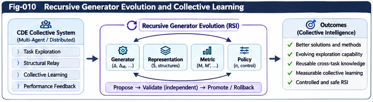

# CDE-011 — Recursive Generator and Policy Evolution

**Series:** Constrained Delta Evolution (CDE) — Foundations  
**Status:** Foundational research proposal, v1.0.0 draft  
**Date:** 2026-11-04  
**Authors:** Sizhe Tan and GPT-Obot  
**License:** Apache-2.0  
**Companion papers:** CDE-001 through CDE-010  
**Related planned specifications:** SPEC-002 Delta Generation and Branch Contract; SPEC-004 Solver and Optimization Contract; SPEC-005 Distributed Exploration and Relay Contract; SPEC-006 Metric and Recursive Evolution Contract  
**Related planned extensions:** EXT-002 Open-Ended Delta and Representation Evolution; EXT-004 CDE Collective Intelligence and Structural RSI

## Abstract

Constrained Delta Evolution (CDE) treats exploration as constraint-governed transitions among logical State Containers, driven by typed Delta generators and evaluated under explicit metrics, policies, and evidence contracts. Earlier papers established adaptive M-to-N branching, solver-neutral orchestration, multi-scale directional generation, metric co-evolution, distributed Delta Exploration Contracts, and Structural Relay. This paper examines a further possibility: **the methods that generate, select, schedule, and validate Deltas may themselves become objects of constrained evolution**. We define recursive generator and policy evolution as an auditable meta-level process that proposes modifications to exploration mechanisms, tests them against independent criteria, and promotes them only under versioned governance. The framework separates task-state improvement, generator improvement, policy improvement, and validation-system changes. It addresses self-referential evaluation, distribution shift, meta-overfitting, budget accounting, unsafe policy relaxation, asynchronous workers, rollback, and knowledge transfer. We present typed meta-Deltas, a minimal recursive-evolution contract, reference algorithms, worked examples, conformance tests, falsifiable hypotheses, and a staged validation roadmap. The proposal does not assert guaranteed recursive self-improvement, monotonic capability growth, convergence, autonomy, or artificial superintelligence. Its narrower contribution is a framework for making candidate improvements to exploration machinery inspectable, testable, reversible, and collectively reusable.

**Keywords:** Constrained Delta Evolution; recursive generator evolution; policy evolution; structural recursive self-improvement; meta-optimization; adaptive search; Delta generators; exploration governance; Structural Relay; Collective Learning; validation; rollback; SIF localization.

---



*Figure 10. Controlled recursive evolution separates task exploration (L0), generator/operator evolution (L1), policy/representation adaptation (L2), and independent validation and governance (L3). Structural Relay can transmit validated methods and evidence across tasks, but recursive improvement and collective learning must be established empirically.*

---

## 1. Motivation: The Search Mechanism Is Also a Search Object

A CDE worker explores a problem by generating candidate Deltas, checking constraints, applying permitted transitions, evaluating outcomes, and allocating further effort. A fixed generator can be effective in one region yet ineffective elsewhere. A fixed selection policy can waste budget on low-value branches. A solver portfolio can allocate work to an algorithm poorly suited to the current state. A control plane can persist with stale assumptions even after evidence suggests a better method.

These are not necessarily defects in the current candidate solution. They are limitations of **how candidate solutions are explored**.

The natural next research question is therefore:

> Can a CDE system represent changes to its own exploration machinery as explicit, constrained, independently validated Delta transitions?

A useful answer requires more than letting a language model rewrite a heuristic. The system must identify what changed, why it was proposed, which tasks support the change, what regressions it introduces, and whether it is authorized to become active.

Recursive evolution should not be confused with unbounded self-modification. This paper proposes a limited, versioned mechanism for improving generators and policies within declared governance boundaries.

## 2. Position in the CDE Research Series

The earlier foundations provide the necessary components:

| Foundation | Contribution to CDE-011 |
|---|---|
| CDE-001 | Generalization from BTP and D-BTP to constraint-governed Delta evolution |
| CDE-002 | Logical State Containers and transition constraints |
| CDE-003 | Typed Deltas, adaptive M-to-N branching, and candidate versus realized edge distinctions |
| CDE-004 | Path memory, decision identity, NoSubtree, and Loop Back control |
| CDE-005 | Search, DP, B&B, solver adapters, and correctness obligations |
| CDE-006 | Directional fields, multi-scale generation, and exploratory localization |
| CDE-007 | Solution–metric co-evolution and independent evaluation |
| CDE-008 | CDE-Orchestrator, control plane, and solver portfolio |
| CDE-009 | Distributed Delta Exploration Contracts and asynchronous coordination |
| CDE-010 | Structural Relay, evidence transfer, negative knowledge, and Collective Learning |

CDE-011 does not supersede these foundations. It adds a **meta-evolution layer** whose objects are generator configurations, branch policies, solver-selection strategies, and selected orchestration methods.

### 2.1 Research contributions

This paper proposes:

1. A typed separation between task Deltas and meta-Deltas.
2. A canonical representation for versioned generator and policy candidates.
3. An evidence-governed promotion protocol.
4. A resource-accounting model for recursive experiments.
5. A distinction between improving search efficiency and improving external task outcomes.
6. A transfer mechanism through Structural Relay.
7. Conditional safety and correctness properties, with explicit non-guarantees.
8. A staged experimental program for assessing whether recursive adaptation adds measurable value.

### 2.2 Non-claims

We do not claim that a system can discover an objectively correct goal without external specification, that self-modification guarantees improvement, or that recursive evolution necessarily accelerates. CDE is not a substitute for established metaheuristics, AutoML, algorithm configuration, hyperparameter optimization, program synthesis, or reinforcement learning. Its proposed contribution is a common, auditable coordination contract.

## 3. Four Distinct Evolution Layers

It is important to avoid collapsing all changes into one category.

**Layer L0 — Task-state evolution.** A solution Delta modifies the state being explored:

$$
x_{t+1}=T_x(x_t,\delta_x).
$$

**Layer L1 — Generator evolution.** A generator Delta modifies the mechanism producing candidate task Deltas:

$$
G_{k+1}=T_G(G_k,\delta_G).
$$

**Layer L2 — Policy evolution.** A policy Delta modifies selection, scheduling, solver choice, exploration budgets, or other decision rules:

$$
P_{k+1}=T_P(P_k,\delta_P).
$$

**Layer L3 — Evaluation and governance evolution.** A separately authorized change may modify metrics, validation protocols, or control-plane rules:

$$
(V_{j+1},C_{j+1})=T_{VC}((V_j,C_j),\delta_{VC}).
$$

L3 is not an unrestricted privilege granted to the same process being evaluated. Its authority, independence, and approval semantics are external to the candidate generator.

The term *recursive* refers to the fact that the system may use its exploration and evaluation machinery to propose better versions of parts of that machinery. It does **not** imply that every layer must be allowed to rewrite every other layer.

## 4. A Typed Meta-State Container

Let the logical meta-state be

$$
\mathcal S_k^{\rm meta}
=(G_k,P_k,\Sigma_k,V_k,C_k,B_k,H_k,\Gamma_k),
$$

where:

- $G_k$: generator registry, including versioned implementations and parameters;
- $P_k$: exploration and solver-allocation policy;
- $\Sigma_k$: solver portfolio and adapter configuration;
- $V_k$: validation contract and benchmark manifest;
- $C_k$: hard constraints and governance requirements;
- $B_k$: resource budgets and cost accounting;
- $H_k$: historical evidence, negative results, and Relay artifacts;
- $\Gamma_k$: authorization, provenance, and rollback metadata.

This tuple is a **logical contract**, not a mandatory centralized data structure. Its fields may be distributed among services, repositories, registries, or workers. A transition must nevertheless resolve the versions relevant to its validity.

A meta-Delta is a typed object

$$
\delta^{\rm meta}\in
\Delta_G\cup\Delta_P\cup\Delta_\Sigma\cup\Delta_V\cup\Delta_C,
$$

subject to capability and authorization checks. Not all Delta types are available to all agents.

### 4.1 Versioned identity

A candidate's identity should incorporate content and dependencies:

$$
K_G=\mathrm{Hash}(
\text{generator definition},
\text{parameters},
\text{dependencies},
\text{runtime contract}
).
$$

A human-readable version label is useful but insufficient for reproducibility. The same code with different data, solver versions, or sampling distributions may behave differently.

### 4.2 Separation of identity classes

As in CDE-004, distinguish:

- **Artifact identity:** which generator or policy definition is under discussion.
- **Proposal identity:** which meta-Delta created a candidate.
- **Evaluation identity:** under which protocol and dataset it was tested.
- **Decision identity:** which authorization accepted, rejected, or deferred it.
- **Deployment identity:** which version is active for a particular worker or scope.

These identities are related but not interchangeable.

## 5. Generator Evolution: What Can Change?

A Delta generator is a conditional proposal mechanism:

$$
G_\theta(S,z,B)\longrightarrow
\{\delta_1,\ldots,\delta_M\},
$$

where $S$ is a task state, $z$ is context, $B$ is a budget, and $\theta$ includes its structural and statistical configuration.

Potential generator Deltas include:

### 5.1 Operator-set Delta

Add, remove, or replace a permitted Delta operator. In routing, this might introduce a multi-stop exchange alongside a one-stop relocation. In structural matching, it might introduce a new composition operator.

**Obligation:** demonstrate that the operator preserves declared transition typing and that its preconditions are checked before application.

### 5.2 Granularity Delta

Change the scale of candidate generation: local, regional, long-range, or cross-domain. A generator can become trapped in local neighborhoods even if its scoring function is accurate.

**Obligation:** report exploration coverage and added computation, not merely the best score.

### 5.3 Sampling Delta

Change the distribution over candidate Deltas. For example, increase sampling of rarely explored regions or decrease repeated low-yield proposals.

**Obligation:** account for lost coverage and possible bias; do not equate fewer samples with better global search.

### 5.4 Representation Delta

Change how states, features, or candidate transformations are encoded. This may enable new neighborhoods, but can invalidate cached state equivalence, DP keys, bounds, or learned scores.

**Obligation:** provide a compatibility or migration contract.

### 5.5 Directional-field Delta

Change a heuristic that guides candidate proposals, including evidence weights, uncertainty handling, or perspective-aware scoring.

**Obligation:** keep heuristic preference separate from hard constraints and safe pruning certificates.

### 5.6 Generator-composition Delta

Compose two generators into a portfolio, cascade, or conditional dispatcher. This is especially relevant to heterogeneous worker systems.

**Obligation:** specify arbitration, duplicate handling, resource accounting, and how performance is attributed to each component.

### 5.7 Learned-proposal Delta

Update a learned model that predicts useful transformations. Training data, objective version, and distribution shift must be tracked.

**Obligation:** independent testing against simple non-learning baselines.

## 6. Policy Evolution: What Can Change?

A policy governs *which* generated proposals receive effort, *when* they are explored, and *how* results influence later work.

We can write

$$
a_t\sim P_\phi(a\mid S_t,H_t,C_t,B_t),
$$

where an action may expand a branch, invoke a solver, dispatch a worker, request evidence, or stop.

Candidate policy Deltas include:

1. **Branch-ranking Delta:** change the ranking of admissible candidates.
2. **Budget-allocation Delta:** change the allocation among local and global exploration.
3. **Solver-selection Delta:** choose a different solver adapter for a task profile.
4. **Worker-routing Delta:** dispatch certain Delta types to specialized workers.
5. **Stop-rule Delta:** adjust stopping under declared resource and quality conditions.
6. **Exploration–exploitation Delta:** alter the tradeoff between probing and refinement.
7. **Relay-consumption Delta:** change when received knowledge is considered for reuse.
8. **Evidence-request Delta:** request additional tests when uncertainty is high.
9. **Fallback Delta:** change recovery behavior when a solver fails or times out.
10. **Portfolio Delta:** add or remove policies from a controlled comparison ensemble.

A policy that ranks branches is not automatically allowed to prune them. In particular, a heuristic improvement does not justify replacing admissible B&B bounds with unverified predictions.

## 7. A General Recursive-Evolution Loop

The central loop is:

$$
\text{Observe}
\rightarrow
\text{Diagnose}
\rightarrow
\text{Propose}
\rightarrow
\text{Validate}
\rightarrow
\text{Promote}
\rightarrow
\text{Monitor}.
$$

A more explicit form is:

$$
(G_{k+1},P_{k+1})=
U(G_k,P_k,F_k\mid C_k,V_k,\Gamma_k),
$$

where $F_k$ is evidence from previous exploration, $U$ is a controlled update procedure, and $\Gamma_k$ contains authorization and rollback requirements.

The equation describes a candidate update process; it does not imply that $U$ is monotonic or that the new configuration is better.

### 7.1 Evidence sources

A proposed improvement may be motivated by:

- high duplicate-proposal rates;
- low feasible-successor yield;
- excessive solver timeouts;
- poor coverage of relevant regions;
- repeated failure modes;
- observed performance gaps between worker types;
- stale or weak directional scores;
- costly re-evaluation after metric changes;
- successful methods transferred from related tasks;
- counterexamples discovered by independent workers.

Evidence should be retained even when it does not lead to a promoted change.

### 7.2 Promotion states

A candidate may be:

`PROPOSED → STATIC_CHECKED → SANDBOX_TESTED → INDEPENDENTLY_VALIDATED → APPROVED → CANARY → ACTIVE`

Alternative terminal or intermediate dispositions include `REJECTED`, `DEFERRED`, `QUARANTINED`, `ROLLED_BACK`, and `RETIRED`.

These states must not be conflated. A candidate that passes a syntax check is not a validated improvement; a candidate that wins one benchmark is not necessarily deployment-ready.

## 8. Objective and Validation Separation

The most important correctness boundary is the distinction between an internal search score and an external assessment of method quality.

Suppose generator $G$ produces task solutions. Its performance may be assessed by

$$
J(G;D,V,B) =
\mathrm{Eval}_V(
\mathrm{Run}(G,D,B)
),
$$

where $D$ is a benchmark distribution, $V$ is an independently specified evaluation protocol, and $B$ is the total allowed budget.

A meta-optimizer may seek

$$
G^* \in \arg\max_{G\in\mathcal G}J(G;D,V,B).
$$

However, if the same system freely modifies $V$ to reward its own candidates, this objective becomes self-referential. A generator can appear to improve merely because the benchmark or scoring rule has changed.

Therefore a default CDE recursive-evolution profile should:

- freeze validation rules during a promotion experiment;
- version every evaluation and benchmark manifest;
- keep a separate, limited-access promotion authority;
- use independent holdouts or fresh tasks where practical;
- measure total compute and data access;
- preserve unsuccessful trials to prevent selective reporting.

A separate metric-evolution process may propose changes to $V$, as in CDE-007, but those changes require an external validation and governance contract.

## 9. What Counts as an Improvement?

Improvement is multidimensional. A method may find higher-quality solutions but consume more compute. It may solve common cases faster while failing rare safety-critical cases. It may improve one domain while harming another.

Define an outcome vector

$$
\mathbf q(G,P)=
(q_{\rm quality},
q_{\rm feasibility},
q_{\rm coverage},
q_{\rm latency},
q_{\rm compute},
q_{\rm robustness},
q_{\rm transfer}).
$$

The evaluation contract must specify orientation, normalization, constraints, and acceptable tradeoffs. One option is a Pareto archive of candidate configurations. Another is a stakeholder-authorized scalarization or lexicographic rule.

A proposed update is a **validated local improvement** only relative to the stated task distribution, budget, constraints, and decision rule.

### 9.1 Four improvement claims

Do not conflate:

- **Task improvement:** a better solution was found.
- **Generator improvement:** a generator yields better task outcomes under controlled comparison.
- **Policy improvement:** allocation or selection decisions improve controlled outcomes.
- **System improvement:** the complete orchestrated system performs better after accounting for overhead and interactions.

A better generator in isolation can make the whole system worse if it overloads the validator or duplicates other workers' work.

## 10. Adaptive M-to-N Branching at the Meta-Level

At meta-state $\mathcal S_k^{\rm meta}$, a meta-generator may propose $M$ candidate modifications:

$$
\{\delta^{\rm meta}_1,\ldots,\delta^{\rm meta}_M\}.
$$

After type checks, authorization, feasibility, deduplication, and resource selection, $N$ exploration edges may be realized. The number of unique successor configurations can differ from both $M$ and $N$.

This distinction matters because:

- multiple parameter changes can produce equivalent behavior;
- one stochastic proposal can yield several trained models;
- a candidate can be deferred without execution;
- a rejected change should remain an evidence-bearing record;
- two different modifications can converge to the same configuration.

A meta-level NoSubtree rule may prevent repeated decisions within a constructive experiment, but it should not globally prohibit re-testing a method under new evidence or a changed task distribution.

## 11. Path Memory, Loop Back, and Recursive Search

Recursive evolution creates several opportunities for cycles:

$$
G_A \rightarrow G_B \rightarrow G_A
$$

or

$$
P_1 \rightarrow P_2 \rightarrow P_3 \rightarrow P_1.
$$

Returning to a previous configuration is not always erroneous. A rollback may intentionally restore an older version; a distribution shift may make a formerly inferior policy preferable again.

The system should distinguish:

1. **Unproductive repetition:** the same candidate is re-tested under equivalent conditions without new information.
2. **Legitimate re-evaluation:** new data, constraints, or validation methods justify another test.
3. **Controlled rollback:** an earlier version is restored after a regression.
4. **Cyclic adaptive behavior:** a policy portfolio switches among known configurations as contexts change.

For a finite constructive profile with no new meta-candidates and no repeated decisions, a finite-depth argument may apply as in CDE-004. It does not establish termination for open-ended generator evolution, where new operators and representations can be introduced indefinitely.

### 11.1 Avoid false deduplication

A cache key should include the future-relevant evaluation context. Identical code evaluated on different task distributions does not represent the same experiment. Conversely, renaming an identical artifact must not defeat duplicate detection.

## 12. Controlled Recursive Self-Improvement

The phrase *recursive self-improvement* (RSI) covers many mechanisms, some much stronger than others. This paper focuses on **structural RSI of exploration methods**, not unconstrained alteration of an entire autonomous system.

A controlled RSI step is:

$$
\text{Current method}
\xrightarrow{\text{meta-Delta}}
\text{Candidate method}
\xrightarrow{\text{independent validation}}
\text{Accepted or rejected method}.
$$

The method may subsequently help generate another meta-Delta. That makes the process recursive, but not necessarily self-accelerating.

### 12.1 Bounded recursion

A practical system can limit:

- number of meta-generations;
- candidate count per generation;
- compute or monetary budget;
- allowed Delta types;
- policy authority;
- deployment scope;
- maximum concurrent experiments;
- validation data exposure;
- rollback depth and recovery time.

These limits provide operational control, not a proof that every conceivable failure is impossible.

### 12.2 Capability boundaries

A method generator should not acquire permission to modify production constraints, conceal negative results, or change validation rules merely because it improved a benchmark. Such permissions are separate capabilities with independent authorization.

## 13. The Three-Plane Architecture

A useful implementation separates three logical planes.

### 13.1 Execution plane

Runs task-level Delta exploration. It owns candidate transitions, solver invocations, and task-state checkpoints.

### 13.2 Learning plane

Collects performance traces, extracts failure patterns, proposes generator and policy changes, and packages Method Relay artifacts.

### 13.3 Governance plane

Owns validation contracts, promotion thresholds, deployment permissions, version registries, and rollback controls.

The planes may be implemented in one process for a small experiment or distributed across independent services. Their **logical separation** matters more than their physical placement.

### 13.4 Data flow

```text
Task contracts and approved metric versions
                  |
                  v
          CDE Execution Plane
       (generators + solvers + workers)
                  |
          outcomes and evidence
                  v
            Learning Plane
     (diagnosis + meta-Delta proposals)
                  |
           candidate artifacts
                  v
           Governance Plane
    (independent tests + authorization)
             /             \
          reject          promote
            |                |
     negative Relay     version registry
                             |
                             v
                     controlled rollout
```

The governance plane must not treat a candidate's self-reported success as sufficient evidence.

## 14. Generator and Policy Candidate Contracts

A proposed minimal artifact schema:

```yaml
MetaCandidate:
  candidate_id: immutable
  parent_artifact_id: immutable
  artifact_kind: generator | policy | solver_portfolio | orchestrator_rule
  delta_id: immutable
  delta_type: typed
  definition_digest: content_address
  dependency_manifest: immutable
  allowed_task_profiles: []
  required_capabilities: []
  declared_effects: []
  safety_invariants: []
  resource_limits: {}
  proposer_id: provenance
  creation_context: immutable

MetaEvaluation:
  evaluation_id: immutable
  candidate_id: immutable
  baseline_id: immutable
  benchmark_manifest_id: immutable
  metric_version: immutable
  constraint_version: immutable
  evaluation_protocol_id: immutable
  random_seed_manifest: immutable
  resource_usage: {}
  outcome_vector: {}
  uncertainty: {}
  failure_cases: []
  evidence_refs: []
  evaluator_id: provenance

PromotionDecision:
  decision_id: immutable
  candidate_id: immutable
  evaluation_ids: []
  authorized_approver: identity
  decision: promote | reject | defer
  scope: declared
  rollout_plan: {}
  rollback_target: immutable
  decision_reason: text
```

An implementation may use JSON, protobuf, SQL, or other representations. The important properties are typed meaning, immutable evidence, and reproducible version resolution.

## 15. A Reference Meta-Evolution Algorithm

The following pseudocode is deliberately conservative.

```text
function EVOLVE_METHODS(active, task_evidence, governance):
    diagnosis = analyze(task_evidence, active.version)

    proposals = meta_generator.propose(
        active.generator,
        active.policy,
        diagnosis,
        governance.allowed_delta_types,
        governance.proposal_budget
    )

    for proposal in proposals:
        record_proposal(proposal)

        if not well_typed(proposal):
            reject(proposal, "invalid_meta_delta")
            continue

        if not authorized(proposal, governance):
            reject(proposal, "unauthorized_change")
            continue

        candidate = apply_meta_delta(active, proposal)

        if not static_invariants_hold(candidate):
            reject(proposal, "invariant_violation")
            continue

        sandbox_report = sandbox_test(candidate)
        if not sandbox_report.passes_required_checks:
            reject_with_evidence(proposal, sandbox_report)
            continue

        independent_report = evaluate_against_frozen_contract(
            candidate,
            baseline=active,
            benchmark=governance.benchmark_manifest,
            total_budget=governance.evaluation_budget
        )

        if not promotion_criteria_met(independent_report):
            reject_or_defer(proposal, independent_report)
            continue

        decision = request_authorized_promotion(
            candidate, independent_report
        )

        if decision == APPROVE:
            rollout_canary(candidate, rollback_target=active)
            monitor_for_regressions(candidate)
        else:
            record_nonpromotion(candidate, decision)

    relay_reusable_methods_and_failures()
    return registry_state()
```

The function returns a registry state, not a guarantee of improvement. In particular, canary monitoring may trigger rollback after an apparently successful independent evaluation.

## 16. Performance Attribution and Fair Comparison

A method that generates more candidates may find better solutions simply because it spends more compute. A method that uses an expensive model may look efficient if model inference costs are excluded.

A credible experiment should account for:

$$
B_{\rm total} =
B_{\rm proposal} +
B_{\rm task\ search} +
B_{\rm evaluation} +
B_{\rm validation} +
B_{\rm coordination}.
$$

When possible, compare candidates under a **matched total budget** and the same task distribution.

Useful experimental controls include:

- paired benchmark instances;
- repeated random seeds;
- preregistered primary outcomes;
- confidence intervals or uncertainty estimates;
- explicit timeout and failure accounting;
- cold-start versus warm-start comparisons;
- independent final holdouts;
- comparisons against simple baselines;
- ablation of each new generator or policy component.

### 16.1 Selection bias

If hundreds of meta-candidates are tested and only the best is reported, apparent gains can arise by chance. Nested evaluation, fresh holdouts, or sequential-testing controls are needed where appropriate.

### 16.2 Winner's curse

A promoted candidate may regress on future tasks because its observed advantage was partly noise. Canary deployment and rollback reduce exposure but do not eliminate the underlying statistical risk.

## 17. Solver-Aware Policy Evolution

CDE-005 distinguishes Search, DP, and B&B as solver families with different correctness assumptions. Policy evolution must respect those assumptions.

**Search:** changing branch order may preserve completeness if all required branches remain eligible and the search eventually visits them. It may not preserve completeness if the policy permanently discards branches.

**Dynamic programming:** changing the state representation or cache key requires re-establishing future equivalence. A meta-Delta that makes two states appear identical can produce incorrect memoization.

**Branch-and-Bound:** changing a heuristic ranking is generally distinct from changing a pruning bound. A bound is safe only when its admissibility or validity is established under the current objective and constraints.

**Stochastic or approximate solvers:** changing sampling, restarts, or temperature may improve expected performance, but evaluation requires appropriate repeated trials and uncertainty reporting.

A solver-aware meta-Delta should declare whether it affects:

1. performance only;
2. completeness;
3. feasibility preservation;
4. optimality guarantees;
5. bound admissibility;
6. stochastic reproducibility.

Unknown effects should be treated as unresolved proof obligations.

## 18. Metric Evolution and the Risk of Circular Validation

CDE-007 allows the metric itself to evolve. Recursive generator evolution therefore faces a coupled problem:

$$
G_{k+1}=U_G(G_k,F_k,m_j), \qquad
m_{j+1}=U_m(m_j,E_j).
$$

If both are updated using the same performance traces, a generator may learn to exploit weaknesses in the metric while the metric learns to reward the generator's behavior.

A conservative design freezes the evaluation metric during each generator promotion test. Metric revisions occur in a separate governed process, after which historical methods may be re-evaluated under the new metric.

**Cross-version rule:** an incumbent generator under metric $m_j$ is not automatically the incumbent under $m_{j+1}$. Raw scores should not be compared across versions without a justified common evaluation.

### 18.1 Meta-metric regress

A higher-level metric used to judge other metrics also needs justification. This cannot be solved by indefinitely adding self-scoring layers. At some boundary, the system must rely on externally specified task outcomes, measurement validity, authorized preferences, or empirical tests.

CDE makes that boundary explicit rather than claiming to eliminate it.

## 19. Structural Relay as the Memory of Recursive Evolution

CDE-010 distinguishes Result, Evidence, Constraint, Method, Policy, Metric, and Leftover Relay. Recursive evolution especially depends on **Method Relay** and **Policy Relay**.

A worker can publish:

- a new Delta operator;
- the task profiles on which it helped;
- the conditions under which it failed;
- measured resource cost;
- required constraints;
- negative examples;
- the independent validation report;
- an adaptation guide for another domain.

A receiving worker should not automatically adopt the artifact. It must verify compatibility and revalidate expected benefits.

### 19.1 Relay is not automatic improvement

A method may transfer poorly because the receiving task has different topology, constraints, metric semantics, or data distribution. Negative transfer is a first-class outcome.

### 19.2 Repeated execution as temporal Relay

Repeated runs can accumulate information about which Deltas work, which branches fail, and how costs vary. This is a temporal form of Structural Relay when observations are retained as structured, evidence-bearing artifacts and influence later decisions.

Repeated execution alone is not learning. If no information is preserved or reused, the system has merely repeated work.

### 19.3 Leftover Relay

Unfinished tasks, untested meta-candidates, unresolved validation failures, and partially explored operator families can be passed to later workers. Such leftovers should include their reason for incompleteness and remaining budget or proof obligations.

## 20. Distributed Recursive Evolution

A distributed CDE system may run multiple meta-evolution experiments in parallel. For example:

- Worker A proposes new local Delta operators.
- Worker B explores long-range generator strategies.
- Worker C tunes solver selection.
- Worker D discovers adversarial benchmark cases.
- Worker E evaluates transfer to new domains.

The coordinator must distinguish **parallel proposals** from **approved active configurations**.

### 20.1 Asynchronous promotion conflicts

Two workers may improve the same baseline configuration independently. Promoting one can invalidate the assumptions of the other.

Possible strategies include:

- immutable candidate branches;
- compare-and-swap promotion against a declared baseline;
- explicit merge and revalidation;
- controlled portfolio coexistence;
- rejection of stale promotion requests.

A merged policy is a new artifact and generally requires fresh evaluation. It should not inherit the validity certificates of its components automatically.

### 20.2 Shared incumbent versus shared method

Sharing a best task solution is often straightforward when evaluations are comparable. Sharing a generator or policy is more demanding because its usefulness depends on future tasks and operating context.

### 20.3 Partial failures

A worker may crash after producing a candidate but before recording evaluation results. A replay-safe system should use idempotent artifact registration and explicit task states. Exactly-once execution is not assumed; duplicate execution must not produce contradictory promotion records.

## 21. Structural Intelligence Framework and Exploratory Localization

Within the Structural Intelligence Framework (SIF), Localization includes finding or constructing relevant regions of a problem, capability, or structural search space. CDE contributes a proposed **dynamic exploratory localization** mechanism through constrained Delta generation.

Recursive evolution adds another question:

> Can the system learn *how to localize* more effectively?

A generator may learn which regions merit probing, which scales to use, and which structural analogies transfer. A policy may learn when to invoke local search versus a broad exploratory sweep.

This suggests three localization layers:

1. **Target localization:** find candidate solutions or structures.
2. **Method localization:** identify generators or solvers suitable for a region.
3. **Meta-localization:** discover which changes to methods may improve future localization.

These are research distinctions, not evidence that the architecture has already achieved general-purpose self-improvement.

### 21.1 Failure boundary

A high directional score is a proposal priority, not proof that a target exists. Similarly, a high predicted generator score is a hypothesis about future performance, not proof of generalization.

## 22. Worked Example A: School-Bus Assignment and Routing

Consider a school-bus scheduling system with hard constraints on capacity, service coverage, safety, and permitted ride duration. A fixed solver uses local route swaps and a greedy branch policy.

The execution plane observes that local swaps frequently stall in feasible but expensive configurations.

A generator meta-Delta proposes a **regional route-exchange operator** that jointly moves several stops between routes. A policy meta-Delta proposes allocating a limited portion of search budget to regional operators when local improvement has stalled.

### 22.1 Experimental design

Use the same school datasets, constraints, and externally agreed objective. Compare:

- baseline local generator and fixed policy;
- baseline generator with adaptive policy;
- expanded generator with fixed policy;
- expanded generator with adaptive policy.

Measure fleet count, total ride time, worst ride time, feasibility, runtime, and total compute. Use held-out school districts or synthetic distributions not used to select the method.

### 22.2 What would count as success?

A candidate may be promoted if it achieves a prespecified improvement in independent task quality without violating safety constraints and within an acceptable resource budget.

A candidate that reduces vehicle count by creating excessively long rides is not a valid improvement when ride limits are hard constraints. A candidate that improves only the training instances is not evidence of broad transfer.

### 22.3 Relay artifact

The regional operator can be published with its preconditions, tested instance classes, known failure modes, and performance evidence. Another district's worker may adapt it, but must revalidate under local constraints.

## 23. Worked Example B: Multi-Scale Peak Search

Suppose a search landscape contains multiple peaks. A local-only generator explores nearby changes; a multi-scale generator can propose regional and long-range Deltas.

A meta-policy might increase long-range exploration after repeated local stagnation, then return to local refinement when a promising new region is found.

This resembles a bee-swarm exploration metaphor, but the analogy is not evidence of optimality.

### 23.1 Hypothesis

Under a fixed total evaluation budget, a validated adaptive multi-scale policy may discover higher-quality peaks than a local-only baseline on landscapes with separated attraction basins.

### 23.2 Counterexample

On a smooth unimodal landscape, long-range exploration may waste budget and underperform a simple local method. Therefore no universal superiority claim follows.

### 23.3 Evaluation

Vary dimensionality, ruggedness, noise, basin separation, and cost per evaluation. Report both successes and cases of negative transfer.

## 24. Worked Example C: Structural Matching

A structural-matching task may involve multiple candidate representations, similarity operators, and directional evidence fields.

A generator meta-Delta adds a new relational-feature operator. A policy meta-Delta changes when the system asks for additional evidence rather than forcing an immediate match.

Evaluation must include false-positive rates, calibration, abstention behavior, and distribution shift. Weak evidence should remain weak; structural resemblance does not establish identity or causality.

A candidate that increases the number of confident matches while worsening false-positive risk should not be promoted merely because its internal score rises.

## 25. Worked Example D: Recursive Solver Portfolio

A CDE-Orchestrator may maintain DFS, best-first search, DP, B&B, and domain-specific heuristics. A policy selects solvers based on problem features.

A meta-Delta proposes a new dispatch rule:

```text
If a state has a reliable admissible bound:
    prioritize a bound-aware solver
Else if a sound future-equivalence key is available:
    consider DP-style caching
Else if the search landscape is poorly understood:
    allocate bounded exploratory trials
```

This is an illustrative policy, not a complete decision procedure.

A learned dispatcher can be evaluated against fixed solver choices, random allocation, and simple rule-based baselines. The cost of extracting problem features and running trial solvers must be included.

## 26. The Economics of Recursive Improvement

Recursive evolution is valuable only if its benefits exceed its costs under the relevant objective and horizon.

Let:

$$
C_{\rm meta} =
C_{\rm proposal} +
C_{\rm sandbox} +
C_{\rm validation} +
C_{\rm deployment} +
C_{\rm monitoring}.
$$

Let $B_{\rm future}$ denote the independently measured benefit over future task runs. A simplified break-even condition is

$$
\mathbb E[B_{\rm future}] > C_{\rm meta},
$$

after converting outcomes to an authorized common value scale.

This expression is not always appropriate: safety and fairness constraints may not be reducible to monetary terms. It nevertheless highlights that a method improvement with small per-run benefit may only pay off when reused across many tasks.

### 26.1 Exploration debt

Meta-evolution can accumulate unresolved candidates, incompatible policies, stale benchmarks, and complex dependencies. These are forms of *exploration debt*. The system should budget for retirement, simplification, and validation maintenance, not only new growth.

### 26.2 Simplicity as a competing objective

A more complex generator may perform marginally better but be harder to validate, debug, transfer, or reproduce. Complexity, interpretability, and operational risk can be explicit selection criteria.

## 27. Safety, Security, and Governance

The primary safety issue is **authority escalation through apparent improvement**.

A method that improves search performance should not automatically gain the right to change hard constraints, data-access rules, validation thresholds, or deployment permissions.

Proposed controls include:

- immutable provenance and evaluation logs;
- capability-scoped meta-Delta types;
- sandboxed candidate execution;
- independent validation and approval;
- protected benchmark partitions;
- staged rollout and canary monitoring;
- rollback targets;
- explicit incident and regression reporting;
- limits on recursive depth and resource use;
- separation between research and production environments.

### 27.1 Untrusted Relay artifacts

A transferred generator, script, policy, or prompt is untrusted input. It may contain errors, hidden dependencies, or malicious instructions. Receiving systems should inspect its declared effects and run it only within appropriate isolation.

### 27.2 Human and institutional authority

Some decisions, especially those involving safety, legal obligations, or stakeholder values, require authorized oversight. CDE can record and route such decisions but cannot derive their legitimacy from optimization scores.

## 28. Conditional Properties and Proof Obligations

### 28.1 Feasibility preservation

If every committed task transition is checked against the applicable hard constraints and the checker is sound, committed task states remain feasible under that constraint version. Meta-evolution does not remove the need for this check.

### 28.2 Promotion traceability

If each active artifact has a unique immutable identity and a recorded promotion decision referencing its evaluation, then its activation is traceable to a declared evidence chain. Traceability does not prove that the evidence was adequate.

### 28.3 Bounded termination

If meta-candidate generation is finite, every candidate has a bounded evaluation budget, and the promotion process has finite decision time, a bounded meta-evolution episode terminates. Open-ended recursive evolution has no such general guarantee.

### 28.4 No general monotonic improvement

Without strong assumptions about task distributions, evaluation accuracy, and candidate generation, there is no guarantee that

$$
J(G_{k+1},P_{k+1}) \ge J(G_k,P_k)
$$

on unseen tasks. Even when a candidate wins a validation suite, future performance may regress.

### 28.5 No universal acceleration

The existence of recursive modification does not imply that the rate of improvement increases. Meta-search can plateau, overfit, or consume resources faster than it produces benefits.

### 28.6 No automatic correctness transfer

A proof of a solver's correctness under one representation, objective, or pruning rule does not automatically transfer to a modified solver or policy. Each relevant assumption must be re-established.

## 29. Conformance Tests

The following are proposed tests for a future SPEC-006 implementation.

| ID | Required behavior | Negative or positive test |
|---|---|---|
| RSI-CONF-01 | Meta-Deltas are typed | Reject unknown transformation |
| RSI-CONF-02 | Candidate artifacts are immutable | Detect in-place candidate mutation |
| RSI-CONF-03 | Artifact identity includes dependencies | Different dependency digest creates distinct identity |
| RSI-CONF-04 | Hard constraints remain authoritative | Reject policy that bypasses feasibility checks |
| RSI-CONF-05 | Promotion evidence is versioned | Reject report without benchmark version |
| RSI-CONF-06 | Evaluation is independent of candidate self-score | Block self-reported-only promotion |
| RSI-CONF-07 | Resource budgets include meta-search cost | Detect omitted validation cost |
| RSI-CONF-08 | Baselines are explicit | Reject comparison against unspecified baseline |
| RSI-CONF-09 | Metric changes invalidate incompatible comparisons | Refuse raw cross-version ranking |
| RSI-CONF-10 | Solver proof obligations are preserved | Flag altered B&B bound as unverified |
| RSI-CONF-11 | DP equivalence changes trigger revalidation | Invalidate incompatible memoization |
| RSI-CONF-12 | Canary regressions trigger controlled response | Roll back after declared threshold breach |
| RSI-CONF-13 | Promotion is concurrency-safe | Reject stale compare-and-swap request |
| RSI-CONF-14 | Duplicate execution is idempotently recorded | Replayed worker result does not double-promote |
| RSI-CONF-15 | Negative results are retained | Failed candidate remains auditable |
| RSI-CONF-16 | Relay methods declare applicability | Reject missing precondition manifest |
| RSI-CONF-17 | Receiver validates transferred methods | Unvalidated method remains inactive |
| RSI-CONF-18 | Path decisions are distinguished from artifact identity | Re-evaluation under new evidence is permitted |
| RSI-CONF-19 | Governance authority is capability-scoped | Generator cannot change approval rules |
| RSI-CONF-20 | Benchmark leakage is tracked | Detect candidate access to protected holdout |
| RSI-CONF-21 | Rollback restores compatible dependencies | Reject incomplete rollback manifest |
| RSI-CONF-22 | Leftovers preserve unresolved obligations | Deferred candidate retains missing tests |
| RSI-CONF-23 | Stopping is explicit | Meta-episode halts at declared budget |
| RSI-CONF-24 | Exploration and validation logs are reproducible | Reconstruct decision chain from records |
| RSI-CONF-25 | Objective changes require new evaluation | Old optimality certificate not silently reused |
| RSI-CONF-26 | Method complexity is reported | Compare runtime and maintenance overhead |
| RSI-CONF-27 | Distribution shift is detectable in reports | Flag out-of-scope deployment claims |
| RSI-CONF-28 | No unsupported global guarantees are emitted | Reject claims lacking proof or evidence |

A conformance suite should test failure paths, stale states, and adversarial inputs, not only successful upgrades.

## 30. Testable Hypotheses

**H1 — Generator adaptation:** On selected heterogeneous benchmark families, validated generator Deltas improve independent task quality per unit of total compute relative to a fixed generator.

**H2 — Policy adaptation:** A validated solver-allocation policy reduces time-to-target quality compared with fixed solver allocation, after accounting for selection overhead.

**H3 — Multi-scale adaptation:** Adaptive local/regional/long-range Delta generation improves coverage on multimodal landscapes but may not outperform local search on unimodal landscapes.

**H4 — Negative-evidence Relay:** Sharing failed meta-candidates and their failure conditions reduces repeated ineffective experiments across workers.

**H5 — Method transfer:** Receiving-side validation of transferred generator operators yields better cross-domain outcomes than unvalidated adoption.

**H6 — Independent validation:** A frozen, independently administered promotion benchmark reduces meta-overfitting compared with promotion by internal training score alone.

**H7 — Rollback:** Versioned canary rollout reduces the duration or impact of performance regressions compared with immediate global promotion.

**H8 — Portfolio diversity:** Maintaining multiple approved generator/policy variants improves robustness to task distribution shift compared with a single global champion.

**H9 — Recursive depth:** Increasing meta-evolution depth exhibits diminishing returns or instability on some benchmarks; the relationship is measurable.

**H10 — SIF localization:** Meta-localization improves the selection of suitable exploration methods for previously unseen structural regions relative to fixed localization heuristics.

**H11 — Coordination overhead:** Distributed meta-evolution improves wall-clock performance only above workload-dependent thresholds.

**H12 — Controlled versus unconstrained:** Restricting meta-Deltas to typed, validated transformations lowers invalid-state or incorrect-pruning incidents compared with unconstrained policy rewriting.

**H13 — Repeated execution as Relay:** Structured retention and reuse of run histories improves future proposal quality relative to stateless repetition.

**H14 — Complexity tradeoff:** Penalizing operational complexity produces more reliable long-term deployment outcomes than selecting exclusively by benchmark score.

For every hypothesis, preregister the task distribution, comparison baselines, resource budgets, primary outcomes, uncertainty analysis, and rejection conditions.

## 31. Validation Roadmap

### Phase I — Contract and semantic validation

Implement a minimal meta-artifact registry, typed generator Deltas, policy Deltas, immutable evaluation records, and promotion states. Use synthetic tasks with known outcomes. Exercise all negative conformance tests.

### Phase II — Single-domain generator evolution

Select one bounded domain such as multi-scale peak search or school-bus route optimization. Compare fixed and evolving generators under matched total budgets. Preserve failed trials and use unseen test instances.

### Phase III — Policy and solver portfolio evolution

Introduce multiple solvers and a controlled dispatcher. Evaluate solver-selection improvements and verify that correctness conditions for DP, B&B, and other solvers remain intact.

### Phase IV — Distributed Structural Relay

Allow heterogeneous workers to propose and exchange method artifacts. Test receiving-side validation, stale-result handling, duplicate work, negative transfer, and asynchronous promotion conflicts.

### Phase V — Controlled recursive episodes

Allow promoted methods to help propose later meta-Deltas, with strict generation, resource, and authorization limits. Measure whether gains persist over several generations without increasing regressions.

### Phase VI — Cross-domain and distribution-shift testing

Evaluate transfer to new task families, metric regimes, and constraint profiles. Report negative transfer and out-of-scope failures. Compare against simple fixed-method and standard meta-optimization baselines.

### Phase VII — Governance and operational assessment

Measure validation burden, auditability, recovery time, complexity, and human review cost. Determine whether the full architecture offers enough practical value to justify its overhead.

## 32. Failure Modes and Counterarguments

**F1 — Self-confirming improvement.** A generator modifies the metric that judges it and declares success. Mitigation: frozen independent validation.

**F2 — Meta-overfitting.** Repeated search over method candidates exploits benchmark noise. Mitigation: protected holdouts and explicit selection accounting.

**F3 — Unbounded resource consumption.** Meta-search consumes more resources than task execution. Mitigation: total-budget contracts and stopping criteria.

**F4 — Unsafe policy relaxation.** A candidate bypasses hard constraints to increase apparent performance. Mitigation: capability-scoped changes and independent feasibility checks.

**F5 — Broken solver guarantees.** A learned policy turns heuristic ranking into unsafe pruning. Mitigation: solver-specific proof obligations.

**F6 — Negative transfer.** A useful method in one domain fails elsewhere. Mitigation: applicability contracts and receiving-side tests.

**F7 — Cyclic method switching.** The system oscillates between variants without durable evidence. Mitigation: context-aware identity, hysteresis where justified, and change-cost accounting.

**F8 — Premature convergence.** Meta-search concentrates on a narrow operator family and loses exploration coverage. Mitigation: diversity and independent probes.

**F9 — Complexity accumulation.** Each upgrade increases fragility. Mitigation: complexity budgets, retirement, simplification, and rollback.

**F10 — Stale asynchronous results.** A worker promotes a candidate evaluated against obsolete constraints. Mitigation: immutable versions and concurrency-safe promotion.

**F11 — Hidden data leakage.** A method uses benchmark information not available in deployment. Mitigation: data lineage and restricted validation access.

**F12 — Misleading success metrics.** Speed improves while real-world outcomes worsen. Mitigation: external task quality and safety outcomes.

**F13 — Framework inflation.** Calling every adaptive optimizer CDE obscures the actual contribution. Mitigation: precise State–Delta–Constraint and Relay contracts.

**F14 — Autonomy overclaim.** A bounded method update is described as general autonomous intelligence. Mitigation: explicit capability scope and empirical reporting.

## 33. Open Research Questions

1. What is the smallest useful typed meta-Delta language for generator and policy changes?
2. Which generator transformations preserve completeness or reachability?
3. How can representation changes be reconciled with existing DP caches and B&B certificates?
4. What is the right resource allocation between task exploration and meta-exploration?
5. How should evaluation uncertainty affect promotion thresholds?
6. Can a system learn when *not* to evolve a method?
7. Which method features transfer reliably across different structural problem families?
8. How should meta-level diversity be maintained without excessive operational complexity?
9. When does a distributed meta-search outperform a centralized one after accounting for coordination?
10. How can negative evidence be represented compactly without losing applicability conditions?
11. What are the best stopping rules for recursive episodes under diminishing returns?
12. How should objective and metric changes trigger revalidation of prior method candidates?
13. Which kinds of governance checks can be formally verified?
14. What empirical conditions produce acceleration, stagnation, or regression across meta-generations?
15. Can SIF localization provide an effective address space for method applicability and transfer?
16. How can open-ended operator discovery be bounded while still preserving useful novelty?
17. Which claims about recursive improvement admit general impossibility results?
18. What evidence would falsify the proposed value of a common CDE meta-evolution contract?

## 34. Relationship to Established Research

This proposal overlaps with substantial prior work:

- **Algorithm configuration and hyperparameter optimization:** automated selection of effective parameter settings.
- **AutoML and neural architecture search:** search over learning systems and model structures.
- **Evolutionary computation and genetic programming:** mutation, recombination, and selection of methods.
- **Meta-learning and learning to optimize:** adaptation of learning or search procedures across tasks.
- **Reinforcement learning and bandit methods:** policy improvement under feedback and exploration constraints.
- **Portfolio algorithms:** adaptive selection among heterogeneous solvers.
- **Program synthesis and automated repair:** constrained modification of executable methods.
- **Bayesian optimization:** budget-aware optimization of expensive black-box configurations.
- **Formal methods and runtime assurance:** invariants, contracts, monitoring, and rollback.
- **Distributed learning and knowledge transfer:** asynchronous workers, shared experience, and negative transfer.

The proposed CDE-specific synthesis is **a solver-neutral, typed Delta contract connecting method modification to state transitions, independent validation, distributed Relay, and controlled deployment**. Whether that synthesis outperforms simpler or established systems is an empirical question.

## 35. Integration with the CDE Orchestrator

CDE-008 introduced an optional orchestrator. CDE-011 adds a meta-evolution service without requiring every CDE deployment to support recursive adaptation.

A minimal deployment may use:

```text
CDE-Core
  + fixed Delta Generator
  + fixed policy
  + solver adapter
```

An adaptive deployment may add:

```text
CDE-Core
  + generator registry
  + policy registry
  + evidence collector
  + candidate meta-Delta service
  + independent validator
  + promotion and rollback controller
```

A distributed Collective Learning deployment may additionally add:

```text
  + Delta Exploration Contracts
  + Method/Policy Relay registry
  + receiving-side conformance
  + cross-domain evaluation
  + version-aware worker coordination
```

The architecture is intentionally incremental. Recursive evolution is an **optional, governed capability**, not a prerequisite for representing or solving CDE problems.

## 36. Conclusion

Constrained Delta Evolution can treat its own exploration mechanisms as objects of structured, constraint-governed change. Generator Deltas modify how candidate transitions are proposed; policy Deltas modify how exploration resources and solver methods are selected; Structural Relay carries reusable evidence and methods across runs and workers.

The central discipline is to keep **proposal, validation, authorization, deployment, and monitoring** distinct. A new method is not an improvement because it was generated recursively, because it scored well on its own training data, or because another worker reported success. It becomes a supported improvement only relative to an explicit task distribution, evaluation regime, resource budget, and independent evidence.

The resulting framework offers a concrete path for researching *controlled structural recursive self-improvement* without assuming unlimited autonomy, monotonic progress, or a general acceleration law. Its long-term promise lies in making method evolution reproducible, inspectable, reversible, and available for Collective Learning.

> **Evolve the generators and policies that explore Deltas—but subject their own evolution to explicit constraints, independent validation, and evidence-bearing Relay.**

---

## Appendix A — Canonical Meta-Delta Record

```yaml
meta_delta_id: "example-meta-delta"
parent_artifact_id: "generator-v1"
artifact_kind: "generator"
transformation_type: "add_operator"
transformation_payload:
  operator_id: "regional-route-exchange"
preconditions:
  task_profile: "constrained-routing"
  required_state_schema: "routing-state-v2"
declared_effects:
  may_change_candidate_set: true
  may_change_branch_order: true
  may_change_hard_constraints: false
proof_obligations:
  - "operator transition typing"
  - "feasibility validation"
  - "budget accounting"
validation:
  benchmark_manifest: "routing-benchmark-v3"
  protocol: "paired-holdout-v1"
  metric_version: "service-quality-v2"
governance:
  authorized_scope: "sandbox-only"
  production_promotion_required: true
provenance:
  proposer: "worker-A"
  evidence_refs: ["relay-method-17", "failure-report-09"]
```

The example is schematic. Its identifiers are illustrative, not existing artifacts.

## Appendix B — Proposed Figure

**Fig-010 — Recursive Generator Evolution and Collective Learning**

Suggested elements:

1. Task-level CDE Delta exploration loop.
2. Evidence and failure extraction.
3. Meta-Delta generator acting on generators and policies.
4. Independent validation and governance gate.
5. Canary rollout and rollback.
6. Distributed Method/Policy Relay.
7. SIF exploratory localization and cross-domain transfer.
8. A visible boundary between candidate self-assessment and authorized external validation.

The diagram should not imply that recursive iteration guarantees increasing intelligence.

## Appendix C — Research and Citation Note

This document is a conceptual research proposal. It synthesizes established ideas from optimization, meta-learning, evolutionary search, program synthesis, runtime assurance, and distributed systems with the CDE State–Delta–Constraint and Structural Relay research program. It is not an empirical claim of superiority or a complete priority review.

Precise bibliographic references, historical attribution, and benchmark comparisons should be added after verification against primary literature. Related project repositories include the Structural Intelligence Framework, Structural Recursive Self-Improvement, Universal Intelligence Evolution and Relay Unit, and the preceding CDE foundations.

**Research status:** Foundational proposal with testable hypotheses and draft contracts.  
**Version:** v1.0.0 draft  
**License:** Apache-2.0
