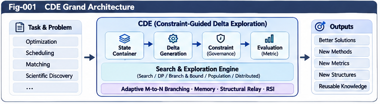
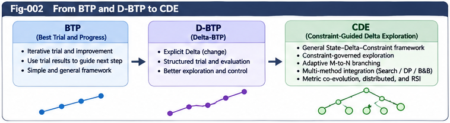
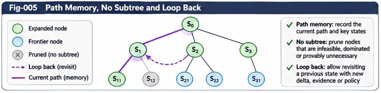

# CDE-012 — Generalization Boundaries, Guarantees, and Open Research

**Series:** Constrained Delta Evolution (CDE) — Foundations  
**Status:** Foundational synthesis and research proposal, v1.0.0 draft  
**Date:** 2026-11-04  
**Authors:** Sizhe Tan and GPT-Obot  
**License:** Apache-2.0  
**Companions:** CDE-001 through CDE-011  
**Related planned specifications:** SPEC-001 through SPEC-006  
**Related planned cases:** CASE-001 through CASE-005

## Abstract

Constrained Delta Evolution (CDE) proposes a common structural language for exploration: logical State Containers, typed Delta transitions, explicit constraints, adaptive branching, path memory, solver adapters, directional fields, metric evolution, distributed exploration contracts, Structural Relay, and controlled evolution of generators and policies. A general framework, however, is valuable only when its scope and limits are as clear as its aspirations. This closing foundations paper therefore asks three distinct questions: **what can CDE represent, what can a conforming CDE implementation guarantee, and what practical advantages—if any—must still be demonstrated experimentally?** We develop a layered account of generalization, from representation and composability to conditional soundness, bounded termination, completeness, optimality, statistical reliability, and cross-domain transfer. We identify the assumptions needed for particular guarantees, provide counterexamples to stronger claims, distinguish CDE's coordination contribution from established search and optimization techniques, and outline a falsifiable research agenda. We also examine SIF exploratory localization, collective learning, distributed governance, evolving metrics, and structural recursive self-improvement. The paper concludes with a proposed claim discipline, conformance matrix, benchmark program, and open questions intended to support rigorous and collaborative development rather than premature claims of universal intelligence or superior optimization.

**Keywords:** Constrained Delta Evolution; CDE; generalization; formal guarantees; completeness; soundness; optimality; search; dynamic programming; branch-and-bound; metric evolution; Structural Relay; Collective Learning; SIF Localization; recursive self-improvement; validation.

---



*Figure 1. Conceptual architecture of Constrained Delta Evolution. A versioned State–Delta–Constraint core supports adaptive proposal generation and solver portfolios; optional orchestration, independent validation, Structural Relay, and controlled meta-evolution extend the system without weakening hard-constraint governance.*

---



*Figure 2. Research lineage from BTP's binary constructive decisions, through D-BTP's dynamic and directional Delta generation, to CDE's representation-independent State–Delta–Constraint framework. The diagram expresses a conceptual generalization, not a claim of strict algorithmic superiority.*

---



*Figure 5. Path-local accepted and excluded decision sets support constructive NoSubtree semantics under fixed-context assumptions. Deferred, infeasible, and pruned branches remain distinct; controlled Loop Back may be legitimate in reconfiguration, cyclic, or representation-evolving searches.*

---


## 1. Purpose: Closing the Foundations without Closing the Questions

The first eleven CDE foundations move from a particular family of constructive decision trees toward a proposed general-purpose exploration architecture. CDE-001 connects Bucket Tree of Permutation (BTP) and Dynamic BTP (D-BTP) to constrained Delta transitions. CDE-002 and CDE-003 establish logical state and branching semantics. CDE-004 clarifies path memory and Loop Back. CDE-005 integrates conventional solvers; CDE-006 adds directional, multi-scale generation; CDE-007 examines solution–metric co-evolution; CDE-008 and CDE-009 develop orchestration and distributed task contracts; CDE-010 formalizes Structural Relay and Collective Learning; CDE-011 introduces controlled generator and policy evolution.

This breadth creates a serious methodological risk: the word *general* can quietly shift between very different meanings. A framework may express many problems while solving none efficiently. A solver may terminate on one finite profile but not on open-ended state spaces. A method may find good candidates but lack an optimality certificate. A distributed system may share results but not reconcile them into a valid global solution.

The objective of CDE-012 is to make those distinctions explicit, thereby providing a defensible boundary for the research program.

### 1.1 Central thesis

CDE is best understood as a **modular, constraint-governed representation and coordination framework for exploration**, whose particular runtime guarantees depend on problem assumptions, generator coverage, solver choice, evaluation semantics, and governance.

It is not itself a theorem that all problems are efficiently solvable, nor a claim that the same algorithm dominates across domains.

### 1.2 Research contribution of this paper

We propose a taxonomy of generality, a matrix of conditional guarantees, counterexamples, an evidence standard for empirical claims, and a sequence of falsifiable experiments. The emphasis is on *what must be proved or measured* before stronger statements are warranted.

## 2. Canonical CDE Model and Its Interpretation

A compact CDE problem can be written as

\[
\mathcal P=(\mathcal S,\Delta,T,C,G,L),
\]

where:

- \(\mathcal S\) is the logical State Container space;
- \(\Delta\) is the universe or family of typed Delta proposals;
- \(T\) is a transition relation or function;
- \(C\) specifies constraints and permitted transitions;
- \(G\) is a candidate Delta generator;
- \(L\) is an evaluation, preference, or selection mechanism.

A transition is admissible when its type, preconditions, authorization, and hard constraints are satisfied:

\[
S\xrightarrow{\delta}S'
\quad\text{only if}\quad
\operatorname{Admissible}(S,\delta,S';C).
\]

The candidate generator may be context-dependent:

\[
G(S,z,B)=\{\delta_1,\ldots,\delta_M\},
\]

with context \(z\) and budget \(B\). After filtering, deferral, execution, and coalescence, the number of realized edges and distinct successor states need not equal \(M\).

The state may be a bucket assignment, graph, schedule, matching, metric definition, scientific hypothesis, generator configuration, or distributed task record. **Logical State Container** does not prescribe a tree or any fixed storage format.

### 2.1 A relation rather than a single deterministic successor

In stochastic or nondeterministic settings, use

\[
T:\mathcal S\times\Delta\longrightarrow 2^{\mathcal S}
\]

or a probability kernel, not necessarily a deterministic function. The transition semantics must identify which uncertainty is environmental, which is algorithmic, and which is due to incomplete information.

### 2.2 CDE-Core versus CDE-Orchestrator

CDE-Core defines state, Delta, constraint, and transition contracts. Solver adapters can invoke DFS, best-first search, DP, B&B, constraint programming, heuristic search, or other methods. An optional CDE-Orchestrator coordinates workers, budgets, evaluation versions, and Relay artifacts.

This layered definition prevents the proposal from claiming that CDE invented the algorithms it integrates.

## 3. Seven Meanings of Generalization

We distinguish seven increasingly demanding claims.

| Level | Meaning | Typical evidence | Not implied |
|---|---|---|---|
| G1 | Representational generality | Encode diverse state/transition systems | Efficient solution |
| G2 | Compositional generality | Combine typed operators and solvers | Correct composition automatically |
| G3 | Operational portability | Execute across runtimes/workers | Identical performance |
| G4 | Conditional correctness | Proof under declared invariants | Completeness |
| G5 | Search coverage and completeness | Exhaustive generator and fair exploration | Polynomial complexity |
| G6 | Optimization quality | Valid bound, certificate, or empirical gap | General superiority |
| G7 | Cross-domain learning and evolution | Independent transfer benchmarks | Universal transfer or open-ended improvement |

A research claim should identify its level. Demonstrating G1 does not establish G5; demonstrating G5 on finite spaces does not establish G6 under changing metrics; demonstrating G7 on a few benchmarks does not establish artificial general intelligence.

## 4. Representational Generality: A Qualified Claim

Many computational processes can be expressed as state transitions. CDE's logical container and typed Delta model is intentionally broad.

For a finite discrete optimization problem, one can often encode a complete candidate solution as a state and a legal modification as a Delta. More generally, search over partial assignments, schedules, programs, or graph configurations can be represented.

But representation may be vacuous if the Delta generator simply enumerates every possible final answer. To be scientifically useful, an encoding should provide at least one of:

1. a meaningful decomposition of transitions;
2. reusable constraint checks;
3. useful structural locality or multi-scale neighborhoods;
4. compatible solver interfaces;
5. auditable provenance and evidence;
6. opportunities for transfer or Relay.

### 4.1 Expressibility versus constructive efficiency

A problem's state space may be exponentially large even when each state is easy to encode. A compact representation does not remove combinatorial complexity.

### 4.2 Continuous and hybrid states

CDE can conceptually represent continuous-valued Deltas and hybrid discrete–continuous states. However, exact equality, termination, numerical tolerances, and solver guarantees require specialized semantics. Finite-branch arguments do not automatically transfer to uncountable spaces.

### 4.3 Partial observability

If the system cannot observe the full environment state, the State Container may hold a belief, estimate, or information state. Sound decisions then depend on the observation model and uncertainty assumptions, not only the CDE transition contract.

## 5. Constraint Semantics and Soundness

Let \(C(S)\) denote a state feasibility predicate, and \(C_T(S,\delta,S')\) a transition-level predicate.

**Proposition 1 — Conditional feasibility preservation.** If:

1. the initial committed state \(S_0\) satisfies \(C\);
2. every committed transition is checked against a sound transition contract;
3. that contract implies \(C(S')\) whenever \(C(S)\) holds; and
4. the applicable constraint version remains fixed or changes only through a separately validated migration,

then all committed states reached by finite transition sequences satisfy \(C\).

**Proof sketch.** Induct on the number of committed transitions. The base state is feasible. The transition implication preserves feasibility from each state to its successor.

This is a conventional inductive invariant, not a CDE-specific discovery. Its value is to make the runtime obligation explicit.

### 5.1 What the proposition does not establish

It does not show that the checker is sound, that a feasible solution exists, that all feasible solutions are reachable, or that the selected solution is optimal.

### 5.2 Hard versus soft constraints

A hard prohibition cannot be replaced by a finite score penalty unless the governing problem definition explicitly permits violation. Soft preferences belong in evaluation or multi-objective tradeoff rules.

### 5.3 Changing constraints

A constraint Delta may invalidate previous feasibility, cached states, or optimality proofs. A safe implementation must either revalidate affected artifacts or prove that the change preserves the relevant invariants.

## 6. Delta Semantics and Adaptive Branching

A candidate Delta is not necessarily an executed transition. CDE-003 distinguishes:

- proposed Delta count \(M\);
- realized transition-edge count \(N\);
- distinct successor-state count \(K\).

In general,

\[
M\neq N,\qquad N\neq K.
\]

Filtering, infeasibility, deferral, stochastic outcomes, and state coalescence explain the differences.

### 6.1 Decision dispositions

`ACCEPT`, `EXCLUDE`, `INFEASIBLE`, `DEFER`, and `PRUNE` should be distinct events. In particular, a heuristic decision to defer or ignore a candidate is not automatically a proof that it cannot contain an optimal solution.

### 6.2 Generator reachability

Let \(R_G(S_0)\) denote states reachable using generated and admissible Deltas. A target outside \(R_G(S_0)\) cannot be found by a search restricted to those Deltas, regardless of ranking quality.

This is a fundamental limitation:

\[
\text{Excellent selection policy}
\not\Rightarrow
\text{adequate generation coverage}.
\]

Directional fields and multi-scale generation may improve coverage in selected domains, but their advantage must be measured.

## 7. Path Memory, NoSubtree, and Loop Back

In a constructive fixed-context BTP profile, a decision on the same Delta should not be repeated on one path after it has been accepted or excluded.

Let \(A_t\) and \(R_t\) denote accepted and rejected decisions, with \(U_t=A_t\cup R_t\). The next decision must be fresh relative to \(U_t\).

But three identities must remain distinct:

1. Delta identity;
2. decision identity;
3. state identity.

A no-repeat Delta rule does **not** imply that state cycles are impossible. Two different Deltas can return to a prior state.

### 7.1 Conditional finite termination

**Proposition 2 — Finite constructive path depth.** Suppose the candidate decision universe has fixed finite size \(m\), every nonterminal expansion resolves a previously unresolved decision, and no new decision identities are introduced. Then each path has at most \(m\) decision expansions.

**Proof sketch.** The ranking function \(\rho_t=m-|U_t|\) is a nonnegative integer that strictly decreases after every expansion.

This does not establish termination of open-ended generator evolution, recursive method creation, or unrestricted cyclic reconfiguration. It also does not prove search completeness if the generator omits required decisions.

### 7.2 Fairness and starvation

For an infinite or dynamically expanding search space, an exploration policy can indefinitely postpone a reachable target. A fairness property must be stated and proved or empirically assessed; it is not inherited from the word *adaptive*.

## 8. Search Completeness: A Conditional Property

Consider a finite state graph with a defined goal predicate.

**Proposition 3 — Conditional exhaustive completeness.** If:

1. the generator exposes every required admissible successor;
2. the traversal is fair or exhaustive;
3. no relevant state or edge is incorrectly discarded;
4. cycle handling preserves reachability; and
5. the search has enough resources to finish,

then exhaustive traversal finds a reachable goal if one exists.

The statement is standard search theory. CDE can host such a search but does not establish its premises automatically.

### 8.1 Counterexample: missing Delta

Suppose the only path to a goal requires Delta \(\delta^*\), but \(G(S)\) never proposes \(\delta^*\). No scoring function or solver scheduling policy can discover that goal through the restricted transition system.

### 8.2 Counterexample: unsafe heuristic pruning

Suppose a high-scoring partial solution is expanded and a low-scoring branch is permanently discarded. If the low-scoring branch leads to the global optimum, the policy is incomplete even if it is computationally efficient.

### 8.3 Infinite spaces

In infinite graphs, even breadth-first search may fail to terminate when no goal exists. Completeness and termination need separate definitions and assumptions.

## 9. Dynamic Programming: Future Equivalence Is Essential

DP-style caching is valid only when merged subproblems have equivalent future-relevant behavior.

Two states with the same visible assignment may differ in path exclusions, remaining resources, metric version, or governance context. A cache key that ignores such distinctions can return incorrect results.

A sound equivalence relation \(\sim\) should preserve the continuation problem relevant to the solver:

\[
S_1\sim S_2
\Longrightarrow
\text{equivalent feasible continuations and objective semantics}.
\]

The precise condition depends on the task and Bellman decomposition.

### 9.1 Counterexample: path-sensitive exclusion

Two partial assignments look identical, but one path has excluded a required future Delta. Merging them by assignment alone may falsely assume that both have the same feasible completions.

### 9.2 Versioning obligation

A change in constraints, metric, representation, or generator semantics may invalidate memoized values. Versioned keys or explicit cache invalidation are required.

## 10. Branch-and-Bound: Proof-Based Pruning

For maximization, suppose \(U(S)\) is a valid upper bound on every feasible completion from state \(S\), and \(I\) is the best known feasible incumbent score under the same fixed objective.

Then a branch may be safely pruned when

\[
U(S)\le I.
\]

This rule is sound only if \(U\) is truly an upper bound, the incumbent is feasible, and both use compatible objective and constraint versions.

### 10.1 Counterexample: predicted score as a bound

A learned model predicts a branch cannot exceed score 80, but a feasible completion scores 95. Pruning against an incumbent of 85 would be incorrect. A prediction is not an admissible bound merely because it is accurate on average.

### 10.2 Changing metrics

An optimality certificate under \(m_k\) does not automatically survive promotion of \(m_{k+1}\). Scores, bounds, dominance relations, and incumbents may require re-evaluation.

## 11. Optimality, Approximation, and Heuristic Success

Three claims must be distinguished:

**Exact optimality:** a proof or certificate establishes that no feasible solution is better under the declared objective.

**Approximation:** a proven bound relates the obtained result to the optimum under stated assumptions.

**Empirical performance:** experiments show useful results on sampled tasks without a universal guarantee.

CDE can support all three *types* of result through solver contracts, but it does not convert a heuristic into an exact method.

### 11.1 No general polynomial-time guarantee

A broad framework capable of representing difficult combinatorial optimization problems does not make those problems tractable. Unless complexity-theoretic assumptions change, no universal efficient exact solver should be claimed.

### 11.2 No-free-lunch intuition

Performance depends on problem structure and task distribution. Broadly, a method advantaged on some landscapes may be disadvantaged on others. Any claimed CDE speedup must identify the relevant domain, baseline, and resource regime.

## 12. Directional Fields and Multi-Scale Exploration

Directional fields provide heuristics for where to generate or prioritize Deltas. Multi-scale generators may propose local, regional, long-range, or cross-domain moves.

These are useful design options, not correctness guarantees.

### 12.1 A separation principle

\[
\text{Generation}
\neq
\text{Evaluation}
\neq
\text{Proof}.
\]

Generation determines which candidates are exposed. Evaluation ranks or compares them. Proof establishes conditional guarantees. A system can perform one well and another poorly.

### 12.2 Weak evidence

A weak directional signal may justify a low-cost probe. It does not justify treating a hypothesis as confirmed, an identity as established, or a branch as safely prunable.

### 12.3 Exploration cost

Broadening the Delta neighborhood may improve reachability but increase computation and duplicate work. Compare quality at matched total budgets rather than merely counting discovered candidates.

## 13. Solution–Metric Co-Evolution: The Evaluation Boundary

CDE-007 extends exploration to the metric space. Let \(x\in\mathcal X\) be a solution and \(m\in\mathcal M\) a metric candidate.

Solution improvement is relative to a fixed metric version:

\[
x_{t+1}\succ_{m_k}x_t.
\]

Metric improvement requires independent evidence:

\[
m_{k+1}\succ_{V}m_k,
\]

where \(V\) is a validation criterion with its own provenance and governance.

### 13.1 Counterexample: score inflation

A metric changes from \(m(x)=f(x)\) to \(m'(x)=100f(x)\). Every score becomes larger, but no solution or decision quality improves. Comparing raw scores across versions would falsely suggest progress.

### 13.2 Goodhart effects

A system can optimize a proxy while harming the intended outcome. The ability to evolve both solutions and metrics may intensify self-confirming feedback unless independent validation is preserved.

### 13.3 No automatic discovery of values

Metric search can discover predictive features, better-calibrated estimators, or empirically useful decision rules. It cannot infer a unique normative objective from an underspecified set of stakeholder values.

## 14. Distributed Exploration: Parallelism Is Not Composability

CDE-009 proposes Delta Exploration Contracts for distributed workers. A worker may receive a state, Delta scope, constraints, metric version, budget, and validation requirements.

Parallel tasks may be easy to distribute. Their results may be difficult to merge.

### 14.1 Independent candidates

If workers each return complete feasible solutions evaluated under a common objective, selecting the best result may be straightforward.

### 14.2 Coupled partial solutions

If workers optimize different pieces of a globally constrained schedule, their outputs may conflict over shared buses, students, capacity, or time windows. A reconciliation solver or explicit coordination protocol is needed.

### 14.3 Stale results

Asynchronous workers may use obsolete constraints or metric versions. An outcome is not globally valid merely because it was locally feasible when computed.

### 14.4 Distributed optimality

A global optimality claim requires a complete proof covering all relevant partitions and bounds, not simply the collection of local best solutions.

## 15. Structural Relay and Collective Learning

CDE-010 distinguishes Result, Evidence, Constraint, Method, Policy, Metric, and Leftover Relay.

The crucial distinction is:

\[
\text{Artifact sharing}
\neq
\text{validated transfer}
\neq
\text{measured collective learning}.
\]

A transferred method may fail because the receiving problem has different constraints or structural properties. Negative transfer must be reported.

### 15.1 Repeated execution

Repeated execution can be viewed as temporal Relay when structured evidence accumulates and affects future exploration. If no information is retained or reused, repetition alone is not learning.

### 15.2 Negative knowledge

Counterexamples, infeasible regions, failed operators, and unresolved proof obligations can be reusable. Their scope must be explicit: a failure in one context is not a universal prohibition.

### 15.3 Collective learning criterion

A credible Collective Learning claim should demonstrate that receiving agents or future runs improve under independent evaluation because of transferred knowledge, relative to suitable no-transfer baselines.

## 16. Recursive Generator and Policy Evolution

CDE-011 treats generators and exploration policies as versioned meta-states:

\[
G_{k+1}=T_G(G_k,\delta_G),\qquad
P_{k+1}=T_P(P_k,\delta_P).
\]

A candidate improvement should pass through proposal, sandbox testing, independent evaluation, authorization, rollout, and monitoring.

### 16.1 No general monotonicity theorem

A method can win on one benchmark and regress on another. Recursive modification does not imply that performance improves at every generation.

### 16.2 No general acceleration theorem

Recursive updates can plateau, oscillate, overfit, or become more expensive. Increasing recursion depth does not by itself establish accelerating capability growth.

### 16.3 Governance independence

A method under evaluation must not gain unrestricted authority to rewrite its own constraints or validation standards. Such changes require separate authorization.

## 17. SIF Localization: A Defined Research Role

Within the Structural Intelligence Framework (SIF), Localization concerns identifying, addressing, and constructing relevant structural regions or capability–problem correspondences.

CDE is proposed as an **exploratory and dynamic Localization method**:

1. Generate constrained Deltas that probe candidate structural regions.
2. Evaluate evidence and feasibility.
3. Preserve paths, counterexamples, and uncertainty.
4. Relay useful findings and methods.
5. Adapt generators and policies under independent validation.

### 17.1 What CDE adds conceptually

Static localization may locate known structures through indexes, keys, or similarity measures. Exploratory localization attempts to discover relevant regions that are not yet directly addressable.

### 17.2 What remains unproved

It has not been established that CDE-based exploratory localization systematically outperforms established search, active learning, graph exploration, or information-retrieval methods. The claim is architectural until benchmarked.

### 17.3 Metric localization

CDE can also explore the space of evaluation methods. A better metric may reveal a previously overlooked solution region; a difficult solution region may expose defects in a metric. This bidirectional interaction is a testable hypothesis, not a guarantee.

## 18. A Guarantee Matrix

| Property | Possible CDE claim | Required conditions | Status |
|---|---|---|---|
| Typed transition validity | Invalid Delta types rejected | Sound schema and checker | Contract-testable |
| Feasibility preservation | Committed states satisfy hard constraints | Feasible initial state, sound checks, fixed/migrated constraints | Conditional proof |
| Finite constructive path depth | No path exceeds finite decision count | Fixed finite universe, fresh decision each step | Conditional proof |
| Search completeness | Reachable goals eventually found | Complete generator, fair exhaustive traversal, valid cycle handling | Conditional proof |
| DP correctness | Cached values preserve continuation semantics | Sound future-equivalence relation | Solver-specific proof |
| Safe B&B pruning | Pruned branches cannot beat incumbent | Valid bounds, fixed compatible objective | Solver-specific proof |
| Exact optimality | Returned result is globally optimal | Exhaustive proof/certificate and correct solver assumptions | Instance/solver-specific |
| Approximation guarantee | Bounded quality loss | Appropriate approximation theorem | Algorithm-specific |
| Better heuristic quality | Improved sampled performance | Matched-budget independent benchmarks | Empirical |
| Better metric | Improved external validity | Independent validation and governance | Empirical/normative |
| Distributed global feasibility | Merged solution satisfies all constraints | Sound reconciliation and global checks | Contract-testable |
| Distributed optimality | Global optimum certified | Complete global proof across partitions | Problem-specific |
| Knowledge transfer | Receiving tasks improve | Receiving-side tests and baselines | Empirical |
| Recursive improvement | New methods improve outcomes | Frozen evaluation, controlled comparison | Empirical |
| Universal efficient optimization | All represented tasks solved efficiently | No general basis | Not claimed |
| Guaranteed open-ended intelligence growth | Recursive changes always advance capability | No general basis | Not claimed |

This matrix should guide README language, specifications, release notes, and public research descriptions.

## 19. Counterexample Gallery

A strong general framework should explain how it can fail.

**CE-01 — Unreachable goal.** The generator omits a required Delta. Search cannot reach the solution.

**CE-02 — Invalid state merge.** Two states share visible data but differ in excluded decisions. DP caching produces a wrong continuation.

**CE-03 — Unsafe bound.** A learned predictor is treated as an admissible upper bound. B&B prunes the optimal branch.

**CE-04 — Cycle despite no-repeat Delta.** Two distinct Deltas return to the same state. A Delta-only repetition check does not detect the state cycle.

**CE-05 — Objective reversal.** A metric version changes weights, reversing candidate rankings. An old incumbent is no longer best.

**CE-06 — Goodhart failure.** Optimizing fleet count alone yields unacceptable ride times.

**CE-07 — Invalid distributed merge.** Two locally feasible route assignments use the same vehicle at conflicting times.

**CE-08 — Stale evidence.** A worker's result is valid under an earlier constraint version but not the current one.

**CE-09 — Negative transfer.** A Delta operator useful on dense graphs performs poorly on sparse graphs.

**CE-10 — Recursive overfitting.** A meta-generator repeatedly tunes against a benchmark and reports gains that vanish on unseen tasks.

**CE-11 — Coordination overhead.** Distributed orchestration costs more than it saves on small problems.

**CE-12 — Noisy directional field.** A heuristic concentrates exploration away from the best region.

**CE-13 — Metric self-validation.** A new metric assigns itself high quality scores but has no independent evidence.

**CE-14 — Governance bypass.** A policy update removes a safety constraint to improve speed.

**CE-15 — Infinite novelty without progress.** An open-ended generator creates many new Deltas but never finds better solutions.

Each counterexample suggests a corresponding conformance or benchmark test.

## 20. The Boundary between Framework and Algorithm

CDE is not a single optimizer. A useful decomposition is:

\[
\text{CDE deployment}
=
\text{Core contracts}
+
\text{chosen solver(s)}
+
\text{optional orchestration}.
\]

The framework supplies a common way to describe transitions, constraints, evidence, and handoffs. The solver supplies the actual search strategy and, where applicable, mathematical guarantees.

### 20.1 A falsifiable architectural claim

The architecture is useful if it demonstrably lowers integration cost, improves auditability, supports safe method reuse, or improves measured outcomes on selected heterogeneous workflows compared with alternatives.

### 20.2 A falsifiable negative outcome

If CDE contracts add substantial overhead without improving portability, reproducibility, correctness, or useful transfer, the framework may be too general or too complex for that application.

### 20.3 Avoiding semantic inflation

Not every state machine, optimization loop, or distributed job system needs to be relabeled CDE. A meaningful CDE implementation should expose typed Delta semantics, constraint governance, and sufficient evidence/provenance for the claimed use case.

## 21. Prior Art and Novelty Discipline

CDE draws on established ideas from:

- state-transition systems and formal methods;
- search theory and graph exploration;
- dynamic programming and state abstraction;
- branch-and-bound and constraint programming;
- heuristic search and metaheuristics;
- multi-objective and bilevel optimization;
- metric learning and decision theory;
- distributed task scheduling and fault tolerance;
- meta-learning, algorithm configuration, and evolutionary computation;
- knowledge representation, provenance, and transfer learning.

The proposed contribution is not ownership of these techniques. It is their **structured integration through State–Delta–Constraint semantics, versioned evaluation, solver-neutral contracts, and evidence-bearing Structural Relay**.

A full literature review and priority analysis remain future work. Formal citations should be added only after checking primary sources.

## 22. Minimal Conformance Profiles

To avoid requiring every deployment to implement the entire architecture, we propose profiles.

### CDE-Core

Typed states and Deltas, transition preconditions, hard constraints, outcome records, and explicit decision dispositions.

### CDE-Search

CDE-Core plus a traversal strategy, path/state memory, generator coverage declarations, and stopping semantics.

### CDE-Optimization

CDE-Search plus objective versioning, solver contracts, incumbent handling, and any claimed bound/certificate checks.

### CDE-Distributed

CDE-Core plus Delta Exploration Contracts, worker provenance, idempotent results, version consistency, and reconciliation semantics.

### CDE-Relay

CDE-Core plus typed knowledge artifacts, applicability scopes, evidence, and receiving-side validation.

### CDE-Evolution

CDE-Relay plus generator/policy candidate registries, independent evaluation, authorization, monitoring, and rollback.

A system can conform to one profile without claiming the guarantees of another.

## 23. Proposed Conformance Test Matrix

| ID | Requirement | Test |
|---|---|---|
| CDE-BOUND-01 | Delta typing | Reject unknown Delta type |
| CDE-BOUND-02 | Transition preconditions | Reject inapplicable operation |
| CDE-BOUND-03 | Hard constraints | Reject high-scoring infeasible successor |
| CDE-BOUND-04 | Outcome distinction | Distinguish exclude, infeasible, defer, prune |
| CDE-BOUND-05 | M-to-N accounting | Report proposed, realized, unique successor counts |
| CDE-BOUND-06 | Path memory | Prevent repeated constructive decisions |
| CDE-BOUND-07 | Cycle handling | Detect revisited state despite distinct Deltas |
| CDE-BOUND-08 | Termination claims | Reject unconditional termination claim on open-ended profile |
| CDE-BOUND-09 | Generator coverage | Record incomplete candidate coverage |
| CDE-BOUND-10 | DP state equivalence | Detect unsound cache key |
| CDE-BOUND-11 | B&B bound provenance | Reject unverified pruning bound |
| CDE-BOUND-12 | Objective versioning | Invalidate incompatible incumbent |
| CDE-BOUND-13 | Metric comparison | Reject raw cross-version comparison |
| CDE-BOUND-14 | Independent validation | Block metric self-certification |
| CDE-BOUND-15 | Distributed provenance | Reject result lacking required version IDs |
| CDE-BOUND-16 | Global reconciliation | Reject conflicting local solutions |
| CDE-BOUND-17 | Retry safety | Duplicate worker result does not double-commit |
| CDE-BOUND-18 | Relay applicability | Flag out-of-scope transferred method |
| CDE-BOUND-19 | Negative knowledge | Preserve failed exploration evidence |
| CDE-BOUND-20 | Governance authority | Reject unauthorized constraint relaxation |
| CDE-BOUND-21 | Recursive promotion | Require independent evaluation |
| CDE-BOUND-22 | Rollback | Restore compatible prior artifact versions |
| CDE-BOUND-23 | Budget accounting | Include orchestration and validation costs |
| CDE-BOUND-24 | Claim labeling | Distinguish proof, empirical result, hypothesis |
| CDE-BOUND-25 | Uncertainty reporting | Preserve weak-evidence status |
| CDE-BOUND-26 | Reproducibility | Reconstruct an exploration decision chain |
| CDE-BOUND-27 | Open-ended stopping | Enforce explicit budget or stop policy |
| CDE-BOUND-28 | Non-guarantee disclosure | Do not emit unsupported universal optimality claim |

These tests are draft research requirements, not an adopted interoperability standard.

## 24. A Benchmark Program for CDE

A fair benchmark must separate algorithmic performance from architectural benefits.

### 24.1 Benchmark families

**B1 — Finite constructive assignment.** Test BTP-style NoSubtree semantics, feasibility preservation, and exhaustive coverage.

**B2 — Graph search with cycles.** Test state revisitation, Loop Back, deduplication, and completeness assumptions.

**B3 — Dynamic programming.** Test future-equivalence keys and cache invalidation under path-dependent constraints.

**B4 — Branch-and-bound.** Test bound validity, optimality certificates, and objective-version changes.

**B5 — Multi-scale peak search.** Test local versus regional versus long-range Delta generation.

**B6 — School-bus scheduling.** Test globally coupled constraints, competing objectives, and distributed reconciliation.

**B7 — Structural matching.** Test uncertain evidence, similarity metrics, false-positive risk, and metric versioning.

**B8 — Metric discovery.** Test external validation, overfitting, and solution–metric feedback.

**B9 — Distributed solver portfolio.** Test task dispatch, worker heterogeneity, retries, and coordination overhead.

**B10 — Cross-domain Method Relay.** Test receiving-side adaptation and negative transfer.

**B11 — Recursive generator evolution.** Test meta-overfitting, controlled promotion, rollback, and diminishing returns.

### 24.2 Baselines

Use strong, appropriate baselines: conventional DFS/BFS, A*, DP, B&B, constraint programming, domain heuristics, local search, evolutionary search, standard distributed scheduling, and standard meta-optimization where applicable.

Avoid weak baselines designed to make CDE look good.

### 24.3 Experimental fairness

Report:

- exact hardware and software versions;
- input distributions and task difficulty;
- total computation, including orchestration;
- matched wall-clock and compute budgets where feasible;
- random seeds and repeated trials;
- feasibility and external task quality;
- optimality gaps where known;
- failure, timeout, and rollback rates;
- confidence intervals or appropriate uncertainty estimates;
- statistical and practical significance;
- negative results and out-of-domain failures.

### 24.4 Ablations

Compare CDE-Core alone with optional modules added individually: directional generation, adaptive branching, solver portfolio, Relay, metric evolution, and recursive policy updates. This isolates the value and cost of each mechanism.

## 25. Testable Hypotheses

**H1 — Contract reuse.** CDE-Core reduces integration effort across heterogeneous solvers compared with bespoke adapters on selected engineering tasks.

**H2 — Auditable correctness.** Typed transition and evidence contracts reduce invalid commits and unverifiable claims in controlled fault-injection tests.

**H3 — Generator reachability.** Multi-scale Delta generation improves discovery of separated feasible regions on selected multimodal benchmarks at matched budgets.

**H4 — Solver portfolio.** Context-aware solver selection improves time-to-target quality relative to fixed allocation on heterogeneous task distributions.

**H5 — Metric governance.** Versioned metric validation reduces misleading cross-run comparisons and proxy exploitation.

**H6 — Distributed overhead threshold.** Distributed CDE improves wall-clock performance only when task granularity exceeds a measurable coordination threshold.

**H7 — Constraint reconciliation.** Explicit global reconciliation reduces invalid merged solutions compared with naïve aggregation of local outputs.

**H8 — Negative Relay.** Sharing failure evidence reduces repeated unsuccessful exploration on related tasks.

**H9 — Method transfer.** Receiving-side validated Method Relay improves outcomes over isolated workers in some domains but exhibits measurable negative transfer in others.

**H10 — Recursive adaptation.** Governed generator evolution improves held-out performance on selected task families relative to fixed generators, with nonzero regression and validation costs.

**H11 — SIF exploratory localization.** CDE-based localization improves discovery of previously unaddressed structural regions relative to static addressing alone on suitable tasks.

**H12 — Architecture cost.** The value of the full CDE-Orchestrator varies with problem scale and heterogeneity; small tasks may favor simpler implementations.

**H13 — Version-safe proofs.** Solver certificate invalidation prevents incorrect optimality claims after objective or constraint changes.

**H14 — Controlled scope.** Explicit conformance profiles improve reproducibility and cross-team interoperability relative to undocumented ad hoc interfaces.

These are hypotheses requiring experiments, not findings.

## 26. Validation Roadmap

### Phase 1 — Formalize the core

Finalize typed State Container, Delta, transition, constraint, and disposition semantics. Specify invariants, failure cases, and reproducibility requirements.

**Exit criterion:** independent implementations pass a shared CDE-Core conformance suite.

### Phase 2 — Solver correctness

Implement small reference adapters for graph search, DP, and B&B. Include counterexamples for invalid caching and pruning.

**Exit criterion:** claimed completeness or optimality properties are supported by solver-specific proofs or certificates on defined profiles.

### Phase 3 — Multi-scale exploration

Benchmark fixed and adaptive generators across controlled landscapes and discrete optimization problems.

**Exit criterion:** reproducible, budget-matched performance results including negative cases.

### Phase 4 — Metric co-evolution

Introduce versioned metrics, external validation, and explicit promotion rules.

**Exit criterion:** independent evaluation demonstrates whether metric evolution improves real outcomes rather than internal scores.

### Phase 5 — Distributed contracts

Test heterogeneous workers, retries, stale versions, checkpointing, and global constraint reconciliation.

**Exit criterion:** correct recovery and valid merged outcomes under controlled fault injection.

### Phase 6 — Relay and Collective Learning

Publish reusable Result, Evidence, Method, and Leftover artifacts. Test transfer on held-out tasks.

**Exit criterion:** receiving-side improvements are measurable and negative transfer is reported.

### Phase 7 — Controlled recursive evolution

Allow bounded generator and policy modifications under independent validation and rollback.

**Exit criterion:** empirical evidence identifies where recursive adaptation helps, fails, or becomes too costly.

### Phase 8 — Cross-domain synthesis

Evaluate CDE's interoperability, SIF Localization role, governance overhead, and reproducibility across unrelated domains.

**Exit criterion:** clear evidence for which CDE profiles are useful and where simpler methods remain preferable.

## 27. Open Research Questions

### 27.1 Representation and semantics

1. What is the smallest State–Delta–Constraint contract that remains useful across discrete, continuous, stochastic, and hybrid systems?
2. Which transition equivalence notions support safe state merging?
3. Can path-sensitive decision histories be compressed without losing future-relevant information?
4. How should uncertainty and partial observability be represented without pretending to know the true state?

### 27.2 Search and optimization

5. Which generator coverage properties can be verified statically?
6. What fairness conditions are practical for dynamically expanding search spaces?
7. How can solver certificates remain valid when Delta operators evolve?
8. Which classes of multi-scale generators offer provable coverage advantages?
9. When does adaptive branching harm completeness or efficiency?

### 27.3 Metric evolution

10. What independent criteria can validate metric changes when ground truth is incomplete?
11. How should competing stakeholder perspectives be governed?
12. Which metric transformations preserve useful orderings, bounds, or dominance relations?
13. How can adaptive validation resist benchmark leakage and Goodhart effects?

### 27.4 Distributed systems

14. What is the minimal Delta Exploration Contract for interoperable workers?
15. When can local partial solutions be safely composed without global re-optimization?
16. How should stale results and partially valid evidence be reconciled?
17. What distributed termination criteria are sound for open-ended task generation?

### 27.5 Collective learning and RSI

18. How can Method Relay encode applicability and known failure conditions compactly?
19. When does repeated execution produce genuine transferable learning?
20. What are the limits of recursive generator evolution under fixed budgets?
21. Can a system reliably detect that its own exploration method is no longer appropriate?
22. Which recursive policy changes preserve safety and solver correctness?
23. What forms of cross-domain transfer are robust to structural mismatch?

### 27.6 SIF and broader theory

24. How should exploratory localization interact with static indexing and capability addressing?
25. What evidence would show that CDE improves the SIF Localization functional domain?
26. Can common CDE contracts support meaningful scientific hypothesis discovery without sacrificing empirical validation?
27. Which apparent generalizations are merely changes in terminology rather than new explanatory or engineering capabilities?

## 28. Research Ethics, Governance, and Evidence

CDE may be applied to optimization and inference problems with significant human consequences. A structurally elegant search framework does not establish the legitimacy of a goal, the adequacy of a dataset, or the acceptability of a decision.

Applications should declare:

- authorized problem objectives and stakeholders;
- hard safety and legal constraints;
- privacy and data-use limitations;
- uncertainty and false-positive costs;
- independent validation procedures;
- human or institutional approval requirements;
- rollback and incident-response paths.

For behavioral attribution or identity inference, correlation, shared infrastructure, or similar patterns are not proof of a unique actor. Weak evidence must remain explicitly uncertain. For school transportation, efficiency must not silently override safety or equity constraints.

## 29. Publication and Claim Discipline

The repository should distinguish four classes of statements:

**Definition:** a proposed contract or term.

**Conditional theorem:** a claim derived under explicit assumptions, with a proof or proof sketch.

**Research hypothesis:** a falsifiable prediction not yet validated.

**Empirical result:** a measured outcome with reproducible methods and data.

Avoid public descriptions such as “CDE guarantees optimality across domains” or “recursive CDE necessarily produces AGI.” Such statements are not supported by the foundations.

Preferred wording includes:

- “proposes a general structural framework”;
- “supports solver-neutral integration”;
- “provides conditional guarantees under stated assumptions”;
- “offers a candidate method for exploratory SIF Localization”;
- “defines contracts for distributed Structural Relay”;
- “investigates controlled recursive generator evolution.”

### 29.1 Evidence tiers

A useful internal evidence label is:

- **E0:** conceptual proposal;
- **E1:** formal definition or logical derivation;
- **E2:** executable conformance demonstration;
- **E3:** controlled single-domain benchmark;
- **E4:** independent replication;
- **E5:** robust cross-domain evidence.

These are proposed reporting labels, not an externally established standard.

## 30. What CDE Can Reasonably Become

The strongest defensible long-term vision is not a universal solver but a **reusable exploration infrastructure**:

1. A common representation for typed, constrained state transitions.
2. A place to plug in established and emerging solvers.
3. A disciplined method for discovering new Delta neighborhoods.
4. A versioned environment for evolving metrics and objectives.
5. A distributed execution contract with provenance and reconciliation.
6. A Structural Relay ecosystem for results, failures, methods, and unfinished work.
7. A governed mechanism for improving generators and policies.
8. An exploratory Localization capability within the broader SIF research program.

Each component can be useful independently. Their combination is a hypothesis about integration value that must be tested against complexity and overhead.

## 31. A Compact Reference Architecture

```text
                         Problem / Capability Context
                                      |
                          Hard Constraints + Goals
                                      |
                            CDE Control Contract
                                      |
                    +-----------------+------------------+
                    |                                    |
             CDE-Core State                         Metric Registry
          State / Delta / T / C                    Versions / Validation
                    |                                    |
                    +-----------------+------------------+
                                      |
                         Delta Generation Portfolio
                      Local / Regional / Long-Range
                                      |
                           Solver Adapter Portfolio
                       Search / DP / B&B / Heuristics
                                      |
                      Optional Distributed Orchestrator
                     Budgets / Workers / Reconciliation
                                      |
                         Evidence and Result Registry
                                      |
                           Structural Relay Layer
                    Result / Failure / Method / Leftover
                                      |
                        Governed Meta-Evolution Layer
                     Generator / Policy Candidates
                                      |
                          Independent Validation
                                      |
                      Promote / Reject / Roll Back
```

The diagram is a logical decomposition. Not every deployment requires every layer, and the control plane need not be physically centralized.

## 32. Conclusion

The first twelve CDE foundations establish a coherent research proposal, but coherence should not be mistaken for proof of universal effectiveness. CDE can provide a general language for state transitions, typed Deltas, constraints, solver integration, directional exploration, metric evolution, distributed tasks, Structural Relay, and controlled recursive method improvement. Its correctness properties remain conditional on sound contracts and solver-specific assumptions. Its performance and transfer advantages remain empirical questions.

The most important boundary is:

\[
\boxed{
\text{Representability}
\neq
\text{Reachability}
\neq
\text{Completeness}
\neq
\text{Optimality}
\neq
\text{Efficiency}
\neq
\text{Validated Generalization}
}
\]

Maintaining these distinctions strengthens rather than weakens the CDE research program. It turns broad architectural ambition into explicit proof obligations, conformance tests, and reproducible experiments.

CDE's next phase should therefore prioritize specifications, counterexamples, reference implementations, and independent validation. Collective Learning becomes meaningful when evidence-bearing results and methods survive transfer; recursive evolution becomes meaningful when new methods demonstrate independently measured benefit without sacrificing constraints or governance.

**CDE is a framework for organizing exploration and its evolution—not a promise that exploration is easy, complete, or automatically intelligent.**

---

## Appendix A — Foundations Cross-Reference

| Paper | Title | Core question |
|---|---|---|
| CDE-001 | From BTP and D-BTP to Constrained Delta Evolution | Why generalize the decision-tree model? |
| CDE-002 | State Containers and Constraint-Governed Transitions | What is a valid state and transition? |
| CDE-003 | Delta Semantics and Adaptive M-to-N Branching | What constitutes a proposal, edge, and successor? |
| CDE-004 | Path Memory, No-Subtree Semantics, and Loop-Back Control | How are decisions and cycles governed? |
| CDE-005 | Search, Dynamic Programming, and Branch-and-Bound Integration | How do established solvers fit? |
| CDE-006 | Directional Fields and Multi-Scale Delta Generation | How are exploration directions generated? |
| CDE-007 | Solution-Space and Metric-Space Co-Evolution | How can evaluation itself evolve responsibly? |
| CDE-008 | CDE as a General Exploration and Optimization Orchestrator | How are modules coordinated? |
| CDE-009 | Distributed CDE and Delta Exploration Contracts | How are tasks distributed and reconciled? |
| CDE-010 | Structural Relay and Collective Learning | How is exploration knowledge transferred? |
| CDE-011 | Recursive Generator and Policy Evolution | How can exploration methods improve? |
| CDE-012 | Generalization Boundaries, Guarantees, and Open Research | What is justified, and what remains open? |

## Appendix B — Suggested Specifications and Case Studies

**Specifications:** State Container and Constraint Contract; Delta Generation and Branch Contract; Path Memory and Loop Control Contract; Solver and Optimization Contract; Distributed Exploration and Relay Contract; Metric and Recursive Evolution Contract.

**Cases:** Multi-Scale Peak Search; Constrained School-Bus Assignment and Routing; Dynamic Structural Matching; Metric Discovery and Co-Evolution; Distributed CDE and Method Relay.

**Extensions:** Biomimetic and Population-Based CDE; Open-Ended Delta and Representation Evolution; CDE for Scientific Hypothesis and Metric Discovery; CDE, Collective Intelligence, and Structural RSI.

## Appendix C — Suggested Figures

The foundation synthesis should be reflected in:

- **Fig-001:** CDE Grand Architecture, including the SIF Localization connection.
- **Fig-002:** From BTP and D-BTP to CDE.
- **Fig-003:** State Container and Constraint-Governed Delta.
- **Fig-004:** Adaptive M-to-N Delta Branching.
- **Fig-005:** Path Memory, NoSubtree, and Loop Back.
- **Fig-006:** Search, DP, and B&B Integration.
- **Fig-007:** Multi-Scale Delta Generation and Directional Exploration.
- **Fig-008:** Solution and Metric Co-Evolution.
- **Fig-009:** Distributed Orchestrator and Structural Relay.
- **Fig-010:** Recursive Generator Evolution and Collective Learning.

Figures should depict proposed architecture and conditional flow, not imply experimental validation.

## Appendix D — Research Context and Attribution

This document is a conceptual synthesis. It draws on established ideas from formal transition systems, graph search, dynamic programming, branch-and-bound, optimization, multi-objective decision theory, distributed systems, knowledge transfer, and meta-learning. The CDE research program proposes to integrate these through explicit State–Delta–Constraint semantics and evidence-bearing Structural Relay.

A comprehensive literature review, verified primary citations, reference implementations, and external replication remain necessary before making strong novelty or performance claims. No DOI is asserted until a repository release and registration actually occur.

**Research status:** Foundational synthesis and open research agenda.  
**Version:** v1.0.0 draft  
**License:** Apache-2.0
