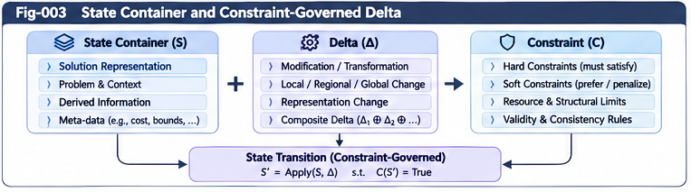

# SPEC-001 — State Container and Constraint Contract

**Project:** Constrained Delta Evolution (CDE)  
**Series:** Specifications  
**Status:** Proposed normative contract, v1.0.0 draft  
**Date:** 2026-11-04  
**Authors:** Sizhe Tan and GPT-Obot  
**License:** Apache-2.0  
**Related foundations:** CDE-001 through CDE-012, especially CDE-002, CDE-003, CDE-004, CDE-005, CDE-007, CDE-009, and CDE-012  
**Companion specifications (planned):** SPEC-002 Delta Generation and Branch Contract; SPEC-003 Path Memory and Loop Control Contract; SPEC-004 Solver and Optimization Contract; SPEC-005 Distributed Exploration and Relay Contract; SPEC-006 Metric and Recursive Evolution Contract

## Abstract

This specification defines the minimum interoperable **State Container and Constraint Contract** for Constrained Delta Evolution (CDE). It specifies logical state identity, schema and context versioning, typed transition requests, constraint evaluation, commit authorization, event provenance, and conformance requirements. The contract distinguishes a candidate proposal from an admissible transition, a committed state, and a solver's claim about the result. It defines mandatory safety invariants while leaving state representation, solver strategy, storage technology, and distributed topology implementation-neutral. It also specifies how implementations handle hard constraints, soft preferences, uncertain evidence, changing constraint versions, stale requests, and rejected transitions. The objective is **contracts and conformance before runtime**, not a universal algorithm or a claim of optimality.

**Keywords:** CDE; State Container; hard constraints; typed transitions; provenance; versioning; conformance; interoperability; optimistic concurrency; formal invariants.

---



*Figure 3. A typed Delta proposes a transition from a versioned State Container to a candidate successor. Hard-constraint checks and coherent-version validation determine whether the transition may be committed; directional scores may prioritize attempts but cannot substitute for feasibility.*

---

## 1. Normative Language and Scope

The terms **MUST**, **MUST NOT**, **REQUIRED**, **SHOULD**, **SHOULD NOT**, and **MAY** express requirement strength in this proposed contract.

- **MUST / MUST NOT:** required for conformance to the stated profile.
- **SHOULD / SHOULD NOT:** recommended unless an implementation documents a justified exception.
- **MAY:** optional.

This document defines **CDE-Core-State-v1**, a minimal conformance profile. It does not require a specific database, programming language, network transport, tree representation, or solver.

It covers:

1. logical State Containers and their identity;
2. state schema and versioning;
3. constraints and constraint contexts;
4. typed transition requests and outcomes;
5. validation and commit boundaries;
6. event records and reproducibility;
7. uncertainty and soft preferences;
8. migration and distributed consistency interfaces;
9. conformance tests and proof obligations.

It does **not** fully specify Delta generation or M-to-N selection (SPEC-002), path NoSubtree and Loop Back policies (SPEC-003), solver optimality (SPEC-004), distributed task protocols (SPEC-005), or metric/recursive governance (SPEC-006). Those specifications may refine but MUST NOT silently weaken this contract's hard-constraint requirements.

## 2. Design Principles

**P1 — Logical, not physical, container.** A State Container is a typed logical state. It may be implemented as a record, graph, object, database view, or external reference.

**P2 — Constraints before commit.** A candidate transition is not a committed transition. Applicable hard constraints must be checked before activation.

**P3 — Immutable identity of evidence.** State versions, constraint versions, validation results, and transition events must be reconstructible.

**P4 — Separation of authority.** A generator may propose a Delta but does not thereby gain permission to change constraints or commit it.

**P5 — Distinguish feasibility from quality.** A high score cannot override a hard constraint.

**P6 — Typed failure is information.** Rejections, stale contexts, deferrals, and unresolved validation are recorded as distinct outcomes.

**P7 — Profile-scoped claims.** Conformance to CDE-Core-State-v1 does not imply search completeness, solver optimality, or distributed consensus.

**P8 — Conservative unknowns.** Missing or indeterminate hard-constraint evidence must not be treated as a successful check.

## 3. Terminology

| Term | Meaning |
|---|---|
| **State Container** | A logical, typed representation of a task or exploration state |
| **State schema** | A versioned definition of required state fields and invariants |
| **State identity** | An identifier for a particular logical state snapshot |
| **State revision** | A version of a state under a defined mutation/commit history |
| **Context** | External information needed to interpret a state or transition |
| **Delta** | A typed proposal for changing or interpreting a state |
| **Transition request** | A proposal to apply a Delta to a specified source state |
| **Candidate successor** | A proposed next state before all checks and commit |
| **Committed successor** | A successor accepted under the applicable contract |
| **Hard constraint** | A mandatory condition that must hold for a committed transition |
| **Soft preference** | A ranking or optimization criterion that cannot override hard constraints |
| **Constraint bundle** | An immutable, versioned collection of applicable constraint rules |
| **Validation report** | Evidence of checks performed under specified versions |
| **Commit record** | An immutable record of an accepted state transition |
| **Provenance** | Information about the origin, dependencies, and evaluation of an artifact |
| **Disposition** | Typed outcome of a proposal, e.g., accepted, rejected, deferred |
| **Canonicalization** | A declared mapping to stable identity or equivalence representations |
| **Feasibility** | Satisfaction of the applicable hard constraints |
| **Admissibility** | Satisfaction of transition typing, preconditions, authorization, and constraints |

## 4. Canonical State Model

A conforming implementation MUST be able to resolve a State Container into the following logical fields, even if they are stored separately:

$$
S=(id,\sigma,v,payload,ctx,provenance).
$$

Where:

- `id` identifies a state snapshot or content-equivalent state under declared rules;
- `schema_id` $\sigma$ identifies the state schema;
- `revision` $v$ identifies the relevant committed version;
- `payload` is the typed task-state content or an immutable reference to it;
- `context_refs` identify dependencies needed for interpretation;
- `provenance` links the state to its origin and creation event.

### 4.1 Required fields

A CDE-Core-State-v1 State Container MUST provide:

```yaml
StateContainer:
  state_id: string
  schema_id: string
  schema_version: string
  state_revision: string
  payload_ref_or_value: typed
  constraint_bundle_id: string
  context_refs: [string]
  provenance_ref: string
```

The YAML is illustrative; wire formats MAY differ.

### 4.2 Identity versus equality

A conforming implementation MUST document whether `state_id` is:

- a unique snapshot identifier;
- a content-addressed identifier;
- a canonical logical-equivalence identifier; or
- a scoped identifier resolved through an external registry.

It MUST NOT assume that equal identifiers imply equivalent future continuations unless the relevant equivalence contract explicitly establishes that property.

Two snapshots can have identical visible payloads but different path memory, resource balances, metric versions, or constraint contexts. Such states may not be interchangeable for DP caching or global deduplication.

### 4.3 State immutability

A committed state revision MUST be immutable for audit purposes. Implementations MAY maintain mutable working copies, but a commit MUST create a new resolvable revision or immutable snapshot reference.

A later correction MUST be represented as a new event or revision; it MUST NOT silently rewrite historical transition evidence.

### 4.4 Partial and external states

A State Container MAY reference an external graph, database, or service. It MUST include enough immutable identifiers, versions, or snapshot semantics to make validation and subsequent audit meaningful.

A reference to an unversioned, mutable external resource is insufficient when the referenced data can change between validation and commit.

## 5. Schema Contract

Each `schema_id` and `schema_version` MUST resolve to a documented state schema defining:

1. required fields and their types;
2. allowed null or unknown values;
3. structural invariants;
4. serialization and canonicalization rules, if used;
5. dependencies on external schemas;
6. compatibility and migration rules.

A validator MUST reject a state that does not conform to the declared schema, unless the implementation explicitly supports a separate `DEFERRED_SCHEMA_VALIDATION` workflow that prevents commit until checks complete.

### 5.1 Schema evolution

Schema changes MUST be versioned. A transition across incompatible schemas MUST declare a migration operation and its validation requirements.

### 5.2 Canonical representation

Canonicalization MAY normalize ordering or encoding. It MUST preserve the semantics relevant to declared identity. A canonicalizer that discards path-sensitive or resource-sensitive fields MUST NOT be used as proof of future-equivalence without additional justification.

## 6. Constraint Bundle Contract

A hard-constraint bundle is an immutable, versioned collection of checks:

$$
C_v=\{c_1,\ldots,c_n\}.
$$

A constraint may be a state predicate, transition predicate, relational predicate, or externally evaluated policy.

A conforming bundle MUST provide:

```yaml
ConstraintBundle:
  constraint_bundle_id: string
  version: string
  applicable_schema_ids: [string]
  state_invariants: [constraint_ref]
  transition_invariants: [constraint_ref]
  authorization_rules: [rule_ref]
  dependency_refs: [string]
  evaluation_policy: string
  provenance_ref: string
```

### 6.1 Constraint result types

Each hard-constraint check MUST return one of:

- `PASS`: the check was performed and satisfied;
- `FAIL`: the check was performed and violated;
- `UNKNOWN`: available evidence cannot establish either result;
- `ERROR`: the checker could not execute reliably.

A conforming implementation MUST NOT treat `UNKNOWN` or `ERROR` as `PASS`.

### 6.2 Commit policy

Under the default strict profile, a transition MAY commit only when every required hard-constraint check returns `PASS`, and authorization and version checks succeed.

An application that uses probabilistic or risk-bounded constraints MUST explicitly define a separate risk contract and approval rule. It MUST NOT silently reinterpret uncertain evidence as deterministic satisfaction.

### 6.3 Constraint priority

Hard constraints have priority over soft preferences, heuristic scores, directional fields, and solver predictions.

For a candidate $S'$, a high utility $L(S')$ cannot compensate for a hard failure $c_i(S')=\texttt{FAIL}$.

### 6.4 External constraints

When checks depend on external systems, the validation report MUST identify the dependency snapshot or observation version. If consistency cannot be established, the implementation MUST reject or defer the commit under the selected profile.

## 7. Transition Request Contract

A transition request MUST bind the Delta to a specific source state and governing context.

```yaml
TransitionRequest:
  request_id: string
  source_state_id: string
  source_state_revision: string
  delta_id: string
  delta_type: string
  delta_payload: typed
  constraint_bundle_id: string
  expected_context_versions: [string]
  proposer_id: string
  authorization_ref: string
  idempotency_key: string
  provenance_ref: string
```

The request MAY include an expected successor digest, resource budget, solver trace, or speculative evaluation. Such fields do not substitute for validation.

### 7.1 Delta preconditions

Every Delta type MUST define the state schemas and contexts to which it applies, together with any preconditions necessary for a valid transition.

### 7.2 Authorization

A request MUST be checked against applicable authorization rules before commit. Proposer identity alone is not authorization.

### 7.3 Idempotency

The same idempotency key, within its documented scope, MUST NOT produce multiple distinct committed effects for the same logical request. Implementations MUST define how retries and conflicting payloads under the same key are handled.

## 8. Transition Lifecycle

The normative lifecycle is:

```text
PROPOSED
  -> TYPE_CHECKED
  -> PRECONDITIONS_CHECKED
  -> CANDIDATE_CONSTRUCTED
  -> CONSTRAINTS_VALIDATED
  -> AUTHORIZED
  -> COMMITTED
```

Failure or alternative dispositions include:

- `REJECTED_TYPE`
- `REJECTED_PRECONDITION`
- `INFEASIBLE`
- `UNAUTHORIZED`
- `STALE_CONTEXT`
- `VALIDATION_UNKNOWN`
- `VALIDATION_ERROR`
- `DEFERRED`
- `CONFLICT`
- `CANCELLED`

A runtime MAY combine internal steps for efficiency, but it MUST preserve the externally observable distinction between a proposal and a commit.

### 8.1 Atomicity requirement

A conforming commit MUST be atomic with respect to its declared state revision and required consistency boundary: either the successor and its commit record become visible together, or neither is committed.

This requirement does not imply a globally atomic transaction across unrelated services. A distributed implementation MUST define the actual consistency scope and compensating or reconciliation behavior.

### 8.2 Time-of-check/time-of-use

If source state, constraints, or external dependencies change between validation and commit, the implementation MUST detect the conflict or revalidate under the new context.

A report validated against an obsolete state revision MUST NOT authorize an incompatible commit.

## 9. Validation Report Contract

A validation report MUST be attributable to a specific request, candidate successor, constraint version, and evidence context.

```yaml
ValidationReport:
  validation_id: string
  request_id: string
  source_state_revision: string
  candidate_state_digest: string
  schema_id: string
  constraint_bundle_id: string
  context_version_refs: [string]
  checks:
    - constraint_id: string
      result: PASS | FAIL | UNKNOWN | ERROR
      evidence_ref: string
  authorization_result: PASS | FAIL | UNKNOWN | ERROR
  validator_id: string
  validation_timestamp: string
  report_digest: string
```

A report MAY include detailed diagnostic traces. Sensitive evidence MAY be access-controlled, but its existence and integrity must remain auditable.

### 9.1 Reuse

A validation report MAY be reused only when the implementation establishes that all future-relevant dependencies and validity conditions remain unchanged. Reuse based solely on a matching payload hash is not generally sufficient.

### 9.2 Proof-carrying validation

Implementations MAY attach machine-checkable certificates. A certificate's verifier, assumptions, and version MUST be identified. The existence of a certificate field does not establish that its contents are sound.

## 10. Commit Record Contract

A successful commit MUST produce an immutable record:

```yaml
CommitRecord:
  commit_id: string
  request_id: string
  source_state_id: string
  source_state_revision: string
  successor_state_id: string
  successor_state_revision: string
  delta_id: string
  constraint_bundle_id: string
  validation_report_id: string
  committed_by: string
  commit_timestamp: string
  provenance_ref: string
```

A commit record MUST refer to a successful validation report for the same candidate and compatible context. It MUST NOT be created for a failed, deferred, or unknown validation outcome.

## 11. Formal Safety Invariants

A conforming implementation SHOULD be able to state and test the following invariants.

### INV-01 — Schema validity

Every committed State Container conforms to its declared schema.

$$
\forall S\in\mathcal S_{\rm committed},\quad
\mathrm{SchemaValid}(S)=\texttt{true}.
$$

### INV-02 — Constraint satisfaction

Every committed state satisfies the hard constraints applicable to that state and commit context.

$$
\forall S\in\mathcal S_{\rm committed},\quad
C_{\mathrm{version}(S)}(S)=\texttt{true}.
$$

### INV-03 — Transition admissibility

Every committed edge has a typed, authorized Delta and successful validation under compatible versions.

### INV-04 — Historical immutability

Committed state revisions and their evidence records are not silently overwritten.

### INV-05 — Version coherence

Every commit refers to a consistent set of source-state, schema, constraint, and context versions.

### INV-06 — Disposition integrity

A proposal recorded as infeasible, deferred, unknown, or unauthorized cannot also be treated as committed without a new successful validation and commit event.

### INV-07 — Idempotent retry

A retried request does not cause unintended duplicate committed effects.

### INV-08 — Evidence traceability

A committed successor can be traced to its source, Delta, validation report, and governing constraints.

These invariants are conditional on correct implementations of schemas, validators, identity, and commit logic. A specification cannot prove that an arbitrary validator is correct.

## 12. State Equivalence and Solver Interoperability

Three notions must remain distinct:

1. **Snapshot equality:** identical recorded state content.
2. **Domain equivalence:** equal under a domain-specific canonicalization.
3. **Future equivalence:** equivalent possible continuations and objective semantics for a solver.

CDE-Core-State-v1 MUST NOT infer future equivalence from snapshot equality alone.

DP adapters MAY declare a `future_equivalence_key`, but they MUST document the assumptions under which it is sound. Constraint or metric changes MAY invalidate that key.

### 12.1 State graph and path context

A solver MAY maintain a separate path-memory structure recording accepted/excluded decisions and revisited states. If path memory affects future admissibility, it MUST be included in the solver's equivalence context.

### 12.2 Loop Back

A transition MAY return to a previously observed logical state if the selected problem profile allows it. State identity alone does not define whether revisitation is legal. SPEC-003 will refine these semantics.

## 13. Soft Preferences, Scores, and Metric Versions

A State Container MAY be evaluated by one or more metrics. Evaluation results MUST be separate from hard-constraint validation unless a specific metric is itself incorporated into an authorized hard constraint.

A score record SHOULD include:

```yaml
EvaluationRecord:
  state_id: string
  metric_id: string
  metric_version: string
  constraint_bundle_id: string
  evaluation_context_refs: [string]
  output: typed
  uncertainty: optional
  provenance_ref: string
```

Raw scores under different metric versions MUST NOT be assumed comparable without a validated translation or common re-evaluation.

A metric change MUST NOT retroactively alter historical evaluation records. Re-scoring creates a new record.

## 14. Unknown, Stochastic, and Approximate States

Some applications cannot determine every state attribute exactly. This specification permits uncertainty but requires it to be explicit.

A state MAY include:

- probability distributions;
- confidence intervals;
- partially observed fields;
- estimated resource consumption;
- uncertain external observations.

However, a hard-constraint check that depends on uncertain information MUST follow the declared uncertainty or risk contract. Under the default strict profile, unresolved hard checks prevent commit.

### 14.1 Numerical tolerance

For floating-point constraints, the implementation MUST define tolerance and rounding semantics. A numerical comparison near a boundary is not meaningful without such rules.

### 14.2 Stochastic transitions

A stochastic Delta may produce multiple candidate successors. Each realized committed outcome MUST have its own traceable identity and validation record. A proposal is not equivalent to a guaranteed successor.

## 15. Constraint Evolution and Migration

A constraint bundle is immutable. Changing constraints requires a new bundle version.

```text
ConstraintBundle-v1
    |
    | authorized constraint migration
    v
ConstraintBundle-v2
```

The migration MUST declare:

1. which states and transitions are affected;
2. whether existing states remain feasible;
3. which cached evaluations or solver certificates become stale;
4. which authorization is required;
5. how rollback or reconciliation works.

A runtime MUST NOT silently re-label an old validation report as valid under a new constraint bundle.

### 15.1 Relaxation and strengthening

A stronger constraint may invalidate prior feasible states. A relaxed constraint may enlarge the feasible set but does not automatically validate previously rejected transitions without rechecking other applicable requirements.

### 15.2 Governance boundary

A generator or solver MUST NOT change a hard-constraint bundle solely by proposing a task Delta. Constraint changes require separately authorized operations.

## 16. Concurrency and Distributed Consistency

Distributed workers may propose transitions from the same state revision.

### 16.1 Optimistic concurrency

A commit request SHOULD specify an expected source revision. If that revision is no longer current within the declared consistency scope, the implementation MUST reject, rebase, or revalidate the request; it MUST NOT silently commit against a different state.

### 16.2 Conflicting proposals

Two locally valid candidate successors may be mutually incompatible because they consume the same resource. A conforming coordinator MUST enforce the relevant global constraints before combining them.

### 16.3 Eventual consistency

An implementation MAY use eventually consistent storage for noncritical observations or candidate caches. It MUST NOT claim global feasibility or atomicity beyond the actual consistency boundary.

### 16.4 Replay and recovery

Committed transition records SHOULD support deterministic or semantically equivalent replay where the underlying transition is deterministic. For stochastic or external transitions, replay MUST preserve the observed outcome and evidence rather than inventing a new historical result.

## 17. Error Model and Typed Outcomes

A standard result envelope is recommended:

```yaml
TransitionOutcome:
  request_id: string
  disposition: COMMITTED | INFEASIBLE | REJECTED_TYPE |
               REJECTED_PRECONDITION | UNAUTHORIZED |
               STALE_CONTEXT | VALIDATION_UNKNOWN |
               VALIDATION_ERROR | DEFERRED | CONFLICT | CANCELLED
  successor_state_id: optional
  validation_report_id: optional
  reason_codes: [string]
  evidence_refs: [string]
  retryable: boolean
  provenance_ref: string
```

Implementations MAY extend the disposition set with namespaced values, but MUST preserve the distinction between successful commit and all noncommit outcomes.

`DEFERRED` MUST NOT be treated as `EXCLUDED` or `PRUNED` by default. Those have different search semantics and will be refined by SPEC-002 and SPEC-003.

## 18. Security and Trust Boundaries

The State Container contract is also a security boundary. An untrusted worker may supply a malformed Delta, false validation report, stale state reference, or unauthorized constraint update.

A conforming implementation MUST:

- authenticate or otherwise validate required authorities within its deployment context;
- enforce authorization for commit and constraint changes;
- validate untrusted inputs against declared schemas;
- prevent worker-supplied scores from overriding hard constraints;
- protect integrity of commit and validation records;
- declare which external dependencies are trusted.

Sensitive payloads MAY be encrypted or access-controlled. Provenance must remain sufficient for authorized audit without requiring public disclosure of private data.

## 19. Minimal Reference Validation Algorithm

The following pseudocode is illustrative, not a complete distributed transaction protocol.

```text
function APPLY_TRANSITION(request):
    source = registry.resolve(request.source_state_id,
                              request.source_state_revision)

    if source is missing:
        return STALE_CONTEXT

    if not schema_registry.accepts(source):
        return REJECTED_TYPE

    delta_contract = delta_registry.resolve(request.delta_type)
    if delta_contract is missing:
        return REJECTED_TYPE

    if not delta_contract.applies_to(source, request.delta_payload):
        return REJECTED_PRECONDITION

    if not authorization.allows(request.proposer_id,
                                request.authorization_ref,
                                request.delta_type):
        return UNAUTHORIZED

    candidate = delta_contract.propose_successor(source,
                                                request.delta_payload)

    if not schema_registry.accepts(candidate):
        return REJECTED_TYPE

    report = validator.check_all(
        source=source,
        delta=request.delta_payload,
        candidate=candidate,
        constraint_bundle=request.constraint_bundle_id,
        context_versions=request.expected_context_versions
    )

    if report.has_FAIL:
        return INFEASIBLE
    if report.has_UNKNOWN:
        return VALIDATION_UNKNOWN
    if report.has_ERROR:
        return VALIDATION_ERROR

    return commit_atomically_if_versions_match(
        source_revision=request.source_state_revision,
        candidate=candidate,
        report=report,
        idempotency_key=request.idempotency_key
    )
```

This algorithm assumes a trustworthy validator and commit service. Its correctness is conditional on those implementations.

## 20. Conformance Profiles

### 20.1 CDE-Core-State-v1 — Required

A conforming implementation MUST support:

- typed state schemas and versions;
- stable state/revision identity;
- immutable constraint-bundle identity;
- typed Delta requests;
- hard-constraint checks with PASS/FAIL/UNKNOWN/ERROR;
- authorization before commit;
- distinct commit and noncommit dispositions;
- immutable commit and validation evidence;
- coherent source/context version checks;
- documented idempotency and consistency scope.

### 20.2 CDE-Core-State-External-v1 — Optional

Adds external snapshot references, dependency consistency, and auditable external validation.

### 20.3 CDE-Core-State-Stochastic-v1 — Optional

Adds stochastic transition outcome semantics and uncertainty-aware checks.

### 20.4 CDE-Core-State-Distributed-v1 — Optional

Adds cross-worker revision coordination, global reconciliation interfaces, and distributed failure handling. Full protocols belong in SPEC-005.

An implementation MUST declare which profiles it supports and MUST NOT imply support for optional profiles solely from core conformance.

## 21. Conformance Test Suite

The following tests are intended to be implementable without a full optimization runtime.

| ID | Test | Expected result |
|---|---|---|
| STATE-001 | Create valid typed state | Accepted |
| STATE-002 | Omit required schema field | Rejected |
| STATE-003 | Use unknown schema version | Rejected or deferred, not committed |
| STATE-004 | Mutate historical committed revision | Rejected |
| STATE-005 | Apply incompatible Delta type | `REJECTED_TYPE` |
| STATE-006 | Violate Delta precondition | `REJECTED_PRECONDITION` |
| STATE-007 | Produce infeasible candidate | `INFEASIBLE` |
| STATE-008 | High score but hard constraint fails | Not committed |
| STATE-009 | Required check returns UNKNOWN | Not committed |
| STATE-010 | Required check returns ERROR | Not committed |
| STATE-011 | Unauthorized proposer requests commit | `UNAUTHORIZED` |
| STATE-012 | Reuse stale source revision | `STALE_CONTEXT` or revalidation |
| STATE-013 | Change constraint bundle after validation | Old report cannot authorize commit |
| STATE-014 | Retry identical idempotent request | No duplicate effect |
| STATE-015 | Reuse idempotency key with different payload | Conflict or rejection |
| STATE-016 | Commit without validation report | Rejected |
| STATE-017 | Commit with mismatched candidate digest | Rejected |
| STATE-018 | Compare scores from incompatible metric versions | Guarded/refused |
| STATE-019 | Re-score historical state | New evaluation record, old retained |
| STATE-020 | Merge conflicting local resource assignments | Rejected pending reconciliation |
| STATE-021 | Revisit prior state under allowed profile | Representable without identity corruption |
| STATE-022 | Equal payload, different path contexts | Not assumed future-equivalent |
| STATE-023 | Stochastic Delta yields two outcomes | Separate outcome records |
| STATE-024 | Missing external dependency snapshot | Not silently committed |
| STATE-025 | Numerical boundary with undeclared tolerance | Validation rejected or deferred |
| STATE-026 | Unauthorized constraint relaxation | Rejected |
| STATE-027 | Replay deterministic committed transition | Same declared outcome |
| STATE-028 | Replay stochastic event | Historical observed outcome preserved |
| STATE-029 | Incomplete audit trail | Conformance failure |
| STATE-030 | Explicit cancellation before commit | `CANCELLED`, no successor committed |

### 21.1 Test fixtures

A minimal suite SHOULD include:

1. a small finite assignment problem;
2. a state with path-sensitive exclusion context;
3. a globally coupled resource allocation;
4. a metric-version change;
5. a stochastic transition;
6. a stale external dependency.

### 21.2 Negative tests

Negative tests are REQUIRED. A suite that exercises only successful commits is insufficient for this contract.

## 22. Conditional Correctness Claims

### 22.1 Feasibility preservation theorem

Assume:

1. the initial committed state is feasible;
2. the validator correctly enforces all applicable hard constraints;
3. each committed transition preserves the constraints;
4. constraint changes use validated migration; and
5. commit atomicity prevents unvalidated successors from becoming visible.

Then every reachable committed state is feasible under its recorded constraint context.

**Proof sketch:** induction over committed transitions. The assumptions establish the base case and inductive step.

This theorem does not establish that a validator is sound, that a goal is reachable, or that a solver finds an optimum.

### 22.2 Auditability proposition

If every committed state has immutable references to its predecessor, Delta, validation, and constraint bundle, then the transition history is structurally traceable.

Traceability does not guarantee that the recorded evidence is true, complete, or independently trustworthy.

### 22.3 No automatic completeness or optimality

CDE-Core-State-v1 conformance establishes neither generator coverage nor solver completeness. It also does not establish performance, termination in open-ended spaces, or global optimality.

## 23. Worked Example A — School-Bus Route Assignment

Consider a State Container:

```yaml
state_id: "bus-state-001"
schema_id: "school-bus-routing"
schema_version: "1.0"
state_revision: "r17"
payload_ref_or_value:
  routes:
    bus_A: [stop_1, stop_2]
    bus_B: [stop_3]
  assigned_students: [student_1, student_2, student_3]
constraint_bundle_id: "bus-safety-constraints-v2"
context_refs: ["fleet-v1", "travel-time-snapshot-v8"]
provenance_ref: "commit-017"
```

A Delta proposes moving `stop_2` from `bus_A` to `bus_B`. The validator checks vehicle capacity, service coverage, schedule feasibility, and any hard ride-time limit. If capacity fails, the candidate is `INFEASIBLE` even if it reduces total fleet cost.

Two workers may independently propose route changes that each pass local checks but conflict when combined. The global coordinator must revalidate the merged assignment.

## 24. Worked Example B — Structural Matching

A matching state may contain candidate correspondences, evidence references, uncertainty, and exclusion decisions. A Delta proposes adding or removing a correspondence.

The State Container must distinguish observed evidence from inferred identity. A similarity score is a soft signal unless a separately authorized rule makes it a constraint. Shared devices, network addresses, or public keys may support investigation but do not alone prove that observations belong to the same actor.

A transition that changes a candidate match should preserve the evidence and uncertainty provenance. An implementation MUST NOT silently convert weak evidence into a categorical identity claim through a scoring threshold without a declared decision policy.

## 25. Worked Example C — Metric Candidate State

A State Container can itself hold a metric definition:

```yaml
state_id: "metric-candidate-007"
schema_id: "metric-definition"
schema_version: "1.0"
state_revision: "r1"
payload_ref_or_value:
  metric_type: "weighted-objective"
  weights:
    fleet_count: 0.6
    travel_time: 0.4
constraint_bundle_id: "metric-governance-v1"
context_refs: ["feature-registry-v3", "validation-protocol-v2"]
provenance_ref: "metric-proposal-007"
```

A metric Delta adjusts weights. The constraint bundle checks permitted ranges and authorized feature use. A successful *state transition* to a new metric candidate does not mean that the metric is validated or approved for production. Promotion requires the separate metric-evolution contract in SPEC-006.

## 26. Interoperability and Extension Rules

Implementations MAY add fields, metadata, specialized validators, and domain-specific Delta types.

Extensions MUST:

1. avoid changing the meaning of required fields;
2. declare their namespace and version;
3. preserve required outcome distinctions;
4. avoid weakening hard-constraint commit requirements;
5. provide migration rules for incompatible changes.

Unknown extension fields MAY be ignored only if the schema declares them noncritical. Unknown critical fields MUST cause rejection or explicit deferral.

## 27. Performance Considerations

State validation, provenance, and versioning add overhead. Implementations may optimize through caching, incremental constraint checks, content-addressed storage, or batched operations.

However:

- cached checks must be valid under the current dependency versions;
- incremental validation must cover all affected invariants;
- batching must not conceal partial commits or conflicts;
- performance shortcuts must not silently change correctness claims.

Benchmark both task performance and the overhead of state/constraint governance.

## 28. Open Issues for SPEC-002 and Later

1. Canonical Delta identity and equivalence.
2. Exact M-to-N branch accounting and outcome cardinality.
3. Distinctions among `EXCLUDE`, `DEFER`, and solver `PRUNE`.
4. Path memory scopes and NoSubtree semantics.
5. Loop Back policies and cycle detection.
6. Future-equivalence requirements for DP caching.
7. Bound certification for B&B.
8. Distributed Delta Exploration Contract envelopes.
9. Metric-version and validation governance.
10. Recursive generator/policy authorization and rollback.
11. Formal treatment of probabilistic constraints.
12. Cross-language canonical serialization and content addressing.

These questions are deliberately not hidden behind an overly broad CDE-Core-State contract.

## 29. Implementation Checklist

A team implementing CDE-Core-State-v1 SHOULD confirm:

- [ ] State schema registry and immutable versions exist.
- [ ] State revisions are resolvable and auditable.
- [ ] Delta types declare applicable schemas and preconditions.
- [ ] Hard constraints are versioned and independently evaluated.
- [ ] UNKNOWN/ERROR never silently pass hard checks.
- [ ] Commit authorization is separate from proposal generation.
- [ ] Candidate validation is bound to source and context versions.
- [ ] Commits are atomic within the declared consistency boundary.
- [ ] Retries have documented idempotency behavior.
- [ ] All noncommit outcomes are typed and recorded.
- [ ] Metric evaluations are separate from hard feasibility.
- [ ] Solver-specific guarantees are not inferred from core conformance.
- [ ] Negative conformance tests are included.
- [ ] Schema and constraint migrations invalidate affected evidence.
- [ ] Privacy and integrity protections match deployment requirements.

## 30. Conclusion

The State Container and Constraint Contract establishes the minimum correctness boundary for CDE: **a logical state is not simply an arbitrary payload, and a Delta proposal is not a valid transition until its typing, preconditions, authorization, context versions, and hard constraints have been checked**.

The contract is intentionally modest. It can support constructive search, reconfiguration, distributed exploration, metric candidates, and recursive method evolution without asserting that any particular solver is complete, optimal, or efficient. Its purpose is to make the foundations implementable and falsifiable through shared conformance tests.

> **State and Delta semantics first; hard-constraint validation before commit; evidence and provenance with every accepted transition.**

This specification is the first step toward a modular, interoperable CDE research and engineering ecosystem.

---

## Appendix A — Compact Formal Contract

Let $\mathcal S_v$ be states under schema version $v$, $\Delta_\tau$ a Delta type, and $C_c$ a constraint bundle.

A transition request is

$$
q=(S,\delta,\tau,c,\kappa,a),
$$

where $\kappa$ is the versioned context and $a$ the authorization reference.

Define

$$
\mathrm{Admissible}(q,S')
=
\mathrm{Typed}(S,\delta,S')
\land
\mathrm{Preconditions}(S,\delta)
\land
\mathrm{Authorized}(a)
\land
\mathrm{ContextCurrent}(\kappa)
\land
C_c(S,\delta,S').
$$

The commit rule is:

$$
\frac{\mathrm{Admissible}(q,S')=\texttt{true}}
     {\mathrm{Commit}(q,S')}.
$$

The rule is operationally sound only when each premise is checked correctly and atomically with respect to the declared consistency boundary.

## Appendix B — Suggested Repository Placement

`docs/specifications/SPEC-001-State-Container-and-Constraint-Contract.md`

## Appendix C — Research Status and Attribution

This is a proposed CDE contract, not an adopted industry standard. It draws on established practices from state-transition systems, schema versioning, design by contract, transactional consistency, provenance, and formal invariants. Its intended contribution is to align these practices with the CDE State–Delta–Constraint research program.

A full implementation, independently executed conformance suite, and verified literature references remain future work. No DOI is asserted until release and registration.

**Version:** v1.0.0 draft  
**License:** Apache-2.0
