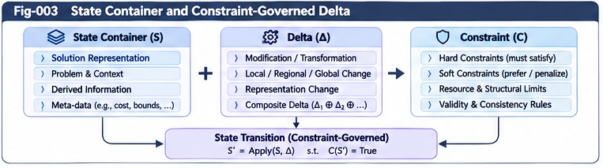
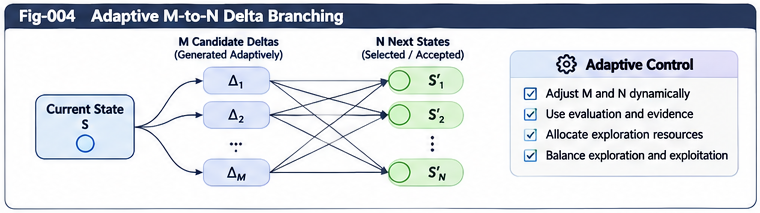

# SPEC-002 — Delta Generation and Branch Contract

**Project:** Constrained Delta Evolution (CDE)  
**Series:** Specifications  
**Status:** Proposed normative contract, v1.0.0 draft  
**Date:** 2026-11-04  
**Authors:** Sizhe Tan and GPT-Obot  
**License:** Apache-2.0  
**Normative dependency:** SPEC-001 — State Container and Constraint Contract  
**Foundational context:** CDE-001 through CDE-012, especially CDE-003, CDE-004, CDE-005, CDE-006, CDE-008, CDE-009, and CDE-011  
**Planned companions:** SPEC-003 Path Memory and Loop Control; SPEC-004 Solver and Optimization; SPEC-005 Distributed Exploration and Relay; SPEC-006 Metric and Recursive Evolution

## Abstract

This specification defines the proposed interoperable contract for **Delta generation, candidate selection, adaptive M-to-N branching, and branch outcome accounting** in Constrained Delta Evolution (CDE). It separates generated proposals, distinct Delta definitions, proposal instances, validation attempts, realized transition edges, and unique successor states. It specifies typed Delta descriptors, generator manifests, coverage declarations, directional evidence, branch selection policies, hard-constraint validation boundaries, deterministic and stochastic successor semantics, branch dispositions, event provenance, and version coherence. It also defines the limits of deduplication, deferred exploration, heuristic filtering, and safe pruning, and provides normative invariants, reference pseudocode, a 40-case conformance suite, and worked examples. This document is a contract proposal, not a claim that adaptive branching guarantees completeness, optimality, or efficiency.

**Keywords:** Constrained Delta Evolution; Delta generator; adaptive M-to-N branching; typed operators; branch contracts; generation coverage; directional fields; constraint validation; candidate deduplication; conformance.

---



*Figure 3. A typed Delta proposes a transition from a versioned State Container to a candidate successor. Hard-constraint checks and coherent-version validation determine whether the transition may be committed; directional scores may prioritize attempts but cannot substitute for feasibility.*

---



*Figure 4. Adaptive Delta branching distinguishes M proposals, Q selected attempts, N realized transition edges, N_c committed edges, and K distinct successor states. Deduplication, invalid attempts, and uncommitted edges prevent these counts from being treated as interchangeable.*

---

## 1. Normative Language and Conformance Scope

The terms **MUST**, **MUST NOT**, **REQUIRED**, **SHOULD**, **SHOULD NOT**, and **MAY** have normative meaning within the declared conformance profile.

- **MUST / MUST NOT** indicate requirements for conformance.
- **SHOULD / SHOULD NOT** indicate recommendations requiring documented justification for exceptions.
- **MAY** indicates optional functionality.

The required profile is **CDE-Delta-Branch-v1**. It assumes a conforming State Container and Constraint Contract under SPEC-001. This specification does not mandate a particular search algorithm, solver, data structure, distributed runtime, or generator implementation.

A conforming implementation MUST support:

1. typed Delta descriptors and proposal instances;
2. source-state and context version binding;
3. generator identity, version, and declared coverage scope;
4. distinction among proposals, selected attempts, realized edges, and unique successors;
5. hard-constraint and authorization checks before commit;
6. typed branch dispositions with auditable provenance;
7. explicit handling of deferral, exclusion, infeasibility, and pruning;
8. version-aware deduplication and branch accounting;
9. bounded generation and stopping semantics for each invocation;
10. negative-path conformance tests.

Optional profiles cover stochastic outcomes, multi-scale generation, distributed dispatch, and adaptive generator evolution.

## 2. Contract Boundaries

SPEC-001 governs state schemas, hard constraints, transition validation, authorization, and commit records. **SPEC-002 MUST NOT redefine a proposed Delta as an already committed state transition.**

SPEC-003 will govern path memory, NoSubtree decision reuse, Loop Back, and state revisitation. SPEC-004 will govern solver completeness, admissible bounds, optimality, and approximation claims. SPEC-005 will govern remote worker contracts, global reconciliation, and distributed failure semantics. SPEC-006 will govern metric changes and recursive generator/policy promotion.

This specification may expose fields needed by those modules, but conformance to SPEC-002 alone does not establish their stronger properties.

## 3. Core Definitions and Identity Layers

A **Delta type** defines a family of permissible state modifications or exploratory actions. A **Delta definition** is a particular operation and its parameterization. A **proposal instance** records one generator's recommendation to consider that Delta in a particular context. A **branch attempt** is a selected proposal submitted for checking or execution. A **realized edge** is an actual transition outcome recorded in the exploration graph. A **unique successor** is a distinct successor state under an explicitly declared equivalence relation.

These must not be conflated.

| Object | Identity | Meaning |
|---|---|---|
| Delta type | `delta_type_id` | Operator family and semantic contract |
| Delta definition | `delta_id` | Canonicalized operator plus parameters |
| Proposal | `proposal_id` | One generated occurrence in one context |
| Generator invocation | `invocation_id` | A bounded generation call |
| Branch attempt | `attempt_id` | One selected attempt to validate/realize a proposal |
| Transition outcome | `outcome_id` | One outcome of an attempt |
| Realized edge | `edge_id` | A recorded source–Delta–outcome–successor relation |
| State snapshot | `state_id`, `revision` | State identity under SPEC-001 |
| Branch decision | `decision_id` | Accepted, excluded, deferred, pruned, etc. |
| Evaluation | `evaluation_id` | Score and evidence under a metric version |

A Delta may be proposed more than once, and distinct proposals may refer to the same Delta definition. Multiple realized edges may converge to a single successor. A stochastic attempt may yield one sampled outcome or a set of modeled outcomes; these must be distinguished.

## 4. Formal Model

Let $S$ be a logical State Container and $\kappa$ a versioned context. A generator invocation produces a finite sequence or bounded stream of proposals:

$$
G_{\gamma}(S,\kappa,B)\longrightarrow
P=\langle p_1,\ldots,p_M\rangle,
$$

where $\gamma$ identifies the generator version and $B$ is a resource budget.

A selection policy chooses a subset or multiset of proposals for attempts:

$$
A=\mathrm{Select}_{\pi}(P,S,\kappa,B),\qquad |A|=Q.
$$

Validation and realization yield an edge multiset $E$ with $|E|=N$. Let $\equiv_\kappa$ be a declared state equivalence relation for successor accounting. Then:

$$
K=\left|\{[S']_{\equiv_\kappa}: S'\text{ is a successor in }E\}\right|.
$$

In the default **single-outcome committed-edge profile**, one attempt creates at most one committed edge, so $N\le Q\le M$ when each proposal is attempted at most once. **These inequalities do not hold universally**: a retry may create multiple attempts, a generator may yield duplicate proposals, and a nondeterministic relation may explicitly enumerate several possible edges per attempt. The implementation MUST declare its accounting mode.

The general rule is:

$$
\boxed{M\ \text{(proposals)},\quad
Q\ \text{(attempts)},\quad
N\ \text{(realized edges)},\quad
K\ \text{(unique successors)}}
$$

with each cardinality measured under documented semantics.

## 5. Typed Delta Descriptor

Every supported Delta type MUST have a versioned descriptor:

```yaml
DeltaTypeDescriptor:
  delta_type_id: string
  type_version: string
  applicable_state_schemas: [schema_ref]
  parameter_schema_ref: string
  precondition_contract_ref: string
  transition_semantics_ref: string
  declared_effects: [effect]
  required_capabilities: [capability]
  outcome_mode: deterministic | sampled | enumerated | external
  canonicalization_contract_ref: optional
  proof_obligations: [string]
  provenance_ref: string
```

A descriptor MUST identify what it may change, which states it accepts, and how outcomes are interpreted. If a Delta may change hard constraints or schema versions, it requires the separate authority and migration contracts of SPEC-001 and later specifications.

### 5.1 Delta definition

A Delta definition MUST bind a type and its parameters:

```yaml
DeltaDefinition:
  delta_id: string
  delta_type_id: string
  type_version: string
  parameters: typed
  dependency_refs: [string]
  definition_digest: string
```

An implementation MUST define the identity scope. It MAY use content addressing, registry identifiers, or canonical representations. Two syntactically different parameter objects MAY be semantically equivalent, but the implementation MUST NOT infer equivalence without a declared rule.

### 5.2 Preconditions

Preconditions MAY depend on the source state, path context, resources, and external snapshots. Their dependencies MUST be declared. An applicable Delta type is not necessarily feasible at every state of the supported schema.

### 5.3 Effects and side effects

A Delta descriptor MUST declare any external or irreversible effects. Exploratory candidate generation SHOULD be side-effect-free. If realization can cause an external effect, it MUST use an explicit execution/commit protocol; a proposal MUST NOT trigger that effect by itself.

## 6. Generator Manifest Contract

A Delta generator MUST publish a manifest:

```yaml
DeltaGeneratorManifest:
  generator_id: string
  generator_version: string
  implementation_digest: string
  accepted_state_schemas: [schema_ref]
  produced_delta_types: [delta_type_ref]
  context_dependencies: [string]
  generation_modes: [local, regional, long_range, relay]
  coverage_claim: none | partial | exhaustive_under_conditions
  coverage_assumptions: [string]
  deterministic_given_seed: boolean
  resource_contract_ref: string
  required_capabilities: [string]
  provenance_ref: string
```

The generator MUST declare whether it is intended to enumerate all applicable Deltas or only a heuristic subset. A `coverage_claim` of `exhaustive_under_conditions` MUST name the conditions and evidence supporting the claim.

### 6.1 No implicit completeness

A generator that emits ten high-scoring candidates from a million possible Deltas is not complete merely because it has high empirical yield. A solver relying on exhaustive coverage MUST independently establish the generator's coverage assumptions.

### 6.2 Version and dependency pinning

An invocation MUST bind a generator version, state revision, applicable constraint bundle, and relevant context versions. A change to any future-relevant dependency MAY invalidate cached proposals or prior coverage claims.

### 6.3 Generator determinism

A generator MAY be stochastic. If it claims deterministic replay, it MUST define the seed and dependency snapshot semantics. A seed alone may be insufficient if external model versions or nondeterministic runtimes are unpinned.

## 7. Generation Invocation Contract

```yaml
GenerationInvocation:
  invocation_id: string
  source_state_id: string
  source_state_revision: string
  generator_id: string
  generator_version: string
  constraint_bundle_id: string
  context_version_refs: [string]
  generation_scope: typed
  resource_budget: typed
  random_seed: optional
  requested_candidate_limit: optional
  coverage_mode: none | partial | exhaustive_under_conditions
  requester_id: string
  authorization_ref: string
  provenance_ref: string
```

The generator MUST respect its declared resource limits or report a typed budget exception. An invocation MUST end with a terminal status such as `COMPLETE`, `PARTIAL_BUDGET`, `CANCELLED`, `FAILED`, or `DEFERRED`.

### 7.1 Streaming generators

A streaming generator MAY emit proposals incrementally. It MUST provide stable sequence identifiers and a terminal record so downstream consumers can distinguish a completed enumeration from a truncated stream.

### 7.2 Cancellation

Cancellation MUST NOT imply that all admissible candidates were generated. The coverage report MUST reflect incomplete execution.

### 7.3 Empty result

A zero-proposal invocation MUST distinguish:

- `EXHAUSTED_UNDER_CLAIMED_SCOPE`;
- `NO_CANDIDATES_OBSERVED`;
- `BUDGET_EXHAUSTED`;
- `GENERATOR_ERROR`;
- `NOT_APPLICABLE`.

Only the first status, under valid exhaustive assumptions, supports a claim that no further candidates exist in the declared scope.

## 8. Proposal Record Contract

Each proposal MUST be individually traceable:

```yaml
DeltaProposal:
  proposal_id: string
  invocation_id: string
  proposal_sequence: integer
  source_state_id: string
  source_state_revision: string
  delta_id: string
  delta_type_id: string
  delta_payload_ref: string
  generator_id: string
  generator_version: string
  generation_scale: local | regional | long_range | relay | unspecified
  evidence_refs: [string]
  declared_preconditions: [string]
  score_refs: [string]
  context_version_refs: [string]
  provenance_ref: string
```

The `proposal_id` MUST be unique within its declared namespace. Duplicate `delta_id` values are permitted when separate proposals represent separate evidence, contexts, or generator occurrences.

A proposal MAY contain an estimated value or feasibility likelihood. It MUST NOT claim that those estimates are hard-constraint validation results.

## 9. Directional Evidence and Multi-Scale Generation

A directional field may guide which Deltas are proposed or selected. CDE-006 distinguishes local, regional, long-range, and cross-domain/Relay generation.

A directional evidence record SHOULD include:

```yaml
DirectionalEvidence:
  evidence_id: string
  source_context_ref: string
  target_hypothesis_ref: optional
  perspective_id: optional
  score_or_distribution: typed
  uncertainty: typed
  evidence_strength: weak | moderate | strong | unknown
  metric_version: string
  method_version: string
  provenance_ref: string
```

**Normative separation:** directional evidence is not a proof of feasibility, identity, reachability, or optimality. A low directional score MAY affect branch priority but MUST NOT be used as a sound pruning certificate without a separate proof obligation under SPEC-004.

### 9.1 Granularity labels

Generation scale labels MUST have documented domain meaning. A `long_range` Delta in a graph, route schedule, or metric space may refer to different notions of distance.

### 9.2 Mixed portfolios

A generator portfolio MAY combine multiple scales. It SHOULD report per-generator yield, duplicate rate, feasibility rate, coverage, cost, and contribution to independent task outcomes.

### 9.3 Weak evidence handling

Weak evidence MAY justify exploration or a request for more evidence. It MUST NOT be silently promoted to a hard constraint or definitive conclusion.

## 10. Branch Selection Policy

A branch selector chooses proposals for further evaluation or execution. Its contract MUST declare:

```yaml
BranchSelectionPolicy:
  policy_id: string
  policy_version: string
  input_contract_ref: string
  metric_version_refs: [string]
  selection_method: typed
  resource_budget_ref: string
  fairness_or_coverage_claim: optional
  pruning_authority: none | certified
  provenance_ref: string
```

A selector MAY prioritize proposals by heuristic score, uncertainty, diversity, cost, coverage, or an authorized multi-objective rule.

### 10.1 Ranking versus filtering

Ranking changes order. Filtering may prevent an attempt from occurring. The implementation MUST record whether a proposal was `SELECTED`, `DEFERRED`, `EXCLUDED_BY_POLICY`, or `PRUNED_WITH_CERTIFICATE`.

### 10.2 No implicit pruning authority

A selector with `pruning_authority: none` MUST NOT emit a sound-pruning disposition. A selector with certified authority MUST reference a verifier and a valid certificate under the current objective/constraint context.

### 10.3 Fairness claims

If a policy claims fair exploration, it MUST define the fairness property and its scope. A policy that repeatedly favors high-scoring branches may starve low-scoring but necessary branches.

## 11. Branch Dispositions

The following dispositions are normative:

| Disposition | Meaning | Commit permitted? | Future re-evaluation? |
|---|---|---|---|
| `PROPOSED` | Generated candidate | No | Yes |
| `SELECTED` | Chosen for attempt | Not yet | Yes |
| `DEFERRED` | Postponed without rejection | No | Yes |
| `EXCLUDED_BY_POLICY` | Not explored under current policy | No | Depends on policy |
| `REJECTED_TYPE` | Invalid Delta type or schema | No | After correction |
| `REJECTED_PRECONDITION` | Preconditions fail | No | Under changed context |
| `INFEASIBLE` | Applicable hard constraint fails | No | Under changed context |
| `UNAUTHORIZED` | Insufficient authority | No | With valid authority |
| `STALE_CONTEXT` | Version mismatch | No | After rebase/revalidation |
| `VALIDATION_UNKNOWN` | Required hard check indeterminate | No | After more evidence |
| `VALIDATION_ERROR` | Checker failure | No | After repair |
| `PRUNED_WITH_CERTIFICATE` | Proven noncompetitive under declared solver contract | No | If assumptions change |
| `REALIZED` | Transition outcome recorded | Depends on edge type | N/A |
| `COMMITTED` | Successor committed under SPEC-001 | Yes | N/A |
| `CANCELLED` | Work cancelled | No | Yes |
| `FAILED_EXECUTION` | Runtime attempt failed | No | Possibly |

`EXCLUDED_BY_POLICY`, `INFEASIBLE`, `DEFERRED`, and `PRUNED_WITH_CERTIFICATE` MUST NOT be conflated. A path-local `EXCLUDE` decision under NoSubtree semantics is further specified by SPEC-003 and is not identical to global policy exclusion.

### 11.1 Disposition transitions

A deferred proposal MAY later become selected through a new decision event. A failed validation MAY be retried under new evidence. Historical dispositions MUST remain immutable; a new event records the new decision.

### 11.2 Failed proposals are evidence

Implementations SHOULD retain failure and rejection reasons for negative knowledge and future Structural Relay, subject to retention and privacy policies.

## 12. Branch Attempt Contract

```yaml
BranchAttempt:
  attempt_id: string
  proposal_id: string
  source_state_revision: string
  delta_definition_digest: string
  constraint_bundle_id: string
  expected_context_versions: [string]
  selection_decision_id: string
  execution_mode: validate_only | realize | commit
  budget_ref: string
  idempotency_key: string
  worker_id: optional
  provenance_ref: string
```

An attempt MUST resolve the proposal and governing versions. If the source or constraints have changed incompatibly, the attempt MUST fail with `STALE_CONTEXT` or be explicitly rebased and revalidated.

### 12.1 Validation-only attempts

A validation-only attempt MAY produce a candidate and report without committing it. Such attempts MUST NOT be counted as committed edges.

### 12.2 Retries

Retries MUST be distinguishable from independent proposals. The idempotency contract of SPEC-001 governs repeated committed effects. A retry MAY consume additional computation even when no additional edge is committed.

## 13. Transition Outcomes and Edge Records

A realized edge SHOULD be represented by:

```yaml
BranchEdge:
  edge_id: string
  attempt_id: string
  proposal_id: string
  source_state_id: string
  source_state_revision: string
  delta_id: string
  outcome_id: string
  successor_state_id: string
  successor_state_revision: string
  edge_kind: observed | committed | modeled
  validation_report_id: optional
  commit_record_id: optional
  context_version_refs: [string]
  provenance_ref: string
```

The edge kind MUST be explicit:

- `modeled`: a possible transition in a model, not necessarily executed;
- `observed`: an outcome was observed but may not be committed;
- `committed`: a successor was accepted under SPEC-001.

Only `committed` edges may be counted as committed transitions. A modeled stochastic branch MUST NOT be presented as an observed execution.

### 13.1 Stochastic semantics

A sampled stochastic attempt normally yields one observed outcome, while a transition model may enumerate several possible outcomes. The implementation MUST declare which accounting mode it uses.

### 13.2 Multiple successor states

A compound Delta MAY intentionally produce several candidate successor states for exploration. Each must be represented by distinct outcome/edge records or a declared batch contract. A batch does not bypass individual feasibility checks.

## 14. Adaptive M-to-N Branch Accounting

Every completed invocation MUST produce an accounting summary:

```yaml
BranchAccounting:
  invocation_id: string
  generated_proposal_count_M: integer
  distinct_delta_definition_count_D: integer
  selected_attempt_count_Q: integer
  realized_edge_count_N: integer
  committed_edge_count_Nc: integer
  unique_successor_count_K: integer
  equivalence_contract_ref: string
  outcome_mode: single_sample | enumerated | batch | mixed
  disposition_counts: map
  budget_consumed: typed
  generation_terminal_status: string
  provenance_ref: string
```

All counts MUST be nonnegative integers. Their definitions MUST remain stable within a report.

### 14.1 Count reconciliation

For a complete invocation, every proposal MUST have a traceable lifecycle. The report MUST explain the mapping from proposals to attempts, attempts to outcomes, and outcomes to edges. It MUST NOT infer one-to-one correspondence when duplicates, retries, or multi-outcome semantics are present.

### 14.2 Distinct Delta count

$D\le M$ for a finite proposal sequence when Delta identity is defined within the invocation. This does not imply $D\le Q$ if retries or repeated attempts are allowed.

### 14.3 Unique successor count

$K\le N$ when computed over the same edge set and equivalence contract. If `unique_successor_count_K` is computed over committed edges, the report MUST identify that subset.

### 14.4 Zero and partial cases

An invocation with $M=0$ MAY be valid. A partial stream MUST report that its counts are partial; it MUST NOT imply exhaustive coverage.

## 15. Deduplication and Coalescence

Deduplication may occur at several layers:

1. identical proposal instances;
2. equivalent Delta definitions;
3. equivalent transition effects;
4. equivalent successor states;
5. future-equivalent solver subproblems.

These are different claims.

### 15.1 Proposal deduplication

The system MAY avoid re-evaluating identical proposals under identical contexts. It SHOULD retain links to all contributing generator occurrences and evidence sources.

### 15.2 Delta deduplication

Equivalent Delta definitions MAY be coalesced under a declared canonicalization contract. Their provenance MUST remain accessible.

### 15.3 State coalescence

Two successor states MAY share a node only if the equivalence relation is valid for the intended use. A common payload hash is not automatically sufficient.

### 15.4 Future equivalence

DP-style future-equivalence requires a stronger proof obligation under SPEC-004. This specification MUST NOT be interpreted as authorizing arbitrary state merging for optimization.

## 16. Path Memory and NoSubtree Interface

SPEC-002 records proposal and branch decisions. SPEC-003 determines which decisions are prohibited from repetition along a path.

The branch interface SHOULD carry:

```yaml
PathDecisionContext:
  path_context_id: string
  resolved_delta_decision_refs: [string]
  accepted_decision_refs: [string]
  excluded_decision_refs: [string]
  state_visit_refs: [string]
  loop_policy_ref: string
```

A generator MAY use this context to suppress already resolved path-local decisions. It MUST NOT assume that suppressing repeated Delta identities prevents all cycles.

### 16.1 Scope of exclusion

An `EXCLUDE` decision can be local to a path, search episode, or policy version. The scope MUST be declared. An exclusion on one path MUST NOT automatically become a global impossibility claim.

### 16.2 Deferral versus resolution

`DEFERRED` does not normally resolve a constructive Yes/No decision. A solver that treats deferral as exclusion must declare and justify that behavior under its completeness contract.

## 17. Constraint Checking and Commit

SPEC-001 remains authoritative for hard-constraint validation. A branch selector or generator MAY perform cheap preliminary checks, but these do not replace required commit validation.

The normative sequence is:

```text
Generate
  -> Record Proposal
  -> Select / Defer / Exclude
  -> Check Type and Preconditions
  -> Construct Candidate Successor
  -> Validate Hard Constraints
  -> Check Authorization and Context Versions
  -> Commit (if requested and permitted)
  -> Record Edge and Evidence
```

An implementation MAY reorder safe preliminary checks for efficiency. It MUST NOT expose an unvalidated candidate as a committed successor.

### 17.1 Two validation levels

- **Preflight validation:** optional early screening that may reject obviously invalid proposals.
- **Commit validation:** required, authoritative check under SPEC-001.

A preflight `PASS` is not a commit certificate.

### 17.2 External side effects

If a Delta affects an external system, the implementation MUST define how feasibility checks, execution, compensation, and commit are coordinated. It MUST NOT claim atomicity beyond the actual transactional boundary.

## 18. Objective and Metric Versioning

A proposal MAY carry one or more heuristic scores. Each score MUST identify the metric version, context, and provenance needed for interpretation.

A policy MUST NOT compare raw scores across incompatible metric versions without a validated mapping or re-evaluation.

If a metric changes during an invocation, the system MUST either pin the old metric for that invocation or record a new selection context. Existing optimality bounds and pruning certificates MUST be revalidated when their assumptions change.

### 18.1 Multi-objective selection

A policy MAY use Pareto dominance, lexicographic ordering, or authorized scalarization. The ordering rule MUST be versioned. A candidate's feasibility remains independent of its rank.

## 19. Coverage, Fairness, and Completeness Claims

A generator's coverage claim and a solver's completeness claim are distinct.

A complete solver cannot find an omitted reachable successor if the generator never exposes it. Conversely, an exhaustive generator does not guarantee completion if the selector indefinitely postpones some branches.

### 19.1 Exhaustive coverage certificate

A generator claiming exhaustive coverage SHOULD provide:

- finite or otherwise characterized candidate universe;
- enumeration rule;
- preconditions for exhaustiveness;
- completion marker;
- duplicate-handling semantics;
- proof or test evidence.

### 19.2 Fairness

A policy claiming fairness MUST state whether it concerns proposals, Delta types, states, or task groups, and whether the guarantee is eventual, probabilistic, or budget-bounded.

### 19.3 Heuristic exclusions

`EXCLUDED_BY_POLICY` is not proof of impossibility. If completeness matters, the solver must retain a mechanism to revisit excluded candidates or prove that their omission is safe.

## 20. Resource Budget Contract

A generation or branching budget MAY constrain:

- number of proposals;
- number of attempts;
- wall-clock time;
- CPU/GPU compute;
- memory;
- external API calls;
- validation cost;
- monetary cost;
- maximum recursion depth;
- maximum active branches.

A conforming invocation MUST declare which resources are counted and report consumed amounts. It SHOULD include coordination and validation overhead in comparisons of overall efficiency.

### 20.1 Budget exhaustion

Budget exhaustion MUST be a typed terminal status. It MUST NOT be reported as exhaustion of the candidate universe unless a valid exhaustive-coverage certificate exists.

### 20.2 Adaptive allocation

An orchestrator MAY reallocate budgets among generators or branches. Such changes MUST be logged with policy version and authorization.

## 21. Distributed Branching Interface

A remote worker MAY receive a branch attempt under a Delta Exploration Contract. The dispatch envelope SHOULD include:

```yaml
DeltaBranchDispatch:
  task_id: string
  proposal_id: string
  source_state_ref: string
  delta_definition_ref: string
  constraint_bundle_id: string
  context_version_refs: [string]
  metric_version_refs: [string]
  resource_budget: typed
  validation_requirements: [string]
  result_contract_ref: string
  idempotency_key: string
  lease_or_deadline: optional
  provenance_ref: string
```

This is an interface sketch; SPEC-005 defines the full distributed protocol.

### 21.1 Worker trust

A worker's claim of feasibility or score MUST NOT be accepted as a global commit without the validation required by the governing deployment.

### 21.2 Global coupling

Independently valid local branches may conflict when combined. Global constraint reconciliation is required before claiming a combined feasible solution.

### 21.3 Stale results

Results evaluated against obsolete source, constraint, or metric versions MUST be marked stale or revalidated.

## 22. Generator Evolution Interface

A generator may itself be updated by a meta-Delta as proposed in CDE-011:

$$
G_{k+1}=T_G(G_k,\delta_G).
$$

SPEC-002 requires that each generator version have a distinct manifest and immutable dependency identity. A candidate generator MUST NOT replace an active version merely because it produces higher internal scores.

Promotion, independent validation, and rollback belong to SPEC-006.

### 22.1 Changed coverage

Adding or removing operators can change reachability. A coverage certificate for $G_k$ MUST NOT automatically be reused for $G_{k+1}$.

### 22.2 Changed equivalence

A representation or canonicalization change may invalidate deduplication, path memory, and DP caches. The update MUST declare those effects.

### 22.3 Negative evidence

Failed generator proposals and low-yield operator families SHOULD be retained as evidence for future learning, without converting context-specific failure into universal exclusion.

## 23. Reference Algorithm: Generate and Realize

```text
function GENERATE_AND_BRANCH(invocation, selector, state_registry):
    source = resolve_pinned_state(invocation)
    manifest = resolve_generator_manifest(invocation)

    verify_schema_and_authorization(source, manifest, invocation)
    proposals = []
    attempts = []
    edges = []

    stream = generator.run(
        state=source,
        context=invocation.context_version_refs,
        scope=invocation.generation_scope,
        budget=invocation.resource_budget,
        seed=invocation.random_seed
    )

    for candidate_delta in stream:
        proposal = record_typed_proposal(
            invocation_id=invocation.invocation_id,
            source_revision=source.revision,
            delta=candidate_delta,
            generator_version=manifest.generator_version
        )
        proposals.append(proposal)

    terminal_status = stream.terminal_status

    decisions = selector.decide(
        proposals,
        pinned_metric_versions=invocation.metric_version_refs,
        remaining_budget=invocation.resource_budget
    )

    for decision in decisions:
        record_decision(decision)

        if decision.disposition != SELECTED:
            continue

        attempt = create_attempt(decision.proposal)
        attempts.append(attempt)

        result = spec001_validate_and_apply(
            source=source,
            delta=attempt.delta,
            constraints=invocation.constraint_bundle_id,
            expected_context=invocation.context_version_refs,
            idempotency_key=attempt.idempotency_key
        )

        record_attempt_result(attempt, result)

        for outcome in result.realized_outcomes:
            edge = record_edge(
                attempt=attempt,
                outcome=outcome,
                edge_kind=outcome.kind
            )
            edges.append(edge)

    return reconcile_accounting(
        invocation=invocation,
        proposals=proposals,
        attempts=attempts,
        edges=edges,
        equivalence_contract=invocation.equivalence_contract,
        terminal_status=terminal_status
    )
```

The pseudocode assumes that the selected SPEC-001 operation supports the requested outcome mode. It does not establish completeness, fairness, or optimality.

## 24. Reference Algorithm: Safe Proposal Coalescence

```text
function COALESCE_PROPOSALS(proposals, canonicalization_contract):
    groups = map()

    for proposal in proposals:
        key = canonicalize_delta(
            proposal.delta,
            canonicalization_contract,
            proposal.context_versions
        )

        if key is UNKNOWN:
            groups[proposal.proposal_id] = [proposal]
        else:
            groups[key].append(proposal)

    for group in groups:
        representative = choose_representative(group)
        preserve_all_provenance(group, representative)
        emit_group(representative, group)

    return groups
```

A canonicalization contract MUST specify the contexts in which equivalence is valid. If equivalence cannot be established, the implementation MUST avoid unsafe coalescence.

## 25. Formal Invariants

### INV-DB-01 — Proposal provenance

Every recorded proposal identifies its generator invocation, source state revision, Delta definition, and relevant versions.

### INV-DB-02 — Type validity

No selected attempt is committed through an unknown or incompatible Delta type.

### INV-DB-03 — Hard-constraint supremacy

No heuristic score or policy preference authorizes an otherwise invalid commit.

### INV-DB-04 — Lifecycle traceability

Every committed edge traces to an attempt, proposal, validation report, and commit record.

### INV-DB-05 — Count integrity

All reported branch counts are derived from identifiable records under a declared accounting mode.

### INV-DB-06 — No silent exhaustive claim

Partial, failed, or budget-limited generation is not labeled exhaustive without an independently valid completion condition.

### INV-DB-07 — Disposition integrity

Deferral, exclusion, infeasibility, and certified pruning are distinct outcomes.

### INV-DB-08 — Version coherence

Proposal evaluation and realization use compatible source, constraint, metric, and context versions.

### INV-DB-09 — Safe coalescence

Deduplication preserves provenance and does not assert stronger equivalence than established.

### INV-DB-10 — Stochastic honesty

Modeled, observed, and committed edges are not conflated.

### INV-DB-11 — Bounded invocation

Every bounded invocation has a terminal status and resource report.

### INV-DB-12 — No implicit solver guarantee

Generator or branch contract conformance does not assert completeness, optimality, or approximation guarantees.

## 26. Conditional Properties

**Proposition A — Count bound in a restricted profile.** If an invocation emits $M$ proposals, each proposal is attempted at most once, and each attempt produces at most one committed edge, then $N_c\le Q\le M$.

*Reason:* attempts are selected from proposals, and committed edges are a subset of single-outcome attempts.

This bound does not apply to unrestricted retries or multi-outcome edge enumeration.

**Proposition B — Unique-successor bound.** If $K$ counts equivalence classes of successors of a fixed set of $N$ edges, then $K\le N$.

*Reason:* a partition cannot contain more nonempty classes than elements.

**Proposition C — Conditional feasibility preservation.** If SPEC-001 validation is sound and every committed edge is validated under compatible constraints, then committed successors satisfy the declared hard constraints.

This does not establish generator completeness or solver optimality.

**Proposition D — Exhaustive generator plus fair solver.** In a finite search graph, if a generator exposes every admissible successor, the solver eventually explores every required edge, and state merging/pruning preserves reachability, then a reachable goal will be found if the search is allowed to complete.

This is a conditional search-theoretic statement; SPEC-002 alone does not prove its premises.

## 27. Conformance Profiles

### 27.1 CDE-Delta-Branch-v1 — Required

Supports typed Deltas, generator manifests, bounded invocations, proposal records, selection dispositions, branch attempts, realized-edge accounting, version coherence, and SPEC-001 validation.

### 27.2 CDE-Delta-Stochastic-v1 — Optional

Adds stochastic outcome distributions, sampled-versus-modeled edge distinction, and uncertainty metadata.

### 27.3 CDE-Delta-MultiScale-v1 — Optional

Adds local/regional/long-range/Relay generation labels, directional evidence, and per-scale budget reporting.

### 27.4 CDE-Delta-Distributed-v1 — Optional

Adds remote dispatch, worker provenance, retry reconciliation, and stale-result handling, subject to SPEC-005.

### 27.5 CDE-Delta-EvolvingGenerator-v1 — Optional

Adds immutable generator version histories and meta-Delta proposal interfaces, subject to SPEC-006 promotion controls.

Implementations MUST declare supported profiles and MUST NOT imply optional conformance from core support.

## 28. Conformance Test Suite

The following 40 tests form a proposed baseline.

| ID | Test | Expected behavior |
|---|---|---|
| DB-001 | Register valid Delta type | Accepted |
| DB-002 | Unknown Delta type | Rejected |
| DB-003 | Invalid Delta parameter schema | Rejected |
| DB-004 | Delta applied to incompatible state schema | Rejected |
| DB-005 | Missing precondition contract | Rejected or nonconformant |
| DB-006 | Generator manifest missing version | Rejected |
| DB-007 | Generator claims exhaustiveness without assumptions | Claim rejected |
| DB-008 | Generate zero proposals with valid exhaustive completion | Exhaustion recorded in scope |
| DB-009 | Generate zero proposals after budget timeout | Not labeled exhaustive |
| DB-010 | Stream cancelled halfway | Partial status and counts |
| DB-011 | Same Delta emitted twice | Distinct proposals, shared Delta identity |
| DB-012 | Different Deltas share successor | Two edges, one unique successor |
| DB-013 | Proposal contains high heuristic score but violates constraint | No commit |
| DB-014 | Required hard check returns UNKNOWN | No commit |
| DB-015 | Required hard check returns ERROR | No commit |
| DB-016 | Selected attempt uses stale source revision | Rejected or revalidated |
| DB-017 | Metric version changes after ranking | Selection context pinned or refreshed |
| DB-018 | Policy defers proposal | `DEFERRED`, not `INFEASIBLE` |
| DB-019 | Policy excludes proposal | `EXCLUDED_BY_POLICY`, not proof of pruning |
| DB-020 | Selector emits prune without certificate | Rejected |
| DB-021 | Certified pruning with mismatched objective | Rejected |
| DB-022 | Retry same idempotent attempt | No duplicate committed effect |
| DB-023 | Two attempts for one proposal | Both attempts traceable |
| DB-024 | Sampled stochastic attempt | Observed outcome recorded |
| DB-025 | Enumerated stochastic model | Modeled edges not counted as commits |
| DB-026 | Multiple modeled outcomes from one attempt | Accounting mode explicit |
| DB-027 | Duplicate proposal coalescence | All provenance retained |
| DB-028 | Unsafe state-equivalence claim | Coalescence refused |
| DB-029 | Same payload, different path context | No assumed future equivalence |
| DB-030 | Local and long-range proposals | Scale labels preserved |
| DB-031 | Weak directional evidence | Cannot override hard checks |
| DB-032 | Generator version updated | Old coverage claim not automatically reused |
| DB-033 | External side effect during proposal generation | Rejected unless explicitly authorized contract |
| DB-034 | Resource budget exhausted | Typed partial/terminal status |
| DB-035 | Complete invocation count reconciliation | M, D, Q, N, Nc, K consistent |
| DB-036 | Edge without proposal or attempt | Conformance failure |
| DB-037 | Commit without SPEC-001 validation | Rejected |
| DB-038 | Distributed worker returns stale result | Marked stale/revalidated |
| DB-039 | Candidate deferred then reconsidered | New decision, historical event retained |
| DB-040 | Generator/branch conformance used to claim universal optimality | Unsupported claim rejected |

### 28.1 Required fixtures

A conformance harness SHOULD include:

- a finite binary assignment tree;
- an adaptive M-to-N generator with duplicate proposals;
- a graph with two distinct Deltas reaching one state;
- a stochastic operator with modeled and sampled outcomes;
- a multi-scale peak search;
- a constrained routing example with hard capacity limits;
- a stale-version distributed worker;
- a heuristic selector attempting unsafe pruning.

### 28.2 Failure injection

The harness SHOULD inject generator crashes, partial streams, invalid schemas, missing evidence, stale constraints, and duplicate retries. Passing only happy-path tests is insufficient.

## 29. Worked Example A — BTP-Style Constructive Branching

Consider a finite set of assignment decisions $d_1,d_2,d_3$. A generator proposes `ACCEPT(d_i)` and `EXCLUDE(d_i)` for unresolved decisions.

A path-local decision registry records which decisions have been resolved. At each step, the generator SHOULD avoid proposing already resolved decisions under the fixed constructive profile. The exact NoSubtree rule belongs to SPEC-003.

Suppose $M=4$ proposals are emitted; one duplicates a Delta definition, one is infeasible, and two are selected for attempts. If one attempt commits a successor and the other fails validation, then:

- $M=4$;
- $D=3$ distinct Delta definitions;
- $Q=2$ selected attempts;
- $N_c=1$ committed edge.

The count of all realized edges $N$ depends on whether the implementation also records modeled or observed noncommitted outcomes; the accounting mode must say so.

## 30. Worked Example B — Multi-Scale Peak Search

A generator portfolio emits:

- five local perturbations;
- three regional jumps;
- two long-range probes.

Thus $M=10$ proposals. A selector chooses six attempts under a fixed evaluation budget. Two attempts yield infeasible states, one is cancelled, and three produce committed successors. If two committed successors are equivalent under a declared state equivalence, then $N_c=3$ and $K_c=2$ unique committed successors.

The selector may use directional scores to prioritize probes, but a low-scoring candidate is not safely prunable unless an appropriate certificate exists.

## 31. Worked Example C — School-Bus Routing

A school-bus assignment state contains routes, vehicle availability, student coverage, and constraint versions. Candidate Deltas include:

1. move a stop between buses;
2. swap route segments;
3. merge two routes;
4. split an overloaded route;
5. introduce a regional multi-stop exchange.

A generator can emit all or a heuristic subset of these operations. Each proposal records its operator type and source state revision.

A candidate route merge may reduce fleet count but violate ride-time or capacity constraints. It must be marked `INFEASIBLE`, not `COMMITTED`. A regional move may require global revalidation because it affects shared resources.

Different generators may discover the same feasible schedule. Their proposals and evidence remain distinct even if the resulting state is coalesced.

## 32. Worked Example D — Metric Discovery

A metric State Container holds a versioned evaluation definition. A metric Delta proposes a new weight, feature, or scoring structure. SPEC-002 can generate and branch over metric candidates, but it cannot certify that a new metric is better.

A metric candidate may be structurally valid and satisfy its hard governance constraints while still failing independent empirical validation. Such a candidate is an admissible *metric-state transition*, not an approved production metric.

Promotion and external validation belong to SPEC-006 and CDE-007.

## 33. Worked Example E — Distributed Method Relay

Worker A proposes a local-search Delta operator, Worker B proposes a long-range operator, and Worker C independently evaluates both.

The distributed coordinator records:

- source state and constraint versions;
- generator and proposal identities;
- validation reports;
- selected attempts and outcomes;
- method applicability conditions;
- negative results;
- any unresolved Leftover Relay tasks.

A method that works on one worker's domain is not automatically adopted elsewhere. Receiving-side validation remains required.

## 34. Security, Safety, and Governance

A generator may be untrusted. It may propose malformed Deltas, exploit score functions, request excessive resources, or embed external effects.

A conforming implementation MUST enforce:

- schema and parameter validation;
- capability-scoped Delta types;
- hard-constraint checks before commit;
- provenance and immutable event records;
- resource limits;
- separation of proposal authority from commit authority;
- version coherence;
- safe handling of untrusted external code and Relay artifacts.

If a generator proposes a change to its own authorization or to a hard constraint, that proposal MUST be routed to a separately governed contract rather than executed as an ordinary task Delta.

### 34.1 Privacy-sensitive exploration

Weak associations, structural similarity, or directional evidence MUST NOT be silently converted into definitive identity claims. Domain-specific privacy and evidentiary constraints apply independently of branch scores.

## 35. Performance and Implementation Guidance

An implementation MAY improve efficiency through:

- lazy generation;
- early precondition screening;
- proposal batching;
- duplicate detection;
- cached evaluation under pinned versions;
- per-generator budgets;
- speculative validation;
- incremental constraint checks;
- specialized solver adapters.

These optimizations MUST preserve required provenance, outcome distinctions, and commit safety. Caching MUST be invalidated when its future-relevant dependencies change.

A useful runtime report SHOULD include:

| Measure | Interpretation |
|---|---|
| Proposal yield | Generated proposals per invocation |
| Distinct Delta rate | Unique Delta definitions / proposals |
| Attempt rate | Attempts / proposals |
| Feasibility rate | Valid candidates / attempts |
| Commit rate | Committed edges / attempts |
| Successor diversity | Unique successors / realized edges |
| Coverage estimate | Declared and measured coverage, if meaningful |
| Directional calibration | Relationship between predicted and observed value |
| Total cost | Generation + validation + execution + orchestration |
| Reuse rate | Validated reuse of previous proposals or methods |

These are descriptive metrics, not universal quality measures.

## 36. Open Issues and Research Questions

1. Which canonicalization methods are safe for complex, path-sensitive Deltas?
2. Can exhaustive generator coverage be certified for useful operator languages?
3. How should probabilistic generation coverage be reported?
4. Which fairness rules are practical for dynamically expanding branch sets?
5. When is state coalescence beneficial without compromising solver correctness?
6. How should multiple directional fields be combined under different perspectives?
7. Can generator portfolios adapt while preserving declared completeness properties?
8. What is the best way to account for stochastic and enumerated outcomes in shared dashboards?
9. How should weak evidence influence exploration without becoming unsafe pruning?
10. When does distributed branch generation outperform local generation after coordination costs?
11. How should recursive generator evolution trigger invalidation of prior coverage and equivalence claims?
12. What evidence is needed to show that CDE branching contracts improve interoperability over existing solver interfaces?

## 37. Implementation Checklist

- [ ] SPEC-001 state and constraint contracts are implemented.
- [ ] Every Delta type has a versioned descriptor.
- [ ] Every generator has a manifest and coverage declaration.
- [ ] Invocations bind source state and context versions.
- [ ] Proposal IDs are distinct from Delta definition IDs.
- [ ] Attempts are distinct from proposals.
- [ ] Realized edges are distinct from committed edges.
- [ ] Unique successors use a declared equivalence contract.
- [ ] Stochastic modeled and observed outcomes are distinguished.
- [ ] Hard constraints and authorization govern commit.
- [ ] Deferred, excluded, infeasible, and pruned outcomes remain distinct.
- [ ] Heuristic scores cannot act as uncertified pruning bounds.
- [ ] Generator partial completion is not mislabeled exhaustive.
- [ ] Duplicate coalescence preserves provenance.
- [ ] Resource budgets and consumed cost are reported.
- [ ] Historical events remain immutable.
- [ ] Generator changes are versioned and invalidate affected claims.
- [ ] Negative-path conformance tests are executed.
- [ ] Solver guarantees are claimed only under their own contracts.

## 38. Conclusion

SPEC-002 establishes a precise contract for the step between **having a state** and **deciding which constrained transitions to explore**. Its central requirement is to keep the full lifecycle visible:

$$
\boxed{
\text{Generate}
\rightarrow
\text{Propose}
\rightarrow
\text{Select}
\rightarrow
\text{Validate}
\rightarrow
\text{Realize}
\rightarrow
\text{Commit / Record}
}
$$

The cardinalities $M$, $Q$, $N$, and $K$ describe different stages and must not be treated as interchangeable. Delta identity is not proposal identity; proposal identity is not branch identity; and successor equality is not necessarily future equivalence.

The specification permits adaptive M-to-N branching, multi-scale directional generation, stochastic outcomes, solver-neutral orchestration, and distributed exploration while preserving a conservative boundary: **a candidate is not a valid committed transition until the governing State Container and Constraint Contract permits it**.

The next specification, **SPEC-003 — Path Memory and Loop Control Contract**, will formalize path-local decision resolution, NoSubtree, state revisitation, and controlled Loop Back.

---

## Appendix A — Minimal JSON-Compatible Example

```json
{
  "invocation_id": "gen-042",
  "source_state_id": "state-017",
  "source_state_revision": "r3",
  "generator_id": "routing-operators",
  "generator_version": "1.0.0",
  "constraint_bundle_id": "routing-constraints-v2",
  "proposals": [
    {
      "proposal_id": "p-001",
      "delta_id": "swap-route-segment-A",
      "delta_type_id": "route-segment-swap",
      "generation_scale": "regional"
    },
    {
      "proposal_id": "p-002",
      "delta_id": "swap-route-segment-A",
      "delta_type_id": "route-segment-swap",
      "generation_scale": "regional"
    }
  ],
  "accounting": {
    "generated_proposal_count_M": 2,
    "distinct_delta_definition_count_D": 1,
    "selected_attempt_count_Q": 1,
    "realized_edge_count_N": 1,
    "committed_edge_count_Nc": 1,
    "unique_successor_count_K": 1,
    "outcome_mode": "single_sample",
    "generation_terminal_status": "COMPLETE"
  }
}
```

The values are illustrative. The example omits fields required in full contract records and is not itself a complete wire-format conformance fixture.

## Appendix B — Suggested Repository Placement

`docs/specifications/SPEC-002-Delta-Generation-and-Branch-Contract.md`

## Appendix C — Traceability to Foundations

| Requirement area | Principal foundation |
|---|---|
| State and constraints | CDE-002 |
| Adaptive M-to-N branching | CDE-003 |
| NoSubtree and Loop Back | CDE-004 |
| Solver correctness boundaries | CDE-005 |
| Directional and multi-scale generation | CDE-006 |
| Metric versioning | CDE-007 |
| Orchestration | CDE-008 |
| Distributed task contracts | CDE-009 |
| Structural Relay | CDE-010 |
| Generator evolution | CDE-011 |
| Generalization and guarantee limits | CDE-012 |

## Appendix D — Research Status and Attribution

This document proposes a CDE-specific interoperability contract. It draws on established practices in state-transition systems, search, optimization, event sourcing, typed APIs, distributed systems, and formal verification. It does not claim that the underlying algorithms or principles originated with CDE.

Formal literature citations, executable reference implementations, and independent conformance testing remain future work. No DOI is asserted until release and registration.

**Version:** v1.0.0 draft  
**License:** Apache-2.0
