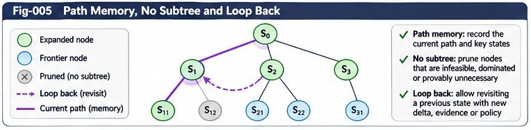

# SPEC-003 — Path Memory and Loop Control Contract

**Project:** Constrained Delta Evolution (CDE)  
**Series:** Specifications  
**Status:** Proposed normative contract — v1.0.0 draft  
**Date:** 2026-11-04  
**Authors:** Sizhe Tan and GPT-Obot  
**License:** Apache-2.0  
**Normative dependencies:** SPEC-001 — State Container and Constraint Contract; SPEC-002 — Delta Generation and Branch Contract  
**Foundational context:** CDE-001 through CDE-012, especially CDE-003, CDE-004, CDE-005, CDE-008, CDE-009, CDE-010, and CDE-012  
**Planned companions:** SPEC-004 — Solver and Optimization Contract; SPEC-005 — Distributed Exploration and Relay Contract; SPEC-006 — Metric and Recursive Evolution Contract

## Abstract

This specification proposes a versioned, auditable **Path Memory and Loop Control Contract** for Constrained Delta Evolution (CDE). Its central purpose is to distinguish four concepts that are frequently conflated: the identity of a Delta operator, the identity of a resolved decision, the identity of a visited state, and the future-equivalence of two search contexts. It formalizes path-local accepted and excluded decision sets for constructive BTP/D-BTP-style exploration; defines NoSubtree eligibility rules; and specifies how cyclic state graphs, reconfiguration, stochastic outcomes, recursive generators, and distributed workers can safely depart from strict no-repeat behavior. It introduces typed memory scopes, revisitation policies, loop witnesses, progress measures, context-aware cache keys, provenance, checkpoint and recovery semantics, and a proposed conformance suite. The contract explicitly separates *cycle detection* from *cycle prohibition*, and *finite constructive path depth* from general termination, completeness, and optimality. It is a proposed interoperability specification, not an established standard or an experimentally validated performance claim.

**Keywords:** CDE; Path Memory; NoSubtree; Loop Back; state identity; Delta identity; decision identity; cycle detection; termination; graph search; conformance; Structural Relay.

---



*Figure 5. Path-local accepted and excluded decision sets support constructive NoSubtree semantics under fixed-context assumptions. Deferred, infeasible, and pruned branches remain distinct; controlled Loop Back may be legitimate in reconfiguration, cyclic, or representation-evolving searches.*

---

## 1. Normative Language

**MUST**, **MUST NOT**, **REQUIRED**, **SHOULD**, **SHOULD NOT**, and **MAY** are normative within a declared conformance profile. A MUST requirement is required for the stated profile; a SHOULD requirement permits a documented exception; MAY denotes optional behavior.

This specification defines the baseline profile **CDE-Path-Memory-v1**, plus optional profiles for constructive NoSubtree, cyclic reconfiguration, stochastic search, and distributed memory. A runtime MUST declare the profiles it supports. It MUST NOT claim termination, completeness, or optimality merely because it conforms to this specification.

## 2. Scope and Dependencies

SPEC-001 governs typed State Containers, immutable state revisions, hard constraints, validation, authorization, and commits. SPEC-002 governs Delta definitions, proposal instances, attempts, branch dispositions, and M–Q–N–K accounting.

SPEC-003 governs:

1. Path-local decision histories and their scopes.
2. Accepted, excluded, unresolved, deferred, and infeasible decision semantics.
3. NoSubtree eligibility for fixed constructive profiles.
4. State visitation and cycle detection in graphs.
5. Explicit Loop Back policies and progress obligations.
6. Context-aware equivalence, caching, and revisitation.
7. Memory versioning, replay, checkpointing, and distributed exchange.
8. Conformance requirements and conditional proofs.

SPEC-004 remains authoritative for solver-specific proofs of completeness, admissible pruning, DP future-equivalence, and optimality. SPEC-005 will refine cross-worker coordination; SPEC-006 will govern changes to generators and policies.

## 3. Four Identities That MUST Remain Distinct

### 3.1 Delta identity

A `delta_id` identifies a typed operation definition, possibly including parameters. Two proposal instances can reference the same Delta. A Delta can be proposed at multiple states or in multiple episodes.

### 3.2 Decision identity

A `decision_key` identifies the proposition being resolved in a specified scope, such as whether an assignment is included in a constructive solution. It is not necessarily identical to `delta_id`. For example, `ACCEPT(x)` and `EXCLUDE(x)` are two outcomes of a single logical decision `x`.

### 3.3 State identity

A `state_id` and revision identify a logical state snapshot under SPEC-001. Different decisions and Deltas may produce the same state. A state may be revisited by a different path.

### 3.4 Future-equivalence identity

Two states or contexts are future-equivalent only if their feasible continuations and relevant objective semantics are equivalent under the declared solver contract. Equality of visible payloads, Delta IDs, or hashes does not establish future equivalence.

**Normative rule ID-01:** A conforming implementation MUST maintain distinct fields or explicit mappings for these four identity concepts. It MUST NOT substitute one for another without a declared and justified equivalence contract.

## 4. Formal Path Model

Let a search path be a finite sequence

$$
\pi_t=(S_0,e_1,S_1,e_2,\ldots,e_t,S_t),
$$

where each edge $e_i$ identifies its source, Delta, decision, disposition, outcome, and successor. A path context is

$$
P_t=(\pi_t,A_t,R_t,D_t,I_t,V_t,\kappa_t),
$$

where:

- $A_t$: accepted decision keys;
- $R_t$: explicitly excluded decision keys;
- $D_t$: deferred decision keys, with status and expiry/revisit conditions;
- $I_t$: infeasibility evidence scoped to the context in which it was checked;
- $V_t$: visited-state observations;
- $\kappa_t$: schema, constraint, generator, metric, policy, and other future-relevant versions.

For the fixed constructive NoSubtree profile, define $U_t=A_t\cup R_t$. A new constructive decision $d$ is eligible only if $d\notin U_t$, subject to all applicable preconditions and hard constraints.

This rule is **path-local** by default. An exclusion on one path does not automatically exclude the same decision on every other path.

## 5. Memory Scope Taxonomy

Every memory record MUST declare one of the following scopes or a versioned extension:

| Scope | Meaning | Default reuse |
|---|---|---|
| `PATH` | One search path or lineage | Only descendants subject to path rules |
| `EPISODE` | One bounded search run | Within the episode and compatible context |
| `STATE_CONTEXT` | A state with future-relevant context | Only if context matches |
| `TASK` | A specified problem instance | Within declared task assumptions |
| `GENERATOR_VERSION` | Evidence about a generator version | Only for that version or validated migration |
| `GLOBAL_PROVEN` | Reusable theorem or validated exclusion | Only under proof assumptions |
| `GLOBAL_HEURISTIC` | Shared experience without proof | Ranking only, not hard pruning |

**SCOPE-01:** A memory entry MUST identify its scope, version dependencies, author or producer, and provenance.

**SCOPE-02:** A `PATH` exclusion MUST NOT be promoted to `GLOBAL_PROVEN` without a separately validated proof.

**SCOPE-03:** Heuristic global memory MUST NOT override hard constraints or serve as a pruning certificate by itself.

## 6. Canonical Path Context Contract

The logical schema is:

```yaml
PathContext:
  path_id: string
  parent_path_id: optional
  current_state_id: string
  current_state_revision: string
  search_episode_id: string
  profile_id: string
  decision_universe_ref: optional
  accepted_decision_refs: [string]
  excluded_decision_refs: [string]
  deferred_decision_refs: [string]
  infeasibility_evidence_refs: [string]
  state_visit_refs: [string]
  loop_policy_id: string
  constraint_bundle_id: string
  generator_version_refs: [string]
  metric_version_refs: [string]
  policy_version_refs: [string]
  context_version_refs: [string]
  path_memory_revision: string
  provenance_ref: string
```

A runtime MAY store compact sets, parent-linked persistent data structures, logs, or hashes. It MUST be able to reconstruct the logical contents required by the selected profile. A digest alone is insufficient if the system cannot verify its semantics or retrieve the underlying record when needed for audit.

## 7. Decision Key Contract

A decision key MUST specify what is being resolved and the identity scope:

```yaml
DecisionKey:
  decision_key_id: string
  decision_family_id: string
  subject_ref: string
  parameterization_ref: optional
  decision_universe_version: string
  scope_ref: string
  canonicalization_ref: optional
```

For a binary constructive decision, the accepted and excluded alternatives SHOULD share the same `decision_key_id`. This prevents the error of treating `ACCEPT(x)` and `EXCLUDE(x)` as two unrelated opportunities to resolve `x` twice.

A reconfiguration operator may have a different decision identity even when it touches the same subject. Implementations MUST document the distinction.

## 8. Decision Event Contract

Every path-affecting event MUST be immutable and traceable:

```yaml
PathDecisionEvent:
  event_id: string
  path_id: string
  parent_event_id: optional
  source_state_ref: string
  decision_key_id: string
  delta_id: optional
  proposal_id: optional
  attempt_id: optional
  disposition: string
  scope: PATH | EPISODE | STATE_CONTEXT | TASK | GLOBAL_PROVEN | GLOBAL_HEURISTIC
  constraint_bundle_id: string
  context_version_refs: [string]
  evidence_refs: [string]
  event_sequence: integer
  provenance_ref: string
```

Historical events MUST NOT be overwritten to change a decision retrospectively. A reversal or reconsideration requires a new event and an explicitly permitted profile transition.

## 9. Decision Dispositions

The contract distinguishes:

- `ACCEPTED`: the constructive decision is resolved positively.
- `EXCLUDED`: the constructive decision is resolved negatively within the declared scope.
- `DEFERRED`: the decision is postponed and ordinarily remains unresolved.
- `INFEASIBLE`: a candidate transition failed a hard constraint under recorded assumptions.
- `REJECTED_PRECONDITION`: the operation was inapplicable in the recorded context.
- `PRUNED_WITH_CERTIFICATE`: a solver-specific proof justifies omitting a branch under its assumptions.
- `EXCLUDED_BY_POLICY`: the selector declined a proposal; not a proof of impossibility.
- `REVISIT_ALLOWED`: a loop policy explicitly permits returning to a prior state.
- `REVISIT_BLOCKED`: a declared loop policy rejects the revisit.
- `REOPENED`: a previously resolved or deferred decision is reconsidered under a profile that permits it.

**DISP-01:** `DEFERRED`, `INFEASIBLE`, `EXCLUDED`, `EXCLUDED_BY_POLICY`, and `PRUNED_WITH_CERTIFICATE` MUST NOT be conflated.

**DISP-02:** `INFEASIBLE` evidence MUST record the constraint and context versions that support it; it MUST NOT be treated as universally valid after those assumptions change.

**DISP-03:** A path-local constructive `EXCLUDED` decision resolves its decision key for that path. It is not automatically a global solver pruning certificate.

## 10. Fixed Constructive NoSubtree Profile

The optional profile **CDE-NoSubtree-Constructive-v1** applies when:

1. The decision universe $\mathcal D$ is finite and fixed for the episode.
2. Each nonterminal constructive expansion resolves one previously unresolved decision key.
3. Decisions are monotonic along a path: once accepted or excluded, they remain resolved.
4. No generator introduces new decision keys during the episode.
5. A path cannot reopen a resolved decision.

For each path, require

$$
A_t\cap R_t=\varnothing,\qquad U_t=A_t\cup R_t,
$$

and for any next decision $d$,

$$
d\notin U_t.
$$

After an accepted or excluded decision,

$$
U_{t+1}=U_t\cup\{d\}.
$$

**NS-01:** The runtime MUST reject a constructive expansion that resolves a decision already in $U_t$.

**NS-02:** A branch that resolves `ACCEPT(d)` MUST prevent a later `EXCLUDE(d)` on the same path, and vice versa.

**NS-03:** Sibling paths MAY make different choices for the same decision.

**NS-04:** A deferred proposal MUST NOT enter $U_t$ solely because it was deferred.

**NS-05:** If an implementation resolves more than one decision per expansion, it MUST declare and validate the full set of newly resolved keys.

## 11. Conditional Finite-Depth Theorem

**Proposition NS-T1.** Under the five fixed constructive assumptions in Section 10, a path has at most $m=|\mathcal D|$ decision-resolving expansions.

**Proof sketch.** Let $\rho_t=m-|U_t|$. Initially $0\le\rho_0\le m$. Every nonterminal expansion adds at least one fresh decision to $U_t$, so $\rho_{t+1}<\rho_t$. The rank cannot decrease indefinitely.

The proposition does **not** imply:

- the generator enumerates all feasible choices;
- the search explores every path;
- a goal exists;
- a solution is optimal;
- a distributed run terminates globally;
- a reconfiguration or open-ended profile terminates.

A runtime MUST NOT advertise this theorem outside its assumptions.

## 12. Why No-Repeat Delta Does Not Prevent State Cycles

Consider three states and distinct operations:

$$
S_0\xrightarrow{\delta_a}S_1\xrightarrow{\delta_b}S_0.
$$

The two Deltas are different, yet the path returns to $S_0$. A system that only remembers Delta IDs will not detect this cycle.

Conversely, a Delta definition may be valid at different states and need not be globally forbidden after its first use. Therefore Delta reuse, decision reuse, and state revisitation require separate policies.

**CYCLE-01:** A runtime claiming state-cycle detection MUST compare states under a declared state-identity or equivalence contract, not solely under Delta identity.

## 13. State Visit Record

```yaml
StateVisitRecord:
  visit_id: string
  path_id: string
  state_id: string
  state_revision: string
  depth: integer
  arrival_edge_id: optional
  constraint_bundle_id: string
  context_version_refs: [string]
  equivalence_contract_ref: string
  visit_class: FIRST | REVISIT | POSSIBLE_REVISIT | UNKNOWN
  provenance_ref: string
```

A visit record MUST distinguish exact snapshot identity from an approximate similarity match. A similarity threshold MAY trigger additional investigation, but it MUST NOT silently establish future equivalence or justify sound pruning.

## 14. Loop Detection Contract

A loop detector SHOULD return:

```yaml
LoopDetectionReport:
  report_id: string
  candidate_successor_ref: string
  matching_visit_refs: [string]
  match_kind: EXACT_SNAPSHOT | DOMAIN_EQUIVALENT | FUTURE_EQUIVALENT | HEURISTIC_SIMILARITY
  equivalence_contract_ref: string
  result: LOOP | POSSIBLE_LOOP | NO_LOOP | UNKNOWN
  witness_ref: optional
  context_version_refs: [string]
  provenance_ref: string
```

**LOOP-01:** `HEURISTIC_SIMILARITY` alone MUST NOT yield a sound `FUTURE_EQUIVALENT` conclusion.

**LOOP-02:** A detector MUST identify which context fields were considered.

**LOOP-03:** A loop witness SHOULD identify the earlier visit and the intervening path segment.

**LOOP-04:** `UNKNOWN` MUST NOT be silently converted to `NO_LOOP` when the selected profile requires definitive loop checks.

## 15. Loop Back Policies

A conforming implementation MUST declare a versioned `loop_policy_id`. Supported baseline policies are:

| Policy | Behavior | Typical use |
|---|---|---|
| `FORBID_EXACT_REVISIT` | Reject repeat exact state snapshot on path | Simple graph search |
| `FORBID_EQUIVALENT_REVISIT` | Reject under declared sound equivalence | Verified state-space reduction |
| `ALLOW_WITH_PROGRESS` | Permit revisit only with accepted progress evidence | Iterative refinement |
| `ALLOW_WITH_BUDGET` | Permit bounded revisits | Local/reconfiguration search |
| `ALLOW_WITH_TTL` | Permit revisits until episode time-to-live | Online exploration |
| `ALLOW_WITH_PROBABILISTIC_STOP` | Permit stochastic revisits with explicit stopping policy | Sampling/search |
| `ALLOW_UNRESTRICTED` | Permit revisits without a termination guarantee | Open-ended research sandbox |

`ALLOW_UNRESTRICTED` MUST be clearly labeled as providing no general termination guarantee. A budget or TTL guarantees only a bounded runtime episode under reliable enforcement, not completeness.

## 16. Loop Policy Contract

```yaml
LoopPolicy:
  loop_policy_id: string
  policy_version: string
  allowed_match_kinds: [string]
  revisit_limit: optional
  depth_limit: optional
  time_budget_ref: optional
  progress_measure_ref: optional
  progress_comparison: optional
  stop_conditions: [string]
  context_dependencies: [string]
  authorization_ref: string
  provenance_ref: string
```

A policy change MUST be versioned. A worker MUST NOT silently substitute its own loop policy when the parent task requires a different one.

## 17. Progress Measures and Well-Foundedness

A progress measure may justify revisitation if it establishes movement toward a well-founded objective. Examples include strictly decreasing unresolved decision count, strictly decreasing nonnegative integer cost potential, or a lexicographically well-founded tuple.

**Proposition LB-T1.** If every permitted nonterminal transition strictly decreases a rank in a well-founded order, then there is no infinite sequence of such transitions.

**Qualification:** An ordinary real-valued score that increases by ever-smaller amounts is not necessarily well-founded. A positive score improvement does not by itself prove termination.

**PROG-01:** A runtime claiming termination from a progress measure MUST document its codomain, ordering, and strict-change proof obligation.

**PROG-02:** A heuristic progress score MAY guide search but MUST NOT be presented as a termination proof without those conditions.

## 18. Reconfiguration and Reopening

Constructive assignment and reconfiguration are distinct profiles. In reconfiguration, a Delta may undo or replace a previous choice. Such behavior conflicts with monotonic NoSubtree unless the decision semantics are redefined.

A reconfiguration profile MUST declare:

1. whether accepted decisions can be reversed;
2. whether excluded decisions can be reconsidered;
3. how reopened decisions are identified;
4. whether the same logical state can be revisited;
5. which budgets or progress measures limit cycling;
6. how path evidence survives reversals.

**RECONF-01:** A `REOPENED` event MUST identify the earlier resolved decision and the authority permitting reconsideration.

**RECONF-02:** Reopening MUST NOT erase the historical event.

**RECONF-03:** A fixed constructive termination claim MUST be withdrawn if the implementation enables reopening without a replacement proof.

## 19. Stochastic and Partially Observed States

A stochastic Delta can return to a previously observed state without repeating a decision. A partially observed system may report the same observation while its hidden state differs.

The optional **CDE-Path-Stochastic-v1** profile MUST distinguish:

- observed state or observation identity;
- belief/information state identity, if modeled;
- sampled transition outcome;
- modeled but unrealized possible outcomes;
- stochastic seed and environment snapshot where applicable.

A loop detector MUST NOT equate identical observations with identical hidden states unless the application supplies a justified equivalence contract.

## 20. State Cache versus Path Memory

**Path memory** answers: *Which decisions and visits occurred along this path?*

**State cache** answers: *What is known about this state or subproblem across paths?*

They are not interchangeable. A state cache may store costs, bounds, partial results, or failures; a path context stores accepted/excluded decisions and lineage.

A cache entry MUST declare its dependency keys. If path history affects future feasibility, a state-only cache key is unsafe.

### 20.1 Example

Two paths reach the same visible assignment. On path A, decision `d` was excluded; on path B, `d` remains unresolved. Their future feasible continuations differ. A DP memoization scheme that merges them by assignment alone can be unsound.

### 20.2 Contract

```yaml
FutureContextKey:
  state_equivalence_ref: string
  relevant_path_memory_digest: string
  constraint_bundle_id: string
  metric_version_refs: [string]
  generator_version_refs: [string]
  policy_version_refs: [string]
  resource_context_ref: optional
  equivalence_proof_ref: optional
```

SPEC-004 will define when such keys are sufficient for solver correctness.

## 21. Memory Compaction

Implementations MAY compress path histories through persistent sets, bitsets, Bloom filters, hashes, or summarized evidence.

**COMP-01:** A lossy filter MUST NOT be used as a definitive exclusion oracle if false positives could eliminate required branches and the solver claims completeness.

**COMP-02:** A digest MUST include or reference the versioned canonicalization scheme.

**COMP-03:** Compaction MUST preserve the evidence needed to reconstruct or verify every claim made by the selected conformance profile.

A Bloom filter may safely act as a *possible-membership* precheck followed by an exact check; it is not an exact proof of membership.

## 22. Path Forking and Sibling Independence

A branch fork creates child paths inheriting the parent's resolved decisions and visit history, with child-specific events appended.

```yaml
PathForkEvent:
  fork_id: string
  parent_path_id: string
  child_path_ids: [string]
  parent_memory_revision: string
  fork_state_ref: string
  branch_decision_refs: [string]
  provenance_ref: string
```

**FORK-01:** Child paths MUST inherit immutable parent history under the selected profile.

**FORK-02:** A decision on one sibling MUST NOT mutate another sibling's path-local memory.

**FORK-03:** Global shared evidence MAY influence both siblings, but its scope and proof status MUST be explicit.

## 23. Distributed Path Memory

SPEC-005 will refine the transport and failure protocol. SPEC-003 requires that a remote worker receive a sufficient immutable snapshot or resolvable reference to its path context.

A distributed task SHOULD include:

```yaml
DistributedPathContext:
  task_id: string
  path_id: string
  parent_path_id: optional
  path_memory_revision: string
  path_context_digest: string
  source_state_revision: string
  constraint_bundle_id: string
  loop_policy_id: string
  generator_version_refs: [string]
  context_version_refs: [string]
  lineage_ref: string
```

**DIST-01:** A worker MUST NOT silently omit required accepted/excluded decisions from the inherited context.

**DIST-02:** A worker result MUST identify the path memory revision used.

**DIST-03:** An outcome computed under stale path or constraint versions MUST be marked stale or revalidated before authoritative use.

**DIST-04:** Cross-worker sharing of path-local exclusions MUST NOT promote them into global prohibitions.

## 24. Global Visited Sets and Concurrency

A global visited set may reduce repeated work, but its correctness depends on what equivalence it represents.

If two workers concurrently discover the same state, the coordinator MAY coalesce work. It MUST preserve distinct incoming edges and provenance when they matter. A globally shared `visited=true` flag is not sufficient to justify pruning if different paths have different future-relevant contexts.

**CONC-01:** Deduplication MUST be scoped by a sound equivalence contract.

**CONC-02:** Concurrent updates MUST not lose path lineage or create contradictory resolved-decision sets.

**CONC-03:** A worker's failure to find a solution MUST NOT be interpreted as global impossibility without a complete coverage or proof certificate.

## 25. Checkpoint, Replay, and Recovery

A checkpoint MUST bind:

- current state and revision;
- path context and memory revision;
- pending/deferred proposals;
- generator, constraint, metric, and policy versions;
- loop policy and budget status;
- event-log position and provenance.

A restored worker MUST verify compatibility before resuming. If a required dependency has changed, it MUST revalidate or create an explicitly migrated context.

A deterministic replay SHOULD reconstruct the same decisions given pinned inputs and deterministic components. For stochastic runs, replay MUST preserve the recorded observed outcomes rather than fabricate identical future randomness.

## 26. Structural Relay of Path Knowledge

Path memory can produce reusable artifacts, including:

- **Result Relay:** successful terminal states and proof references;
- **Evidence Relay:** visited regions, infeasible transitions, counterexamples;
- **Method Relay:** effective loop policies, decision ordering, cache strategies;
- **Leftover Relay:** deferred branches, unresolved decisions, unvisited regions;
- **Constraint Relay:** validated constraint implications, with scope;
- **Policy Relay:** proposed changes to search behavior.

A Relay artifact MUST declare its applicability assumptions and provenance. An excluded decision on one path is not automatically an exclusion for a receiving path. A failure observed under one metric or constraint version may not transfer to another.

Repeated execution can contribute learning only when the accumulated evidence is retained and evaluated for future use.

## 27. Reference Algorithm: Constructive Eligibility

```text
function ELIGIBLE_CONSTRUCTIVE_DECISION(path, decision_key, proposal):
    assert path.profile == CDE-NoSubtree-Constructive-v1
    assert proposal.source_revision == path.current_state_revision
    assert proposal.context_versions compatible with path.context_versions

    if decision_key not in path.decision_universe:
        return REJECTED_UNKNOWN_DECISION

    if decision_key in path.accepted_decisions:
        return REJECTED_ALREADY_RESOLVED

    if decision_key in path.excluded_decisions:
        return REJECTED_ALREADY_RESOLVED

    if proposal.preconditions_fail:
        return REJECTED_PRECONDITION

    return ELIGIBLE_FOR_SPEC001_VALIDATION
```

This function does not itself commit a transition; SPEC-001 validation remains mandatory.

## 28. Reference Algorithm: Loop Check

```text
function CHECK_LOOP(path, candidate_state, loop_policy):
    matches = compare_with_prior_visits(
        candidate_state,
        path.visits,
        loop_policy.equivalence_contract
    )

    report = record_loop_detection(matches, loop_policy)

    if report.result == UNKNOWN:
        return policy_defined_unknown_handling(loop_policy)

    if report.result == NO_LOOP:
        return ALLOW_SUBJECT_TO_SPEC001

    if loop_policy.kind == FORBID_EXACT_REVISIT:
        return BLOCK if report.match_kind == EXACT_SNAPSHOT else RECHECK

    if loop_policy.kind == FORBID_EQUIVALENT_REVISIT:
        return BLOCK if report.equivalence_is_sound else RECHECK

    if loop_policy.kind == ALLOW_WITH_PROGRESS:
        return ALLOW if verified_progress_decreases(path, candidate_state) else BLOCK

    if loop_policy.kind in [ALLOW_WITH_BUDGET, ALLOW_WITH_TTL]:
        return ALLOW if budget_remaining(path) else BLOCK

    if loop_policy.kind == ALLOW_UNRESTRICTED:
        return ALLOW_WITH_NO_TERMINATION_GUARANTEE

    return REJECT_UNKNOWN_POLICY
```

`RECHECK` and `BLOCK` are policy decisions, not statements that a state is infeasible under hard constraints.

## 29. Reference Algorithm: Fork and Record

```text
function FORK_PATH(parent, decision_key, disposition, edge):
    validate_profile_transition(parent, decision_key, disposition)

    child = persistent_copy(parent)
    child.path_id = new_path_id()
    child.parent_path_id = parent.path_id

    if disposition == ACCEPTED:
        child.accepted_decisions.add(decision_key)
    else if disposition == EXCLUDED:
        child.excluded_decisions.add(decision_key)
    else if disposition == DEFERRED:
        child.deferred_decisions.add(decision_key)
    else:
        record_nonresolution_event(child, disposition)

    if edge is committed:
        child.current_state = edge.successor_state
        child.visits.append(visit_record(edge.successor_state))

    assert child.accepted_decisions intersection child.excluded_decisions is empty
    persist_immutable_fork_and_events(parent, child)
    return child
```

For a strict constructive profile, a decision-resolution event MUST use a fresh decision key; a nonresolution event MUST NOT silently consume that key.

## 30. Formal Invariants

**INV-PM-01 — Identity separation.** Delta, decision, state, and future-equivalence identities are not implicitly interchangeable.

**INV-PM-02 — Constructive disjointness.** In strict NoSubtree paths, $A_t\cap R_t=\varnothing$.

**INV-PM-03 — Constructive monotonicity.** Strict constructive resolved sets only grow along a path.

**INV-PM-04 — Fresh resolution.** A strict constructive decision is resolved at most once on a path.

**INV-PM-05 — Deferred nonresolution.** Deferral alone does not resolve a decision.

**INV-PM-06 — Scope preservation.** Path-local knowledge is not silently globalized.

**INV-PM-07 — State-visit provenance.** A revisitation claim identifies its equivalence contract and matching visit.

**INV-PM-08 — Loop-policy coherence.** Every revisit decision uses a declared, versioned policy.

**INV-PM-09 — Context-aware caching.** Shared cache reuse requires compatible future-relevant context.

**INV-PM-10 — Immutable history.** Reconsideration is a new event, not an edit to history.

**INV-PM-11 — Fork isolation.** Sibling path-local memory is not mutated by another sibling.

**INV-PM-12 — Version coherence.** Memory, source state, constraints, and policy versions are compatible for authoritative use.

**INV-PM-13 — Conditional claims.** Termination, completeness, and optimality claims include their assumptions.

**INV-PM-14 — Relay applicability.** Transferred path evidence retains scope, assumptions, and uncertainty.

## 31. Conformance Profiles

### 31.1 CDE-Path-Memory-v1 — Required

Requires typed path contexts, identity separation, scoped decision events, visit records, loop-policy identity, versioned provenance, immutable history, and explicit nonresolution dispositions.

### 31.2 CDE-NoSubtree-Constructive-v1 — Optional

Adds finite fixed decision universe, monotonic accepted/excluded sets, fresh resolution, sibling independence, and the finite-depth theorem's preconditions.

### 31.3 CDE-LoopBack-Reconfiguration-v1 — Optional

Adds reversible decisions, `REOPENED` events, state revisitation, bounded or progress-based loop policies, and history-preserving reversal.

### 31.4 CDE-Path-Stochastic-v1 — Optional

Adds sampled outcome records, observation/belief-state distinctions, and stochastic revisit policies.

### 31.5 CDE-Path-Distributed-v1 — Optional

Adds immutable path snapshots, worker lineage, stale-result checks, concurrency-safe scope handling, and recovery contracts; full transport semantics belong to SPEC-005.

## 32. Conformance Test Suite

The following tests are proposed; passing them does not establish universal solver correctness.

| ID | Test | Expected behavior |
|---|---|---|
| PM-001 | Create valid path context | Accepted |
| PM-002 | Missing path ID | Rejected |
| PM-003 | Missing memory revision | Rejected |
| PM-004 | Delta ID used as decision key without mapping | Rejected or explicitly mapped |
| PM-005 | Same decision accepted then excluded on strict path | Rejected |
| PM-006 | Same decision excluded then accepted on strict path | Rejected |
| PM-007 | Distinct sibling paths resolve same key differently | Allowed |
| PM-008 | Deferred decision later selected | Allowed, history preserved |
| PM-009 | Deferred decision counted as resolved | Rejected |
| PM-010 | Infeasibility treated as global proof without assumptions | Rejected |
| PM-011 | Path exclusion exported as global prohibition | Rejected |
| PM-012 | Finite constructive rank decreases | Verified |
| PM-013 | Generator introduces new key in fixed profile | Profile violation |
| PM-014 | Strict profile reopens decision | Rejected |
| PM-015 | Reconfiguration profile reopens with authorization | Allowed, new event |
| PM-016 | Different Deltas return to same state | Loop detected |
| PM-017 | Same Delta applied in distinct valid contexts | Not globally forbidden by default |
| PM-018 | Exact-state revisit under forbid policy | Blocked |
| PM-019 | Sound-equivalence revisit under forbid policy | Blocked |
| PM-020 | Heuristic similarity claimed as future equivalence | Rejected |
| PM-021 | Unknown loop result under strict policy | Not silently allowed |
| PM-022 | Loop witness missing prior visit | Report invalid |
| PM-023 | Budgeted revisit with budget available | Allowed |
| PM-024 | Budgeted revisit after exhaustion | Blocked |
| PM-025 | Progress policy with valid well-founded rank | Allowed when rank decreases |
| PM-026 | Real-valued heuristic increase used as termination proof | Rejected |
| PM-027 | Unrestricted Loop Back claims termination | Claim rejected |
| PM-028 | Identical payload with different exclusions | Not assumed future-equivalent |
| PM-029 | State-only cache ignores path-relevant context | Cache reuse rejected |
| PM-030 | Bloom filter false positive treated as definitive exclusion | Rejected |
| PM-031 | Compaction retains verifiable evidence | Accepted |
| PM-032 | Fork mutates sibling's path memory | Rejected |
| PM-033 | Worker omits inherited exclusions | Rejected |
| PM-034 | Worker result uses stale path revision | Marked stale/revalidated |
| PM-035 | Two workers find same state via different paths | Both lineages preserved |
| PM-036 | Checkpoint lacks loop policy version | Recovery blocked or revalidated |
| PM-037 | Replay deterministic path with pinned versions | Same declared result |
| PM-038 | Replay stochastic path changes historical outcome | Rejected |
| PM-039 | Constraint version change invalidates infeasibility evidence | Revalidation required |
| PM-040 | Metric version change invalidates bound-based cache | Revalidation required |
| PM-041 | Relay negative evidence without scope | Rejected or labeled unusable |
| PM-042 | Leftover Relay retains deferred branch | Accepted |
| PM-043 | Policy change without version record | Rejected |
| PM-044 | Path event history silently overwritten | Rejected |
| PM-045 | No-repeat Delta claimed to prevent all state cycles | Unsupported claim rejected |
| PM-046 | Strict constructive termination used to claim completeness | Unsupported claim rejected |
| PM-047 | Strict constructive termination used to claim optimality | Unsupported claim rejected |
| PM-048 | Valid cyclic search with explicit stop budget | Accepted without completeness claim |

### 32.1 Required fixtures

A test harness SHOULD include a finite three-decision constructive tree, a two-edge state cycle, two paths with identical payloads but different exclusions, a reversible routing operation, a stochastic revisit, a stale distributed worker, and a lossy membership filter.

### 32.2 Negative tests

A conformance suite MUST exercise conflicting decisions, stale context, invalid equivalence, false-positive membership, unsafe global promotion, and unauthorized reopening. Happy-path tests alone are insufficient.

## 33. Worked Example A — BTP Yes/No Decisions

Suppose a constructive assignment problem has decision universe $\mathcal D=\{a,b,c\}$. From the root, the search resolves `a=YES` on one path and `a=NO` on its sibling. Both are legal, but neither child may resolve `a` again in the strict profile.

For the YES child:

$$
A_1=\{a\},\quad R_1=\varnothing,\quad U_1=\{a\}.
$$

For the NO child:

$$
A_1=\varnothing,\quad R_1=\{a\},\quad U_1=\{a\}.
$$

A later `DEFER(b)` does not add `b` to $U$. A later `ACCEPT(b)` does. Each path has at most three decision-resolving expansions, assuming the fixed-universe profile remains in force. This says nothing about whether all feasible assignments are generated or whether the best assignment is selected.

## 34. Worked Example B — Loop Back in Route Reconfiguration

A bus-routing solver moves stop `x` from route A to B, then later moves it back from B to A. These are distinct transition events and may return to an earlier schedule. A strict constructive profile would be inappropriate if such reversals are central to the algorithm.

Under `ALLOW_WITH_BUDGET`, the solver may permit the revisit but record the visit count, route state, source context, and remaining budget. Under `ALLOW_WITH_PROGRESS`, it must demonstrate a valid progress measure; merely claiming that the heuristic score has improved is insufficient for a general termination proof.

Hard safety constraints on bus capacity, student coverage, and ride time remain enforced by SPEC-001 regardless of loop policy.

## 35. Worked Example C — DP Cache Collision

Two paths reach the same visible partial matching. Path P excludes candidate edge `e`; path Q leaves `e` unresolved. If a DP cache uses only the visible matching as its key, it may return a continuation requiring `e` for path P, where that continuation is illegal.

The correct remedy is not necessarily to store the entire path. It is to include a **sufficient future-relevant context** in the key or prove that the difference does not affect the continuation problem. The proof obligation belongs to SPEC-004.

## 36. Worked Example D — Distributed Exploration and Leftovers

Worker A explores path P under constraint bundle v3 and defers decisions `d7` and `d9`. It sends a Leftover Relay artifact with its path revision, unresolved decision references, and reason for deferral.

Worker B may resume that work only after resolving the inherited path context and checking version compatibility. If constraints changed to v4, previously recorded infeasibility and pruning evidence may require revalidation. Worker B MUST NOT treat A's path-local exclusions as globally proven impossible decisions.

## 37. Worked Example E — Stochastic Search

A stochastic operator proposes a transition from belief state $B_0$. Two sampled executions produce the same visible observation, but different hidden states may remain possible. A loop detector based only on observation equality may report `POSSIBLE_LOOP`; it must not assert exact hidden-state identity without a valid observation/belief equivalence contract.

The system can still use revisit budgets or time limits to control cost. Such limits bound the episode, not the underlying stochastic process's convergence.

## 38. Security and Governance

Path memory may contain sensitive decisions, provenance, and inferred relationships. A worker could attempt to forge a global exclusion, suppress prior evidence, or manipulate a loop policy to hide nontermination.

A conforming deployment MUST validate event provenance and authority, enforce scope restrictions, protect immutable history, and prevent untrusted heuristic evidence from becoming certified pruning. It SHOULD provide access controls for sensitive path records and preserve auditability for authorized reviewers.

A policy change that relaxes hard constraints is not a path-memory operation and MUST follow the separately authorized constraint-governance contract.

## 39. Performance Considerations

Path histories can grow rapidly. Persistent data structures, compact decision bitsets, checkpoint intervals, scoped visited maps, and validated cache reuse may reduce cost. Implementations SHOULD measure:

- path memory bytes per decision;
- lookup latency for resolved decisions;
- loop detection cost;
- state-cache hit rate and invalidation rate;
- false-positive rates of approximate filters;
- redundant exploration avoided;
- valid branches mistakenly suppressed (target: zero under sound profiles);
- checkpoint and recovery overhead;
- distributed memory transfer cost;
- contribution of negative and Leftover Relay to subsequent work.

Performance optimization MUST NOT silently weaken declared correctness or evidence obligations.

## 40. Open Research Questions

1. What is the minimal sufficient path context for common DP families?
2. Which state-equivalence relations can be checked cheaply and soundly?
3. Can path histories be compressed with formal preservation of future-relevant decisions?
4. When is controlled Loop Back preferable to strict no-repeat exploration?
5. Which well-founded progress measures are useful in real reconfiguration problems?
6. How should stochastic revisitation be compared across belief-state approximations?
7. Can global negative knowledge be extracted safely from local failures?
8. What distributed memory-sharing policies minimize duplicate work without unsafe pruning?
9. How do generator updates affect decision identity and old NoSubtree evidence?
10. Which aspects of path memory transfer robustly across domains?
11. How can Loop Back policies be learned while preserving independent safety validation?
12. How should open-ended exploration report useful progress without claiming termination?

## 41. Implementation Checklist

- [ ] SPEC-001 and SPEC-002 dependencies are satisfied.
- [ ] Delta, decision, state, and future-equivalence identities are separate.
- [ ] Path contexts have immutable revisions and provenance.
- [ ] Accepted, excluded, deferred, infeasible, and pruned events are distinct.
- [ ] Memory scope is explicit for every reusable record.
- [ ] Fixed constructive profiles declare a finite decision universe.
- [ ] Strict NoSubtree paths resolve each decision at most once.
- [ ] Sibling paths do not share mutable path-local memory.
- [ ] Loop detection uses declared state/equivalence semantics.
- [ ] Every Loop Back policy is versioned.
- [ ] Reconfiguration and reopening preserve historical events.
- [ ] Termination claims name a valid finite-rank or well-founded argument.
- [ ] Cache keys include future-relevant path and version context.
- [ ] Approximate filters cannot silently eliminate valid branches.
- [ ] Distributed workers receive compatible path snapshots.
- [ ] Checkpoints include path and loop-policy versions.
- [ ] Relay artifacts preserve assumptions and evidence strength.
- [ ] Negative conformance tests are executed.
- [ ] No general completeness or optimality claim is inferred from path memory.

## 42. Conclusion

SPEC-003 defines the distinction between **remembering decisions** and **recognizing revisited states**. A strict BTP-style NoSubtree path can enjoy a conditional finite-depth guarantee because each expansion resolves a fresh decision from a fixed finite universe. A general CDE graph, however, may contain cycles, reversible Deltas, stochastic outcomes, evolving generators, and distinct paths to the same state. These require explicit Loop Back policies, versioned equivalence contracts, and context-aware caches rather than an indiscriminate ban on repeated Delta IDs.

The central contract is:

$$
\boxed{
\text{Decision Memory}
\neq
\text{State Visit Memory}
\neq
\text{Future Equivalence}
}
$$

CDE can support constructive no-repeat exploration and cyclic reconfiguration within a shared architecture, provided their different assumptions remain visible and testable. **Conformance before runtime** means documenting what a memory record proves, where it applies, and when it must be reconsidered.

The next specification, **SPEC-004 — Solver and Optimization Contract**, will establish solver adapter interfaces, proof and bound semantics, DP equivalence obligations, and the conditions under which completeness or optimality claims are justified.

---

## Appendix A — Minimal Path Memory Example

```yaml
path_id: "path-017"
parent_path_id: "path-009"
current_state_id: "assignment-state-017"
current_state_revision: "r4"
search_episode_id: "episode-002"
profile_id: "CDE-NoSubtree-Constructive-v1"
decision_universe_ref: "assignment-decisions-v1"
accepted_decision_refs: ["decision-a"]
excluded_decision_refs: ["decision-b"]
deferred_decision_refs: ["decision-c"]
infeasibility_evidence_refs: []
state_visit_refs: ["visit-001", "visit-017"]
loop_policy_id: "FORBID_EXACT_REVISIT-v1"
constraint_bundle_id: "assignment-constraints-v1"
generator_version_refs: ["constructive-generator-v1"]
metric_version_refs: ["assignment-score-v1"]
policy_version_refs: ["depth-first-v1"]
context_version_refs: []
path_memory_revision: "pm-r4"
provenance_ref: "path-event-017"
```

Here `decision-c` remains unresolved because it was deferred. A later attempt to resolve `decision-a` or `decision-b` again on the same strict constructive path must be rejected.

## Appendix B — Requirements Traceability

| Requirement family | Main source | Companion obligation |
|---|---|---|
| State identity and revisions | SPEC-001 | State schema and commit validity |
| Delta proposal and attempt identity | SPEC-002 | Branch lifecycle and accounting |
| Constructive NoSubtree | CDE-004 | Finite fixed decision universe |
| State revisitation and Loop Back | CDE-004 | Versioned loop policy |
| DP future-equivalence | CDE-005 | SPEC-004 solver proof |
| Distributed path context | CDE-009 | SPEC-005 task protocol |
| Leftover and negative Relay | CDE-010 | Applicability and provenance |
| Generator/policy evolution | CDE-011 | SPEC-006 promotion governance |
| Guarantee boundaries | CDE-012 | Conditional claim discipline |

## Appendix C — Proposed Repository Placement

`docs/specifications/SPEC-003-Path-Memory-and-Loop-Control-Contract.md`

## Appendix D — Research Status and Attribution

This specification is a proposed interoperability contract. It integrates familiar concepts from graph search, state-transition systems, persistent data structures, memoization, formal termination arguments, distributed provenance, and event-sourced histories into the CDE State–Delta–Constraint research program. It does not claim priority over these established concepts.

Reference implementations, independently executed conformance suites, and a verified literature review remain future work. No DOI is asserted until a release and registration occur.

**Version:** v1.0.0 draft  
**License:** Apache-2.0
