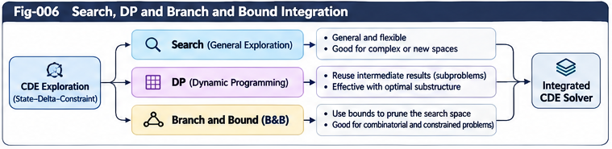

# SPEC-004 — Solver and Optimization Contract

**Project:** Constrained Delta Evolution (CDE)  
**Series:** Specifications  
**Status:** Proposed normative contract, v1.0.0 draft  
**Date:** 2026-11-04  
**Authors:** Sizhe Tan and GPT-Obot  
**License:** Apache-2.0  
**Normative dependencies:** SPEC-001 — State Container and Constraint Contract; SPEC-002 — Delta Generation and Branch Contract; SPEC-003 — Path Memory and Loop Control Contract  
**Foundational context:** CDE-001 through CDE-012, particularly CDE-005, CDE-007, CDE-008, CDE-009, and CDE-012  
**Planned companion contracts:** SPEC-005 — Distributed Exploration and Relay Contract; SPEC-006 — Metric and Recursive Evolution Contract

## Abstract

This proposed specification defines an interoperable, solver-neutral **Solver and Optimization Contract** for Constrained Delta Evolution (CDE). Its central purpose is to allow graph search, dynamic programming (DP), branch-and-bound (B&B), constraint programming, mixed-integer optimization, local search, stochastic search, and heterogeneous solver portfolios to operate over versioned CDE states and Deltas without conflating feasibility, solution quality, search coverage, or mathematical guarantees. It standardizes problem declarations, solver capability manifests, task requests, result envelopes, incumbent handling, admissible bounds, memoization requirements, termination evidence, proof verification, metric-version coherence, and portfolio arbitration. It establishes conditional safety and correctness obligations, a conformance suite, and worked examples. A conforming adapter does not automatically make a heuristic complete or an approximate result optimal.

**Keywords:** solver interoperability; optimization; search; dynamic programming; branch-and-bound; admissible bounds; incumbent; proof-carrying results; solver portfolio; conformance.

---



*Figure 6. CDE acts as a contract-driven exploration interface over solver families. General search proposes candidates; dynamic programming requires valid future-equivalence keys; branch-and-bound requires admissible bounds and sound pruning. Solver-specific certificates remain distinct from heuristic best-known solutions.*

---

## 1. Normative language and scope

The terms **MUST**, **MUST NOT**, **SHOULD**, **SHOULD NOT**, and **MAY** express requirements for the declared conformance profile. The baseline profile is **CDE-Solver-Core-v1**. Optional profiles are identified in Section 31.

This contract defines:

1. solver registration and capability declarations;
2. problem, objective, and constraint context pinning;
3. solver invocation and budget semantics;
4. feasibility and objective verification;
5. search coverage and completeness evidence;
6. DP equivalence and cache safety;
7. B&B bound direction and pruning certificates;
8. incumbent comparison and portfolio aggregation;
9. result and termination claims;
10. failure, cancellation, stale-version, and partial-result handling;
11. conformance tests and conditional propositions.

This document does **not** define a universal solver, prove any particular solver optimal, or require a particular numerical optimization package. It does not replace the state-commit requirements of SPEC-001, the proposal semantics of SPEC-002, or the path and cycle rules of SPEC-003.

## 2. Architectural placement

A CDE runtime can be decomposed into:

```text
                  CDE Control Plane
              budgets, policies, authority
                           |
                           v
   State / Delta / Path Contracts (SPEC-001/002/003)
                           |
                           v
                  Solver Orchestrator
             /        |         |       \
        Search       DP        B&B      Heuristic
             \        |         |       /
                    Result Verifier
                           |
                           v
                 Versioned Result Registry
                           |
                           v
                  Structural Relay
```

The orchestrator MAY choose and coordinate solvers. The **verifier**, not the solver's self-description, determines which externally visible guarantees are supported. A solver's proposal authority is not permission to modify constraints, metric definitions, or committed states.

## 3. Formal problem declaration

A solver request MUST identify a versioned problem instance:

\[
\mathcal P_v=(\mathcal S,\Delta,T,C_v,F_v,\mathcal G,\kappa,B),
\]

where \(\mathcal S\) is the state domain; \(\Delta\) the Delta/operator domain; \(T\) the transition relation; \(C_v\) the applicable hard constraints; \(F_v\) the objective or multi-objective evaluation; \(\mathcal G\) the goal or acceptable terminal-state predicate; \(\kappa\) the complete relevant context; and \(B\) the resource budget.

A request MUST declare whether the task is **feasibility**, **satisfaction**, **optimization**, **enumeration**, **exploration**, or **metric discovery**. These task types have different result semantics.

### 3.1 Objective orientation

An optimization task MUST specify `minimize`, `maximize`, `lexicographic`, `pareto`, or another explicitly defined ordering. A numeric score without orientation and metric version is not an interoperable objective.

### 3.2 Hard versus soft conditions

A hard constraint defines admissibility. A soft condition contributes to ranking or objective value. A high objective score MUST NOT override a failed hard constraint.

### 3.3 Frozen versus evolving problems

A single exact-optimality claim MUST refer to a frozen, identified problem instance. A runtime MAY evolve its objective or constraints, but the resulting optimization claim belongs to a new versioned instance unless a sound transformation theorem is supplied.

## 4. Canonical problem manifest

```yaml
ProblemManifest:
  problem_id: string
  problem_version: string
  task_kind: feasibility | satisfaction | optimization | enumeration | exploration
  initial_state_ref: string
  state_schema_ref: string
  delta_type_refs: [string]
  constraint_bundle_ref: string
  objective_ref: optional
  objective_version: optional
  objective_direction: minimize | maximize | lexicographic | pareto | other
  goal_predicate_ref: string
  context_version_refs: [string]
  path_policy_ref: string
  equivalence_contract_ref: optional
  numerical_semantics_ref: optional
  provenance_ref: string
```

All future-relevant dependencies MUST be version-pinned or governed by an explicit revalidation policy. A problem manifest MAY reference an external model; if the model is mutable, the request MUST identify a stable snapshot or equivalent consistency guarantee.

## 5. Solver capability manifest

Every solver adapter MUST publish a manifest:

```yaml
SolverManifest:
  solver_id: string
  solver_version: string
  implementation_digest: string
  adapter_version: string
  supported_task_kinds: [string]
  supported_state_schemas: [string]
  supported_delta_types: [string]
  supported_objective_orders: [string]
  supported_constraint_modes: [string]
  supported_path_policies: [string]
  result_guarantees: [feasible, best_known, bounded_gap, optimal, exhaustive]
  guarantee_preconditions: [string]
  proof_formats: [string]
  numerical_semantics_ref: string
  resource_limits_ref: string
  external_side_effects: [string]
  provenance_ref: string
```

The manifest MUST distinguish **supported result forms** from **guarantees available for a specific invocation**. Listing `optimal` does not imply every run proves optimality. Guarantee preconditions MUST be documented, including finite-domain, exact-arithmetic, admissible-bound, or complete-generation assumptions where applicable.

### 5.1 Capability mismatch

A solver MUST reject or explicitly downgrade a request that requires unsupported constraint types, objective ordering, path semantics, or proof format. Silent semantic conversion is prohibited.

### 5.2 Solver-neutral adapter

An adapter MAY translate CDE states into SAT, SMT, MILP, CP, graph, or local-search representations. The translation MUST document whether it is sound, complete, both, or neither for the declared task and whether reverse-mapping preserves feasibility and objective value.

## 6. Solver request contract

```yaml
SolverRequest:
  task_id: string
  problem_manifest_ref: string
  solver_id: string
  solver_version: string
  source_state_ref: string
  constraint_bundle_ref: string
  objective_ref: optional
  context_version_refs: [string]
  path_policy_ref: string
  requested_guarantee: feasible | best_known | bounded_gap | optimal | exhaustive
  resource_budget: typed
  incumbent_ref: optional
  seed: optional
  checkpoint_ref: optional
  authorization_ref: string
  idempotency_key: string
  provenance_ref: string
```

A solver request MUST be uniquely identifiable and replayable to the extent supported by the declared determinism and external-dependency semantics. A solver MUST NOT claim deterministic replay merely because a seed is supplied.

## 7. Task lifecycle

The normative logical lifecycle is:

```text
CREATED -> VALIDATED -> ADMITTED -> RUNNING
                                  |   |  \
                                  |   |   -> CHECKPOINTED -> RUNNING
                                  |   -> CANCELLED
                                  -> COMPLETED -> RESULT_VERIFIED -> ACCEPTED
                                              \-> REJECTED_RESULT
```

Additional terminal states include `UNSUPPORTED`, `FAILED`, `TIMEOUT`, `RESOURCE_EXHAUSTED`, `STALE_CONTEXT`, and `INDETERMINATE`. The runtime MUST preserve partial evidence when available, without upgrading a partial result to a stronger guarantee.

### 7.1 Logical task versus attempt

A retry MUST have an attempt identity distinct from the logical task identity. Duplicate execution MAY consume resources but MUST NOT create duplicate committed effects under the applicable idempotency contract.

### 7.2 Checkpoints

A checkpoint MUST bind the problem version, solver implementation, objective, constraints, relevant state, and path context. Resuming an incompatible checkpoint requires explicit migration or rejection.

## 8. Result claim taxonomy

The following claims are distinct:

| Claim | Meaning | Required evidence |
|---|---|---|
| `CANDIDATE` | Proposed solution, unchecked | State and provenance |
| `FEASIBLE` | Satisfies applicable hard constraints | Independent or trusted validation |
| `BEST_KNOWN` | Best among a specified observed set | Feasible comparison set and objective versions |
| `BOUNDED_GAP` | Bound on distance from optimum | Valid bound, incumbent, gap definition |
| `OPTIMAL` | Globally optimal in the declared problem | Complete proof or verified certificate |
| `INFEASIBLE_PROVEN` | No feasible solution exists | Sound infeasibility proof under declared model |
| `EXHAUSTIVE` | Declared finite search scope fully explored | Coverage and termination evidence |
| `UNKNOWN` | No stronger conclusion justified | Attempt trace |

`BEST_KNOWN` MUST NOT be described as `OPTIMAL`. `NO_SOLUTION_FOUND` MUST NOT be described as `INFEASIBLE_PROVEN`. A solver timeout does not prove infeasibility.

## 9. Result envelope

```yaml
SolverResult:
  result_id: string
  task_id: string
  attempt_id: string
  solver_id: string
  solver_version: string
  problem_manifest_ref: string
  status: completed | partial | timeout | cancelled | failed | unsupported
  claim: CANDIDATE | FEASIBLE | BEST_KNOWN | BOUNDED_GAP |
         OPTIMAL | INFEASIBLE_PROVEN | EXHAUSTIVE | UNKNOWN
  candidate_state_refs: [string]
  objective_records: [string]
  bound_record_refs: [string]
  proof_artifact_refs: [string]
  validation_report_refs: [string]
  coverage_report_ref: optional
  termination_report_ref: string
  resource_usage: typed
  context_version_refs: [string]
  provenance_ref: string
```

A result MUST NOT claim a guarantee without referencing the evidence required by its claim class. A result MAY report several candidate states, each with its own feasibility and objective records.

## 10. Feasibility verification

A proposed solution MUST be validated against the exact state schema, hard constraints, and relevant external context before it is accepted as feasible. SPEC-001 controls state commit. A solver's internal feasibility check MAY be reused only under a declared trust and evidence contract.

### 10.1 Independent verification

A verifier SHOULD be separable from the solver, especially for externally supplied results, remote workers, or high-assurance applications. The verifier MUST identify its implementation and dependency versions.

### 10.2 Approximate constraints

Numerical tolerances, floating-point rounding, and probabilistic constraint semantics MUST be explicit. An approximate feasibility claim MUST NOT silently become a strict mathematical claim.

### 10.3 External state

If feasibility depends on live data, the validation report MUST pin the observation snapshot or specify a bounded consistency window. A stale result is not automatically feasible under the current context.

## 11. Objective evaluation and comparison

A comparable objective record SHOULD contain:

```yaml
ObjectiveRecord:
  candidate_state_ref: string
  metric_id: string
  metric_version: string
  objective_direction: string
  evaluation_context_refs: [string]
  value: typed
  uncertainty: optional
  evaluator_id: string
  provenance_ref: string
```

Comparisons MUST use compatible metric versions and evaluation contexts or a validated cross-version transformation. A metric revision MUST NOT retroactively rewrite prior objective values.

### 11.1 Tie handling

The ordering contract MUST define tie and numerical-tolerance semantics. A tie-breaker MAY favor lower cost, diversity, reproducibility, or another documented policy; it MUST NOT be presented as a change in primary objective value.

### 11.2 Pareto results

For multi-objective problems, the solver MUST declare the dominance relation and objective directions. A returned Pareto set MAY be approximate; completeness of the frontier requires separate evidence.

## 12. Search adapter contract

A search adapter MUST declare:

- frontier discipline (DFS, BFS, best-first, A*, etc.);
- generator coverage assumptions;
- visited-state and path-memory semantics;
- goal predicate;
- duplicate-state treatment;
- termination and completeness assumptions;
- admissibility and consistency assumptions for heuristics, if used.

### 12.1 Search coverage

A search adapter MUST distinguish `fully_enumerated`, `partially_enumerated`, `heuristically_filtered`, and `unknown` generation coverage. A finite queue becoming empty does not prove exhaustion if the generator omitted candidates.

### 12.2 Cyclic state graphs

A search adapter MUST use the path/loop policy of SPEC-003. A repeated Delta prohibition does not alone prevent state cycles, and a visited-state cache does not automatically justify global pruning.

### 12.3 A* claims

An A* adapter MAY claim optimality only under appropriate assumptions, including a valid cost model, admissible heuristic, correct duplicate handling, and termination conditions. An arbitrary heuristic score is not an admissible estimate.

## 13. Dynamic programming adapter contract

A DP adapter MUST declare its subproblem identity and recurrence. A cache key MUST capture all information relevant to future feasible continuations and objective values.

Let \(s_1\sim s_2\) denote claimed future equivalence. For safe memoization, the implementation must establish, under the relevant context, that the two states have equivalent continuation opportunities and objective semantics for the recurrence being cached.

### 13.1 Future-equivalence certificate

```yaml
DPEquivalenceContract:
  equivalence_id: string
  version: string
  key_function_ref: string
  relevant_state_fields: [string]
  relevant_path_fields: [string]
  constraint_version_refs: [string]
  metric_version_refs: [string]
  proof_assumptions: [string]
  verifier_ref: optional
```

A DP cache MUST NOT equate states solely because their visible payloads match when different path exclusions, resource budgets, histories, or constraint versions affect future choices.

### 13.2 Cache invalidation

Constraint, metric, representation, generator-coverage, or path-policy changes MAY invalidate cached values. An implementation MUST document dependency-aware invalidation and MUST NOT silently reuse incompatible values.

### 13.3 Cyclic recurrences

A DP adapter MUST declare how it handles cyclic dependencies: topological evaluation, fixed-point iteration, contraction, bounded horizon, or another justified method. Naive recursion without cycle control is insufficient.

### 13.4 DP result claim

A computed recurrence value is not an optimality proof unless the recurrence correctly represents the full relevant decision space and its evaluation is sound.

## 14. Branch-and-bound adapter contract

A B&B adapter MUST define the objective orientation, incumbent semantics, node relaxation, bound computation, and pruning rule.

For **minimization**, a valid node lower bound \(L(n)\) satisfies:

\[
L(n)\le \min_{x\in F(n)} f(x),
\]

where \(F(n)\) is the node's feasible completion set. If a verified feasible incumbent has objective \(U\), the node MAY be pruned when \(L(n)\ge U\), subject to the declared tie policy and numerical semantics.

For **maximization**, a valid node upper bound \(U(n)\) satisfies:

\[
U(n)\ge \max_{x\in F(n)} f(x).
\]

With a verified feasible incumbent \(L\), the node MAY be pruned when \(U(n)\le L\), subject to tie policy.

These inequalities assume nonempty completion sets; an empty node requires an independently justified infeasibility determination. Infinite or undefined bounds require explicit handling.

### 14.1 Bound record

```yaml
BoundRecord:
  bound_id: string
  node_state_ref: string
  problem_manifest_ref: string
  objective_version: string
  direction: lower | upper
  value: typed
  derivation_method_ref: string
  validity_assumptions: [string]
  numerical_error_bound: optional
  verifier_ref: string
  provenance_ref: string
```

### 14.2 Pruning certificate

Every externally claimed sound B&B prune MUST reference a valid bound, a comparable verified incumbent, the applicable objective and constraint versions, and a verifier or documented proof obligation.

### 14.3 Heuristic filtering

Discarding a node because it looks unpromising is **heuristic filtering**, not sound B&B pruning. It MAY be used in approximate profiles but MUST be labeled accordingly.

### 14.4 Bound invalidation

If the objective, constraints, feasible completion semantics, or relevant context changes, a previously valid bound MUST be revalidated before reuse.

## 15. Incumbent registry contract

An **incumbent** is the best verified feasible candidate under a specified objective ordering and problem version. A registry SHOULD support atomic compare-and-update within its declared consistency boundary.

```yaml
IncumbentRecord:
  incumbent_id: string
  problem_manifest_ref: string
  candidate_state_ref: string
  feasibility_validation_ref: string
  objective_record_ref: string
  objective_version: string
  update_sequence: integer
  accepted_by: string
  provenance_ref: string
```

### 15.1 Verification before promotion

An unverified solver candidate MUST NOT replace a verified incumbent. A lower numeric score is not sufficient if the candidate violates constraints or uses a different metric version.

### 15.2 Concurrent updates

Two workers MAY submit candidates concurrently. The coordinator MUST compare them under a coherent problem and objective version. It MUST not discard a better verified candidate because of a stale write.

### 15.3 Incumbent monotonicity

Within a fixed minimization problem, the accepted incumbent objective SHOULD be nonincreasing; within a fixed maximization problem, nondecreasing. If a new problem version is created, the registry MUST start a new comparison lineage or explicitly document cross-version re-evaluation.

## 16. Optimality, gaps, and certificates

An `OPTIMAL` claim MUST be supported by a sound certificate or an auditable exact-completion argument under declared assumptions.

For minimization with feasible incumbent \(U\) and valid global lower bound \(L\), an absolute gap is \(U-L\ge0\). For maximization with feasible incumbent \(L\) and valid global upper bound \(U\), the absolute gap is again \(U-L\ge0\). A relative gap MUST declare its denominator, treatment of zero, and numerical tolerances.

### 16.1 Proof artifacts

Examples include a complete finite enumeration trace, dual bound certificate, SAT/SMT proof, or solver-specific verified proof. The contract MUST identify the certificate format, checker, assumptions, and problem version.

### 16.2 Conditional nature of guarantees

A valid B&B proof depends on sound node bounds and complete coverage of all unpruned branches. A complete search proof depends on generator coverage and correct duplicate handling. A proof checker may itself be faulty; the trust boundary MUST be stated.

### 16.3 Infeasibility proof

`INFEASIBLE_PROVEN` requires evidence that no feasible solution exists within the declared domain and constraints. Failure to find a solution under a budget is not such evidence.

## 17. Heuristic and approximate solver contract

Heuristic solvers MAY return feasible candidates, best-known results, empirical performance summaries, or probabilistic confidence statements. They MUST NOT claim global optimality without independent supporting evidence.

A stochastic solver SHOULD record seed, model version, sampled trajectory or summary, number of restarts, and resource consumption. A probabilistic guarantee MUST state its distributional assumptions and confidence interpretation.

### 17.1 Local search

A local optimum is relative to a declared neighborhood and termination rule. It MUST NOT be described as a global optimum unless a separate theorem applies.

### 17.2 Population and evolutionary methods

Population diversity, mutation rate, selection policy, and stopping criteria SHOULD be versioned. An improving fitness curve is not a proof of global optimality or transferable learning.

### 17.3 Learned policies

A learned solver policy MAY rank Deltas. Its predictions MUST remain separate from feasibility checks and certified bounds. Training-data leakage and distribution shift SHOULD be tested.

## 18. Heterogeneous solver portfolios

An orchestrator MAY dispatch the same or related tasks to multiple solvers. Each result MUST retain its solver identity, versions, objective context, and guarantee class.

A portfolio can combine:

- exact solvers for small or structured subproblems;
- heuristics for fast incumbents;
- B&B for certified bounds;
- DP for reusable subproblem values;
- local or population search for exploratory coverage;
- learned generators for candidate discovery.

### 18.1 Arbitration rule

A portfolio MUST first establish feasibility and version compatibility, then compare objective values. It MAY prefer stronger verified guarantees or lower cost when objective results tie.

### 18.2 Cross-solver knowledge sharing

A feasible incumbent MAY be shared with a compatible B&B solver. A heuristic score MUST NOT be passed off as a certified bound. A DP cache MAY be shared only if its future-equivalence and context assumptions hold for the receiver.

### 18.3 Negative transfer

A method that succeeds in one domain MAY fail in another. Method Relay SHOULD carry applicability conditions, observed failure modes, and independent receiver-side validation.

## 19. Partitioning and decomposition

A problem MAY be partitioned into independent, conditionally composable, or globally coupled subproblems.

1. **Independent:** each result can be evaluated separately, with an authorized aggregation rule.
2. **Conditionally composable:** partial results may be combined only if interface and shared-resource constraints are satisfied.
3. **Globally coupled:** local feasibility is insufficient; global reconciliation is mandatory.

A decomposition adapter MUST declare the aggregation regime. It MUST NOT infer global feasibility from individually feasible components when shared constraints exist.

### 19.1 Dual decomposition and relaxations

Relaxations MAY produce useful bounds, but the adapter MUST identify the relaxation direction and the proof that its bound is valid for the original problem.

### 19.2 Overlapping subproblems

When subproblems share variables or resources, the coordinator MUST enforce consistency before accepting a combined result.

## 20. Path memory, loops, and solver correctness

SPEC-003 governs NoSubtree, revisitation, and Loop Back. A solver MUST declare whether its correctness depends on:

- finite, fixed constructive decisions;
- path-local exclusion semantics;
- state revisitation with a progress measure;
- globally safe visited-state merging;
- cycle detection;
- bounded horizon or discounting.

A no-repeat-Delta rule does not establish absence of cycles. A globally visited-state rule can destroy completeness if future choices depend on path history.

## 21. Termination contract

```yaml
TerminationReport:
  task_id: string
  termination_reason: goal_found | optimality_proven |
                      infeasibility_proven | frontier_exhausted |
                      budget_exhausted | timeout | cancelled |
                      error | no_progress | unknown
  coverage_scope_ref: string
  open_frontier_summary_ref: optional
  unresolved_work_refs: [string]
  proof_refs: [string]
  resource_usage: typed
  context_version_refs: [string]
  provenance_ref: string
```

### 21.1 Termination versus completeness

Termination does not imply completeness. A solver may terminate because it ran out of time, reached a local optimum, exhausted a heuristic subset, or proved the exact search frontier empty. These outcomes MUST be distinguished.

### 21.2 Open-ended exploration

An open-ended CDE process MAY have no finite termination guarantee. The runtime MUST support budget-bounded episodes and explicit leftover work rather than implying that the search space has been exhausted.

### 21.3 Repeated execution

Repeated runs MAY be meaningful as evidence accumulation, stochastic replication, or method comparison. The system SHOULD record them as separate attempts linked to a common logical question rather than silently collapsing their results.

## 22. Resource and cost contract

A solver request MUST declare relevant limits, such as time, compute, memory, branch count, external calls, or monetary budget. A result MUST report measured consumption within the available instrumentation.

For fair benchmarking, total cost SHOULD include generation, validation, solver execution, communication, orchestration, proof checking, and reconciliation. A claimed speedup MUST specify hardware, task distribution, baseline, and whether overhead is included.

## 23. Numerical semantics

Numerical comparisons MUST declare arithmetic type, tolerance, overflow behavior, and objective-value precision. Bound certificates MUST account for numerical error conservatively.

A floating-point result near a hard boundary MUST NOT be accepted as strictly feasible without a justified tolerance or exact check. For mixed-integer models, integrality tolerances and feasibility tolerances MUST be recorded.

## 24. Version invalidation matrix

| Changed dependency | Typical invalidation requirement |
|---|---|
| Hard constraint bundle | Feasibility reports, node bounds, cached feasibility |
| Objective or metric version | Objective records, incumbent comparisons, bounds |
| State schema | Adapter translation, cache keys, validation |
| Delta generator coverage | Completeness and frontier-exhaustion claims |
| Path/loop policy | Visited-state and DP equivalence assumptions |
| External data snapshot | Feasibility, scores, forecasts, resource estimates |
| Solver implementation | Replay, proof assumptions, numerical behavior |
| Representation canonicalizer | Deduplication, cache identity, equivalence |

The runtime MUST identify affected artifacts rather than assuming all prior results remain valid. It MAY preserve historical records while marking them inapplicable to the new context.

## 25. Security and trust

Solver output is untrusted until checked under the deployment's trust policy. A solver MAY return malformed states, incorrect bounds, forged proof references, or resource-exhausting artifacts.

A conforming implementation MUST validate input and result schemas, enforce authorization and budgets, protect commit integrity, and separate solver suggestions from constraint governance. External solver processes SHOULD be sandboxed according to their risk. A certificate verifier SHOULD have a smaller, independently testable trust base than the solver when practical.

## 26. Structural Relay interface

Solver results MAY be packaged as Relay artifacts:

| Relay kind | Typical payload | Receiver obligation |
|---|---|---|
| Result | Candidate solution, objective, feasibility | Revalidate context |
| Bound | Certified lower/upper bound | Check direction and assumptions |
| Evidence | Failures, uncertainty, observations | Assess provenance and applicability |
| Method | Solver configuration or operator strategy | Test on receiver tasks |
| Constraint | Newly observed feasibility rule | Obtain governance authorization |
| Metric | Objective or evaluation proposal | Independent validation |
| Leftover | Unexplored branch, unresolved proof obligation | Reconcile scope and versions |

A Relay artifact MUST NOT acquire stronger authority merely because it was transferred. A receiving solver MUST check compatibility before reuse.

## 27. Reference orchestration algorithm

```text
function RUN_SOLVER_PORTFOLIO(problem, solver_set, budget):
    validate_problem_manifest(problem)
    compatible = filter_by_declared_capabilities(solver_set, problem)
    registry = create_versioned_result_registry(problem)
    incumbent = NONE

    for solver in compatible:
        request = issue_version_pinned_request(solver, problem, budget.share(solver))
        submit(request)

    while pending_tasks_exist() and budget.remaining():
        event = receive_solver_event()
        record_immutable_event(event)

        if event.is_candidate():
            validation = verify_feasibility(event.candidate, problem)
            if validation.PASS:
                score = evaluate_under_pinned_objective(event.candidate, problem)
                incumbent = atomic_compare_and_update(incumbent, event.candidate,
                                                       validation, score)
                publish_compatible_incumbent(incumbent)

        if event.is_bound():
            verify_bound_certificate(event.bound, problem)

        if event.is_proof_claim():
            verify_claim_and_proof(event.claim, event.proof, problem,
                                   registry.coverage_and_bounds())

    return assemble_result_with_verified_claims_and_leftovers(
        registry, incumbent, problem, budget
    )
```

The algorithm is illustrative. It does not implement a complete proof checker, distributed consensus, or an exact solver.

## 28. Reference B&B prune verifier

```text
function MAY_PRUNE(node, bound, incumbent, problem):
    if incumbent is NONE or not incumbent.feasibility_verified:
        return false
    if not compatible_versions(bound, incumbent, problem):
        return false
    if not verify_bound_certificate(bound, node, problem):
        return false
    if not conservative_numerical_comparison_available(problem):
        return false

    if problem.direction == MINIMIZE and bound.kind == LOWER:
        return proven(bound.value >= incumbent.value)
    if problem.direction == MAXIMIZE and bound.kind == UPPER:
        return proven(bound.value <= incumbent.value)
    return false
```

This verifier does not by itself prove global optimality; the remaining frontier must also be accounted for.

## 29. Formal invariants

**INV-SO-01 — Constraint supremacy.** No accepted solver result bypasses applicable hard constraints.

**INV-SO-02 — Version coherence.** Every comparable result refers to compatible problem, constraint, objective, and context versions.

**INV-SO-03 — Claim integrity.** A result's externally visible guarantee does not exceed its verified evidence.

**INV-SO-04 — Incumbent validity.** Every promoted incumbent has verified feasibility and comparable objective evaluation.

**INV-SO-05 — Pruning soundness.** Every sound-pruning claim references a valid, directionally correct bound and incumbent context.

**INV-SO-06 — Cache safety.** DP cache reuse requires a valid future-equivalence contract.

**INV-SO-07 — Coverage honesty.** Heuristic generation or filtering is not mislabeled exhaustive.

**INV-SO-08 — Termination honesty.** Timeouts, cancellation, and budget exhaustion are not interpreted as optimality or infeasibility proofs.

**INV-SO-09 — Provenance.** Every accepted result traces to its solver attempt, validations, and governing versions.

**INV-SO-10 — Portfolio safety.** Cross-solver aggregation does not create unvalidated global feasibility.

**INV-SO-11 — Historical immutability.** Results, bounds, and evaluations are versioned; corrections create new records.

**INV-SO-12 — No automatic transfer.** Relay methods, bounds, and caches are reused only after compatibility checks.

**INV-SO-13 — Numerical conservatism.** Uncertain numerical comparisons do not authorize exact proof claims.

**INV-SO-14 — Explicit leftovers.** Unresolved frontier, stale work, and proof gaps are preserved in terminal reports.

## 30. Conditional correctness propositions

### Proposition A — Feasibility preservation

Assume that SPEC-001 validation is sound, all accepted candidates pass it, and constraint/context versions remain coherent. Then all accepted feasible results satisfy the applicable hard constraints. This does not prove that the constraint model correctly captures real-world safety requirements.

### Proposition B — Sound B&B pruning

For minimization, if \(L(n)\) is a sound lower bound for every feasible completion of node \(n\) and \(U\) is the objective of a verified feasible incumbent, then pruning node \(n\) when \(L(n)\ge U\) cannot remove a strictly better feasible solution. For maximization the dual statement holds with a sound upper bound and feasible lower incumbent. Tie handling may matter when enumerating all optima.

### Proposition C — DP memoization

If two states have equivalent future feasible continuations, objective contributions, and transition semantics under a fixed context, then reusing the same exact subproblem value is sound. A matching payload hash alone does not establish the premise.

### Proposition D — Exact search optimality

If the finite feasible search space is exhaustively generated, every relevant node is either explored or soundly pruned, all candidate feasibility and objective evaluations are correct, and termination is complete, then the best verified feasible incumbent is globally optimal for the declared problem. This proposition does not apply when heuristic filtering silently removes reachable candidates.

### Proposition E — Portfolio incumbent monotonicity

For a fixed minimization objective, if every incumbent update accepts only verified feasible candidates with non-worse comparable objective values, the incumbent objective sequence is nonincreasing. The analogous maximization sequence is nondecreasing. This does not imply convergence to a global optimum.

## 31. Conformance profiles

**CDE-Solver-Core-v1 (required).** Capability manifests, pinned requests, typed results, feasibility validation, objective compatibility, termination reports, and claim taxonomy.

**CDE-Solver-Search-v1 (optional).** Frontier semantics, generation coverage, path policies, and completeness claims.

**CDE-Solver-DP-v1 (optional).** Future-equivalence contracts, recurrence definitions, and cache invalidation.

**CDE-Solver-BnB-v1 (optional).** Bound orientation, certificates, pruning verification, and global proof accounting.

**CDE-Solver-Portfolio-v1 (optional).** Heterogeneous dispatch, incumbent registry, arbitration, and cross-solver Relay.

**CDE-Solver-Stochastic-v1 (optional).** Seed/context tracking, uncertainty semantics, and probabilistic claims.

**CDE-Solver-Distributed-v1 (optional).** Remote execution, retry identity, stale-result handling, and global reconciliation; further specified in SPEC-005.

Implementations MUST declare the profiles they support and MUST NOT infer optional guarantees from core conformance.

## 32. Conformance test suite

The following tests are proposed baseline checks. Tests involving an optional profile apply when that profile is claimed.

| ID | Test | Expected result |
|---|---|---|
| SO-001 | Valid problem manifest | Accepted |
| SO-002 | Missing constraint version | Rejected |
| SO-003 | Missing objective orientation for optimization | Rejected |
| SO-004 | Unsupported task kind | `UNSUPPORTED` |
| SO-005 | Solver manifest lacks guarantee preconditions | Guarantee claim rejected |
| SO-006 | Candidate violates hard constraint | Not accepted as feasible |
| SO-007 | Solver says feasible without required evidence | Not promoted |
| SO-008 | Solver returns valid feasible candidate | Verified and recorded |
| SO-009 | Candidate uses stale context | Revalidate or reject |
| SO-010 | Compare incompatible metric versions | Comparison refused |
| SO-011 | Lower score but infeasible candidate | Incumbent unchanged |
| SO-012 | Better verified minimization candidate | Incumbent updated |
| SO-013 | Worse verified minimization candidate | Incumbent unchanged |
| SO-014 | Concurrent incumbent updates | Coherent best accepted value |
| SO-015 | Timeout with feasible candidate | Feasible/best-known, not optimal |
| SO-016 | No solution found under budget | Not `INFEASIBLE_PROVEN` |
| SO-017 | Complete finite enumeration with proof | Eligible for exact claim |
| SO-018 | Partial generator coverage | No completeness claim |
| SO-019 | Empty frontier after heuristic filtering | Not labeled exhaustive |
| SO-020 | DP cache same payload, different path memory | Reuse blocked unless proved safe |
| SO-021 | DP cache across changed constraints | Invalidated or revalidated |
| SO-022 | DP cache across changed objective | Invalidated or revalidated |
| SO-023 | Cyclic DP recurrence without termination policy | Rejected/unsupported |
| SO-024 | Valid minimization lower bound | Accepted with proof |
| SO-025 | Invalid minimization upper bound used to prune | Rejected |
| SO-026 | Valid maximization upper bound | Accepted with proof |
| SO-027 | Wrong bound direction | Prune refused |
| SO-028 | Bound compared against unverified incumbent | Prune refused |
| SO-029 | Bound objective version differs | Prune refused |
| SO-030 | Near-equality floating-point prune | Conservative tolerance required |
| SO-031 | Claimed optimal without frontier proof | Claim downgraded/rejected |
| SO-032 | Claimed infeasible without proof | Claim rejected |
| SO-033 | Valid optimality certificate | Verified exact claim |
| SO-034 | Invalid proof artifact | Claim rejected |
| SO-035 | Local optimum labeled global optimum | Claim rejected |
| SO-036 | Stochastic solver missing reproducibility context | Limitation recorded |
| SO-037 | Pareto result missing dominance definition | Rejected/incomplete |
| SO-038 | Independent subproblems combined validly | Aggregation accepted |
| SO-039 | Globally coupled local solutions conflict | Combined result rejected |
| SO-040 | Portfolio shares verified incumbent | Compatible solver may consume |
| SO-041 | Portfolio shares heuristic score as bound | Rejected |
| SO-042 | Solver checkpoint under changed problem version | Rejected or migrated |
| SO-043 | Duplicate retry of logical task | Attempts tracked; no duplicate commit |
| SO-044 | Cancellation with partial result | Partial result and leftovers retained |
| SO-045 | Resource exhaustion | Typed terminal status |
| SO-046 | Solver changes hard constraints without authority | Rejected |
| SO-047 | External side effect without execution contract | Rejected |
| SO-048 | Result missing provenance | Conformance failure |
| SO-049 | Historical objective value overwritten | Conformance failure |
| SO-050 | Exact claim on unbounded open-ended search without proof | Rejected |
| SO-051 | Metric evolution during exact run | New version or frozen context |
| SO-052 | Remote worker returns stale bound | Revalidation required |
| SO-053 | Valid bound but incomplete coverage | No global optimality claim |
| SO-054 | Best-known candidate under one objective compared with another | Separate lineages |
| SO-055 | Repeated stochastic runs | Distinct attempts and evidence |
| SO-056 | Solver adapter unsound reverse translation | Result rejected |

### 32.1 Test fixture requirements

A conformance harness SHOULD include a finite assignment problem, a shortest-path graph with cycles, a DP example with path-sensitive constraints, a minimization B&B problem, a maximization B&B problem, a globally coupled routing problem, a multi-objective metric-version case, and a distributed stale-result scenario.

### 32.2 Negative tests

Negative tests MUST exercise incorrect bounds, invalid feasibility, incomplete generation, stale versions, unsafe memoization, and false optimality claims. A test suite containing only successful optimization runs is insufficient.

## 33. Worked case A — Finite assignment search

A constructive assignment task has four binary decisions. A complete generator exposes both accepted and excluded choices for each unresolved decision, and the path policy prevents repeating resolved decisions. A breadth-first solver explores all feasible assignments under a finite budget sufficient for completion.

A verified best candidate is not yet `OPTIMAL` merely because it has the lowest score seen. The solver may claim optimality only after all remaining assignments are explored or soundly eliminated. If one generator silently omits an assignment, the completeness premise fails.

## 34. Worked case B — DP and path-dependent feasibility

Suppose two route-construction states have identical current bus locations but different previously served students and remaining ride-time budgets. A DP cache keyed only by current locations is unsound: future feasible stops differ.

A valid DP key must incorporate all future-relevant fields, or the adapter must prove a reduced sufficient-state representation. The cache is also invalidated if the ride-time constraint changes.

## 35. Worked case C — School-bus assignment and routing

Consider minimizing the number of buses subject to vehicle capacity, service coverage, pickup windows, and ride-time constraints, with travel distance as a secondary objective.

A heuristic produces a three-bus schedule. Independent validation confirms feasibility. A B&B solver may then use that schedule as a feasible incumbent. If the B&B relaxation proves that no two-bus solution is possible, the three-bus count is optimal for the frozen model. If the solver merely times out with an unexplored frontier, the three-bus schedule remains `BEST_KNOWN`, not `OPTIMAL`.

A change in travel-time data or the ride-time rule requires revalidation of feasibility and possibly bounds. Local route changes from two workers must be reconciled before accepting the combined schedule.

## 36. Worked case D — Multi-scale peak search

Local, regional, and long-range Delta generators propose different moves over a multimodal objective landscape. A learned directional field prioritizes promising regions. A local-search adapter may return a strong feasible incumbent quickly, while a certified global optimizer works to establish bounds.

The learned directional score is useful for search ordering but is not a proof that discarded regions lack better solutions. The orchestrator must keep heuristic filtering distinct from certified pruning.

## 37. Worked case E — Metric co-evolution

A CDE run proposes both candidate solutions and revised evaluation metrics. The solution optimizer uses metric version \(m_1\), while a separate validation process evaluates a proposed \(m_2\).

An optimum under \(m_1\) is not automatically optimal under \(m_2\). The orchestrator creates distinct problem lineages or re-evaluates candidates under a common metric. The proposed metric itself requires independent validation before promotion under SPEC-006.

## 38. Worked case F — Distributed solver portfolio

Worker A runs a heuristic, Worker B runs B&B, and Worker C checks certificates. A sends a feasible incumbent; B verifies compatibility and uses it for pruning; C checks B's bound proof. A remote worker later returns a result against an obsolete constraint version.

The coordinator may retain that stale result as historical evidence but must not treat it as a current feasible incumbent or certified bound without revalidation. Duplicate task attempts remain separately traceable.

## 39. Evaluation and benchmarking roadmap

**Phase 1 — Contract-only fixtures.** Implement schemas, manifests, request/result envelopes, and negative conformance tests without optimizing real tasks.

**Phase 2 — Single-solver reference adapters.** Implement one exhaustive finite search adapter, one DP adapter, one B&B adapter, and one heuristic adapter.

**Phase 3 — Proof verification.** Introduce independent feasibility checks, bound verifiers, and small-instance exhaustive oracles.

**Phase 4 — Portfolio experiments.** Compare single solvers with mixed portfolios under equal total resource budgets, including orchestration overhead.

**Phase 5 — Dynamic contexts.** Test constraint/metric changes, cache invalidation, stale results, and revalidation.

**Phase 6 — Distributed Relay.** Test remote worker failures, duplicate attempts, global coupling, and cross-domain method transfer.

Suggested metrics: verified feasibility rate, objective quality, certified optimality rate, proof-check failure rate, unsafe-prune detection, cache hit rate versus incorrect reuse, total wall-clock/compute cost, coordination overhead, and performance under distribution shift. Pre-register baselines and report negative results.

## 40. Testable hypotheses

**H-SO-01.** A solver-neutral result envelope reduces integration errors relative to ad hoc result formats on heterogeneous tasks.

**H-SO-02.** Independent feasibility verification catches materially more invalid candidates than trusting solver self-reports under injected faults.

**H-SO-03.** Version-aware DP caches reduce stale-result errors compared with payload-only caches.

**H-SO-04.** Proof-carrying B&B pruning detects unsafe heuristic pruning under controlled perturbations.

**H-SO-05.** A mixed heuristic-plus-exact portfolio improves time-to-feasible-solution or time-to-proof on selected benchmark families after accounting for overhead.

**H-SO-06.** Explicit generation-coverage declarations reduce false completeness claims.

**H-SO-07.** Context-aware incumbent registries prevent invalid cross-version comparisons under concurrent updates.

**H-SO-08.** Explicit Leftover Relay improves recovery of partially explored tasks after interruption.

**H-SO-09.** Learned directional generators improve solution quality per budget on some distributions but exhibit negative transfer under domain shift.

**H-SO-10.** Receiver-side validation reduces harmful method Relay compared with unconditional adoption.

These are research hypotheses, not established empirical results. Experiments must include failure cases and cost controls.

## 41. Known limits and counterexamples

1. **Incomplete generator:** an exact search routine cannot find a solution omitted from its successor relation.
2. **Unsound state merge:** two visually equal states with different path constraints may have different optimal continuations.
3. **Wrong bound direction:** a minimization upper bound is not a valid pruning lower bound.
4. **Metric drift:** a previously optimal solution may lose optimality after the objective changes.
5. **Constraint drift:** a formerly feasible incumbent may violate new requirements.
6. **Numerical unsoundness:** floating-point rounding can falsely certify a bound near the pruning threshold.
7. **Global coupling:** individually feasible partial solutions may violate a shared capacity constraint.
8. **Stochastic luck:** repeated improvements do not establish convergence or global optimality.
9. **False infeasibility:** exhausting a heuristic candidate list is not exhausting the full feasible set.
10. **Unverified certificate:** an attached proof file does not establish correctness until its assumptions and verifier are checked.
11. **Open-ended exploration:** a solver may be productive indefinitely without a finite termination proof.
12. **Negative transfer:** a successful operator in one domain can degrade another domain's search.

## 42. Prior-art positioning

The contract builds on established ideas in search theory, dynamic programming, mathematical optimization, constraint programming, proof-carrying computation, transactional systems, distributed scheduling, and multi-agent orchestration. The proposed CDE contribution is an integrated, versioned **interoperability and evidence contract** across these methods, not a claim to have invented their underlying algorithms. Formal comparison with existing solver interfaces and independently validated implementations remains future work.

## 43. Open research questions

1. What is the smallest proof format shared across SAT/SMT, MILP, DP, and graph search?
2. Which DP future-equivalence conditions can be mechanically verified?
3. Can a generator provide a practical machine-checkable coverage certificate?
4. How should Pareto-frontier completeness be represented under approximate search?
5. Which bounds remain valid across limited metric or constraint updates?
6. How can distributed proof fragments be composed without a large trusted coordinator?
7. How should probabilistic feasibility and risk budgets interact with strict hard constraints?
8. What is the best abstraction for solver-neutral numerical error bounds?
9. How can orchestration costs be compared fairly against specialized monolithic solvers?
10. Which Relay artifacts generalize across domains without negative transfer?
11. How should solver capabilities evolve under controlled recursive policy improvement?
12. Can SIF localization guide solver selection without creating hidden coverage bias?

## 44. Implementation checklist

- [ ] SPEC-001 state and hard-constraint validation is active.
- [ ] SPEC-002 generation and branch accounting is versioned.
- [ ] SPEC-003 path/loop semantics are declared.
- [ ] Every problem has a pinned manifest and objective orientation.
- [ ] Every solver has a versioned capability manifest.
- [ ] Unsupported requests fail explicitly.
- [ ] Candidate, feasible, best-known, bounded-gap, optimal, and infeasible-proven claims are distinct.
- [ ] Accepted incumbents are independently validated.
- [ ] Bound orientation and proof assumptions are checked.
- [ ] DP caches use a valid future-equivalence contract.
- [ ] Generator coverage is not inferred from frontier exhaustion alone.
- [ ] Constraint and metric changes invalidate affected artifacts.
- [ ] Solver results carry provenance and resource usage.
- [ ] Numerical tolerance and uncertainty are explicit.
- [ ] Distributed aggregation respects global coupling.
- [ ] Timeouts and cancellations retain partial evidence and leftovers.
- [ ] Negative-path conformance tests are executed.
- [ ] Strong guarantees are externally verified before publication.

## 45. Conclusion

SPEC-004 defines a conservative, extensible boundary between **CDE exploration** and **solver-specific mathematical guarantees**. The essential distinction is:

\[
\boxed{\text{Feasible}\neq\text{Best Known}\neq\text{Bounded Gap}\neq\text{Proven Optimal}.}
\]

A solver may discover candidates; an orchestrator may coordinate methods; a verifier must establish which claims the evidence supports. DP requires future-equivalent subproblems. B&B requires sound bounds and complete frontier accounting. Heuristic filtering is not certified pruning. Distributed local feasibility is not global feasibility. Metric evolution changes the meaning of optimization claims unless context is pinned.

By separating contracts, proofs, and runtime strategies, CDE can accommodate heterogeneous search and optimization engines while preserving explicit assumptions, auditable outcomes, and safe Structural Relay. The next specification, **SPEC-005 — Distributed Exploration and Relay Contract**, will define remote task execution, reconciliation, and cross-worker evidence transfer.

---

## Appendix A — Minimal example request

```yaml
SolverRequest:
  task_id: "bus-opt-001"
  problem_manifest_ref: "school-bus-routing-v3"
  solver_id: "bnb-route-adapter"
  solver_version: "1.0.0"
  source_state_ref: "bus-state-r17"
  constraint_bundle_ref: "bus-safety-v2"
  objective_ref: "fleet-count-then-ride-time"
  context_version_refs: ["travel-times-v8", "fleet-v1"]
  path_policy_ref: "finite-constructive-v1"
  requested_guarantee: "optimal"
  resource_budget: {wall_seconds: 300, memory_mb: 2048}
  incumbent_ref: "verified-three-bus-schedule"
  authorization_ref: "research-solver-run"
  idempotency_key: "bus-opt-001-attempt-1"
  provenance_ref: "experiment-2026-11-04"
```

A request for `optimal` does not guarantee that the result will be optimal; a timeout may return only a verified feasible incumbent.

## Appendix B — Minimal result example

```yaml
SolverResult:
  result_id: "bus-result-001"
  task_id: "bus-opt-001"
  attempt_id: "bus-opt-001-attempt-1"
  solver_id: "bnb-route-adapter"
  solver_version: "1.0.0"
  problem_manifest_ref: "school-bus-routing-v3"
  status: "partial"
  claim: "BEST_KNOWN"
  candidate_state_refs: ["verified-three-bus-schedule"]
  objective_records: ["fleet-objective-m1"]
  bound_record_refs: ["lower-bound-two-buses"]
  proof_artifact_refs: []
  validation_report_refs: ["feasibility-report-001"]
  termination_report_ref: "timeout-report-001"
  resource_usage: {wall_seconds: 300}
  context_version_refs: ["travel-times-v8", "fleet-v1"]
  provenance_ref: "experiment-2026-11-04"
```

The incumbent uses three buses, while a lower bound of two leaves a nonzero optimality gap; the result must not claim `OPTIMAL`.

## Appendix C — Traceability matrix

| Contract topic | Upstream research or specification |
|---|---|
| State/constraint safety | SPEC-001; CDE-002 |
| Delta coverage and branch outcomes | SPEC-002; CDE-003; CDE-006 |
| Path memory, Loop Back, future equivalence | SPEC-003; CDE-004 |
| Search/DP/B&B | CDE-005 |
| Metric versioning | CDE-007 |
| Orchestration | CDE-008 |
| Distributed workers and contracts | CDE-009 |
| Structural Relay and collective learning | CDE-010 |
| Recursive generator/policy changes | CDE-011 |
| Guarantees and limitations | CDE-012 |

## Appendix D — Research status and attribution

This document is a proposed research specification rather than an adopted industry standard. The contract is intentionally compatible with established optimization and verification techniques. Its correctness statements are conditional and require implementation-level testing. No DOI or external validation is asserted until the corresponding release and registration have occurred.

**Suggested repository path:** `docs/specifications/SPEC-004-Solver-and-Optimization-Contract.md`  
**Version:** v1.0.0 draft  
**License:** Apache-2.0
